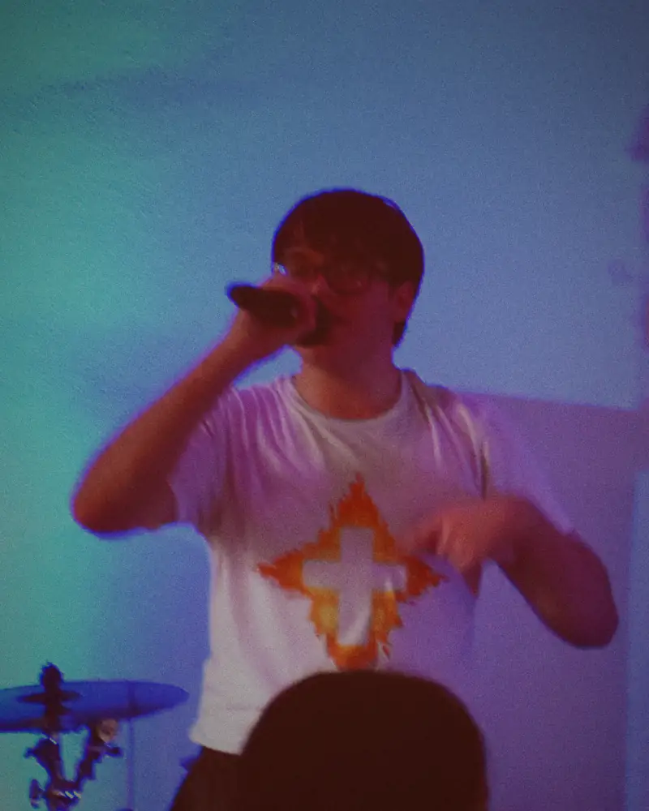
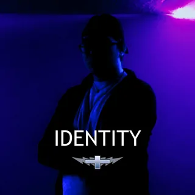
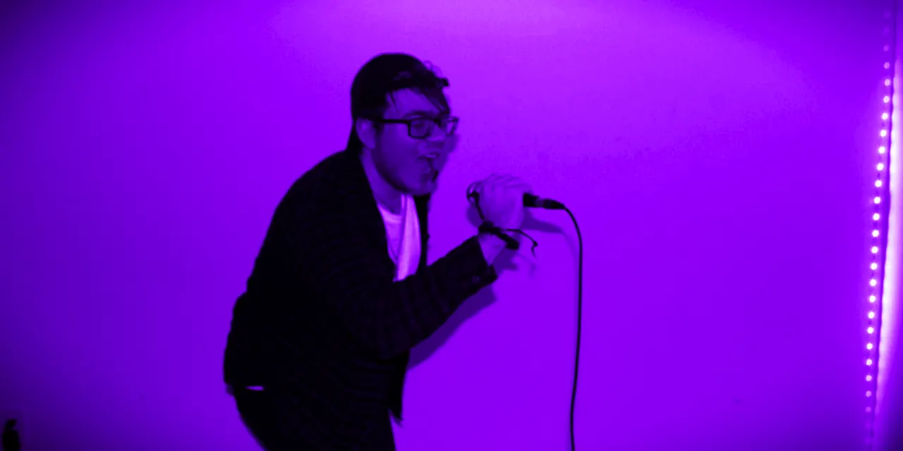
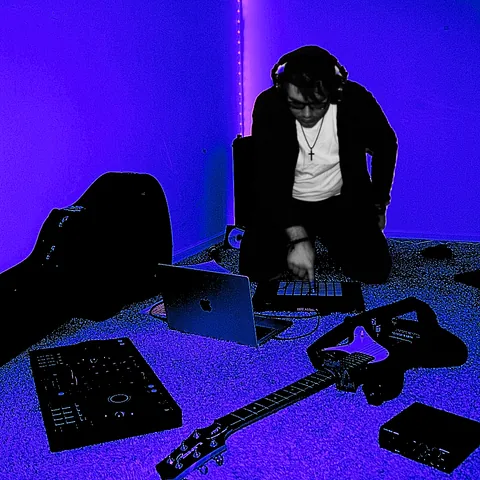
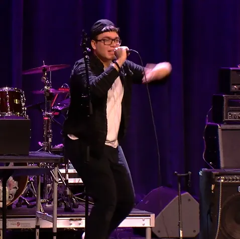
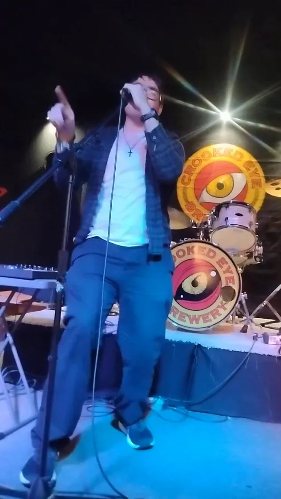

# GLucak website design (phase 1, Laptop designer, 2026-11-02)

Spec for the coder. Sources: `docs/research/direction.md` sections 2-4, `DECISIONS.md` D2-D16, the Home prototype in
`prototype/`. Where this file and the prototype disagree, tell the designer; don't guess.

**Status (2026-11-05):** Home is designed and measured with **Gabe's real photos**, the real playlist and Logo D, on a placeholder
era (colors). Type is **locked** (section 2). Hero A vs B waits on the owner's pick (`prototype/shots/hero-pick.png`). Still
waiting on Gabe: IDENTITY colors and art, the booking email, and his OK on the two "From Gabe" quotes (R1, L2 in `docs/copy/home.md`).
Known and in the prototype: Spotify artist link `https://open.spotify.com/artist/1SxMTO4oSXDbNSNzxx7cVX` (footer Spotify link).

**L2 (2026-11-05): Shop and the admin console** are designed in sections 14 and 15 and prototyped in `prototype/shop.html`
and `prototype/edit.html` (both open from disk). `node prototype/check.mjs --shop` checks them alone.

**Round 2 (2026-11-06): Music cover grid, footer / About link grid, Add to calendar, 404, pressed feedback** are section 16,
prototyped in `prototype/music.html`, `prototype/404.html` and Home's Shows block and footer. `node prototype/tools/round2.mjs`
checks them (shots in `docs/review/round2-design/`); the port list is 16h.

**v2 picks (2026-11-06): release card, Watch row, one photo per slot, the 5 : 7 phrase grid, solid header** are section 18,
built by the Desktop at 3ee444d and mirrored in `prototype/index.html` (plus the changes still to make, 18h). `node prototype/tools/v2picks.mjs`
checks them (shots in `docs/review/v2-picks/`).

**Open the prototype:** `prototype/index.html` from disk. Switches: `?hero=a` `?hero=b` `?shows=none` `?header=scrim`
`?era=placeholder-b` `?identity=out` `?identity=none`. Re-check with `node prototype/check.mjs` (results in
`prototype/shots/check-report.txt`), then `node prototype/tools/hero-pick.mjs` for the owner's side-by-side.
Web copies of Gabe's files: `node prototype/tools/resize.mjs` (section 3b).

## 1. The idea
Gabe's slogan runs the page, and the page gets louder as it goes. Four things make it his and not a template:
1. **The slogan as a poster lockup.** Each phrase is set in fitted lines of heavy condensed type, full width, so the
   headings grow from RISE to LIVE IT LOUD to PUSH PAST FEAR to THE TIME IS NOW. Volume comes from size. Nothing moves to do it.
2. **Crate-divider tabs.** Each section's plain label (Music, Shows, About, Join) is a tab standing on the section's top
   edge, like a divider in a record bin. It uses the exact nav word, costs no height, and reads before the big phrase.
3. **The show as a printed poster.** The next show is a paper-colored block on the dark page, with a huge date.
4. **One era color, spent carefully.** It appears on the main button, the poster's Tickets button, the play button,
   the duotone and the glow. Everything else is `bg` and `text`.

Rap is the type, rock is the still grain and hard edges, EDM is the slow glow. No other decoration.

## 2. Type (locked 2026-11-05)
**Locked: Big Shoulders Display 900 + Atkinson Hyperlegible Next.** D14 held the type until the logo arrived, to avoid two
competing wordmarks. Logo D, the logo IDENTITY uses, is a **symbol with no lettering** (a chrome cross with grey lightning
wings), so there is no second wordmark to compete with: GLUCAK in Big Shoulders *is* the wordmark, and Logo D sits beside it
as the mark (section 3a). Checked side by side in the header and the IDENTITY block: the cross's straight arms and hard
corners match the flat-sided, square-shouldered letters, and the lightning wings' sharp diagonals echo the K and A. The
mark's chrome and bevel stay in the mark: the type never gets chrome, bevels or outlines to match it. No clash, so no switch,
and the `--w-*` measurements stand. Changing the display face from here is a reviewed change (D12): re-measure every `--w-*`
with `node prototype/check.mjs --measure`.

| Role | Face | File | License |
|---|---|---|---|
| Display: name, phrases, buttons, dates | **Big Shoulders Display 900** | `fonts/big-shoulders-display-900.woff2` (14 KB, latin) | SIL OFL 1.1 |
| Reading: body, labels, links | **Atkinson Hyperlegible Next** 200-800 variable | `fonts/atkinson-hyperlegible-next-wght.woff2` (34 KB, latin) | SIL OFL 1.1 |

Both are self-hosted (CSP `font-src 'self'`). The license text sits beside them in `prototype/fonts/OFL-*.txt` and must ship with the fonts.

**Why Big Shoulders:** I set "GLUCAK" in nine heavy condensed options. Its tall, flat-sided letters read like level meters
on a mixing desk, it stays legible down to the slogan's 21px on a 320px phone, and it isn't the usual poster Anton. Rejected:
Anton (common), Archivo condensed (wider, so a shorter name), League Gothic (too light), Anybody at 50% width (letters clog),
Bebas Neue (direction.md). **Why Atkinson:** built for legibility, with enough character to sit beside the display face.

**Fitted lines.** Every lockup line has its font size calculated from its container, so each line fills the width and wraps
the same at every screen, with no script and no reflow:
```css
.fit { container-type: inline-size; }
.ln  { display: block; width: max-content; white-space: nowrap; line-height: .82;
       text-transform: uppercase; text-box: trim-both cap alphabetic;
       font-size: calc(100cqi / var(--w-line)); }
```
`--w-*` is that string's measured width in em, times 1.003 as a safety margin. `node prototype/check.mjs --measure` prints
them. **If the display face changes, re-measure every `--w-*`; nothing else changes.** Line breaks are forced in markup, one
span per line. `text-fit` would be simpler, but it is Chrome and Edge only, and these fans are on iPhones. `text-box` is a
harmless no-op in Firefox because `line-height` stays under 1.

**Scale** (`rem`): `--step--1` 1 (the floor on phones), `--step-0` 1.125 body, `--step-1` clamp(1.25, 1.15 + .5vw, 1.5),
`--step-2` clamp(1.625, 1.4 + 1.1vw, 2.25), `--step-3` clamp(2.25, 1.8 + 2.2vw, 3.5). Fallback stack for display:
`Impact, 'Arial Narrow', sans-serif`. Preload the display face. `font-display: swap`.

## 3. Tokens and color
Same structure as Riverside's `global.css`; the serif and gold don't carry over. Copy the `:root` block from
`prototype/styles.css`: space `--space-xs` to `--space-xl`, `--section`, `--gutter`, `--container: 90rem`, `--radius-s: 2px`,
`--header-h` 60px (72px from 900px), `--tab-h` 2.125rem, `--bar-h` calc(62px + safe area) under 700px, else 0. Corners are
hard (2px) except the Spotify box (12px, matches the embed). No shadows, no cards (one exception since 2026-11-06: the
release card in RISE, section 18a).

Era colors load as `--bg --text --accent --accent-text --muted`. Everything else derives, so no era adds a role:
- `--bg-2`: `color-mix(in srgb, var(--text) 7%, var(--bg))`. `--line`: same at 26%.
- **Poster:** `--text` as the paper, `--bg` as the ink, both already tested as a 4.5:1 pair.
- **Accent as small text on `bg` is banned.** The era test only promises 3:1 there. Accent carries fills, with `accent-text` on top.
- **Duotone, live photos only. Covers and Dave Bahm's art are never tinted.** An SVG filter: grayscale, then a two-stop table
  from `bg` to a capped peak. **The ceiling:** the peak is `bg` mixed toward `accent`, stopping at the first mix with 4:1 against
  `text`. So text over any tinted photo passes the 3:1 large-text rule by construction, in any era, whatever the photo. Proven:
  a teal era failed at 2.77:1 before the ceiling and passes at 5.12:1 with it. Compute it at build from the era file (`peak()` in
  `prototype/app.js`) and print the filter into the layout. No extra color role needed.
- **Scrims:** only where small text sits (2026-11-05: the old full-width top band dimmed his face). Hero: a top-right ellipse,
  `bg` at 55% strength, 62% of the width by 130px, behind Menu and the nav (4.5:1); plus the bottom ramp, clear until 42% of
  the height, `bg` at 80% strength at 70%, solid `bg` at the bottom (Now line). **Hero A under 900px (2026-11-05, with the lifted
  (a) photo):** two more layers: a top-left ellipse (`bg` 45%, 40% of the width by 110px) over the brand's spot (it is hidden
  until the header goes solid, but shows there with no JS), and a light veil from 1.5rem above the strip's end to 2.5rem below
  it, then `bg` at 30% under name and slogan (the lift puts his white shirt behind the name: 3.07:1 with no veil). His face in the
  strip stays clear. Push Past Fear uses a lighter one. Exact values in `styles.css` and section 11.
- **Treatments replace the duotone on photos (D34, section 3b):** the photos are graded in the file (`class="graded"`); the
  ceiling below still applies to any untreated photo with `.duo`.
- **Real photos through the duotone (2026-11-05), the ROADMAP risk 9 verdict: no muddiness, keep the derived ceiling and the
  filter as they are.** Tested all three photos against a darker curve (gamma 1.8), a lighter one (gamma 0.7) and two
  contrast stretches. Kealey's photo is not low-light, it is high-key (a bright, blue-lit wall), so his white shirt and the wall
  both land near the capped peak; he reads by his hair, glasses, mic and arms, which is enough. The current filter is best for
  it: darker curves turn his face into a silhouette. The low-light MCCC still holds up: face, shirt and arm lift off the dark
  curtain; only his black jacket merges with it. Gamma 0.7 separates the jacket a little. **If the owner finds a low-light
  photo too dark, the smallest fix is a per-photo `lift` (one `feFuncR/G/B type="gamma" exponent="0.7"` before the table),
  for low-light photos only.** It sits below the table, so the ceiling still holds. Not built: no photo needs it yet. What
  *does* dim hero A is the ceiling itself plus the glow over the photo. That's the price of text on a photo, and the reason B
  exists.

### 3a. The mark: Logo D (IDENTITY's logo)
`assets/from-gabe/logo-d-identity.png`, 1554x495: a chrome cross with a black outline, grey lightning wings at 65% opacity, a
soft drop shadow. **The PNG has real transparency** (64.5% of pixels fully clear, 16.2% partial: the wings and the shadow), so
no redraw is needed. It is a **mark, not a wordmark: it never replaces GLUCAK in the hero or anywhere else.** It belongs to the
era (D12 amended by the boss, 2026-11-05: era file field `mark`, section 4), so the next era can bring its own or none.
- **Header:** left of the brand word, `height: 30px` (94px wide), 0.5rem gap, in the same link (one target, "GLucak home").
  **Why 30px:** GLUCAK at 28px has 23px caps (Big Shoulders' cap height is 0.81em), and at 30px the cross is 25px tall, one step
  above the caps, so it reads as a symbol at a glance and doesn't outweigh the word. The pair is 183px wide (measured at 390),
  fits at 320 beside Menu, stays inside the 60px header, and the wings still span 16px. Same 30px from 900px (the 72px
  header gives it air; going bigger would make the mark louder than the name). On Home it hides with the brand word while
  the header is see-through over the hero (it would sit on the photo, which is banned below).
- **IDENTITY block** (Join band on Home, Music page): **beside** the word IDENTITY, to its left, `height: 40px`, vertically centred on
  the word (beside, not above: it saves about 60px of phone height, boss 2026-11-05).
- **Favicon:** a square crop of the cross from the original (wing tips inside the square stay as drawn), `favicon-32.png` and
  `apple-touch-icon-180.png` (on the era `bg`, because iOS fills transparency with black). Made by `tools/resize.mjs`; no
  redrawing. A cross-only file from Gabe or Dave would be crisper at 16px; nice to have, not needed.
- **Minimum size:** 24px tall (cross 20px). Below that the wings stop reading as lightning. Never in body text.
- **Clear space:** a quarter of the mark's height on every side (the cross's arm thickness): 8px at 30px, 10px at 40px (the IDENTITY gap is 12px). No
  text, edge or other graphic inside it.
- **Backgrounds:** solid `bg` or `bg-2`, with or without the grain, **in dark eras only** (bg luminance under about 0.05). The
  wings are 65% grey, so they need a dark ground (5.7:1 on #111). **Never** on a photo, the accent, the poster paper or any light
  ground: there the wings vanish (1.2:1 on #f5f5f5). If an era has a light `bg`, that era ships its own `mark` or none.
- **Never:** recolor, tint, duotone, outline, add glow or motion, stretch, crop for layout (the favicon crop is the one
  exception), or set type in chrome to match it.
- **Credit:** CREDITS.md says the logo is Gabe's or Dave Bahm's. Ask Gabe which, for the About page credits.

### 3b. Photos (Gabe's; treatments per slot, 2026-11-05, D34) Superseded by 29 (OV6): one photo language, hero A/B and the gallery.
**Privacy rule (hard): No identifiable audience member on the site, ever; crops keep only Gabe, the stage and backs of heads
(privacy, 2026-11-05).** Above all no minors: the child in Kealey's frame sits under the cross (source x 3060-3300, y 2780-3120).
So the whole Kealey frame and the Paslier still (two fans' faces) are **never used**, in any size, on any page; the prototype's
`live-kealey-*` and `live-paslier-753` files are deleted and `prototype/tools/resize.mjs` no longer makes them. A new photo gets
a crop rectangle in the Desktop's `tools/photo/run.mjs` that leaves out every face but Gabe's (or a bandmate's) before it ships.

Every photo is one of the owner-approved **treatments** (`docs/research/photo-art-direction.md`), made by the Desktop's
`tools/photo/run.mjs` from Gabe's originals (sharp, no metadata, seeded, no AI) into `docs/review/photo-treatments/`, and
copied as they are. The treatment is the grade, so **no CSS duotone on top**: the `` carries `class="graded"` (`filter:
none`), not `duo`. The SVG duotone (`.duo`, section 3) stays only for a future untreated live photo; none is on Home. One
process per slot, so the page isn't a filter sampler. `alt=""`: they sit behind or beside his name. Era swap = one re-run of
`run.mjs --era` (the files bake in the era colors; the prototype's other two eras still show the placeholder renders).

| Slot | Treatment | Files (served by width) | Crop / CSS | Faces in frame |
|---|---|---|---|---|
| **Hero A** (default under 900px, D34; `?hero=a` everywhere) | **(a) era grade** | `a-era-grade-phone-800` (800x1000) under 900px; `a-era-grade-800` / `-1600` (3:2) only for `?hero=a` from 900px | Under 900px pinned by width and lifted so his eyes sit in the open strip above the name (section 5, the exact CSS in section 11) | Gabe; one back of a head at the bottom edge |
| **Hero B** (default from 900px, D34; `?hero=b` everywhere) | **(b) two-colour riso** | `b-riso-600` / `-1000` (`sizes="37vw"`, the slot is ~470px at 1280, so the 600 file at 0.78x) | `object-fit: cover; object-position: 50% 30%` (same 1.42 aspect as the slot) | Gabe; the same back of a head |
| Hero B's slot under 900px (`?hero=b` only) | **(f)** MCCC still, two inks on black | `f-mccc-240` / `-478` (`sizes="34vw"`, slot ~132px square at 390) | `44% 20%` | Gabe only (stage) |
| **Live It Loud poster** (the first booked `show`) | **(c) gig-poster cut**, torn foot | `c-poster-600` / `-1000` (600x750 alpha; `sizes="(min-width: 640px) 23rem, 50vw"`) | Square, `object-position: 50% 63%` (source rows ~95-695: above his head to under the tear), `mix-blend-mode: darken` (section 5) | Gabe; a back of a head as a solid silhouette |
| **Push Past Fear** (Home and About) | **(d) crowd tritone** | `d-crowd-phone-800` (800x371) under 753px; `d-crowd-800` / `-1600` from 753px | Under 753px `object-position: 8% 50%` (the box is taller than the file, so it loses the sides: keep Gabe, left); from 753px `50% 50%` | Gabe, the pallet cross, backs of heads only (crop stops at source y 2440) |
| **About, contact strip** (spec, section 6) | **(e) contact strip, B&W** | `e-contact-1600` (1600x339), `-phone-800` (two strips of two). **Must be regenerated first** (below); don't use the current files anywhere | As made, full column width | After the swap: Gabe, the cross, the mic stand or his shirt cross, the kit |

**Halftones (b, c, f) and moire:** each file is screened at its own size; never show one below ~0.6x of its file on a 2x+ screen.
`sizes` matches the slot, so the browser picks the file nearest it (riso 0.78x at 1280; poster 0.63x on a 2x phone at 390,
0.95x at 3x, 0.64x at 1280). Never stretch them full-bleed beyond their file.

**Exception to "one color world" (owner-approved treatments, 2026-11-05):** About's contact strip (e) is **black and white**, not
duotone and not era-graded; only its grease-pencil loop on frame 1 takes the era accent. It reads as the photographer's contact
sheet, so it stays B&W in every era.

**The video stills are never shown wider than their native size** (CREDITS.md); (f) files are at or below native.
Markup: `<picture>` with `media` sources, `srcset` with `w` descriptors, `width`/`height` set, the hero image
`fetchpriority="high"`, the rest `loading="lazy"`. **Hero by width (D34, `HERO = 'ab'`):** both heroes are in the page; each
`<picture>` serves a 1x1 data GIF (`data:image/gif;base64,R0lGODlhAQABAAAAACw=`, CSP `img-src data:` allows it) at the widths
where it is hidden, so **exactly one hero photo downloads** (measured, CHECK 2b: 320, 390, 800, 899 fetch only
`a-era-grade-phone-800`; 900 and 1280 only `b-riso-600`). Hero A's `` fallback is the phone file itself, not the 3:2 one: in
Chrome's device emulation the preload scanner once fetched the `` fallback (`a-era-grade-1600`) at 320 as well, and with the
phone file as fallback a slip like that can only fetch the file the phone needs anyway.

**Photo credits** go in the footer of every page, under the slogan, muted 16px, listing only the photos that page shows, in
CREDITS.md's wording: "Photo: Alexander Kealey." (every treatment above but (f) is his photo) and "Video: Montgomery County
Community College, MSP program group." only where (f) appears (`?hero=b` under 900px; never in the D34 default). Paslier's
credit goes with his still, which is no longer used. The About page repeats the full list with the photos.
- **Grain:** `era.texture` tiled on bands, footer and poster; still, never animated. If `texture` is null, use the site default
  `grain.png` (128px tile, 15 KB).

### 3c. IDENTITY guess era (2026-11-05): **a guess, not Gabe's colors**
**Superseded 2026-11-11 by section 25 (D93):** the real era is `src/eras/identity.json`, from Gabe's IDENTITY CD art.
Prototype only: `?era=identity-guess` (in `prototype/data.js`, **not** in `src/eras/`). It lets the owner see the site in
IDENTITY's light before Gabe's real art and colors arrive (about Nov 30); then this era is deleted, not promoted. In this era the
hero chip reads "IDENTITY colors: our guess from the smart-link art" and the footer note says the same.

**Source:** the og:image of `https://wingsmusic.lnk.to/IDENTITY` (Linkfire `artwork-600x315.jpg` and `-440x440.jpg`, read only,
kept out of the repo). Gabe's face and shoulders in deep blue light, a violet-magenta glow top right, white IDENTITY type, Logo D
under it. Dominant colors (k-means, 8 clusters, 440px square): black `#000001` 27%, indigo `#040243` 21%, `#090359` 17%,
ultramarine `#18078d` 10%, violet `#3b07ba` 10%, near-black blue `#02041c` 8%, the glow `#8312c8` 5%, the type `#dfdbed` /
`#f6f6f6` 2%. Hues 240-255 hold about 55% of the picture.

| Role | Value | From the art |
|---|---|---|
| `bg` | `#08044a` | The indigo field (between `#040243` and `#090359`). Luminance 0.0063: dark enough for Logo D (D25) |
| `text` | `#f6f5ff` | The white IDENTITY type, a touch cool |
| `accent` | `#a866ff` | The violet glow (`#8312c8`, hue 277, and `#3b07ba`, hue 258), lifted to hue 266 and lightened until it passes 3:1 on `bg` (the art's own violets reach only 1.7 to 2.6:1) |
| `accent-text` | `#08044a` | `bg`, as in every era |
| `muted` | `#bab6e6` | Lavender grey, between the type and the field |
| `bg-2` (derived) | `#191557` | `text` 7% into `bg` |
| `line` (derived) | `#464379` | `text` 26% into `bg` |
| Duotone dark / light (derived) | `#08044a` / `#9359e7` | `bg`; the ceiling stops at 87% toward `accent` (peak 4.01:1 against `text`) |

No new roles, ceiling rule unchanged, covers and Dave Bahm's art never tinted. **Contrast** (same maths as `app.js`, mark
composited from `mark-identity-300.webp`): text/bg 17.24, text/bg-2 15.14, muted/bg 9.69, muted/bg-2 8.51, muted on the player
box 5.40; **Listen** (accent-text on accent) 5.33, Listen's fill against the page (accent/bg) 5.33, on bg-2 4.68; **Now tag, tabs, poster
ink on paper** (bg on text, no accent involved) 17.24; **poster Tickets**: label 5.33, fill against the paper 3.23 (and its 3px
`bg` border 17.24); duotone peak 4.01 against text. **Logo D wings** (65% grey): on bg median 5.48:1 (darkest tenth 4.42), on
bg-2 5.19 (4.24), against 5.68 / 5.24 on the placeholder era; bg against black 1.13 (the D25 test allows 1.5). All pass the
era-file test (`test/eras.test.js` rules) and `prototype/check.mjs` (section 12).

**How it looks (my read of `prototype/shots/hero-pick-identity-guess.png`):** energetic, not muddy, and close to the art. The
indigo ground, white type and violet buttons read as IDENTITY at a glance, and it feels cooler and more "night" than the
red-orange placeholder. **Hero B is the stronger hero in this light:** indigo page, violet photo in the slot, white name: it is
nearly the cover. **Hero A goes flat:** the Kealey photo is high-key, so most of it lands near the capped peak, and violet at
that luminance (0.19) looks lighter and more pastel than red-orange did. Add the violet glow over it and the hero becomes a
lavender-violet field with his face as a ghost at the top. The text still passes (5.33:1), and it isn't muddy, but A has
less depth here than in the placeholder era, where the photo still read as a photo. A darker accent wouldn't help: the ceiling,
not the hue, sets the peak's lightness. If Gabe's real colors are also blue-violet, that's a point for B. A print-style two-colour
treatment (the Desktop's `docs/review/photo-treatments/`) with harder blacks would fix A's flatness better than the smooth
duotone. **Spotify's embed is always dark-themed** (`theme=0`, Spotify's dark grey) in every era (D35, amends D19). The
cover-derived colour follows Gabe's playlist cover, not the era, so it can clash with any palette; the dark theme sits on every
era's dark `bg`.

## 4. Field names (shared with the Desktop: keep this section in step with `src/`)
> **Single source for these names.** They match `src/lib/shows.js`, `src/eras/placeholder.json` and `src/data/shows.json` at
> 7a2e937. Release and IDENTITY fields below are agreed (D18) but not in `src/` yet.

**Era file** (`src/eras/<slug>.json`), matches D12:
| Field | Type | Use |
|---|---|---|
| `name` | string | Internal era name |
| `colors.bg` | #rrggbb | Page ground, duotone shadow |
| `colors.text` | #rrggbb | Main text, poster paper |
| `colors.accent` | #rrggbb | The one strong color (about a tenth of a screen) |
| `colors.accent-text` | #rrggbb | Text on accent |
| `colors.muted` | #rrggbb | Secondary text |
| `art` | path | Cover art, shown as made |
| `texture` | path or null | Still grain tile; null uses the site default |
| `word` | string | Era word, used in Join and on Music. Real era: `IDENTITY` |
| `mark` | path or null | **New 2026-11-05 (amends D12, boss ruling).** The era's logo mark, transparent PNG/WebP, shown as made (section 3a). IDENTITY: Logo D. Null: no mark anywhere, the brand word stands alone. Never replaces the word |

No extra color role is needed. The font is not in this file (D12).

**"From Gabe" quote** (D21, optional, one per band, on the band's own data; Home bands: `rise`, `live`, `now`; never `push`):
| Field | Type | Rule |
|---|---|---|
| `quote.text` | string | Required if `quote` is set. His exact words, at most 120 characters, from a post `social-content.md` marks as his own. Rendered escaped, never as HTML |
| `quote.url` | http(s) URL | Required. The post the words come from. The credit links here |
| `quote.date` | `YYYY-MM` or `YYYY-MM-DD` | Required. Shown as "Mar 2026" |
| `quote.platform` | string | Required. `Instagram`, `Threads`, `X`, `YouTube` and so on, as shown in the credit |

No `quote`, or any field missing or invalid, means nothing shows (no empty box). Gabe approves each one via the owner (D21).

**Show row** (`src/data/shows.json`):
| Field | Type | Rule |
|---|---|---|
| `date` | `YYYY-MM-DD` | Required |
| `time` | `HH:MM` 24h | Optional |
| `type` | `show` or `open-mic` | Required |
| `venue` | string | Required |
| `city` | string | Required |
| `link` | http(s) URL | Optional. `show` -> **Tickets**, `open-mic` -> **Details**, no link -> no button |
| `with` | string | Optional, renders "With Fran Carroll". Shown on the poster and the Shows page. |

**Release** (agreed, D18): `title`, `date`, `cover` (path, as made), `link` (smart link,
http(s)), `soundcloud` (optional), `type` (`single`, `ep`, `album`). Home's card uses the newest by `date`.

**IDENTITY block** (agreed, D18; not the era file): a release date and a pre-save link, both optional. The build reads them from
the IDENTITY row in `src/data/releases.json` (`date` 2027-08-13 from Gabe's own post, `link`), which serves the same purpose as
`releaseDate` / `presaveLink`. With no date, the state in section 7 applies. `tracks` waits on Gabe's answers (D10).

## 5. Home, top to bottom
> **Changed by section 28 (overhaul, 2026-11-18):** shows in date order with the next date big (28a, D100); the Now line is a ticket stub (28f); nav + Listen from 700px (28e); player first at every width (28h).
Target about 5 phone screens. All heights below are measured at 390px.

> **Changed by section 18 (v2 picks, 2026-11-06):** the header is a solid band (18e); RISE is the release card (18a); the
> poster is text only and "Latest video" is the Watch row (18b, 18c); PUSH PAST FEAR has no photo band on Home (18c); from
> 900px every band is the 5 : 7 split (18d). Where this section and 18 disagree, 18 wins.

**Header.** Fixed. See-through over the hero, `bg` with a 2px `--line` once scrolled (IntersectionObserver on a sentinel, as in
Riverside `Header.astro`). Brand left: the era `mark` at 30px tall, then "GLUCAK" in the display face (the wordmark; locked,
section 2), one link: `<a class="brand"><span class="brand-word">GLUCAK</span></a>`. With no
`mark`, the word alone. On Home the brand stays hidden while the header is see-through over the hero, so the name never appears twice
and the mark never sits on the photo; it shows once the header is solid, and on every other page (with no JS it always shows). From
900px: nav **Music, Shows, About**, then a **Listen** button. Under 900px: **Menu** only; the bar carries Listen. `<details>` sheet
with focus moved in, Escape and link tap close it. Shop slot: one nav entry, off by a switch.

**0. Hero: A under 900px, B from 900px (D34; `html[data-hero='ab']`, the default).** Not full height. `?hero=a` / `?hero=b`
force one layout at every width (prototype test switches; the build's `HERO` constant). Holds, in order:
- `<h1 aria-label="GLucak">`, letters aria-hidden.
- **A:** GLUCAK fitted to full width over a full-bleed photo, treatment (a). **B:** G[photo]LUCAK: flex row,
  `--fs: calc(100cqi / (w-name + k + .1))`; slot width `fs × k`, height `fs × 1.56`, standing above the letters. `k` is 1.18 on phones,
  1.9 from 900px (slot height 1.34). No photo behind B. In `ab`, the slot is `display: none` under 900px and `.hero-photo` is
  `display: none` from 900px.
- **Photos (section 3b):** A uses (a)'s portrait file under 900px, **his face in the open strip above the name** (tuned
  2026-11-05; a plain cover crop hid it behind GLUCAK): the strip is `--strip` = header + 1.75rem (88px) on phones, header + 11vw
  from 700 to 899px; A gets `padding-top: var(--strip)`; the photo is pinned by width and lifted so his eyes land 2.625rem above
  the strip's end (46px on every phone, 106px at 800). Hair, glasses and eyes show; mouth and mic meet the top of the letters.
  B's slot uses (b) riso from 900px ((f) under 900px with `?hero=b`). Scrim as in section 3.
- Slogan, exact text. Phones: two fitted lines, "Rise, Live It Loud," / "Push Past Fear, The Time Is Now." From 900px: one fitted line.
- **Listen** (solid) and **Shows** (outline), 52px tall. Listen goes to the player, Shows to `#shows`.
- **Now line:** "Now" tag + one link. See section 7. No ticker: it never moves. Release wording (copy, `docs/copy/home.md`):
  **"Out now: {title}"**, the title exactly as on Spotify (today "Out now: Duck, Dodge, Jump, Fight"; the artists line sits right below in RISE, D33),
  linked to that release's `link`. Long titles wrap to two lines inside the 48px line (measured: the player stays put).

**1. RISE, tab Music.** Phrase at 3.5rem on phones; huge in a left column from 900px. The official embed at exactly **352px**,
full column width, with its height reserved, always dark-themed (`theme=0`, D35). Under it: **Play full songs on Spotify** as a real button (2026-11-05):
`btn btn-line btn-small`, 48px tall, display face 1.25rem, full width under 700px, natural width beside the link from 700px. It's
the playlist link: logged-out fans, most of them in Instagram's in-app browser, get 30-second previews in the embed, and this is
the way to full songs, so it earns a button. Outline, not solid: the accent stays on Listen. Then **Listen everywhere**, a text
link. It sits below the player, so the player's position doesn't move. Then the latest release: cover 96px
(160px wide screens) as made, title, then the **artists line** when the release has more than one artist (D33): the release's
`artists` exactly as Spotify shows them ("GLucak, J-BOY"), body face, `muted`, no "feat."; a solo release has no line. Then
"Latest release. Listen on:", two links. The title is `--step-2` (not `--step-3`), `text-wrap: balance`, so long titles take two
lines at 390. The same artists line goes under each title in the Music page's release strip.
**Every platform** and **Listen everywhere** both go to that release's `link`. Then the optional **From Gabe** quote (below).

**From Gabe (D21), the one quote style, every band that has one.** After the band's main content, never above the player:
RISE under the latest release (from 900px in the left column under it); LIVE IT LOUD after All shows; THE TIME IS NOW after the
IDENTITY block; never in PUSH PAST FEAR. Markup:
`<figure class="quote"><p class="quote-tag">From Gabe</p><blockquote class="quote-text"><p>{text}</p></blockquote><figcaption class="quote-credit"><a href="{url}">GLucak, {platform}, {Mon YYYY}</a></figcaption></figure>`.
4px left rule in `text` (same weight as band edges), 1rem left padding, 1rem above (0.5rem after All shows), max 36rem wide.
**Compact (2026-11-05):** the tag (like the Now tag: `text` ground, `bg` letters, 16px, 700) floats into the quote's first line,
so it costs no line of its own. Quote in the reading face, 700, `--step-1`, line-height 1.3, inline, curly quotes added by CSS
(`::before`/`::after`), so `text` stays exactly his words. The credit runs inline after the last word (muted 16px, a 48px link,
0.4rem before it): a short quote and its credit share a line. Static: no rotation, no carousel, no fade of its own. No accent.
**Measured at 390:** R1 (86 characters) is 3 lines plus the credit line, 132px; L2 (22 characters) is 2 lines with the credit on the
second, 76px. At 320: 163px and 107px. LIVE IT LOUD's quote is not shown when no show is booked ("Hope to see you there!"
would point at nothing).

**2. LIVE IT LOUD, tab Shows.** One fitted line. Then next shows: **first show as the poster** + up to two rows. Poster: fitted date,
place, time and `with`, button, and **the art, treatment (c)** (2026-11-05): `<picture></picture>`, first in the `li`, `picture { display: contents }`. Grid areas: phones (card
under 37rem) `'date date' 'place art' 'meta art' 'btn art'`, columns `minmax(0, 1fr) 55%`, rows `auto auto auto 1fr`: the date
across the top as before, the art a square on the right bled to the card's right and bottom edges (`margin: 0 -1rem -1rem 0`,
`width: calc(100% + 1rem)`, `aspect-ratio: 1`, `align-self: end`), so the torn edge is the poster's foot; Tickets bottom-left.
Card 37rem and up (container query on `ul.shows`): `'date art' 'place art' 'meta art' 'btn art'`, columns `minmax(0, 1fr) 23rem`,
art also bled to the top (`margin-top: -1rem`), place aligned to the bottom of its row. Art: `object-fit: cover; object-position:
50% 63%; mix-blend-mode: darken` (its paper, #f5f5f5, takes the card's paper and grain in every era; only ink and the tear
show). At 390 the art is 190px and the poster 291px tall (the text-only layout measures 177px, so +114px; a full-width art band cost 360px,
so it was rejected for phones). **Shows beside the video only from 72rem (1152px)** (was 900px): below that the shows column is
under 37rem and the art would stack 500px tall. Rows: date, place, kind, button or nothing; 60px minimum. Poster rule: the first upcoming row with
`type: show` is the poster; if none in the three is a show, all rows, no poster. Then **All shows**, then the From Gabe quote
(L2, if approved), in the same column. Then **Latest video**, a 16:9
facade: no YouTube loads until tapped; the iframe uses `youtube-nocookie.com` (allowed by CSP); no JS means a plain link. From
1152px: shows left 7 columns, video right 5.

**3. PUSH PAST FEAR, tab About.** Lockup on two fitted lines (FEAR is the biggest word on the phone) over a full-bleed photo,
treatment (d), the crowd tritone (section 3b: Gabe, the cross, backs of heads); one line from 900px. Under it, **bio sentence 1
only, exact** (241 characters: "Despite facing various difficulties ... bring others to Christ."). **D23: his words go on the site
exact or not at all**, so there is no shortened or stitched second line on Home; the full bio, word for word, is on About. No
invented testimony; epilepsy appears only because his bio says it, and whether that sentence stays on Home is open for Gabe (D18).
**Patreon**, **About GLucak**. No "From Gabe" quote here (D21). The About tab stands on the band edge above the photo: `.push-head`
must not clip overflow (fixed 2026-11-05; the tab was clipped before, so check the build's port).

**4. THE TIME IS NOW, tab Join.** Lockup on two fitted lines. **Sign-up comes first:** "Get the next show and every new song first."
(proposal, Gabe reviews), one email field, **Join**. Then the **IDENTITY block**. From 900px the lockup takes the left 7 columns and the
form sits beside it, so the form is in view with the heading.

**IDENTITY block** (same classes as the build, `src/pages/index.astro`; the Music page uses it too):
```html
<div class="identity-state">
                 <!-- era mark, 40px tall, left of the word; omitted if mark is null -->
  <p class="identity">IDENTITY</p>                      <!-- display face, --step-3 -->
  <p class="identity-when"><time datetime="2027-08-13">August 13, 2027</time> &middot; 281 days to go</p>
  <a class="btn btn-line">Pre-save IDENTITY</a>
</div>
```
`.identity-state`: grid, `grid-template-columns: auto 1fr`, items centred in the row, start-aligned, gap 0.5rem by 0.75rem; mark and
word share row 1, everything else spans both columns (`grid-column: 1 / -1`). `.identity-when`: reading face 700, `--step-0`, `text` color, tabular figures.
The pre-save is `btn-line` (52px), 0.75rem above it (gap plus 0.25rem), never solid (the accent stays with Join in this band). The day count is
worked out once, New York time, at build or page load, and **never ticks**: no live counter, no seconds, no animation.
"1 day" singular. On release day and after: `<p class="identity-when">Out now. <a class="text-link">Listen</a></p>` and no
pre-save. No date: the mark and the word only. Gabe's own post settles the date, so the old "IDENTITY, 2027" line is retired.

**Footer (every page).** Closing line "Listen. Shows. Join." fitted, each word a link. The link grid (section 16b): Instagram, Threads, X,
YouTube, Spotify, SoundCloud, Patreon. Slogan. **Photo credits** for that page (`.credits`, muted 16px, section 3b). **Motion on/off**. Automatic year. Privacy. On pages other than Home, add the
sign-up above the links. The prototype's note about placeholders is removed.

**Phone bar (under 700px, every page, D8).** Always visible: never hides on scroll, so **delete Riverside's hide script**. Listen,
Shows, Watch, Join; icon plus 16px label, 60px tall plus safe area. Shop replaces Watch when the shop opens. Body gets
`padding-bottom: var(--bar-h)`, and `scroll-padding` clears both header and bar. Set `aria-current` on subpages.

## 6. Other launch pages
Same header, footer, bar, tokens and tabs. Each page opens with its one fitted phrase, tab above.
- **Music** (tab Music, RISE): the player; releases as the cover grid, the crate (section 16a); the IDENTITY block, `era.word` as a fitted line
  with tracks filling in toward Scenic Route as the larger last row (slots and titles wait on Gabe, D10); SoundCloud.
- **Shows** (tab Shows, LIVE IT LOUD): table of Date, Venue, City, Tickets; on phones, stacked rows; `with` under the venue. **Played** list.
  Booking email. Empty state as in section 7.
- **About** (tab About, PUSH PAST FEAR): full bio word for word (D23: exact or not at all), photos, Patreon, socials, booking
  email, and the photo credits list (every photographer and video source on the site, plus the logo credit once Gabe says whose it is).
  Not prototyped (Home only); the build follows this:
  - **Top:** the PUSH PAST FEAR band with treatment (d), exactly as on Home (`PushPhoto`, section 3b).
  - **The photos: treatment (e), the contact strip (D34),** after the full bio, before Patreon and socials. Full column width
    (max `--container`), `alt="Four frames from one photo by Alexander Kealey: Gabe singing, the cross of pallets, the mic stand,
    the drum kit"`, `loading="lazy"`, `class="graded"` (no duotone). From 700px `e-contact-1600` (one strip of four, 1600x339,
    `sizes="(min-width: 90rem) 90rem, 100vw"`); under 700px `e-contact-phone-800` (two strips of two, 800x674). Frames are about
    190 CSS px wide on a phone: fine for a contact sheet, so no tap-to-zoom. Static: no hover, no motion.
  - **The HANDS frame (frame 3) is REPLACED before this ships.** It is an audience close-up (raised hands, right beside the
    child under the cross), which breaks the privacy rule (section 3b). **The Desktop's `tools/photo/run.mjs` must regenerate
    `e-contact-1600` and `e-contact-phone-800` with frame 3 swapped:** replace
    `['HANDS', { left: 1820, top: 2600, width: 1200, height: 800 }]` with
    `['MIC', { left: 2050, top: 1750, width: 1050, height: 700 }]` (source pixels of `live-alexander-kealey.jpg`, 6000x4000;
    3:2 like the others): the empty mic stand against the white panel, the pallets to its right, a sliver of Gabe's elbow at the
    left edge, **no audience** (checked on the original: the nearest back of a head ends at x 1977; the child is at y 2780+). If
    the owner prefers his shirt cross: `['SHIRT', { left: 1560, top: 1880, width: 450, height: 300 }]` (checked: only his shirt,
    the cross and his hand; it stops above the back of a head at y 2240), but it is soft (450px of source for a ~380px frame)
    and repeats frame 1, so MIC is the pick. The edge print keeps
    "DSC 0832 · PHOTO ALEXANDER KEALEY", the frame label reads MIC. **Don't use the current `e-contact-*` files anywhere**, not
    in a preview either.
  - **B&W, the one exception to the era colors (owner-approved treatments, 2026-11-05; section 3b):** the strip is black and
    white in every era; only the grease-pencil loop on frame 1 takes the era accent. It sits on `bg` with no scrim and no text
    over it.
  - Under it, `a-era-grade-clear-1200` (the unprinted (a), no text over it) may follow as the big photo once the Desktop
    confirms its crop: same frame as hero A, Gabe plus one back of a head, so it passes the rule.
- **From Gabe on other pages:** the same style and rules as Home (section 5), at most one per band, after the band's main content.
- **Privacy:** plain text page, footer link only. Covers email sign-up and the Spotify embed.
- **Shop** (tab Shop, MERCH): built early (D36, temporary store), designed in **section 14**. Off by `SHOP_ENABLED`; when on,
  Shop joins the nav, the sheet and the footer line, and replaces Watch in the phone bar (D8).

## 7. States
| Case | Shows |
|---|---|
| **No upcoming shows** | Heading stays. "No shows booked right now" in display type, **Follow** (Instagram), **Request a show** (mailto, needs the booking email), then **Played** rows if any. Latest video stays. The LIVE IT LOUD quote is not shown. Never a blank section. |
| **No past shows either** | Omit Played. |
| **No ticket link** | No button, ever. No disabled button, no "TBA". |
| **Open mic** | Row with kind "Open mic"; Details if linked. Never the poster. |
| **Show today** | Stays upcoming through the whole New York day (`splitShows`). |
| **Now line** | Next upcoming row of either type if within 14 days (D18), labelled by its type: "Next show: Venue, City" or "Next open mic: Venue, City", linked to `#shows`. Otherwise the newest release. (Most of his gigs are open mics; the label keeps it honest.) |
| **No IDENTITY date** | Mark and "IDENTITY" only. No countdown, no pre-save, nothing broken-looking. (The date is now known, 2027-08-13 from Gabe's own post, so this is the fallback only.) Prototype: `?identity=none`. |
| **Date set** | "August 13, 2027 · 281 days to go", static per page load (no ticking digits, so no motion), plus **Pre-save IDENTITY** if linked. Section 5. |
| **Release day** | Flips to "Out now. Listen" by date, New York time; the pre-save goes. Prototype: `?identity=out`. |
| **No quote** | Nothing: no "From Gabe" box, no empty space (D21). |
| **No era mark** | The brand word alone in the header; nothing above IDENTITY. |
| **No playlist link** | Launch blocker. Never ship the empty box. |
| **Embed blocked or slow** | Box keeps 352px. A note under the iframe, seen only while it loads or if it's blocked: "Loading the Spotify player. If it doesn't appear, use Play full songs on Spotify below." No layout jump. |
| **No JS** | Page reads fully: no motion, headings visible, facade is a link, server-rendered shows. |
| **Sign-up** | Success: "You're on the list." Bad email: "Enter an email like name@example.com." Server down: "That didn't go through. Try again." All in `role="status"`. |
| **Sign-up sending** (DESIGN 19d) | Valid email sent: the status line reads "Sending…" and Join gets `aria-disabled="true"`; another tap or Enter does nothing until the server answers, then one of the three messages above replaces it and `aria-disabled` goes. Join keeps its look (no grey, no spinner, no new words on it). A bad email never reaches Sending. No JS: the form posts as before. |
| **Link not known yet** | Build fails rather than ships `#`. In the prototype these are dashed links. |

## 8. Motion (hard rule)
> **Amended by section 28h (D102, 2026-11-18):** the three heading fades are removed; the glow was already gone (23b). Left: the D64 page fade and the 23c Menu sheet, both behind both switches.
Exactly two motions exist on Home.
1. **Glow:** one layer behind hero and player, a radial gradient painted once and moved only by `transform` and `opacity`: 24s,
   ease-in-out, alternate, opacity .68 to .88, shift about 12% of its width. Stops when hero + Rise no longer fill the bottom of the
   screen (IntersectionObserver), so it is never a second moving thing beside a heading fade.
2. **Heading fade:** LIVE IT LOUD, PUSH PAST FEAR, THE TIME IS NOW fade in once, opacity only, 0.6s, the first time they reach the
   screen. No slide. RISE doesn't fade: the glow already owns that screen.

Banned: flashing, strobe, glitch, distortion, video in the hero, tickers, carousels (a still swipe row that moves only under a
finger is not one: section 18b), parallax, pinned scroll, smooth-scroll hijacking,
hover animation on cards, any animation on `background`, `filter` or layout. A clip added later must pass a frame-level flash check first (D14).

**Spotify's embed** scrolls a long playlist title inside its cross-origin iframe. It stops under the device's reduce-motion setting
(checked 2026-11-05 with `--force-prefers-reduced-motion`); our footer Motion switch can't reach it. Accepted: small, no luminance
change, and the device setting stops it (D19).

**Off switches, both required.** CSS motion is only declared inside `@media (prefers-reduced-motion: no-preference)` **and** under
`html[data-motion='on']`, so with no JS or either switch off, nothing runs. `boot.js` sets `data-motion` before paint. Footer button:
"Motion: on / off", remembered in `localStorage` in a try/catch. Under the device setting it reads "Motion: off (device setting)" and is disabled.

## 9. Accessibility floor
Text 4.5:1. Large text and controls 3:1. Targets 48px minimum. Nothing under 16px on phones. Tabs 16px or more, exact nav word, real
content right under the heading (D6). Tab and phrase share one `<h2>`: `<span class="tab">Shows</span> <span class="phrase">Live It Loud</span>`,
so screen readers and find-in-page get both. 3px focus ring in `text`. Skip link. No autoplay sound.
**Spotify player focus (a11y audit row 9, 2.4.7, accepted 2026-11-06):** the embed's `<iframe>` gets no ring of ours
(`outline: none` on our side); the focus ring on the controls inside it is Spotify's own, drawn in their document, and we
can't style it. Accepted: it is a third-party frame, its own controls do show focus, and the "Skip the Spotify player" link
before it (and the audit's row 2 fix) keeps keyboard users from having to walk through it.
Text at 200% (1.4.4 / 1.4.10): section 17.

## 10. Gabe's edit screen
> **Changed by section 28i (D106, 2026-11-18):** tabs Shows | Releases | IDENTITY | Bio | Products, compact rows, Played folded, Delete inside the form, "See it on the site".
**The look of `/edit/` (sign-in, shell, sidebar, tabs, rows, editor form, upload, save bar, every message state) is section 15 (rewritten 2026-11-24).** This
section keeps the scope.
One simple form page per thing, large fields, plain words, phone friendly. Built on Riverside's admin pattern; every field escaped on
output, http(s) links only, with the `<script>` and `' OR 1=1 --` tests.
- **Shows:** list with Add, Edit, Delete. Fields: Date (date picker), Time (optional), Type (Show / Open mic), Venue, City, Link (optional, hint:
  "Tickets or details page"), With (optional). Save shows the row as fans will see it. Past shows move to Played by themselves.
- **Releases:** Title, Date, Cover (upload, shown as made, square), Smart link, SoundCloud link (optional), Type.
- **Links:** Spotify playlist, YouTube channel, Patreon, socials, booking email.
- **Bio:** About text and the Home short version.
- **IDENTITY:** Release date, Pre-save link.
- **Not on this screen** (a reviewed change): era file, fonts, layout.

## 11. Speed and porting notes for the coder
- **Copy into `public/media` (L1):** `c-poster-600`, `f-mccc-240` and `f-mccc-478` (only `c-poster-1000` is there now). Copy the
  poster block (`.shows` container, `.poster*`, `@container (min-width: 37rem)`) from `prototype/styles.css` word for word;
  don't rebuild it from the prose in section 5.
- Prototype first load (2026-11-05, uncompressed): HTML 15 KB, CSS 32 KB, JS 13 KB (app 10, boot 1, data 2), fonts 48 KB, grain 15 KB,
  mark 5 KB, favicon 2 KB = **130 KB before photos**. **Photos (D34 default, exactly one hero photo per width, the prototype
  too):** under 900px `a-era-grade-phone-800` 29 KB (one file at every density); from 900px `b-riso-600` 25 KB (1x) or
  `b-riso-1000` 64 KB (2x). Lazy, below the fold: poster art `c-poster-600` 16 KB / `-1000` 38 KB; Push Past Fear
  `d-crowd-phone-800` 19 KB on a phone, `d-crowd-800` 12 KB / `-1600` 42 KB wider. **A phone loads about 160 KB before Spotify
  (was about 200 KB on 3x).** One live iframe (Spotify); YouTube behind the facade. Photos are the Desktop's treatment files
  (`tools/photo/run.mjs`, sharp, no metadata), copied as they are; `prototype/tools/resize.mjs` now makes only Logo D and icons.
- **Port of L1 for D4 (2026-11-05), exact values from `prototype/styles.css`:**
  - Hero A under 900px (replaces the src rule `@media (max-width: 699px) { html[data-hero='a'] .hero-inner, html[data-hero='ab']
    .hero-inner { padding-top: calc(var(--header-h) + 1.75rem); } }`, which now runs to 899px with a width-scaled strip):
    ```css
    @media (max-width: 899px) {
      :root { --strip: calc(var(--header-h) + 1.75rem); }
      html:not([data-hero='b']) .hero-inner { padding-top: var(--strip); }
      .hero-photo img {
        position: absolute; left: 0; top: 0; height: auto; margin-top: calc(var(--strip) - 2.625rem - 41.875%);
        -webkit-mask-image: linear-gradient(to bottom, #000 78%, transparent); mask-image: linear-gradient(to bottom, #000 78%, transparent);
      }
      .hero-photo::after {
        background:
          radial-gradient(ellipse 62% 130px at 100% 0, color-mix(in srgb, var(--bg) 55%, transparent), transparent),
          radial-gradient(ellipse 40% 110px at 0 0, color-mix(in srgb, var(--bg) 45%, transparent), transparent),
          linear-gradient(to bottom, transparent calc(var(--strip) - 1.5rem), color-mix(in srgb, var(--bg) 30%, transparent) calc(var(--strip) + 2.5rem)),
          linear-gradient(to bottom, transparent 42%, color-mix(in srgb, var(--bg) 80%, transparent) 70%, var(--bg));
      }
    }
    @media (min-width: 700px) and (max-width: 899px) { :root { --strip: calc(var(--header-h) + 11vw); } }
    ```
    The `.hero-photo::after` override must come after the base `::after` rule. `41.875%` = his glasses at y 335 of the 800px-wide
    file; margin-top % resolves against the width, so it holds at every width. If `run.mjs` re-crops (a)'s phone file, re-measure
    that one number.
  - Hero A markup in `ab`: the phone file serves every width under 900px and is the `` fallback itself:
    `<source media="(min-width: 900px)" srcset="{GIF}">` (drop the `(max-width: 699px)` source and the 3:2 `srcset` in `ab`; keep them for
    `HERO = 'a'`, where from 900px the 3:2 file takes `object-position: 50% 30%`).
  - Push Past Fear: `.push-photo { object-position: 8% 50%; } @media (min-width: 753px) { .push-photo { object-position: 50% 50%; } }`
    (src has `50% 50%` at every width, which cuts Gabe off the left on phones).
  - Poster art: section 5, item 2 (markup, grid areas, `.shows { container-type: inline-size }`, `@container (min-width: 37rem)`),
    `sizes="(min-width: 640px) 23rem, 50vw"`, and the shows/video split moving from 900px to 72rem. `src/lib/shows.js` prints the art
    in the poster `li` only (rows never get it).
  - Credits: the MCCC credit only with `HERO = 'b'` under 900px; Paslier's credit goes (his still isn't used).
- **Port of L2 for D4 (2026-11-05): Shop (section 14) and the admin console (section 15).** CSS is the block headed "L2" at the end
  of `prototype/styles.css`; copy it word for word. In order:
  1. **`src/styles/global.css`:** add to `:root` `--w-merch: 2.6128;` and `--hatch: repeating-linear-gradient(-45deg,
     color-mix(in srgb, var(--line) 70%, transparent) 0 2px, transparent 2px 14px);`; add `[hidden] { display: none !important; }` and
     `.vh {…}` from the prototype's reset; add the `aria-current` rules (nav, sheet, phone bar) from "Subpages"; **replace** the built
     Shop block (`.shop-title .phrase` to `@media (min-width: 700px) { .product-detail … }`) with the prototype's "Shop" block; keep
     the built `.ln-close:has(a[href$="/shop/"]) { --w-close: 10.46; }` (the prototype's `.ln-close-shop` is its stand-in).
     The Shop block includes **`.shop-details .product-detail:not(:target) { display: none; }`** (D41 F1: only the detail you
     came to shows; the server still prints every detail, so shared `#product-<id>` links work).
  2. **`src/pages/shop/index.astro`:** the phrase becomes `<span class="phrase fit"><span class="ln ln-merch">Merch</span></span>`.
  3. **`src/lib/products.js`:** `card()`: `<li class="product-card" data-status="${p.status}">`, then after `img(…)` the tape
     (`<span class="product-tape" aria-hidden="true">Sample</span>` for sample, `…>Sold out</span>` for sold-out, nothing else).
     `detail()`: `data-status` on the `article` and the same tape after its `img`. Status `p`: `class="product-status ${cls}"`
     with `is-sold-out` / `is-available` (buyable) / `is-coming-soon` (everything else), on the card and in `actionHtml()` (replaces
     the `is-sold-out`-only logic). **The card's `img` gets `alt=""`** (D41 F4: the name is already the link's text); the
     detail's `img` keeps `alt="{name}"`. Everything else (escaping, price rule, Buy + note) unchanged. Tests: the tape and class
     appear for each status; the tape's text is never data; card `alt` empty, detail `alt` the escaped name.
  4. **`tools/make-shop-samples.mjs`:** render `prototype/assets/shop/sample-*.svg` as they are to transparent WebP
     (`sharp(svg).webp({ quality: 90, alphaQuality: 100 })`), same names in `public/media/shop/`. No era colours, no text in the image.
  5. **`src/pages/edit/index.astro`:** replace the `<style is:global>` rules with the prototype's "Admin console" block (keep
     `[hidden]`); `#out-ask` becomes `<div id="out-ask" class="ed-ask" role="alert" hidden><p>…question…</p><p class="ed-ask-btns">
     <button id="out-yes" class="ed-btn">Sign out</button> <button id="out-no" class="ed-btn">Stay</button></p></div>` (Stay is a
     plain `ed-btn`, D41 F3: one accent button per view);
     Add buttons get `ed-add`. The Save button stays before its message (CSS reorders).
  6. **`public/js/edit.js`** (the prototype's `prototype/admin.js` is a working reference with the same names): `say(el, text,
     state)` sets `data-state` per the table in 15h; rows rebuilt as 15f (head, actions, `fieldset.ed-form[hidden]` with a `.vh`
     legend, Edit with `aria-expanded` / `aria-controls`, new rows open, error rows `.bad` + open, `err` in the head); `number()` also
     disables Move up on the first row and Move down on the last; Status as radios (15g); the upload button markup (15g), keeping
     the built `fetch` upload and its "Uploading…" line (D41 F2: no progress bar, no XHR);
     `save()` guards with `aria-disabled` (15i); the empty line gets `ed-help ed-empty`; drop the past-row opacity (CSS does it).
     All data still through `textContent` / `value` only.
- **Port of round 2 (verdict task 7): section 16h.** Cover grid, link grid, Add to calendar, 404, pressed states; CSS block "Round 2" at the
  end of `prototype/styles.css`, word for word.
- **CSP:** the prototype ran clean under the exact `server.js` CSP. **No inline scripts:** Riverside's `is:inline` scripts in `Header` and
  `MobileBar` won't run under `script-src 'self'`; move them to external files. `boot.js` must load blocking in `<head>`.
- **`filter: url(#duo)`** needs the SVG in the same document: print it in `Base` layout.
- **Sign-up form** posts to our own server (`form-action 'self'`), `POST /api/signup` (D18); **the server calls Kit**, the browser
  never does. Include the injection tests and rate limiting.
- **`src/lib/shows.js` changes needed (Desktop's file):** poster plus rows markup with the classes in `prototype/styles.css`; empty state
  from section 7 instead of "No upcoming shows yet."; "Played" instead of "Past shows".
- **Reuse:** `Header` (overlay, sheet), `MobileBar` (without the hide script), `Facade` (without the hover zoom and the sendBeacon, unless stats
  are wanted), token structure. **Don't reuse:** serif and gold, pills, shadows, rounded cards, hero video.

## 12. Measured (2026-11-05, Gabe's real photos; Chrome headless over DevTools, `Emulation.setDeviceMetricsOverride`, so 320 and 390 are true widths)
| Check | Result |
|---|---|
| **Round 2 (2026-11-06, `node prototype/tools/round2.mjs`, section 16g)** | No sideways scroll at 320 / 390 / 1280 (Home, Music, 404, Shop); targets none under 48px; 16px minimum; contrast lowest 8.77:1 at rest, 16.83:1 pressed, 3 eras; 0 animations on Music and 404; every pressable changes colour, 0 transitions; **Home 5.78 screens** at 390x660 without the note with the 16f trim (5.86 without it) |
| **L2, Shop and admin console (CHECK 7, `node prototype/check.mjs --shop`, report `shots/check-shop-report.txt`; also in the full run)** | **Re-run 2026-11-06 after D41 (F1-F4).** **No sideways scroll** at 320, 390 and 1280 on 12 states (shop samples / mixed / empty / off; one detail targeted: sample, available with Buy, sold out; edit sign-in, products uploading + 409, products with errors + sign-out ask, shows, empty). **Tap targets:** 3 to 40 per state, **none under 48px** at 320 or 390 (radio rows measured by their label; the file input lies over its 56px button). **Smallest text 16px** (status lines, chips, hints). **Contrast** (45 pairs per era against the nearest painted background, every page state): lowest 5.71:1 placeholder, 7.41:1 placeholder-b, 5.33:1 identity-guess (the accent Buy / Save buttons), field borders 7.41:1+, **none under the floor**. D6: tab "Shop" 17px 700, nav word matches; MERCH 133px at 390. **First products:** top of the first picture at y 362 (y 341 at 320x568); two pictures fully and four partly in view at 390x844, four fully at 1280x800. **Shop page height (D41 F1: only the targeted detail shows; 5 details in the markup, 0 shown without a hash, 1 with):** grid only **1748px = 2.07 screens at 390x844** (2.65 at 390x660; 1791px = 3.15 at 320x568; 1618px = 2.02 at 1280x800), was 3644px = 4.32 at 390x844 with every detail shown. With one detail: sample 2120px = 2.51 at 390x844, available 2168px = 2.57, sold out 2042px = 2.42 (2094-2167px at 1280). **Buy's note (or the status line) is on the first screen** when you arrive from a card: bottom at y 535 (available), 474 (sample), 409 (sold out) against a fold at 782 (390x844) and 598 (390x660); y 333-430 at 1280. **Animations 0** on both pages, normal and reduced motion, also after opening a row and switching tabs. **No innerHTML** (or outerHTML / insertAdjacentHTML / document.write) in `shop.js` or `admin.js`. **CSP and errors: none.** Both open from disk (the font *preload* is refused on `file://` there, as on Home; `@font-face` still loads it). Home unchanged: player 90px visible, 5.80 screens, flash 0.0001 |
| **L1, treatments + hero by width (D34), re-run 2026-11-05 with `?hero=ab` added to every loop** | Player at 390x660: ab / a **90px visible**, b 80 (unchanged). No sideways scroll at 320, 390, 1280 for ab, a, b. **One hero photo per width (CHECK 2b):** 320, 390, 800, 899 fetch only `a-era-grade-phone-800`; 900 and 1280 only `b-riso-600`. **His face in the strip (A):** eyes at y 46 on phones (name starts at 88; hair top -4 at 390, chin 102), y 106 at 800 (name at 148). **Text over (a), lifted, with the phone veil:** at 390: name **4.65**, slogan **6.18**, brand 3.93 (need 3); Menu **6.82**, Now **14.18** (need 4.5). Second era 4.60 / 5.93 / 3.90 / 6.69 / 11.80; IDENTITY guess 4.76 / 6.43 / 3.95 / 6.94 / 13.86. At 320: 4.72 / 6.02 / 3.94 / 6.35 / 14.29 (second era 4.65 / 5.86, guess 4.83 / 5.81, Menu 6.26-6.48, Now 11.82-14.29). At 800x1024: 3.97 / 8.65 / 4.26 / 7.80 / 13.50. Without the veil the name was 3.07. PUSH PAST FEAR over (d): **5.39:1**. Tap targets 36, none under 48px (Tickets beside the art included). Solid pairs unchanged (lowest 5.33, IDENTITY guess). Reduced motion: no animations. Flash: 86 / 87 / 94 frames, largest change 0.0001. CSP and errors: none; opens from disk. **Home height at 390x660: ab 3938px = 5.80 screens without the note** (was 5.61): the poster art adds 114px (poster 177 to 291px). Cap 5.8 (D39) |
| Player top at 390x660, clear of the bar (before L1) | A: top 508, bar 598, **90px visible** (was 114; A gave 24px to the strip for his face). B: top 518, **80px visible** (unchanged). Holds with the real Now line "Out now: Duck, Dodge, Jump, Fight (feat. J-BOY)", which wraps to two lines inside its 48px. Box 352px, the real embed |
| Slogan and GLUCAK, no horizontal scroll | scrollWidth equals viewport at 320, 390, 1280 on both heroes. Slogan is two forced lines at 320: 41px and 21.6px |
| D6 labels at 390 | 17px, weight 700, 17.3:1, exact nav word. All four tabs show (About was clipped by `.push-head` before; fixed) |
| Text over the **real** photos, from pixels (99.5th percentile background, text hidden) (before L1) | A: name **5.39:1**, slogan **6.19:1** (need 3), Menu **10.84:1**, Now **13.63:1** (need 4.5; the real two-line Now line). B: name 16.85, slogan 15.90, Menu 17.32, Now 14.06. A on the second era: name 5.34, slogan 5.95, Menu 10.35, Now 11.37. PUSH PAST FEAR heading over the Paslier still: 7.68:1 |
| Tap targets, text size | 36 targets, none under 48px (Spotify button 48px, both quote credits 48px). Smallest text 16px. No sideways scroll at 320, 390, 1280 with the long title and quotes |
| Solid pairs, both eras | Lowest 5.71:1 |
| **IDENTITY guess era** (`?era=identity-guess`, section 3c; **a guess, not Gabe's colors**) | Text over the real photo, hero A at 390x660: name **5.33:1**, slogan **6.10**, brand 6.23 (need 3); Menu **10.53**, Now **13.43** (need 4.5). Solid pairs (CHECK 3e): lowest solid button (Listen) 5.33, Tickets on poster 5.33, muted on footer 8.49. Tabs and Now tag 17.24. Logo D wings on bg 5.48:1, on bg-2 5.19:1. Duotone peak `#9359e7`, 4.01:1 against text. All other checks unchanged (same layout). Sheet: `prototype/shots/hero-pick-identity-guess.png` (`node prototype/tools/hero-pick.mjs --era identity-guess`) |
| Home height at 390x660 | **A 3812px = 5.61 without the prototype note after D33's artists line** (3px over the cap 5.6; accepted, since the collaborator credit is never dropped; the built site measures 5.25). Before D33: A 3795px = 5.75 screens, 5.58 without the note (cap 5.6, boss 2026-11-05). B 5.84 / 5.67. Empty shows 5.60 / 5.43. With both real quotes (R1, L2), the real release title and Now line. Committed baseline was 5.21 / 5.07 (2026-11-03 report; the 5.13 in the old table was an earlier run). What added height: the IDENTITY block (date, pre-save, mark beside the word), both quotes (132 and 76px, compact style), the Spotify button and the footer credits; what took it back: D23 (mission line gone), the mark beside IDENTITY instead of above (about 60px), the compact quote (tag in the first line, credit inline) |
| Reduced motion | Emulated with `Emulation.setEmulatedMedia`: `document.getAnimations()` empty, headings visible. Footer switch: also empty. The IDENTITY count is text, not motion |
| Flash | **By construction:** the only loop is one 24s opacity and transform drift (opacity .68 to .88), so it cannot reach 3 flashes a second. Supporting sample only, too slow to detect a 3 Hz flash on its own: 87 and 95 frames over 26s, largest change in mean luminance 0.0001 against WCAG's 0.10, on both heroes with the real photos. Most moving things on screen at once, brisk scroll: 1 |
| CSP and errors | None under the real CSP (WebP served as `image/webp`). Also opens from disk |
| Real Spotify embed (CHECK 1b) | Loads logged out under the real CSP at 390 and 1280, no errors, 137 and 107 colors painted. Spotify's "Preview" badge shows (30-second previews). Title marquee stops under the device reduce-motion setting |
| Photo files | The treatment files carry no EXIF, ICC or XMP (sharp writes none; `photo-art-direction.md`). Rows above marked "before L1" were measured on the old whole-frame and Paslier files, now deleted |
| **Faces, slot by slot (2026-11-05, every image the prototype uses, at 390 and 1280 in placeholder, placeholder-b and identity-guess; the files are the same in every era, only the page colors change)** | Hero A (a) phone file: Gabe, one back of a head at the bottom (masked into bg). Hero A (a) 3:2, `?hero=a` from 900px: Gabe, the same back of a head. Hero B (b) riso: Gabe, the same back of a head as a dot silhouette. (f) MCCC, `?hero=b` phones: Gabe on stage only. Poster (c): Gabe, the back of a head as a solid ink shape. Push Past Fear (d), all three sizes: Gabe, the pallet cross, three backs of heads, no profile. Spotify embed cover: Gabe only. **No identifiable audience face anywhere.** Not on the page: (e) contact strip (its HANDS frame fails; regenerate first, section 6) |

## 13. Not verified
- **The hero is decided (D34):** A under 900px, B from 900px; `prototype/shots/hero-pick.png` and `-identity-guess.png` now show the
  live default first, then A and B alone.
- **The treatments in other eras.** The files are the placeholder era's renders; `?era=placeholder-b` and `?era=identity-guess`
  show them unchanged (the riso stays red-orange on the violet page, (d) stays red). Real look per era needs `run.mjs --era` on
  Gabe's era file. Contrast over (a) was measured in all three eras, but on the same pixels.
- **The (e) contact strip** is spec only, and its files must be regenerated with the MIC frame (section 6) before anyone looks at
  it on a page.
- **Halftone moire on 1x screens.** On a 1x phone-sized window the poster art shows at 0.32x of its 600 file (190px); real phones
  are 2x+ (0.63x at 2x, 0.95x at 3x), and 320px 2x phones get 0.51x. A 400px poster file from `run.mjs` would cover those.
- **Hero A at 700-899px** uses the 800px phone file, so a 2x tablet (iPad portrait) upsamples it about 2x: soft. A
  `a-era-grade-phone-1600` from `run.mjs` (same crop) would fix it; add it as `1600w` in a `srcset` on the `` fallback.
- **The duotone on IDENTITY's real colors.** All photo tests ran on the placeholder era (and the second one). The ceiling holds by
  construction in any era, but how dark the photos look depends on the real accent. **Partly tried on the IDENTITY guess era**
  (section 3c, blue-violet from the smart-link art): it passes, but it flattens hero A. Re-run on Gabe's real colors.
- **The IDENTITY guess era is a guess.** Its colors come from a 600x315 / 440x440 JPEG of the smart link's art, not from Gabe's
  files or his palette, and the accent was lifted to pass contrast, so it is brighter than any violet in the art. Never ship it
  or copy it to `src/eras/`.
- **Logo D at 16px** (browser tab) was seen only as a 32px PNG. A cross-only file from Gabe or Dave would be crisper.
- **The "From Gabe" quotes are real words but not yet approved** (R1 and L2, marked "Pending Gabe's OK" in the prototype; the chip
  never ships). Real wrap measured (section 5): R1, 86 characters, 3 lines plus credit at 390 (132px), 4 at 320 (163px); L2, 22
  characters, 2 lines with the credit inline at 390 (76px). Credits "GLucak, Instagram, Sep 2026" and "GLucak, YouTube, Sep 2026"
  link to the posts. Not checked in Safari (the floated tag and inline credit).
- **Safari and the Instagram in-app browser were not tested.** Only Chrome ran. Check `filter: url()`, `cqi`, `text-box`, `color-mix`,
  `mask-image` (hero A's fade; `-webkit-` prefixed too), `mix-blend-mode: darken` (poster art), container queries and the safe
  areas on a real iPhone.
- The Spotify embed ran only in headless Chrome, logged out. Logged-in playback, Safari, and Instagram's in-app browser (previews? does
  the playlist link open the app?) are part of the real-phone test.
- No PEAT run. The flash result rests on the code having one 24s loop, not on the 3.4 fps sample.
- Screen readers and a keyboard-only pass were not run. Hero B's slot is thumbnail-sized on phones, as D14 predicted.
- The Music, Shows and About pages, and the footer sign-up on them, are specified here, not prototyped.
- **L2, Shop and admin (sections 14, 15), Chrome only.** Not run in Safari / iOS: `display: contents` on `#shop-mount` and
  `.product-body` inside a grid, the tape's grid-area containing block (an absolutely positioned grid child), `rotate`,
  `:has()` (save bar edge, radio rows, upload focus ring), `color-scheme: dark` on the native date / time pickers, `accent-color`
  on the radios, and `:target` showing the one detail after a tap, Back, and a shared link opened from Instagram's in-app
  browser (D41 F1). Real-phone test list.
- **The placeholder line art ships as SVG in the prototype only.** The build's `IMAGE` rule allows webp / png / jpg, so the
  Desktop renders the same SVGs to transparent WebP (`tools/make-shop-samples.mjs`); the alpha edge of the dashes at 600px
  was not checked.
- **Screen readers on the collapsed admin rows** (Edit with `aria-expanded` / `aria-controls`, the visually hidden legend, the
  radio fieldset) and the tape being `aria-hidden` were reasoned, not heard.
- **New words not in `docs/copy/admin.md`:** the button **Edit** (the brief asks for it; it opens a row's form). Everything
  else on both pages is copy from shop.md / admin.md or a word those files already use (Sample, Sold out, the short status
  names). Edit and Stay are approved (D41, in `docs/copy/admin.md`). (No Back link on the detail, by D41: the browser's Back and the phone bar's
  Shop return to the grid.)
- **A real product photo on the card** was not tried (none exist). The hatch sits under every picture; an opaque photo hides
  it. A product photo with transparency would show the hatch through it: the upload re-encode should flatten onto `bg-2` if
  that ever looks wrong.

- **Round 2 (section 16), Chrome only.** Not run on a real iPhone: `:active` with the empty touchstart listener, `-webkit-tap-highlight-color`,
  tapping a `text/calendar` link (iOS Add to Calendar sheet; Android downloads the file and offers the calendar app), and **the
  Instagram in-app browser with an .ics link** (it may not hand the file to the calendar; then the fan has to open the page in
  Safari). Whether fans read the calendar-plus glyph without words is a guess: watch the real-phone test, and if they don't, the
  words go back on the Shows page poster only (it has no height cap). The coming singles' real art was not fetched (Linkfire's
  440px square may be a promo, not the cover). Covers are 300px files: soft on 2x screens from 700px (16h item 8).

## 14. Shop (`/shop/`, L2 2026-11-05, D36 / D37 / D8)
**Prototype:** `prototype/shop.html` (`?shop=samples` default | `mixed` (one example per fan state, prototype only) | `empty`,
`?open=no` = the switched-off preview, `?era=`). Copy: `docs/copy/shop.md`, word for word. Products: `src/data/products.json`.

**The idea: the merch table at the show.** Gig merch is laid out on a table, each thing with a strip of masking tape on it, the
tour poster behind. Three pieces carry it, all from the system that already exists: the fitted MERCH (the band phrase),
**paper** (poster paper = `text` ground, `bg` ink) for anything a fan must read before buying (the sample banner, the tape), and
the **hatch** for "nothing real here yet". One loud thing: **the tape**. No new colours, no new type, no motion.

### 14a. Heading
`<h1 class="spine shop-title" id="h-shop"><span class="tab">Shop</span> <span class="phrase fit"><span class="ln ln-merch">Merch</span></span></h1>`
(the build has a plain `<span class="phrase">Merch</span>`; make it fitted like every other page). `.ln-merch { font-size:
calc(100cqi / var(--w-merch)); }`, `--w-merch: 2.6128` (MERCH measured 2.6050em × 1.003). D6 holds: the tab is the exact nav word
(Shop, 17px, 700), real content (the banner, then products) sits right under. At 390 MERCH is 133px type, 348 of 349px wide.
**From 900px** the band's `.wrap` is a grid `minmax(0, 7fr) minmax(0, 5fr)`, gap `--space-xl`, `align-items: end`, and
`#shop-mount { display: contents }`, so MERCH takes the left 7 columns (rows 1-2) and the banner sits beside its foot (column 2,
row 2), the preview chip above it (row 1); grid, details and the empty slot span both columns. The first products start at
y 362 at 1280x800 (four fully in view).

### 14b. Preview chip and sample banner
- **Preview chip** (`SHOP_ENABLED` off): unchanged, `<p class="shop-preview"><span class="ph-chip inline">Preview: the shop is not open yet</span></p>`.
- **Sample banner** (only when **every** product is a sample, D37): `<p class="shop-banner" role="note">This shop is a preview.
  Everything here is a sample and can't be bought.</p>`. Paper: `background-color: var(--text); background-image: var(--texture);
  color: var(--bg)`, 700, `--step-0`, line-height 1.35, `max-width: 40rem`, padding `--space-s` `--space-m`, left padding
  `calc(--space-m + .75rem)`; a `::before` hatch stub 0.75rem wide on the left edge: `repeating-linear-gradient(-45deg, var(--bg) 0
  3px, transparent 3px 9px)`. The same `text` / `bg` pair the era test already holds to 4.5:1, so it passes in every era by construction.

### 14c. Product grid and card
**Two columns on phones.** Why: four products in the first screen and a half (the first two pictures fully in view at 390x660,
four partly at 390x844); one column is a full screen per product, five screens of samples before anything else. 16px text still
fits the 132px column at 320. Three columns from 700px, four from 1100px. `.shop-grid { grid-template-columns: repeat(2,
minmax(0, 1fr)); gap: var(--space-l) var(--space-m); }`, from 700px `gap: var(--space-xl) var(--space-l)`.

Markup (build + **L2 additions in bold**):
`<li class="product-card" **data-status="{status}"**><a class="product-link" href="#product-{id}">`**`<span
class="product-tape" aria-hidden="true">Sample</span>`**`<p class="product-name">…</p><p class="product-price">…</p><p class="product-status
**is-coming-soon**">Coming soon</p></a></li>`. Price only when not a sample (built). Order: picture, tape, name, price, status.
- **The card is one link** (the whole card, ~170x260px at 390). No hover motion: on hover devices only the name underlines (0.06em).
  Focus: the 3px `text` ring, offset 4px.
- **Picture:** `alt=""` on the card (D41 F4: the name is already the link's text, so a screen reader hears it once); square,
  `object-fit: cover`, 2px `--line` border, `background-color: var(--bg-2); background-image: var(--hatch)`.
  `--hatch: repeating-linear-gradient(-45deg, color-mix(in srgb, var(--line) 70%, transparent) 0 2px, transparent 2px 14px)` in
  `:root`. The hatch shows only through transparent placeholder art; a real (opaque) photo covers it.
- **Name:** display face 900, 1.5rem, line-height 1, uppercase, `text-wrap: balance`, `overflow-wrap: anywhere`.
- **Price:** reading face 800, `--step-0`, tabular figures. "Free" for 0 (built).
- **Status (never colour alone): a square glyph + the word**, reading face 700, 16px, `text`: `::before` 0.75em square, 2px
  `currentColor` border. `is-available` filled; `is-coming-soon` hollow; `is-sold-out` hollow with a diagonal stroke and the word in
  `muted`; `is-sample` dashed (admin rows only: fans see Coming soon). Class from status: sold-out -> `is-sold-out`; available with a
  link -> `is-available`; everything else (sample, coming-soon, available without a link) -> `is-coming-soon`. It matches
  `statusText()`.
- **The tape** (only two words ever: **Sample** for status sample, **Sold out** for sold-out; nothing on Available or Coming soon):
  `position: absolute; top: .75rem; left: -.4rem; rotate: -4deg;` paper (`text` + texture, `bg` ink), display face 900, 1.25rem
  (1.5rem from 700px), uppercase, letter-spacing .03em, padding `.2rem .55rem .15rem`, `pointer-events: none`. **Static**, never
  animated. `aria-hidden="true"`: the name already starts "Sample:" and the status line says Sold out. It moves the word SAMPLE
  out of the image (the built webps bake it in at a size that is about 6px on a phone) into real text at 20px.
- **Sold out:** `[data-status='sold-out'] .product-media { filter: grayscale(1); opacity: .55; }` (static), plus the tape and the
  crossed glyph.

### 14d. Placeholder pictures (replace the built SAMPLE webps)
The built images bake in the placeholder era's colours (red-orange on #111: wrong in every other era), Arial, and 30px text that
is ~6px on a phone. **New art: `prototype/assets/shop/sample-{tee,hoodie,identity-cd,identity-vinyl,sticker}.svg`**, 800x800,
**transparent**, no text: the object as a **dashed outline** (`stroke="#fff" stroke-opacity=".8" stroke-width="10"
stroke-dasharray="30 18"`) plus four print **crop marks** in the corners (`stroke-opacity=".55"`, width 6). A dashed outline on a
hatched ground reads as a pattern-cutting sheet, never as a merch photo, in every era (white at 80% sits on any dark `bg-2`; all
eras are dark, D25). The Desktop's `tools/make-shop-samples.mjs` renders these SVGs as they are to transparent WebP
(`sharp(svg).webp({ quality: 90, alphaQuality: 100 })`, same file names, ~600-800px), so `products.json` doesn't change.

### 14e. Product detail (`article.product-detail#product-{id}`, under the grid)
Markup: built, plus `data-status="{status}"` on the `article` and the same tape `span` right after the `img`. Rules:
- **Only the detail you came to shows (D41 F1):** `.shop-details .product-detail:not(:target) { display: none; }`. The server
  still prints every detail, so a shared `/shop/#product-{id}` link opens that product; without a hash the page is the grid
  alone (2.07 screens at 390x844 instead of 4.32). No Back link and no new words: the browser's Back and the phone bar's Shop
  return to the grid. The detail's picture keeps `alt="{name}"`.
- `.shop-details`: grid, gap `--section`, `margin-top: --section`. `.product-detail`: grid, `position: relative`, gap `--space-m`,
  `padding-top: --space-l`, `border-top: 4px solid var(--line)`; **`:target` turns that edge `text`** (you see which one you
  came to). Scroll offset comes from `html`'s existing `scroll-padding-top` (header + tab).
- **Phones (under 700px): the poster pattern.** `grid-template-columns: minmax(0, 1fr) 48%; grid-template-rows: auto 1fr; gap:
  var(--space-s) var(--space-m)`; `.product-body { display: contents }` so its children join the article's grid: picture column 2
  rows 1-2; name column 1 row 1 (display 900, `--step-2`, line-height .95); price column 1 row 2 (display 900, `--step-2`);
  description, sizes, Buy, note and status span both columns below. **Why:** with a full-width picture (the built layout) Buy sat
  under the phone bar at 390x844; now Buy and its note are on the first screen when you arrive from a card.
- **From 700px:** `grid-template-columns: minmax(0, 22rem) minmax(0, 1fr)` (28rem from 900px), gap `--space-xl`; body is a grid,
  gap `--space-s`, `justify-items: start`; name `--step-3`.
- **Tape on the detail:** `grid-row: 1; grid-column: 2` on phones, `grid-column: 1` from 700px, `top: .75rem`: an absolutely
  positioned grid child uses its grid area as the containing block, so it lands on the picture's corner in both layouts.
- Description: `--step-0`, `max-width: 40rem`, `white-space: pre-line` (built). Sizes: 700, the built line "Sizes: S, M, L, XL,
  2XL". **Sizes are text, not boxes:** boxes look tappable, and size is picked on the store's page.
- **Buy** (`btn btn-solid product-buy`, the site's 52px accent button): full width on phones, `min-width: 12rem` and start-aligned
  from 700px. **The note** right under it, only there: muted 16px, `max-width: 30rem`: "You pay on the store's own page. We never
  see your card details." (D37).
- **Not buyable:** the status line as on the card at `--step-1` with its glyph: Coming soon or Sold out. A label, never a box, so it
  can't read as a disabled button.

### 14f. States
| Case | Shows |
|---|---|
| Every product is a sample (today) | Banner; every card: tape **Sample**, no price, hollow glyph "Coming soon"; detail: no price, no Buy, no note |
| Some real, some samples | No banner (D37); samples still taped, no price |
| Available with a link | Price; filled glyph "Available"; detail: price, **Buy** + the note |
| Available, no link yet / Coming soon | Price; hollow glyph "Coming soon"; no Buy, no note |
| Sold out | Price; grey picture at 55%; tape **Sold out**; crossed glyph, muted "Sold out"; no Buy |
| Free (price 0) | "Free" as the price line |
| No hash / a `#product-{id}` hash | The grid alone / the grid plus that one detail, its 4px top edge in `text` (D41 F1) |
| No products | `<p class="shop-empty">Nothing in the shop yet.</p>`: display 900 `--step-3` uppercase, inside a 2px dashed `muted` slot, padding `--space-xl --space-m`. No second line (copy) |
| Shop off (`SHOP_ENABLED` unset) | The preview chip; no Shop in nav, sheet or footer; Watch in the phone bar (D8) |
| Shop on | Shop in the nav and the sheet (`aria-current="page"` here: underlined 3px), the footer line "Listen. Shows. Shop. Join." (`--w-close` 10.46, built), the phone bar's Shop item (`aria-current`: a 3px `text` bar on its top edge, `box-shadow: inset 0 3px 0 var(--text)`) |
| Motion | None on the page: 0 animations, normal or reduced (the tape is a static rotation) |

## 15. Admin console (`/edit/`; look rewritten 2026-11-24, Laptop designer)
**This section is the only description of how `/edit/` looks.** Sections 10, 28i and 31 keep scope, behaviour and words (tabs, rows,
Today, Undo, History, drafts, error codes, Videos, Copy this show, Fans will tap); where they describe a look (paper boxes, inverted
tabs, display-face dates, 2px outlines, "no new colour or motion") this section wins. `prototype/edit.html` shows the old 2026-11-05 look:
do not build from it. **Basis:** Base kit `research/admin-panels.md` "Recommendations for the kit" 1-15; usability from
`docs/research/admin-panel-research-2026-11-23.md` (all of it already built, kept). **Before** (session scratchpad, not in the repo): `gl-preview/shows-1280.png`
(one 740px column centred in 1280, ~270px dead navy each side, every control the same 2px outline), `shows-390.png`, `save-390.png`,
`card-390.png`. **Copy:** `docs/copy/admin.md`, word for word; the only word changes are the two chip words in 15c.

### 15a. Principles
- **A tool, not the fan site.** Neutral chrome in the system UI font; the brand shows in three places only: the GLUCAK name (display
  face), the active tab's accent bar, and the accent on the one primary button and the focus ring.
- **Left-aligned, width by job.** Phone: one column, edge to edge with 16px gutters.  Bio tab: the Save bar is capped at the 40rem form column so Save lines up with the textarea edge; the History fold and the backup block sit `--s6` apart; a phone bar hairline is inset by the 16px gutter. Desktop: a fixed left sidebar, content
  left-aligned beside it (lists up to 60rem, forms up to 40rem), never centred in a bare window.
- **One primary per screen:** the tab's Save (Sign in on the sign-in card). Everything else is secondary (1px outline) or quiet (no outline).
- **Dense, calm lists:** rows on one surface with hairlines, one meta line, one status chip, a quiet Edit.
- **Every state in words plus a glyph,** never colour alone. Targets 48px tall, 24px wide minimum. Text never under 16px.
- **Same DOM order at every width;** the shell is drawn with CSS only (`position: fixed` sidebar, grid, sticky bar). No framework, no new font, no new image.

### 15b. Tokens (scoped to `html[data-admin]`; the era file still gives `--accent` and `--accent-text`)
```css
html[data-admin] {                     /* dark: today, because the IDENTITY ground #05024c is dark (15m) */
  color-scheme: dark;
  --n1: #0f1117;  /* page */            --n2: #161922;  /* sidebar, list, cards */
  --n3: #1e2230;  /* hover, open row */ --n4: #272c3d;  /* selected tab, neutral chip */
  --n5: #2e3345;  /* hairlines (decorative only) */
  --n6: #6b7186;  /* control borders, 3:1+ on n1-n3 */
  --n7: #a3a9bb;  /* muted text */      --n8: #eceef4;  /* text */
  --go: #6fdc9b;   --go-bg: #11291d;     /* Upcoming, Available, On the site now, ok messages */
  --info: #93bdff; --info-bg: #14253f;   /* Now showing, Coming soon, the look-around line */
  --cau: #f0c463;  --cau-bg: #2e2410;    /* asks (sign out, draft offer, go back), Sample */
  --crit: #ff9a9f; --crit-bg: #331418;   /* errors, Delete */
  --ring: var(--accent);                 /* focus ring and the active-tab bar */
  --ed-font: system-ui, -apple-system, 'Segoe UI', Roboto, 'Helvetica Neue', Arial, sans-serif;
  --s1: .25rem; --s2: .5rem; --s3: .75rem; --s4: 1rem; --s6: 1.5rem; --s8: 2rem; --s12: 3rem;   /* the only spacing values */
  --r1: 6px; --r2: 8px; --r3: 12px;      /* thumbs / controls / cards and lists; chips 999px */
  --side: 15rem;                         /* desktop sidebar */
  background: var(--n1); scrollbar-color: var(--n6) var(--n1);
}
html[data-admin][data-scheme='light'] {
  color-scheme: light;
  --n1: #f6f7f9; --n2: #ffffff; --n3: #eff1f5; --n4: #e3e6ee; --n5: #dadde6; --n6: #7f8597; --n7: #555b6c; --n8: #14161d;
  --go: #17663a; --go-bg: #e2f4e9; --info: #1d4f9e; --info-bg: #e4eeff; --cau: #75500c; --cau-bg: #fbf0d4; --crit: #a8202a; --crit-bg: #fde6e7;
  --ring: color-mix(in srgb, var(--accent) 70%, #000);   /* raw magenta is 2.81:1 on n4 in light; this is 5.11 */
}
.ed-body { background: var(--n1); color: var(--n8); font-family: var(--ed-font); font-size: 1rem; line-height: 1.5; }
.ed-body ::selection { background: var(--n8); color: var(--n1); }
.ed-body :focus-visible { outline: 2px solid var(--ring); outline-offset: 2px; }   /* replaces the site's 3px text ring here */
```
- **Type** (system font; Atkinson is no longer requested on `/edit/`, Big Shoulders only for the name): body, labels, meta, hints,
  chips **1rem / 1.5**; row titles and buttons **1rem 600**; Today values **1.125rem 600 / 1.4**; card and bar headings **1.25rem
  600 / 1.3**; the name **GLUCAK** `--font-display` 900, 1.75rem desktop / 1.5rem phone, uppercase, line-height 1. Dates, times,
  prices and counts `font-variant-numeric: tabular-nums`. Inputs 1rem (iOS never zooms).
- **Accent only on:** the active tab's 3px bar, the primary button fill (`.ed-main`), the focus ring. Nowhere else (no accent links,
  chips, borders, headings). Links in the chrome are `--n8` underlined.
- **Surfaces:** two levels only, page `--n1` and surface `--n2` (sidebar, lists, Today, sign-in card); `--n3` is the hover and the
  open row. Borders are 1px; hairlines `--n5` between rows and around surfaces; no shadows, no glow (designer rules).
- **Fields never sit on `--n4`** (`--n6` is 2.86:1 there).

### 15c. Markup and script changes (exact; everything else stays as built)
`src/pages/edit/index.astro`:
1. Frontmatter: `const lum = (h) => { const c = [1, 3, 5].map((i) => parseInt(h.slice(i, i + 2), 16) / 255).map((v) => (v <= 0.04045 ? v / 12.92 : ((v + 0.055) / 1.055) ** 2.4)); return 0.2126 * c[0] + 0.7152 * c[1] + 0.0722 * c[2]; };`
   `const scheme = HEX.test(era.colors.bg) && lum(era.colors.bg) > 0.4 ? 'light' : 'dark';` and `<html lang="en" data-admin data-scheme={scheme}>`.
2. The title: `<h1 class="ed-title"><span class="ed-site">GLucak</span> <span class="ed-title-t">Edit the site</span></h1>`.
3. In `#editor`, wrap the first three blocks in one new element, **order unchanged except Today moves after the tabs**:
   `<div class="ed-side">` `.ed-who` (as is), `#out-ask` (as is), `.ed-tabs` (as is) `</div>`, then `section.ed-now`, then the six
   panels, then `.ed-backup`. (Tests only match the Today markup, the Undo bar as the bar's first child, and History right before
   the bar: all unchanged.)
4. The whole `<style is:global>` block is replaced by the rules in this section; class names stay. **`container-type: inline-size`
   moves from `.ed` to `.ed-panel` and `.ed-side`**: on `.ed` its layout containment would make the fixed sidebar and title scroll
   with the page.

`public/js/edit.js` (three lines; nothing else changes):
1. Line 579, the tab key map gains up and down (the desktop tab list is vertical): `{ ArrowLeft: (i + n - 1) % n, ArrowUp: (i + n - 1) % n, ArrowRight: (i + 1) % n, ArrowDown: (i + 1) % n, Home: 0, End: n - 1 }`.
2. Line 217 (`showRow` mark): the chip shows on every dated show: `...(date.value ? [el('span', { class: 'ed-tag', textContent: past ? 'Played' : 'Upcoming' })] : [])`. A date typed into the past flips the chip to Played before Save.
3. Line 260 (`releaseRow` mark): the chip word `'Coming'` becomes `'Upcoming'` (one word for one state everywhere). Helper syncs
   `docs/copy/admin.md` (Upcoming on shows and releases).

### 15d. Shell
**Phone and tablet (under 900px, or under 35rem tall):** one column, DOM order top to bottom.
`.ed { padding: var(--s3) var(--s4) 0 }` (no max-width under 600px; `max-width: 46rem` left-aligned, `padding-inline: var(--s8)` from 600px).
- Title row: `GLUCAK` and "Edit the site" on one line (`.ed-site` 1.5rem display, then `.ed-title-t` 1.125rem 600 `--n7`, gap
  `--s2`, baseline-aligned, wraps at 320). 28px tall.
- The look-around line (edit.js:1048 inserts `p.ed-help` right after the title; style `.ed-title + .ed-help`): info box, 15l.
- `.ed-side` is a plain block (`display: grid; gap: var(--s3); margin-top: var(--s3)`): who row, the sign-out ask when shown, the tabs.
- Who row `.ed-who`: flex, wrap, space-between, `gap: var(--s2)`; "Signed in as gabe" / "Looking around" `--n7`; **View site** and
  **Sign out** quiet buttons (15k), 48px, side by side.
- Tabs: 15e. Then Today (15g), then the active panel (15f, 15h), then backup.
- **First screen at 390** (preview data): 12 + title 28 + 12 + who 48 + 12 + tabs 110 + 16 + Today about 240 (with the Last saved
  note) + 16 + Shows help 48 + 16 + Add show 48 = **about 606px** to the bottom of Add show (today's build: about 810px, measured on
  `shows-390.png`). At 390x660 the help line and the top of Add show sit above the 64px empty bar; at 390x844 everything through Add show does.

**Desktop (`@media (min-width: 900px) and (min-height: 35rem)`, signed in = `.ed:has(> #editor:not([hidden]))`):**
```css
.ed { width: auto; max-width: none; margin: 0; padding: 0 var(--s8) var(--s12) calc(var(--side) + var(--s8)); }
.ed-title { position: fixed; inset: 0 auto auto 0; width: var(--side); z-index: 11; padding: var(--s6) var(--s4) var(--s3);
  background: var(--n2); display: grid; gap: var(--s1); }               /* GLUCAK 1.75rem over "Edit the site" 1rem --n7 */
.ed-side { position: fixed; inset: 0 auto 0 0; z-index: 10; width: var(--side); overflow-y: auto; display: flex;
  flex-direction: column; gap: var(--s4); padding: 6.25rem var(--s3) var(--s6); background: var(--n2); border-right: 1px solid var(--n5); }
#editor:not([hidden]) { display: grid; grid-template-columns: minmax(0, 60rem); align-items: start; }
```
- Sidebar, top to bottom: the name (the fixed title), who block (name `--n7`; View site | Sign out as a 2-column grid of quiet
  buttons, `gap: var(--s2)`), the sign-out ask in place when shown, a hairline, the six tabs as a vertical list. Everything is 48px;
  total about 550px with the ask closed, so 35rem (560px) tall screens fit; shorter ones get the phone layout. With the ask open or
  text zoomed the sidebar scrolls on its own (`overflow-y: auto`).
- **Main, 900-1199px:** one column (max 60rem): Today, then the panel; the panel's bar docks at the top once Today scrolls away.
- **Main, from 1200px:** `#editor { grid-template-columns: minmax(0, 60rem) 18rem; column-gap: var(--s8) }`; the panel and backup in
  column 1, **Today in column 2** (`grid-column: 2; grid-row: 1 / span 2; position: sticky; top: var(--s3); margin-top: var(--s3)`),
  so the bar is the first thing at the top of the content. At 1280: sidebar 240, content 656, Today 288, all left-aligned.
- **Sign-in (not signed in), every width:** no sidebar. `.ed { max-width: 28rem; margin-inline: clamp(1rem, 10vw, 10rem) auto;
  padding-top: clamp(var(--s6), 12vh, 7rem) }`: the name, then the card. Left of centre on desktop, full width on phone.
- **Signed out mid-session (401):** `#login` shows above `#editor` in the main column, as built (edit.js focuses Name).
- `html[data-admin]` scroll-padding: phones `1rem 0 16rem` (as built); desktop `6rem 0 2rem` (the bar is on top).

### 15e. Tabs (`.ed-tabs`, `.ed-tab`; the dirty ring kept)
- **Phone:** a 3 x 2 segmented grid. `.ed-tabs { display: grid; grid-template-columns: repeat(3, minmax(0, 1fr)); gap: var(--s1);
  padding: var(--s1); background: var(--n2); border: 1px solid var(--n5); border-radius: var(--r3) }`. Cell: 48px, `padding: 0
  var(--s1)`, 1rem 600 `--n7`, centred, transparent, radius `--r2`. At 320 each cell is 90px ("IDENTITY" about 78px: fits). Container
  `.ed-side`: under 17rem two columns, under 12rem one column (200% text). All six always visible: **no bottom tab bar** (six tabs
  fail its 3-5 limit, 16px labels do not fit six across at 320, and a second sticky bar beside the save bar would eat 128px of a
  660px screen) and **no More menu** (it would split the tablist and need new script).
- **Desktop:** `grid-template-columns: minmax(0, 1fr)`, no container box (`background: none; border: 0; padding: 0`); cells
  left-aligned, `padding: 0 var(--s3)`, 48px.
- **Hover** (hover devices): `--n3` ground, `--n8` text. **Active** `[aria-selected='true']`: `--n4` ground, `--n8` text, 600, plus the
  accent bar `::before` (position absolute; phone: bottom `var(--s1)`, inset-inline `var(--s4)`, 3px tall; desktop: left 0,
  inset-block `var(--s3)`, 3px wide; radius 2px, `background: var(--ring)`). Three cues: ground, weight, bar.
- **Unsaved** `[data-dirty]::after`: the hollow ring (0.5rem, 2px `currentColor`), position absolute: phone top-right `var(--s2)`,
  desktop right `var(--s3)` centred; the hidden " (not saved)" stays. Cells are `position: relative`.
- Keys: Left / Up previous, Right / Down next, wrapping, Home / End (15c).

### 15f. The bar (`.ed-bar`, per panel): the one primary Save
The panel is a flex column (`.ed-panel:not([hidden]) { display: flex; flex-direction: column; gap: var(--s4) }`: never set display on
`.ed-panel` without `:not([hidden])`). DOM order stays (bar last: fill, then save).
- **Phone:** as built: sticky at the bottom, full-bleed (`margin-inline: calc(-1 * var(--s4)); padding: var(--s2) var(--s4)
  calc(var(--s2) + env(safe-area-inset-bottom))`), `--n1` ground, 1px `--n5` top border. Undo first, then the message with See it on
  the site, then **Save** full width, 48px. Empty bar 64px.
- **Desktop:** the same element docks at the top: `order: -1; position: sticky; top: 0; z-index: 5; min-height: 4rem; background: var(--n1); padding:
  var(--s2) 0; border-bottom: 1px solid var(--n5); border-top: 0; display: grid; grid-template-columns: minmax(0, 1fr) auto;
  column-gap: var(--s4); align-items: center`. Left: on Products a `.ed-bar-t` title ("Products", 1.25rem 600), then `.ed-say` (message, See link, code, fix list, Reload); right: Save, `min-width:
  8rem`, `height: 2.75rem`, radius `--r2`, fill the accent mixed 18% toward grey (`color-mix(in srgb, var(--accent) 82%, #888)`), `--accent-text` label. Panel gap `--s3`; Bio History sits in a hairline-topped block, `margin-top: var(--s4)`. On desktop `.ed-now` has `margin-top: 0; padding-top: var(--s2)` to share the bar's top line. The Undo snackbar takes a full row above them (as built: `grid-column: 1 / -1`). The fix list caps at `max-height: 12rem;
  overflow-y: auto` so a long error list cannot cover the page. The draft offer (`.ed-draft`, prepended by edit.js) gets `order: -2`
  and sits above the bar.
- Keyboard users reach Save after the list (DOM order) while sighted users see it docked on top: the help line already says "Change
  anything, then press Save", and every message is `role="status"` or focuses itself.
- **Failed or unsaved:** no border change; the message carries the state (15l). On error the bar's top (phone) or bottom (desktop)
  hairline turns `--crit` 2px.
- **Saving:** Save keeps its label, `aria-disabled="true"` draws it as `--n3` ground, `--n7` text, 1px dashed `--n6`,
  `cursor: progress`; the message says "Saving…" (busy).

### 15g. Today (`.ed-now`)
Surface card: `--n2`, 1px `--n5`, radius `--r3`, padding `var(--s4)`, `display: grid; gap: var(--s3)`. No 4px top edge.
- `.ed-now-h` "Today": 1.25rem 600, not uppercase, not display face.
- Items: key and value **inline** on one run so a value never needs its own line for the label: `.ed-now-k { display: inline;
  color: var(--n7); font-weight: 600 } .ed-now-k::after { content: ': ' } .ed-now-v { display: inline; font-size: 1.125rem;
  font-weight: 600; overflow-wrap: anywhere }`. `.ed-now-grid`: one column, `gap: var(--s2)`; two columns 600-1199px.
- `.ed-now-note` (Last saved, drafts waiting): 1rem `--n7`.
- `.ed-now-btns`: grid `repeat(auto-fit, minmax(0, 1fr))`, gap `var(--s2)`, secondary buttons (15k), "Add show" and "Add video" with
  the "+" glyph; in the 18rem aside one column (three stacked, 48px each); at max-width 600px one full-width column, and the Today card is hidden while the Videos tab is open so the list is first.

### 15h. Lists, rows and status chips
- **List** `.ed-list`: `display: grid; gap: 0; margin: 0; background: var(--n2); border: 1px solid var(--n5); border-radius:
  var(--r3)`. Rows have no box of their own: `.ed-row { position: relative; padding: var(--s3) var(--s4);
  background: transparent; border: 0; border-top: 1px solid var(--n5) }`, first row no top border; first and last rows take the
  list's corner radius so the hover tint fits. Hover (hover devices) and `.is-open`: `--n3`.
- **Head** grid as built (`lead | text | Edit`), `align-items: center`, `gap: var(--s1) var(--s3)`, **min-height 48px**, so a row is
  56px with two text lines. Lead: Shows a fixed `9rem` date column, one line ("Nov 29," 1rem 600 tabular `--n8` then "2026" 1rem `--n7`; `nowrap`; **no display
  face**); title and meta stack as a flex column, `gap: 2px`, line-height 1.4; Releases thumb 40 x 40, Products thumb 3rem x 3rem (title and chip on one line from 40rem up), radius `--r1`, 1px `--n5`, the hatch until a picture; Videos 64 x 36.
- Text: `.ed-row-title` 1rem 600 `--n8`, wraps; `.ed-row-meta` one line of 1rem `--n7` that may wrap, `gap: var(--s1) var(--s2)`,
  holding the meta words and **one chip**. The row number stays `.vh`.
- **Past and hidden rows** (`.past`): title and date `--n7`; no dashed border; the chip says it.
- **Rows with a save error** (`.bad`): a 3px `--crit` bar on the row's left edge (`::before`, inset-block 0); the `.ed-err` box under
  the head (15l). The old `.ed-row-num::after` "!" goes (the number is visually hidden, so it never showed).
- **Chips** (`.ed-tag`, and `.product-status` inside `.ed-row-meta`): `display: inline-flex; align-items: center; gap: .375rem;
  padding: 0 var(--s2); border-radius: 999px; 1rem 600; line-height: 1.5`, glyph `::before` 0.5rem circle. Tone by context, no new
  classes (later rules win; keep this order):

  | Chip (word as shown) | Selector | Tone | Glyph |
  |---|---|---|---|
  | Upcoming (shows, releases), On the site now (History) | `.ed-row:not(.past) .ed-tag` | `--go` on `--go-bg` | filled dot |
  | Played (shows), Hidden (videos) | `.ed-row.past .ed-tag` | `--n7` on `--n4` | hollow ring; Hidden also 1px dashed `--n6` edge |
  | Now showing (videos: the first one fans see, the brief's "Pinned") | `.ed-row-vid:not(.past) .ed-tag` | `--info` on `--info-bg` | filled dot |
  | Available / Coming soon / Sold out / Sample (products) | `.product-status.is-available / .is-coming-soon / .is-sold-out / .is-sample` | go / info / neutral / `--cau` on `--cau-bg` | filled / filled / hollow / hollow |

  The site's own `.product-status` glyph is replaced inside `.ed`. "Pinned" stays the screen's existing words ("Put first" /
  "Now showing"): Gabe never sees the word Pinned.
- **Edit** (`.ed-edit`): quiet (15k), `min-width: 4.5rem`, `min-height: 48px`, `--n8` text, 1px `--n6` border on hover, a chevron `::after` (0.45rem, 2px `currentColor` right and
  bottom borders, `rotate: 45deg`, pointing down); open: label "Close" (as built), `--n8` text, `--n4` ground, chevron `rotate:
  -135deg` (up).
- **Played and History folds** (`details.ed-played > summary`): quiet full-width rows, 48px, left-aligned with `padding-inline: 0` (chevrons and labels share one left edge), 600 `--n8`, the chevron
  as built; `margin-block: var(--s2) 0`, History box `width: 100%`; on phones (30rem) show rows use a 3.5rem date column and one-line title and meta with ellipsis, the chip stays beside the meta; History items (`.ed-hist-item`) sit in the same list surface as rows.
- **Products tab (loop 9):** `#panel-products .ed-list` and its History fold cap at 40rem so Edit sits near the name; the fold is a bordered `--n2` box (`--r3`, min 48px); product rows are one line (title ellipsised, chip beside it, ~57px on a phone); the sidebar hairline runs behind the title too; History to backup is `--s6`.
- **History empty note** (`.ed-hist .ed-empty`): solid 1px `--n5`, `--n2`, `--n7` text weight 400, full width of the fold, padding `--s4`; Played and History folds are `--s6` apart; on phones `--s6` above the bar, bar `padding-bottom: --s4`, backup `margin-top: --s6`, its heading flush with the gutter.
- **Empty** (`.ed-empty`, under the Add button): `--n2`, 1px dashed `--n6`, radius `--r3`, padding `var(--s6) var(--s4)`, 1rem 600
  `--n8` (words as built: "No shows yet. Press Add show."). Lists render only after load, so it never shows while loading; Today and
  History say "Loading..." meanwhile (as built).
- **Add** (`.ed-add`): secondary, `align-self: flex-start` (left, natural width, not a dashed full-width slot), "+" glyph before the label; at 40rem and below it is full width, min-height 3rem, and on Products the Today card moves after the list (`order: 2`).

### 15i. Editing a row: inline expand, kept (decision)
Edit opens the form **under its row, in place**, at every width. Not a side sheet, because the built script relies on the form living
in flow under its row: save errors open **every** bad row at once (`send()`), Copy this show opens a second row beside the first,
Undo re-inserts rows (Played fold included), drafts lock the panel with `inert`, Save makes the lists `inert`, and the error-summary
links jump to `#form-N`. A fixed sheet would stack several open forms on one another, would need new focus, Escape and one-open-at-a-time
script, and on phones a full-height sheet would cover the sticky bar that holds Save, Undo and the error list. The research also
found no evidence that a sheet beats inline expand on phones (admin-panels.md, gaps). Inline costs no script and no risk.
- Open row: `--n3` ground (the whole row, head and form); `.ed-form { margin: var(--s2) 0 var(--s2); padding: var(--s4) var(--s3)
  var(--s2) 0; border-top: 1px solid var(--n5); max-width: 40rem; display: grid; gap: var(--s4) }`.
- Opening still calls `scrollIntoView({ block: 'nearest' })` (instant); the scroll-padding keeps the form clear of the bar on both widths.
- Delete sits at the form's end after a 1px `--n5` hairline (as built), **quiet destructive** (15k).

### 15j. Fields, choices, upload (labels above fields, one column)
- `.ed-field { display: grid; gap: var(--s1) }`; label 1rem 600 `--n8`; hint 1rem `--n7` under the field; IDENTITY and Bio fields
  `max-width: 40rem`; `.ed-two` two columns from 480px (as built).
- Inputs, selects, textareas: `min-height: 48px; padding: var(--s2) var(--s3); background: var(--n1); color: var(--n8); border:
  1px solid var(--n6); border-radius: var(--r2)`; placeholder `--n7`; focus: the ring plus `border-color: var(--n8)`. Textarea
  min 7.5rem; on the Bio tab `field-sizing: content`, `max-height: 60vh`, `resize: vertical`, min 6rem on desktop (fallback 9rem Home sentence, 16rem About bio), and `.ed-panel` has `padding-bottom: 5rem` on phones so the last field clears the sticky bar. Native date and time icons follow `color-scheme`.
- `.ed-choice` rows (status, video type, the flash box): 48px, `--n1` ground, 1px `--n6`, radius `--r2`; checked: 1px `--n8` border, `--n3` ground, no shadow (never 2px, the flash box too)
  and 600; radio and checkbox 1.25rem, `accent-color: var(--n8)` (not the accent); focus ring on the row via `:has(input:focus-visible)`.
- Upload: preview `.ed-pic` 96 x 96, radius `--r2`, 1px `--n5`, hatch; `.ed-file` a full-width secondary button with the real input
  over it (as built); hint and `.ed-upmsg` under it.
- `.ed-today` ("On the site today: ...") and `.ed-fans` ("Fans will tap: ...") 1rem 600 `--n8`, wrap anywhere; `.ed-linked` (the saved video link) is the quiet exception: 1rem 400 `--n7`, tabular figures, break anywhere, so it never reads as a title. Videos: `.ed-vis` is a 2-column grid, `max-width: 24rem` from 600px, full width below; its disabled Put first keeps a solid 1px `--n5` border and `--n7` text at full opacity, and "Already first" sits 8px under the pair (line-height 1.4). From 60rem the in-page `#v-add` is hidden (the Today card has the one Add video); the Videos help line is `max-width: 42rem`.

### 15k. Buttons (all 48px tall, `min-width: 48px`, radius `--r2`, 1rem 600, `padding: 0 var(--s4)`, the system font, no uppercase)
| Kind | Class | Look | Hover / pressed |
|---|---|---|---|
| Primary (Save x6, Sign in) | `.ed-main` | `--accent` fill, `--accent-text` label, 1px `--accent` border | `color-mix(in srgb, var(--accent) 88%, #fff)` / `76%` |
| Secondary (Add, Today buttons, Keep / Throw away, Go back / Stay, Sign out / Stay in the ask, Reload, upload, Move up / down, Hide, Put first, Copy this show) | `.ed-btn` | transparent, 1px `--n6`, `--n8` label | `--n3` / `--n4` |
| Quiet (Edit, View site, Sign out, Download a backup, fold summaries) | `.ed-plain`, `.ed-edit`, `summary` | no border, `--n7` label (`--n8` for summaries) | `--n3` ground, `--n8` label / `--n4` |
| Quiet destructive (Delete this show / release / product) | `.ed-del` | no border, `--crit` label | `--crit-bg` ground |
| Disabled (Move up on the first row, Put first) | `:disabled` | `--n7` label, 1px dashed `--n5`, `cursor: not-allowed` | none |

The site's inverted hover (`text` ground) is gone from `/edit/`. Hover only under `@media (hover: hover)`; pressed (`:active`) everywhere.

### 15l. Messages, asks, Undo, errors, the look-around line (every word as built)
One glyph per state, drawn by `::before` (as built), never colour alone:
| State | Look | Glyph |
|---|---|---|
| `dirty` ("Not saved yet.", "Signed in again. Press Save.") | 1rem 600 `--n8` | hollow ring 0.75rem, 2px `--cau` |
| `busy` ("Saving…", "Uploading…", "Getting your photo ready...", "Loading...", "Going back...") | 1rem `--n7` | ring, left half filled, static (no spinner) |
| `ok` ("Saved at 4:12 PM. …", "Uploaded. …", "Done. …", "Copied. …") | 1rem 600 `--go` | tick |
| `error` (every error line, the 409 line, "Look-around mode: nothing is saved right now.") | box: `--crit-bg` ground, 1px `color-mix(in srgb, var(--crit) 40%, transparent)` border, radius `--r2`, padding `var(--s2) var(--s3)`, `--n8` text 600 | "!" in a 1.25rem `--crit` square, `--crit-bg` ink |
- `.ed-code` ("Send this code to the person who runs the site: K7P4Q2") and `.ed-fix` (the error summary links) continue the error
  box; the code in `ui-monospace, SFMono-Regular, Menlo, Consolas, monospace` 1.125rem 700, `letter-spacing: .08em`, `user-select:
  all`; fix links `--crit` underlined, 48px tall, focus ring `--crit`.
- **Row errors** `.ed-err` (role=alert, in the head): the same error box, full width under the head.
- **Asks** (`.ed-ask`: sign-out ask `#out-ask`, draft offer `.ed-draft`, History "Go back to …?"): `--cau-bg` ground, 1px `--n5`
  border plus a 3px `--cau` left edge, radius `--r2`, padding `var(--s3)`, text 1rem 600 `--n8`; the two buttons secondary on an
  `--n1` ground, 2-column grid, gap `var(--s2)`. In the desktop sidebar the sign-out ask is the sidebar's width (two 100px buttons fit).
- **Undo** (`.ed-undo`, role=status, in the bar): an inverted snackbar, `--n8` ground, `--n1` text 600, radius `--r2`, padding
  `var(--s2) var(--s2) var(--s2) var(--s3)`, flex wrap; **Undo** button `--n1` ground, `--n8` label, focus ring `--n1`. Behaviour as
  built (no timer, stack, focus).
- **Look-around line** (`.ed-title + .ed-help`, preview only): info box `--info-bg`, 1px `--n5`, 3px `--info` left edge, `--n8`
  text, radius `--r2`, padding `var(--s2) var(--s3)`, `max-width: 40rem`; on desktop it is the first thing in the main column. The
  who line says "Looking around" (as built); every write still answers with the error line "Look-around mode: nothing is saved right now."
- `.ed-help` lines: 1rem `--n7`, `max-width: 40rem`. Backup block: hairline top, quiet **Download a backup**, hint and message under it.

### 15m. Light and dark: follow the site
The public site has no light / dark switch: its ground comes from the era file, and IDENTITY's is dark navy. `/edit/` follows that:
`data-scheme` is computed at build from the era's `bg` (15c), so today it is **dark** (the 15b ramp); an era with a light ground
(luminance over 0.4) gets the light ramp, with `--ring` darkened 30% toward black. No `prefers-color-scheme` rule (the site has none,
so Gabe sees the same ground on both). The owner's `?palettes` preview lives only in public pages' localStorage and does not reach `/edit/`.

### 15n. Motion (subtle; nothing moves on its own; nothing flashes)
- `transition: background-color 120ms ease-out, color 120ms ease-out, border-color 120ms ease-out` on `.ed-btn`, `.ed-tab`, `.ed-row`,
  `.ed-choice`, summaries. Never `transition: all`.
- `.ed-undo`, `.ed-ask` and `[data-state]` messages fade in: `opacity` 0 -> 1 over 150ms via `@starting-style` (browsers without it
  show them at once).
- Rows open, folds open, tabs switch and `scrollIntoView` are instant (as built). No spinner, no slide, no transform.
- `@media (prefers-reduced-motion: reduce) { html[data-admin] *, html[data-admin] *::before, html[data-admin] *::after { transition: none !important } }`
  and the `@starting-style` block sits inside `@media (prefers-reduced-motion: no-preference)`.

### 15o. Contrast, computed (WCAG 2.x relative luminance, designer script 2026-11-24; text 4.5:1, controls and indicators 3:1)
| Pair | Dark | Light |
|---|---|---|
| Text `--n8` on n1 / n2 / n3 / n4 | 16.27 / 15.13 / 13.64 / 11.96 | 16.86 / 18.07 / 15.98 / 14.47 |
| Muted `--n7` on n1 / n2 / n3 / n4 | 8.04 / 7.48 / 6.75 / 5.91 | 6.32 / 6.78 / 5.99 / 5.43 |
| Control border `--n6` on n1 / n2 / n3 | 3.89 / 3.62 / 3.26 | 3.43 / 3.68 / 3.26 |
| Chips: go / info / caution / critical on their tint | 9.12 / 8.03 / 9.29 / 8.27 | 6.12 / 6.75 / 6.36 / 6.08 |
| Neutral chip `--n7` on n4 | 5.91 | 5.43 |
| `--go` (ok line) / `--crit` (Delete) on n1 | 11.13 / 9.32 | 6.53 / 6.74 |
| `--n8` on the error, ask and info tints | 14.44 / 13.16 / 13.25 | 15.19 / 15.93 / 15.46 |
| Undo: `--n1` on `--n8` | 16.27 | 16.86 |
| IDENTITY Save: `#05024c` on `#d93cfb` / hover / pressed | 5.35 / 6.02 / 6.92 | same |
| IDENTITY ring and active bar: accent on n1 / n2 / n4 | 5.38 / 5.01 / 3.96 | `--ring` #982ab0: 5.95 on n1, 5.11 on n4 |
| Placeholder era Save: `#111111` on `#ff4d2e` / hover / pressed | 5.71 / 6.38 / 7.29 | same |
| Placeholder ring and bar: accent on n1 / n4 | 5.71 / 4.20 | `--ring` #b33620: 5.65 on n1, 4.85 on n4 |

Known fails, avoided by rule: `--n6` on `--n4` 2.86 (fields never on n4); raw accent on light n4 2.81 (light uses the darkened
`--ring`); a darkening hover on the IDENTITY accent 4.26 (hover lightens instead). **The era test gains two checks** for each era:
`accent-text` on `accent` >= 4.5 and `--ring` on `--n1` and `--n4` of its scheme >= 3.

### 15p. Deleted with this rewrite
The paper boxes (`text` ground) for errors, asks and Undo; the inverted selected tab and the 2px `text` tab frame; the 4px `text`
top edges on the sign-in card, Today and the bar; display-face 900 on Today, dates, Save and Sign in; 52 / 56px controls (now 48);
2px `--muted` field borders; the 46rem centred column; `.ed-actions` / `.ed-actions-4` and the duplicate `.ed-thumb` / `.ed-row-*`
blocks (index.astro 276-295, left from 28i); `@container` tab rules on `.ed`. Kept: every element, id, message, glyph meaning,
the Played fold, History, drafts, error codes, Undo, look-around mode, the 16rem phone scroll-padding, 0 animations under reduced motion.

### 15q. Acceptance (reviewers check these on the built page, 390x844, 390x660, 320 and 1280x800, motion on and reduced)
1. **Shell 1280:** signed in, a fixed 240px sidebar holds GLUCAK, the who block and six tabs; content starts at x = 272, left-aligned;
   Today sits right of the list from 1200px; nothing is centred in the window; no horizontal scroll at 320, 390, 768, 1280, 1600.
2. **Top bar:** at 1280, scrolled 2000px down Shows, the bar (message left, Save right) is still at the top; Tab through an open show
   form and no focused field is hidden under the bar.
3. **Phone first screen:** at 390x844 the title row, who row, 3 x 2 tabs, Today, the Shows help and the whole Add show button are above
   the bottom bar (at 390x660 at least the help line and the top of Add show); the bar is full-bleed with a 48px full-width Save.
4. **One primary:** Save (or Sign in) is the only accent-filled control on every screen; accent pixels appear only on that button,
   the active tab's bar and the focus ring.
5. **Rows:** one list surface with hairlines, no per-row box; each row is lead, title, one meta line with exactly one chip, and a quiet
   Edit that becomes Close with the chevron up; rows are 56px with short names.
6. **Chips:** Upcoming, Played, Hidden, Now showing and the four product statuses each show a word and a glyph, in the 15h tones, the
   same tone for the same word on every tab; a date typed into the past flips Upcoming to Played before Save.
7. **Targets and type:** every interactive element is 48px tall and 24px+ wide at 320, 390 and 1280; no text under 16px; inputs 16px.
8. **Contrast:** spot-check 15o in the build (DevTools picker); field borders 3:1+ on their ground; `npm test` green including the two
   new era checks and the unchanged bar and History order tests.
9. **Every state still renders and reads the same words:** dirty, busy, ok with See it on the site, error with code and fix links,
   409 with Reload, Undo snackbar, draft offer (panel locked), sign-out ask in the sidebar (desktop), History loading / empty / error
   / Go back ask, upload busy / ok / error, empty lists, Today Loading / No shows booked, look-around line plus "Looking around".
10. **Keyboard:** order is who, tabs, Today, panel, Save; Left / Right / Up / Down / Home / End move between tabs; a 2px ring with 2px
    offset is visible on every control, including inside the Undo snackbar and the error box.
11. **Motion:** only 120ms colour changes and 150ms fades; with reduced motion `document.getAnimations()` is empty and every computed
    `transition-duration` is 0s; nothing flashes.
12. **Zoom:** at 200% text the tabs fall to two, then one column, row heads stack, the sidebar becomes the phone layout below 900px
    or 35rem tall, and nothing is cut off.

## 16. Round 2: Music cover grid, link grid, Add to calendar, 404, pressed feedback (Laptop designer, 2026-11-06)
Sources: `docs/review/round2-verdict.md` task 5, D47, D51, D53, `docs/research/design-round-2.md` items 5-8 and 10,
`docs/copy/round2.md` (copy, word for word) and `docs/copy/music.md`. **Prototype:** `prototype/music.html`, `prototype/404.html`,
the Shows block and footer of `prototype/index.html` (both open from disk; `?era=` works on all three). CSS: the block headed
"Round 2" at the end of `prototype/styles.css`, sections 16a to 16f, **copy it word for word**. Checks: `node
prototype/tools/round2.mjs` (report and shots in `docs/review/round2-design/`). Port list: 16h.

**Hard rules held:** nothing new moves (0 animations on Music and 404, normal and reduced; no transition on any pressed state);
covers are never tinted, filtered, bordered or overlaid (D51); only our two fonts; Logo D only in the header and IDENTITY block, on
solid dark ground, as before; every target 48px or more; 16px minimum; contrast passes in all three eras (16g).

### 16a. Music: the crate (cover grid)
**The idea:** flipping through a record crate. The covers are Gabe's most eye-catching material, so they do the work: a plain grid,
no frames, no hover zoom, words underneath like a sleeve's spine.

**Page order (Music):** the RISE band (tab Music, RISE, the player, Play full songs on Spotify, Listen everywhere from 700px),
**without** its latest-release block (the crate's first released tile is the same release; the build's `RiseBand` takes a
`release={false}` prop on Music), then a `band releases-band` with "All releases" (`prose-h`), the crate, the IDENTITY block
(`margin-top: var(--section)`), "Hear more on SoundCloud".

**Grid:** `ul.crate`, 2 columns under 700px, 3 from 700px, 4 from 900px; gap `--space-l --space-m` (from 700px `--space-xl
--space-l`). At 390 a cover is 166px (2 x 166 = 332 device px on a 2x phone, close to the 300px files); at 1280 it is 283px.

**Order:** every row of `releases.json` except IDENTITY (it has its own block), **newest date first, one sort, no special cases**.
Coming releases are simply the newest, so they lead: today Scenic Route (Jan 15) then Who I Am (Nov 13), side by side in the first
row at every width, then Duck, Dodge, Jump, Fight and so on back to Time is at the Essence. Undated rows go last. On release day
(New York time, the daily rebuild) a coming tile becomes a released one in place; nothing moves position.

**Tile markup** (the whole tile is one link):
```html
<li class="tile" data-state="coming">                       <!-- data-state only while the date is after today -->
  <a class="tile-link" href="{link}" rel="noopener">
    
    <!-- no cover file: <span class="tile-art tile-art-none" aria-hidden="true"><span class="tile-when">Nov 13</span></span> -->
    <span class="tile-text">
      <h3 class="tile-title">{title}</h3>
      <span class="tile-artists">{artists}</span>              <!-- only when credit(r) is set (D33) -->
      <span class="tile-meta"><span class="tile-tag">Album</span>Dec 19, 2025</span>   <!-- tag for album / ep only -->
      <span class="tile-go">Listen</span>                     <!-- coming: Pre-save -->
    </span>
  </a>
</li>
```
- **Title exact** from `releases.json` (checked against Spotify, D31), shown in the display face uppercased by CSS only (the text
  node stays exact, as everywhere else); 1.375rem (1.625rem from 900px), `text-wrap: balance`, `overflow-wrap: anywhere`.
- **Artists line** (D33): 16px `muted`, only with a second artist ("GLucak, J-BOY", "GLucak, Micah Haun").
- **Meta line:** released "Sep 4, 2026" (16px `muted`, tabular figures); coming "Out Nov 13, 2026" (16px 700 `text`). Copy:
  music.md section 2. **Type tag only for Album and EP**, in the Now tag's look (`text` ground, `bg` letters): singles are most of
  the grid, so the tag marks the exception instead of saying "Single" nine times. (Changes music.md's "Single · Sep 4, 2026" meta;
  boss-approved, D55; no new words.)
- **Action word** "Listen" (released) or "Pre-save" (coming), 16px 700 underlined: it says what a tap does. Copy: music.md.
- **Cover `alt=""`:** the title is already the link's text (D41 F4's rule). This replaces music.md's "{title} cover art" alt in
  the grid only; Home's release block keeps its alt.

**What a tap does:** opens the release's `link` (its smart link, or its Spotify page) in the same tab, `rel="noopener"`, no new
window; a coming tile opens the same smart link, which carries the pre-save. One target per tile (about 166x290px at 390). No
SoundCloud link on tiles (no release has one today; if one gets a `soundcloud`, it goes on Home's release block, not here).

**No art yet** (a coming single without a cover file, or any release whose `cover` is missing): `.tile-art-none`, the shop's
hatch on `bg-2` with a 2px `--line` edge, and the date ("Nov 13", short month + day) as a `bg` label in the display face at 24cqi,
like a date sticker on an empty sleeve. It is never a made-up cover (D51). A released row without a cover shows the same slot
without the label. **Coming singles' real art:** when a square cover exists (Spotify after release; the smart link's
`artwork-440x440` only if it is the cover as made, not a promo), the Desktop's `tools/fetch-covers.mjs` saves it like the others and
the slot becomes the cover. The verdict's "placeholder cover" is this slot (the grey X box in `public/media/placeholder-cover.svg`
is retired from the grid).

**Hover** (hover devices): the title underlines (0.06em). **Pressed:** 16e. **Focus:** 3px `text` ring, offset 4px.

**States:** coming (hatched slot or art, "Out {date}", Pre-save) / released (cover, date, Listen) / album or EP (tag) / no cover
(hatched slot, no label) / no releases at all: the crate is omitted and the IDENTITY block follows the heading (never an empty grid).

### 16b. Link grid (footer on every page, About's "Find GLucak")
**Replaces `ul.socials`** (loose wrapping words, "X" alone on a line). `ul.links`: a ruled list of glyph + word.
- **Glyphs:** the brand marks from Simple Icons (CC0 1.0), one colour (`fill: currentColor`, so `text`), 20px, as drawn: never
  recoloured per brand, redrawn or outlined. Printed once per page as an inline sprite (`<svg class="defs" aria-hidden="true"
  width="0" height="0">` with `<symbol id="i-instagram" viewBox="0 0 24 24">` and so on; copy the paths from the sprite at the
  top of `prototype/music.html`). Inline, so CSP needs nothing new. 6.3 KB for all seven.
- **Cell:** `<li><a href rel="noopener"><svg aria-hidden="true"><use href="#i-x"/></svg><span>X</span></a></li>`: 48px tall, 16px
  700, gap 0.4rem, no underline (the rules and glyphs say "list of links"; hover underlines the word). Rows ruled with 2px `--line`
  (top of each cell, bottom of the list), like the show rows.
- **Columns:** 2 under 380px; **3 from 380px** (the six socials in two rows), each column at least its widest word
  (`minmax(max-content, 1fr)`, boss fix D55: with equal columns SoundCloud ran 11px past its rule at 390); **Patreon on its own full row** (`li.links-wide`,
  `grid-column: 1 / -1`): it is support, not a social, so the odd seventh item is a deliberate row, not an orphan. Footer from
  900px: all seven in one row. Footer order: Instagram, Threads, X, YouTube, Spotify, **SoundCloud**, Patreon (Spotify and
  SoundCloud swap): SoundCloud is the widest word (glyph + gap + word = 116px) and at 380-399px it runs 3-6px past its cell, so it
  goes last in its row. Under 380px two columns.
- **About ("Find GLucak"):** the same list with `links-lg` (56px rows, `--step-0`, 24px glyphs), in About's order with Patreon
  moved last (Spotify, YouTube, Instagram, SoundCloud, Threads, X, then Patreon wide). Not prototyped (About isn't); same CSS.

### 16c. Add to calendar (D53)
**Where:** the poster card and every upcoming row (shows and open mics), on Home and the Shows page. **Not** on Played rows (past
shows have no `.ics`; the server answers 404). **What:** a link to the server-made `.ics` for that show (verdict task 7).
- **Boss ruling D55:** glyph only on the rows and on the phone poster (below); **a poster card 37rem and wider shows the words
  too** (`span.cal-word` "Add to calendar" beside the glyph, the link on its own line under the date, `.poster-date` back to full
  width), at no height cost. Accessible name everywhere: `aria-label="Add to calendar: {venue}, {Mon D}"` (starts with the
  visible words, WCAG 2.5.3).
- **The glyph, always beside the date it saves:** calendar-plus (`#i-cal` in the sprite: rect 3/5/18x16, line at y 10, two rings,
  a + in the page), stroke 2, round caps, like the phone bar's icons. **No visible words.** Why: "Add to calendar" in words cost
  the poster a line (+31px at 390: Home 5.84, over the D39 cap), and in a row it either doubles the row or squeezes the venue to
  33px at 320. A calendar-with-a-plus next to a date is the common sign for "save this date". **Accessible name:** as D55 above.
- **Poster:** `a.cal-link`, a 48px square stamped at the right end of the date line: 3px `bg` border, transparent, the glyph 24px in
  `bg` ink. It shares the date's grid area (`grid-area: date; justify-self: end; align-self: start`) and `.poster-date` gets
  `padding-right: 3.5rem`, so the fitted date shrinks about 16% and the **poster is 13px shorter than before** (278px at 390).
  Works in both poster layouts (phone and the 37rem container) because both have a `date` area.
- **Rows:** `a.cal-btn` under the date (`grid-template-areas: 'date text btn' 'cal text btn'`, the date `align-self: end`). The glyph
  draws 24px; its box is 48x48 (`margin: -12px; padding: 12px`), reaching into the row padding and the gap above, where nothing
  else is tappable, so **rows stay 60px**. Played rows have no glyph and their date centres as before (`:has()`).
- **States:** default / hover (none beyond the cursor) / pressed (16e: poster square fills `bg` with a `text` glyph; row glyph gets
  a 36px `text` square behind a `bg` glyph) / focus ring. No "added" state: the phone's calendar takes over and we can't know.
  No time in the data: all-day event (round2.md). Show today: still has it. A show with no ticket link: still has it.
- **The file** (coder, from round2.md): `GET /shows/{date}-{venue-slug}.ics`, `Content-Type: text/calendar; charset=utf-8`,
  `Content-Disposition: attachment; filename="glucak-{date}-{venue-slug}.ics"`, no `download` attribute on the link (iOS Safari
  opens a `text/calendar` response as "Add to Calendar"; `download` can turn it into a plain file). CRLF, RFC 5545 escaping
  (`\\ \; \, \n`), http(s) URL only. `prototype/assets/sample-show.ics` is a valid all-day example.

### 16d. 404
Copy: round2.md section 2, word for word. `<title>Page not found - GLucak</title>`, `noindex`, status 404. Same header (no nav item
current), footer and phone bar as every subpage. **Nothing moves.**
- **Tab: an empty crate divider.** `span.tab.tab-blank` (aria-hidden): the tab's shape with no word, hatched `bg` on `text`. The
  crate has a gap where this page should be; no invented label, and D6's exact-nav-word rule isn't bent.
- **Heading:** h1 "Wrong turn." as a fitted lockup: phones two lines ("WRONG" / "TURN.", TURN. the bigger word, like PUSH PAST /
  FEAR), from 900px one line. `--w-lost: 5.2211; --w-lost1: 2.8179; --w-lost2: 2.1825` (measured x 1.003).
- Then the line "That page isn't here. The music is." (`--step-1`, 700), **Listen** (solid, to Music) and **Shows** (outline, to
  Shows), the hero's 52px pair, side by side, full width on phones; then **Home** as a text link. aria-labels from round2.md.
- Everything above the bar in one 390x844 screen (the footer starts at y 590); at 320x640 the buttons and Home are in view.
- The prototype `404.html` uses page-relative links; the build uses `/music/`, `/shows/`, `/`.

### 16e. Pressed: instant `:active` (D47; the Desktop builds it)
**One rule: pressed = ground and ink swap places, at once.** No transition, no movement, no scale, no shadow, no opacity change.
It is feedback to a finger, one swap per tap, so it isn't motion and stays on under reduced motion and with the Motion switch off.
The largest pressed area is a full-width link cell or tile text block (about 349x52 or 182x130 at 390), far under WCAG 2.3.1's
small-area threshold; and it only happens as often as someone taps.
| What | At rest | Pressed |
|---|---|---|
| `.btn-solid` (Listen, Join, Patreon, Follow, Buy) | `accent` / `accent-text` | `text` ground, `bg` letters (= its hover) |
| `.btn-line` (Shows, Pre-save, Spotify button) | outline | `text` ground, `bg` letters |
| Row Tickets / Details (`.row .btn-show`) | `text` / `bg` | `bg` ground, `text` letters, `text` border |
| Poster Tickets, poster calendar | `accent` fill / outline square on paper | `bg` ground, `text` letters (an ink block on the paper) |
| Text links (`.text-link`, Now link, Listen everywhere, listen-on, credit, legal, the closing LISTEN. SHOWS. JOIN., nav, sheet, Menu), link cells, Motion | plain | `text` block behind `bg` letters |
| Cover tile, product card | cover / picture as made | 4px `text` outline round the cover, the words below inverted (cover never changed) |
| Row calendar glyph | glyph | 36px `text` square behind a `bg` glyph |
| Video facade | dashed edge | solid `text` edge, play square `text` |
| Admin buttons and tabs (`.ed-btn`, `.ed-main`, `.ed-tab`, upload) | as section 15 | inverted |
| Phone bar | as built | as built (`accent` / `accent-text`) |
Plus `a, button, summary, label { -webkit-tap-highlight-color: transparent; }` (our own feedback replaces the grey flash), and
**iOS needs a touch listener for `:active` to fire:** `boot.js` adds `document.addEventListener('touchstart', () => {}, { passive:
true })` (one line, no work done). Hover rules stay inside `@media (hover: hover)`, so a tap never leaves a sticky hover.

### 16f. Home height (D39) and the trim that pays for it
The link grid costs the footer 56px at 390 (7 links in 48px rows need 3 rows where wrapped words took 2). D39: additions trim
first. **Trim (boss-approved, D55, Home only): under 700px Home's "Listen everywhere" is hidden** (Music keeps it, having no release block): it is the same smart link as the release
block's "every platform" 150px below it, and the full-width Spotify button already sits there. From 700px it stays beside the
button at no height. The calendar costs nothing (poster 13px shorter, rows unchanged). **Result: Home 5.78 screens at 390x660
without the note** (was 5.80; top 1260 (-56), shows 931 (-13), footer 520 (+56)). No shows booked: 5.46. If the boss rejects the
trim, Home is 5.86 and needs another trim or a logged cap change.

### 16g. Measured (`node prototype/tools/round2.mjs`, report `docs/review/round2-design/round2-report.txt`)
| Check | Result |
|---|---|
| Sideways scroll | None at 320, 390, 1280 on Home (shows / no shows), Music (two eras), 404, Shop (the glow layer is wider by design and clipped, as before) |
| Tap targets | Home 38, Music 31, 404 21, Shop 24 at 320 and 390: **none under 48px** (row calendar 48x48 box) |
| Smallest text | 16px everywhere (Now tag, player note, tile meta, link words) |
| Contrast, 3 eras, at rest and pressed (`CSS.forcePseudoState`) | Lowest at rest: tile artists 9.01 (placeholder) / 8.77 (placeholder-b) / 9.69 (identity guess); link words and glyphs 14.22+; calendar on the poster 16.83+. Pressed: 16.83+. **None under the floor** |
| Pressed | Every button, link, card and cell on Home (32), Music (29), 404 (19), Shop (22) changes colour when pressed; **0 have a transition** |
| Motion | 0 animations on Music and 404, normal and reduced motion. Home unchanged (two motions, section 8) |
| Home height | **5.78 screens** at 390x660 without the note (cap 5.8), poster 278px, rows 60px (16f) |
| Music page | Grid starts at y 715 (after the 352px player); 390x844: 2 columns, cover 166px, page 3.73 screens; 1280x800: 4 columns, cover 283px, 3.48 screens |
| CSP and errors | None under the real CSP |
| Shots | `docs/review/round2-design/`: music 320 / 390 / 1280 full, Music in the IDENTITY guess, 404 at 320 / 390 / 1280, Home 320 / 390 / 1280 full, shows and footer close-ups at 390 and 1280, pressed tiles and buttons at 390 |

### 16h. Port of round 2 (for the Desktop coder; verdict task 7, plus D47's `:active`)
Copy the "Round 2" CSS block from `prototype/styles.css` (16a to 16f) to the end of `src/styles/global.css`, word for word. Then:
1. **`src/components/Icons.astro`** (new): the sprite from `prototype/music.html` (seven Simple Icons symbols + `i-cal`), printed
   once in `Base.astro` right after `<body>`. Credit "Brand icons: Simple Icons (CC0)" in a source comment; no page credit needed.
2. **`Footer.astro`:** replace `<ul class="socials">…` with `<ul class="links">`, each item `<li><a href rel="noopener"><svg
   aria-hidden="true"><use href="#i-{id}"/></svg><span>{name}</span></a></li>`, Patreon's `li` gets `class="links-wide"`. Give
   `SOCIALS` in `content.js` an `id` per row and the 16b order (`instagram threads x youtube spotify soundcloud patreon`). Remove the old `.socials`
   rules from `global.css`.
3. **`about/index.astro`:** "Find GLucak" becomes `<ul class="links links-lg">` with the same items, `ORDER` = Spotify, YouTube,
   Instagram, SoundCloud, Threads, X, Patreon (wide).
4. **`music/index.astro`:** `<RiseBand release={false} />` (RiseBand skips its `article.release` and quote when false); the
   releases band becomes `<section class="band releases-band" id="releases">` with `prose-h` "All releases", one `ul.crate` built
   from **all** rows (released and upcoming, minus IDENTITY) sorted newest date first, tile markup as 16a. Coming = `date >
   etDay()`: `data-state="coming"`, "Out {dateLine}", Pre-save; no cover -> `.tile-art-none` with "{Mon D}". Drop the
   `releases coming` list, `release-row`, the `Single ·` meta and the "Placeholder cover" chip. IDENTITY block and the SoundCloud
   line stay after the crate (`.releases-band .identity-state` sets the gap).
5. **`src/lib/shows.js`:** `posterHtml` and `rowHtml` print the calendar link for **upcoming rows only** (a `past` flag from
   `playedHtml`): poster `<a class="cal-link" href="/shows/{key}.ics" aria-label="Add to calendar: {venue}, {Mon D}"><svg
   class="cal-icon" aria-hidden="true"><use href="#i-cal"/></svg><span class="cal-word">Add to calendar</span></a>` right after the `.poster-date`; rows
   `<a class="cal-btn" …>` (same, without the `cal-word` span) right after `.row-date`. `{venue}` escaped; `{key}` = the same date + venue slug the `.ics` route derives. Tests: the
   link is absent on Played rows; a venue with `<script>` / quotes stays escaped in the `aria-label`.
6. **The `.ics` route and `404.astro`:** as verdict task 7. 404 markup: copy `prototype/404.html`'s `<main>` (links `/music/`,
   `/shows/`, `/`), add `--w-lost*` to `:root`. Served with status 404 for unknown paths.
7. **`public/js/` boot script:** the one `touchstart` line from `prototype/boot.js` (16e). No other JS.
8. **Covers:** `fetch-covers.mjs` saves a 640px file next to the 300px one where Spotify has it, and the tile gets `srcset="… 300w,
   … 640w" sizes="(min-width: 900px) 18rem, (min-width: 700px) 30vw, 45vw"` (at 1280 the 300px file shows at 283px, soft on 2x).
   Nice to have, not blocking.
9. **Home trim (16f, approved D55):** the `@media (max-width: 699px) { .rise-player:has(~ .release) .under-link { display: none; } }`
   line (Home only; it is in the copied block). Without it the build's Home grows by the link grid's 56px.
10. **Remove the interim `:active` rules** bf6704b added to `global.css` (`.btn-line:active, .btn-show:active` in accent,
   `.product-card:active` brightness filter, `.sheet a:active`): 16e replaces them, so one pressed rule set exists and pictures are
   never changed.
11. **Copy changes from D57** (Now line show state, no aria-label on the Now link): `docs/copy/round2.md` section 1, as amended.

## 17. Text at 200% (a11y audit rows 1, 9, 10; Laptop designer, 2026-11-06)
Audit: `docs/research/discoverability-a11y.md` Part 2. Row 9 is the note in section 9. Check: `node prototype/tools/a11y200.mjs`
(every prototype page at 320 / 390 / 1280, root font 100% and 200%; sideways scroll is measured against the device width,
because in mobile emulation Chrome widens the layout viewport to fit the overflow; also overlaps, clipped text, targets under
48px). `--url http://localhost:PORT` runs it on the build; `--inject` adds this section's prototype block to the build first.
Report and shots in `docs/review/a11y-200/`: `report.txt` + first screens at 200% (prototype, fixed), `look-*.png` (the
problem spots, fixed), `before/` (the same spots before), `build/report.txt` (the build at c8a4aa1+), `build-fixed/report.txt`
(the build with 17b applied by `--inject`). The Desktop's `README.md` and `before*/after*` shots there are its c8a4aa1 pass.

**How the fixes work.** Root font 200% doubles rem and em, not px and not px media queries, so every fix keys on text size:
(a) a flex row that wraps only when a word stops fitting (`flex: 1 1 0%` + the automatic min-width), or (b) a container
query in rem (rem in a container query is the root size: 15rem is 240px at 100%, 480px at 200%). Each threshold sits below
what the narrowest 100% layout (320px) measures, so **100% is pixel-identical** (diffed shot for shot: only the D64 header
sync and the new Back link differ). Prototype: 0 issues in 66 views (was 27). Build at 97c5f91 (after c8a4aa1): 15 of
48 views still fail (320 at 200% on every page: phone-bar words, Menu, link grid, shop grid; shop 390; `/edit/` tabs and date
fields; a long poster place word under the art at 100%). The same build with 17b injected: 0 of 48.

### 17a. Causes (audit row 1)
| Symptom | Real cause | Fix |
|---|---|---|
| Hero Shows button off-screen | `.hero-actions`: two `flex: 1` buttons, no wrap | wrap (a) |
| GLUCAK collides with Menu | 94px mark + 1.75rem word + Menu in one fixed, px-height row; the word's line-height 1.5 made the bar 84px, taller than `--header-h` | line-height 1; word capped at 11.5cqi of the header; mark hidden under 19rem; desktop nav falls back to Menu under 36rem |
| "Music" label overlaps hero text | the 84px header over a 60px slot (it covers the tab under it) | as above |
| Poster photo over Tickets | `1fr` text column beside a 55% art column; Tickets is wider than the column | under 15rem the art goes under the text, full bleed |
| Rows off-screen | `4.5rem / 1fr / auto` row: the 1fr can't hold the place and Details is pushed out. `min-width: 0` on `.row-text` (suggested) would only let the text spill instead | under 17rem: date + calendar, then place, then the button |
| Bottom-bar labels touch | four 1rem labels in quarter columns (90px words in 80px at 320) | labels capped at 7cqi of the bar (22px at 320, 27px at 390). The bar stays one 62px row: body padding and scroll-padding use `--bar-h` in px, so two rows would cover content and focus |
| `/edit/` Products tab clipped | `.ed-tabs` grid `1fr 1fr` | wrapping flex (a) |
| Footer links overlap (also at 1280) | `.links`: 3 columns `minmax(max-content, 1fr)` from 380px, 7 from 900px | 7 from 52rem, 3 from 21rem, 2 from 15.5rem, else 1 |
| Found while testing | skip link peeking out (`top: -100px` < its height at 200%); release title beside the cover; Spotify note cut off in its 352px box; shop grid; product detail name 4 letters wide; editor date input's own min width; "Request a show" nowrap; video label climbing out of its box; Menu 7px off-screen (its -0.85rem margin outgrew the gutter); the 1.25rem gutter floor doubling to 40px; a long poster place word under the art (also at 100% on the build's real data, 320) | 17b |

### 17b. Port of a11y fixes (for the Desktop coder)
The Desktop's c8a4aa1 made a first pass in `src/` while the Laptop was out. This list is the **delta from the current
`global.css`** (items say what to replace). Copy the prototype's "17. Text at 200%" block (from its header comment to the end of `prototype/styles.css`) to the **end** of
`src/styles/global.css` word for word, except the lines marked below. It must stay last: it overrides media rules. Per selector:

**`src/styles/global.css`**
1. `.skip { top: -100vh; }` (`.skip:focus { top: 0.5rem; }` and the `.skip-inline` rules unchanged).
2. Header: `.site-header { container-type: inline-size; }` · `.brand { line-height: 1; font-size: min(1.75rem, 11.5cqi); }` ·
   `@container (width < 19rem) { .mark-head { display: none; } }` · `@container (width < 36rem) { .nav-desktop, .header-listen
   { display: none; } .nav-mobile { display: block; } }` · `.nav-mobile summary { margin-right: calc(-1 * min(0.85rem,
   var(--gutter))); }`. Checked with D64's scrim and `view-transition-name: site-header`. **Replace c8a4aa1's header pass:**
   remove `container-type: inline-size` from `.header-bar` and its `@container (max-width: 19rem) { .mark + .brand-word { display:
   none; } }`. Why: GLUCAK is the name and the link's visible label, the mark is decorative (`alt=""`); and above 19rem the
   word's 1.5 line-height still makes the bar 84px, which only `line-height: 1` fixes.
3. `:root { --gutter: clamp(20px, 12.8px + 2vw, 40px); }` (the same px as `clamp(1.25rem, 0.8rem + 2vw, 2.5rem)` at a 16px root).
4. `.hero-actions, .lost-actions { flex-wrap: wrap; }`, and set c8a4aa1's `.hero-actions .btn { flex: 1 1 auto; }` back to
   `flex: 1` (auto basis makes LISTEN and SHOWS unequal at 100%; with basis 0 they stay equal halves and still wrap).
5. `.release { flex-wrap: wrap; }` · `.release-text { flex: 1 1 0%; }`
6. `.player-box { height: auto; min-height: 352px; }` · `.player { height: 100%; }` (the build sets `height: 352px` on both).
7. Shows: `.rows { container-type: inline-size; }` (the Played `ul.rows`; `.shows` already is one) ·
   `@container (width < 15rem) { .poster { grid-template-columns: minmax(0, 1fr); grid-template-rows: none;
   grid-template-areas: 'date' 'place' 'meta' 'btn' 'art'; } .poster-art { width: calc(100% + 2 * var(--space-m)); margin:
   var(--space-m) calc(-1 * var(--space-m)) calc(-1 * var(--space-m)); } }` ·
   `@container (width < 17rem) { .row { grid-template-columns: minmax(0, 1fr) auto; grid-template-areas: 'date cal' 'text text'
   'btn btn'; row-gap: var(--space-xs); padding-block: var(--space-s); } .row-date, .row:not(:has(.cal-btn)) .row-date
   { grid-row: auto; align-self: center; } .cal-btn { justify-self: end; align-self: center; margin: 0; } .row > .btn-show
   { justify-self: start; } }` · `.poster-place, .poster-meta { overflow-wrap: break-word; hyphens: auto; }`. **Delete c8a4aa1's
   `@container (max-width: 17rem) { .row … .poster … }` block** at the end of the file (these two replace it: the calendar
   glyph stays beside the date instead of costing a line, and the poster keeps its art beside the text down to 15rem).
   c8a4aa1's `.shows, .rows { container-type: inline-size; }` stays (then drop the `.rows` line from the copied block).
8. `.empty-actions .btn { white-space: normal; text-align: center; }`
9. Video facade: `.yt { display: flex; flex-direction: column; justify-content: flex-end; overflow: visible; }` and, **instead
   of the prototype's `.yt-note` line**, `.yt-title { position: relative; z-index: 1; inset: auto; margin: 0 0.75rem 0.6rem; }`
   (the same place as the build's `inset: auto 0.75rem 0.6rem`; `.yt-img` stays absolute under it).
10. Links: `.wrap:has(> .links) { container-type: inline-size; }` (the footer wrap and About's `.wrap.prose`) ·
   `@media (min-width: 900px) { @container (width < 52rem) { .site-footer .links { grid-template-columns: repeat(3,
   minmax(max-content, 1fr)); } .site-footer .links-wide { grid-column: 1 / -1; } } }` ·
   `@container (width < 21rem) { .links { grid-template-columns: repeat(2, minmax(0, 1fr)); } }` ·
   `@container (width < 15.5rem) { .links { grid-template-columns: minmax(0, 1fr); } }`. **Revert c8a4aa1's auto-fit lines:**
   `.links` base back to `repeat(2, minmax(0, 1fr))`; `@media (min-width: 380px)` back to `repeat(3, minmax(max-content, 1fr))`;
   `.site-footer .links` at 900px back to `repeat(7, minmax(max-content, 1fr))`; `.links-lg` back to `@media (min-width: 380px)
   and (max-width: 519px) { .links-lg { grid-template-columns: repeat(2, minmax(0, 1fr)); } }`. Why: identical at 100% (auto-fit
   moved the columns) and D63 F1's "a cell is at least its word" holds at every size.
11. `.phone-bar { container-type: inline-size; }` · `.phone-bar a { font-size: min(1rem, 7cqi); }` (keep c8a4aa1's
   `repeat(4, minmax(0, 1fr))`: equal columns either way; the cap is what keeps the words apart).
12. Shop: `.band-shop > .wrap { container-type: inline-size; }` · `@container (width < 11.5rem) { .shop-grid
   { grid-template-columns: minmax(0, 1fr); } }` · `@container (width < 17rem) { .product-detail { grid-template-columns:
   minmax(0, 1fr); grid-template-rows: none; } .product-detail .product-name { grid-column: 1; grid-row: 1; } .product-detail
   .product-media { grid-column: 1; grid-row: 2; max-width: 66%; } .product-detail .product-tape { grid-column: 1; grid-row: 2; }
   .product-detail .product-price { grid-column: 1; grid-row: 3; } }` (after the existing `max-width: 699px` detail rules).
13. Back link (17c): `.product-back { margin-top: var(--space-xs); font-size: var(--step--1); }` · `@media (max-width: 699px)
   { .product-detail .product-body > .product-back { grid-column: 1 / -1; } }`
14. **Leave out** (prototype only): `.ph-note`, both `.hero-chip.is-long` lines, `.yt-note`, and the editor lines (next item).

**`src/pages/edit/index.astro`** (end of its `<style is:global>`): `.ed-tabs { display: flex; flex-wrap: wrap; }` ·
`.ed-tab { flex: 1 1 0%; }` · `.ed { container-type: inline-size; }` · `@container (width < 17rem) { .ed-row { padding:
var(--space-s) var(--space-xs); } .ed-row-head, .ed-row-head:has(.ed-row-date) { grid-template-columns: minmax(0, 1fr); }
.ed-choice { padding-inline: var(--space-xs); gap: var(--space-xs); } .ed-choice span { min-width: 0; overflow-wrap: anywhere; } }`
· `.ed-two { grid-template-columns: minmax(0, 1fr); }` · `@media (min-width: 480px) { .ed-two { grid-template-columns:
repeat(2, minmax(0, 1fr)); } }` (replaces the `1fr 1fr` line) · `.ed-field { min-width: 0; }`

**Markup:** `src/lib/products.js` `detail()`: append `<a class="text-link product-back" href="#h-shop">Back to all merch</a>` as
the **last child of `.product-body`** (after `actionHtml(p)`); `#h-shop` is the shop page's `h1` id. Test: each detail has
exactly one, with that href.

### 17c. "Back to all merch" (audit row 10, WCAG 2.4.3; overrides L2's "no Back link", kept small)
Words: **Back to all merch** (the page's own word, MERCH; no arrow glyph). Place: last in the detail, after Buy and its note (or
the status line), so the first screen on arrival from a card is unchanged and Buy stays where it was. Look: the `.text-link`
(700 weight, underline, 48px target) one step down (`--step--1`), a full-width row on phones. It links to the page's `h1`
(`#h-shop`): the hash leaves the detail, so the detail hides (D41 F1) and the page lands on MERCH with the grid under it.

## 18. v2 picks: release card, video row, one photo per slot, phrase grid, solid header (Laptop designer, 2026-11-06)
Sources: the owner's picks of the Desktop's `/v2/` Home, items 1-4 (`docs/review/v2-compare/README.md`, with its measurements),
item 5 by the Laptop boss under D25 (the owner may overrule: one switch, 18e); `docs/research/modern-references.md` items 1-5;
`assets/from-gabe/social/INDEX.md` (USE / MAYBE verdicts); the boss review of the port, `docs/review/v2-port-review.md` (F1-F5).
**Built** by the Desktop at **3ee444d** (`RiseBand.astro`, `VideoBlock.astro`, `index.astro`, `content.js` `HEADER_STYLE` +
`videoRow()` + `PHOTO_CREDITS`, `Base.astro`, the "v2 port" block at the end of `global.css`), with the boss's F1-F5 fixed at
**db72e35**. This section documents what is built, with the build's class names (`v2-*`), and lists the four changes still
to make in 18h (D1, D2, D4, D7).
**Prototype:** `prototype/index.html` (Home) is the build's markup and CSS (block "18. v2 picks" in `prototype/styles.css`,
before the 17 block) plus 18h, each marked `DELTA` there. Switch: `?header=scrim`. Check: `node prototype/tools/v2picks.mjs`
(report and shots in `docs/review/v2-picks/`).

**Hard rules held:** nothing new moves (the swipe row moves only under a finger or a Tab; 0 animations under reduced
motion; the glow and the heading fades are the same two motions as section 8); nothing flashes; every target 48px or more;
16px minimum; contrast passes in all three eras (18f); covers and Gabe's art are shown as made; no MAYBE picture anywhere.

### 18a. The release card (pick 1): the one exception to "no cards"
Section 3 says "no shadows, no cards". **Amended: no shadows; one panel is allowed, the release card in RISE.** It turns the
band from "word + embed box" into a thing you can play. Its look is fixed so it doesn't spread: `bg-2` ground, 2px corners
(`--radius-s`), no border, no shadow, no hover lift, no tint from the cover. No other block on the site gets a panel.

**Markup** (`RiseBand.astro`, `release` true; Music keeps the bare player, `release={false}`), in this source order:
`div.v2-card` > `div.rise-play` (`a.skip.skip-inline` "Skip the Spotify player", `div.player-box` 352px,
`p.under-player#after-player` with **Play full songs on Spotify**, plus SoundCloud only if the release has its own
`soundcloud`) > `article.v2-rel` (`img.v2-cover`, `div.v2-rel-text` > `p.v2-kicker` "Latest {type} · {Mon D, YYYY}", `h3` title
exact, `p.credit` artists line (D33, only with a second artist), `a.btn.btn-solid` **Listen**, `aria-label="Listen to
{title}"`, the smart link) > the RISE "From Gabe" quote, inside the panel (only once Gabe OKs it, `QUOTES_APPROVED`).

**Order: the player first on phones (the owner's condition).** Under 900px the panel reads player, Spotify button, then the
cover row, so the player's top stays on the first phone screen. **From 900px the cover row leads** (`.v2-card > .v2-rel {
order: -1; }`), the player under it. Measured at 390x660: player top **556px**, 42px above the phone bar (was 508 / 90px
before the picks; the v2 compare page had it at 780). `.band-rise .v2-split { gap: 0; }` and `.v2-card { padding-top:
var(--space-xs); }` under 900px keep it that high. The source order is the phone order (boss F5, db72e35; 3ee444d had the
cover row first and moved the player up with `order`, so on phones Tab met Listen under the player before the skip link).

**Sizes:** cover 36% of the panel on phones (117px at 390), 2fr : 3fr of the panel from 900px (250px at 1280); cover file
as made (`width="400" height="400"`, not lazy). Panel padding 0.75rem (1rem from 900px). Title `--step-2`, balanced.
Kicker and artists 16px `muted` (kicker 700). Listen 52px. **Kicker words:** "Latest single · Sep 4, 2026" (type from
`releases.json`, date by `dateLine`); no date: "Latest single". The date never breaks inside itself (18h item 5).

**Supersedes** section 5 item 1's release block (96px / 160px cover, "Latest release. Listen on:", the **every platform** /
SoundCloud links, and on Home "Listen everywhere", which the card's Listen replaces), the From Gabe placement "from 900px in
the left column under it" (now inside the panel), and 16f's Home trim rule (`.rise-player:has(~ .release) .under-link`:
nothing left to trim on Home). Music is unchanged (player, Spotify button, Listen everywhere).

### 18b. The video row (pick 2)
**"Watch"** replaces "Latest video" (section 5 item 2, the single 16:9 facade). `VideoBlock.astro`:
`div.video-block.v2-videos#shows-video` > `h3` Watch (`h2` on /shows/) > `ul.v2-vrow` > three `li.v2-vid` > `a` (`data-yt`:
the build swaps in the youtube-nocookie iframe on tap, D64(3); no YouTube request before the tap; without JS a plain link) >
`span.v2-thumb` (`img.yt-img` 640 / 1280 local thumbnail, `alt=""`, lazy; `span.yt-play`) + `span.v2-vtitle` (the first gets
`span.v2-tag` **Latest**). Which three: `videoRow(3)`, the newest upload, then the two newest `featured` (today Hobbyist?,
You're Not Alone, Duck, Dodge, Jump, Fight). No videos: one card to the channel and the placeholder chip.
- **Phones: a still swipe row.** Cards 82% wide, so the next one peeks; `scroll-snap-type: x mandatory`, `overscroll-behavior-x:
  contain`, `overflow-x: auto`, `position: relative` (keeps the new-tab hint inside). It costs no more height than the old box.
- **Not a carousel (section 8 clarified):** no autoplay, no timer, no arrows, no dots, no loop, no `scroll-behavior: smooth`.
  It moves only while a finger moves it, or to bring a card that takes keyboard focus fully into view: `public/js/app.js`
  `focusin` -> `scrollIntoView({ block: 'nearest', inline: 'nearest' })`, instant (boss F3, db72e35; Chrome otherwise leaves a
  focused card 46px on screen). A carousel that moves by itself stays banned.
- Titles: 16px 700, whole, no clamp (boss F4, db72e35: a two-line clamp hid 125 of 208px of the Duck, Dodge, Jump, Fight title
  at 200%); the longest takes 3-4 lines in a phone card. Hover underlines the title. Pressed (16e): the thumbnail's edge goes
  `text`, the title inverts; the picture is never changed.
- **Built: three across from 700px** (and on /shows/ a swipe row again in its narrow column from 72rem). **The owner's pick
  said "from 900px the latest big and two stacked"**: 18h D1 (700-899px keeps three across).

### 18c. One photo per slot, none repeated (pick 3)
**Rule (new, every page): one picture per slot, and no picture twice on a page,** counting the treatments of one photo as
the same picture (the Kealey frame is hero A, hero B, (c) and (d)). Pictures come only from `INDEX.md` rows marked **USE**, Gabe's
own photos (`CREDITS.md`) and his covers. A **MAYBE** file is never used, not cropped, not blurred; its slot shows the
labelled empty frame below until Gabe says yes. Video stills are 634x1128 or 874x492 screen captures: shown at or under native
width, portrait stills only in portrait slots, never full-bleed. Files: WebP, metadata stripped, never upscaled
(`public/media/v2/`, `public/media/videos/`; the prototype's copies are byte-identical, checked: no EXIF / XMP / ICC chunk).

| Slot (Home) | Under 900px | From 900px | Picture (INDEX.md) |
|---|---|---|---|
| Hero | A: (a) era grade | B: (b) riso | Kealey (the only slot that carries it) |
| RISE | the cover in the card | + `v2-land` still under RISE | Duck, Dodge, Jump, Fight cover; garage still `yt-K-OZiNvQB14-1` (camera Joseph Lucak) |
| LIVE IT LOUD | **poster text only** | + `v2-tall` still under the phrase | stage at Crooked Eye `yt-aZNW63M_C2E-2` |
| Watch | 3 thumbnails | 3 thumbnails | the videos' own thumbnails |
| PUSH PAST FEAR | `v2-belt` beside the lockup (D4) | under the lockup (D2) + the waiting slot | Crooked Eye, arm raised `yt-aZNW63M_C2E-4`; slot for the MAYBE crowd shot `yt-GRVXG9cHRX4-2` |
| THE TIME IS NOW | IDENTITY art beside the block | same, 12rem | `ig-De4m7omGlSq-2` |

Count (`v2picks.mjs` V2-3): **7 pictures at 320 / 390 / 899, 9 at 900 / 1280, no repeats** (6 photos + the cover on phones;
the boss found no repeat on Home, Shows, Music or About in the build either). Phones download only theirs: the `v2-wide-only`
stills are `display: none` + `loading="lazy"` under 900px and are never fetched (V2-4).
- **The poster becomes text only on Home:** `.v2-main .poster-art { display: none; }` and one column (`'date' 'place' 'meta'
  'btn'`; 37rem+: `'date' 'cal' 'place' 'meta' 'btn'`). The poster is 212px at 390 (was 278). **Supersedes D34 (c) on Home**
  (the approved gig-poster art, a cut of the Kealey photo). The Shows page keeps (c): there's no hero there, so it repeats
  nothing. It can come back on Home with a second real photo that isn't the hero's.
- **Push Past Fear loses its full-bleed (d) band on Home** (also Kealey). **Supersedes D34 (d) on Home** and section 5 item 3's
  "lockup over a full-bleed photo"; About keeps (d) at its top (`PushPhoto`), the only Kealey picture on that page.
- **The waiting slot** (`div.v2-slot.v2-wide-only`, `role="img"`, `aria-label="Empty photo slot: crowd shot, waiting on Gabe's
  OK"`): 4:5 (22rem wide at most, D2), the shop's hatch on `bg-2`, 2px dashed `muted` edge, the words "Photo slot: crowd shot.
  Waiting on Gabe's OK." on a `bg` label. From 900px only. When Gabe says yes, the file still needs a crop that keeps the
  child out (section 3b's rule).
- **Credits** (footer `.credits`, boss F1, db72e35: each picture named by its source): Home "Photo: Alexander Kealey. Video
  still: Joseph Lucak. Video stills: GLucak on YouTube. IDENTITY art: from GLucak's Instagram." (Joseph Lucak for the Duck,
  Dodge, Jump, Fight thumbnail at every width and the garage still from 900px; the Crooked Eye stills and the IDENTITY art by
  source until Gabe answers INDEX.md questions 1-2). /shows/: Kealey + Joseph Lucak. `CREDIT_FOR` in `content.js` maps each
  image to its credit and `test/credits.test.js` checks every built page against it. Three lines at 390 (+24px, paid in D7).

### 18d. Each phrase beside its content from 900px (pick 4)
From 900px every Home band is `div.wrap.v2-split`, `grid-template-columns: minmax(0, 5fr) minmax(0, 7fr)`, gap `--space-xl`:
`div.v2-side` (the `h2` with tab and phrase, then the band's photo, gap `--space-l`) and `div.v2-main` (the content). Under
900px it is one column, the same stack as before. The fitted lines are fitted to the side column (`.fit` is the container), so
nothing new is measured. **Supersedes** section 1 point 1 ("each phrase full width") from 900px (phones keep it), and section 5's
wide layouts: RISE's `rise-grid` on Home, the shows / video 7 : 5 split from 72rem on Home (`shows-grid` stays on /shows/),
PUSH PAST FEAR's one line across the photo, and THE TIME IS NOW's 7 : 5 lockup + form. D6 holds: the tab and the real content
are still the first thing beside or under the phrase.

**FEAR in the 5fr column** (the owner: "use the one-line lock if it's too heavy"). Measured (V2-6): two fitted lines make
FEAR **274px at 1280** (188 at 900, 311 at 1440), against IS NOW 176 (121, 200) and LIVE IT LOUD 108. The finale should be
the loudest phrase (section 1: the page gets louder as it goes), and FEAR at 2.5x LIVE IT LOUD reads as the page's headline.
**My call: too heavy, lock it** (one fitted line: 82px at 1280, 56 at 900), with the still under it so the left column isn't
empty beside the bio. **Built without the lock**: 18h D2. Phones are unchanged in type (FEAR 129px at 390, the biggest word).

### 18e. Header: a solid band from the first paint (pick 5, Laptop boss under D25)
One switch, one place: `HEADER_STYLE = 'solid' | 'scrim'` in `src/components/content.js` -> `<html data-header>` (prototype:
`boot.js`, `?header=scrim`). **'solid' (default):** `html[data-header='solid'] .site-header { background: var(--bg) !important;
border-color: var(--line) !important; }` on every page from the first paint, so Logo D always sits on solid dark ground (D25,
17.3:1 for the brand) and stays visible (D64(2)). Under 900px the hero A strip grows by one header height so his face sits
between the band and the name: `html[data-header='solid']:root { --strip: calc(var(--header-h) * 2 + 1.25rem); }` (700-899px:
`* 2 + 11vw`); eyes at y 98 at 390, hair just under the band. **'scrim':** the D64 gradient over the hero until you scroll, the
old 88px strip; Home is 52px shorter and the player 52px higher (504px). **Supersedes** section 5 "Header. Fixed. See-through
over the hero" and the D64(2) scrim as the default. The hero scrim's two top ellipses (section 3, for Menu and the brand over
the photo) now sit mostly under the band; harmless, left as built.

### 18f. Measured (`node prototype/tools/v2picks.mjs`, report `docs/review/v2-picks/v2picks-report.txt`)
The prototype is the build (db72e35) plus 18h, with both "From Gabe" quotes in (D39's measure; the build ships without them
until Gabe OKs them).
| Check | Result |
|---|---|
| **Home height, 390x660, D39 cap 5.8** | **5.80 screens without the note (3828px)**, both quotes in, with D4 and D7. The prototype as built (no D4 / D7) would be 4057px = **6.15**: D4 takes 185px, D7 44px. The boss measured the build with quotes at 6.13 at 3ee444d (F2); db72e35 then added a credit line and whole video titles (about +53px at 390), so expect the build with D4 + D7 near **5.85**, about 35px over. Before `QUOTES_APPROVED` flips: port D4 + D7, measure, and if still over, show one quote on Home (the boss's F2 option: L2 is 76px + gap) or log a cap change. Quotes off, the build measured 5.76 at 3ee444d. No shows: 5.31. `?header=scrim`: 5.72 |
| **Spotify player, px from the top** | 390x660: **556**, 42px above the phone bar; 390x844: 226px visible; 320x568: 524, under the bar (it was 476, 30px visible, before the picks; at 320x660 74px show); `?header=scrim` 504 (94px). 900x800: 713 (87px on screen); 1280x800: 902, under the cover row (the card leads there) |
| Photos | 7 pictures at 320 / 390 / 899, 9 at 900 / 1280, **none repeated**; a phone downloads none of the wide-only stills |
| Header | `rgb(17,17,17)` solid at scroll 0 on Home at 390 and 1280; the scrim switch gives the gradient |
| Swipe row | 390: row 349px, scrolls to 890 inside itself, page 390 (no sideways page scroll); 320: 280 / 721 / 320. Tab to the 2nd card: the row scrolls 302px and the card shows whole at x 21-307 (it stayed at 323-609 before F3). 1280 (D1): latest 443px wide, two stacked 222px |
| Contrast, 3 eras, 390 and 1280 | Lowest: card Listen 5.33 (IDENTITY guess), kicker / artists on `bg-2` 7.41-8.49, video titles and tag on `bg` 14+; **none under the floor** |
| Targets | 11 in the new pieces at 320 and 390, none under 48px (Home 39, none under 48: round2.mjs R2-2) |
| Motion | Reduced motion: 0 animations; normal: 1 (the glow). The row's `scroll-behavior` is `auto` |
| **Text at 200%** (`node prototype/tools/a11y200.mjs`; cards inside a scrolling `.v2-vrow` are exempt from "past the edge", the row itself is checked) | **0 issues in 66 views** (Home, no shows, IDENTITY guess, Music, Shop, product, 404, edit x4; 320 / 390 / 1280; 100% and 200%). Now line at 390x660 / 200%: **354-498px**, clear of the bar at 598 (569-665 before the boss's fix) |
| Round 2 (`node prototype/tools/round2.mjs`) | No sideways scroll (the glow excepted, by design), targets none under 48px, 16px minimum, contrast lowest 8.77:1, every pressable changes, 0 transitions, Music / 404 0 animations, Home 5.80, poster 212px, CSP and errors none |
| Shots | `docs/review/v2-picks/`: Home 390 first / full, 320 full, 900 full, 1280 first / full, the scrim switch at 390, IDENTITY guess 1280, no shows 390, the row swiped one card. `laptop-variant/`: my first pass before the build landed (not proposed further). 200% first screens: `docs/review/a11y-200/home-*-200.png` |

**Not verified:** Safari / iOS (scroll-snap with the 82% peek, `display: contents` on `.v2-push-body`, `order` in a grid,
container queries in rem, `scrollIntoView` inline in a snap row); the Instagram in-app browser; the build's click-to-load
iframe inside a swipe card (the prototype links out); screen readers on the card.

### 18g. Check the port against this (the build at db72e35, by selector)
Built and matching: `html[data-header]` from `HEADER_STYLE`; the two `--strip` rules; `.v2-split` / `.v2-side` / `.v2-main` and the
900px grid; `.v2-wide-only` (none + lazy under 900px); the `.v2-card` panel with `div.rise-play` first in the source and
`@media (min-width: 900px) { .v2-card > .v2-rel { order: -1; } }`; `.band-rise .v2-split { gap: 0 }` + `.v2-card { padding-top:
var(--space-xs) }` under 900px; `.v2-rel` 36% / 2fr : 3fr; `.v2-main .poster-art { display: none }` + the one-column poster
areas; the `.v2-vrow` swipe row (82%, snap, contain, relative) with the `focusin` line in `app.js`; `.v2-vtitle` unclamped;
`.v2-push-body`, `.v2-belt`, `.v2-slot`; `.v2-identity` 26% / 12rem with its 20rem / 26rem big-text rules; `.hero-inner` as a
container with `.hero-actions` hidden under 16rem on phones; `videoRow(3)`; `PHOTO_CREDITS` / `CREDIT_FOR`. Also: the `.played`
hide is Home-only (`.v2-main .played`), so Home's empty state shows no Played rows (section 7's "then Played rows" now means
/shows/); the quotes stay out until `QUOTES_APPROVED` (and D39, 18f).

### 18h. Port of v2: what is still to change (for the Desktop; the CSS is the DELTAS part at the end of the prototype's block 18, word for word)
1. **D1, video row from 900px (the owner's pick 2):** `@media (min-width: 900px) { .v2-vrow { grid-template-columns: minmax(0,
   2fr) minmax(0, 1fr); } .v2-vid:first-child { grid-row: 1 / span 2; } }` after the built `min-width: 700px` rule (700-899px
   keeps three across); the first card's `sizes` becomes `(min-width: 900px) 34vw, 82vw`. /shows/: its 72rem rule still wins
   inside `.shows-grid`; check 900-1151px there, where the row is full width.
2. **D2, FEAR's one-line lock with the still under it (pick 4):** `index.astro`: the push phrase becomes `<span class="phrase fit
   lock-push">` (the built `.lock-push` rules do the rest from 900px). CSS: `.v2-push .v2-push-body { display: contents; }`,
   `.v2-push .v2-side { grid-area: side; }`, and from 900px `.band-push.v2-push > .wrap.v2-split { grid-template-columns:
   minmax(0, 5fr) minmax(0, 7fr); grid-template-areas: 'side bio' 'p1 bio' 'p1 act' 'p1 p2'; grid-template-rows: auto auto
   auto 1fr; row-gap: var(--space-l); } .v2-push .v2-slot { width: min(100%, 22rem); }` (the children keep their built
   `grid-area`s). Belt `sizes="(min-width: 900px) 40vw, 30vw"`.
3. **D4, Push Past Fear on phones (pays for the quotes, boss F2):** with D2's `display: contents`: `.band-push.v2-push >
   .wrap.v2-split { grid-template-columns: minmax(0, 1fr) 30%; grid-template-areas: 'side p1' 'bio bio' 'act act'; }` and
   `@media (max-width: 899px) { .v2-push .v2-belt { align-self: stretch; height: 0; min-height: 100%; object-fit: cover;
   object-position: 50% 22%; } }`. The still stands beside the lockup at the lockup's height; the bio runs full width (6 lines,
   was 9 in the 70% column). **-185px at 390.**
4. **D7, D39 after the named credits (+24px) and the whole titles (+29px):** `.v2-card > .quote { margin-top: 0; }` and
   `@media (max-width: 899px) { .v2-card { padding-bottom: var(--space-xs); } .v2-videos { margin-top: var(--space-m); }
   .band-push.v2-push { padding-top: var(--space-m); } .band-push.v2-push > .wrap.v2-split { row-gap: var(--space-s); } }`.
   **-44px at 390.** (The quote's own margin is a gap twice over inside the panel; the rest are 0.25-0.5rem each.)
5. **Kicker date:** print it with no-break spaces (`Sep&nbsp;4,&nbsp;2026`, in the kicker or in `dateLine`), so a narrow card
   breaks after "·", never inside the date ("Sep / 4, 2026" at 390 in my first pass).
6. **Leave out of `global.css` (prototype only):** the lines marked "prototype only" (`.v2-rel-text .credit`, `.v2-thumb
   .yt-img`, the `.quote-chip` line): the build has its own `.credit` and `.yt-img` rules and no chip.
7. **Dead on Home after this** (check Music, /shows/ and About before removing): the 16f `.rise-player:has(~ .release)
   .under-link` line, `.rise-grid`'s `.release, .quote { grid-column: 1; }`. `rise-grid`, `rise-player`, `shows-grid`,
   `PushPhoto` and the poster art stay (Music, /shows/, About use them). `/v2/` and `v2.css` can go when the owner no longer
   wants the side-by-side.

## 19. Round IG: no filled labels, tinted neutrals, one rule less, the sign-up's Sending state (Laptop designer, 2026-11-10)
Sources: `docs/research/ig-design-tips.md` 4b items 1, 2, 3, 6, 9; `docs/review/round-ig-plan.md` (slice A); D47, D57, D67,
D69, D71. **Specified against the build** (repo at f0b4acc, `dist/` served by `node server.js`, empty `DATA_DIR`), not the
prototype (D69). Line numbers are `src/styles/global.css` at f0b4acc. Every look below was checked by injecting the delta
into the served build over CDP (no `src/` edit); shots in `docs/review/ig-round/design/` (`19a-*`, `19c-*` before / after,
`tint-*`, `tint-sheet.png`).

**Hard rules held:** nothing new moves, nothing can flash, no new colour role, no new font, the glow untouched. Home at
390x660, quotes off: **3633px -> 3631px** (19a 0, 19c -2; the slice 0 baseline is 3633 on this machine). 320: 3814 -> 3812;
1280: 4289 -> 4287. With the RISE quote on (the D67 setup) the quote block is **28px shorter** (160 -> 132px at 390).

**Generic defaults in my first plan, and what replaced each (ai-design-workflow 5):**
| Default I reached for | Why it is the template look | Instead |
|---|---|---|
| Swap each pill for a small tracked-out caps eyebrow ("NOW", "FROM GABE") above the line | The eyebrow is slop #13 / #18; it moves the label, it doesn't remove it | Drop the label where the line already says it; one plain word in weight and colour where it doesn't (Album / EP) |
| "Album · Dec 19, 2025" | Middle-dot meta line (the ban list) | Two spans in the existing flex row, separated by its 0.5rem gap: the word in `text` 700, the date stays `muted` |
| Label in the accent colour | Accent as small text on `bg` is banned (section 3); it also spends the era colour on a label | `text` only |
| A big decorative quotation mark (accent, 4rem) where "From Gabe" was | Decoration standing in for a label | Nothing added: the 4px rule, the quote marks and the credit already say whose words |
| A stock warm-grey ramp (stone / zinc) for the neutrals | A palette from a framework, not from the era | Mix the era's own accent into `--bg-2` / `--line` in OKLCH, one number, 0% = today |
| "Remove borders for a cleaner look", rules swapped for panels or shadows | Panels are slop #6; shadows are banned here | Keep every rule that does a job; remove only the one that repeats an ending the content already makes; zero would have been an allowed answer |
| Sending = spinner in the button, button greyed to 50% | A spinner is motion; a faded button reads as broken, and `disabled` drops focus | The words "Sending…" in the status line that already exists; Join keeps its look; `aria-disabled`, so focus stays |

### 19a. Filled labels: three go, one becomes a word (4b items 2, 3; D71 (1))
The four filled spans (`text` ground, `bg` letters) are the "tags and pills" tell. Each line was checked to read alone.
| Label | Where | Ruling | The line without it |
|---|---|---|---|
| **Now** (`.now-tag`) | `Hero.astro:35` | **Drop** | Every Now state starts with its own status word and date (D57): "Out Nov 13: Who I Am", "Out today: …", "Out now: …", "Show Nov 20: {venue}, {city}", "Open mic Nov 20: …", "Show today: …"; the fallback is "Out now: {title}". "Now Out now: …" said it twice. Same 48px row (measured 385-433 at 390, unchanged). |
| **From Gabe** (`.quote-tag`) | `Quote.astro:9` | **Drop** | Quote marks, the 4px `text` rule and the credit link "GLucak, Instagram, Sep 2026" under it. Shown only once `QUOTES_APPROVED` (still off). |
| **Album / EP** (`.tile-tag`) | `music/index.astro:25` | **A plain word**: `span.tile-type`, `text` 700, beside the `muted` date | "**Album** Dec 19, 2025". Singles carry no word (D55). It now fits on the date's line at 390 (the filled tag wrapped it: meta 48 -> 20px, Music 3292 -> 3234px). A coming album would read "**Album** **Out Jan 5, 2027**" (both 700 `text`, the coming tile's existing rule). |
| **Latest** (`.v2-tag`) | `VideoBlock.astro:25` | **Drop** | `videoRow(3)` puts the newest upload first by construction, and from 900px it is the big card spanning two rows (18h D1). The "Watch" heading and the order say it. |

**Markup (exact):**
- `src/components/Hero.astro:35` becomes (the `<!--gl:now-->` markers stay exactly as they are; server.js fills them):
  `<p class="now"><Fragment set:html="<!--gl:now-->" /><a href={now.link} rel="noopener">Out now: {now.title}</a><Fragment set:html="<!--/gl:now-->" /></p>`
- `src/components/Quote.astro`: delete line 9, `<p class="quote-tag">From Gabe</p>`.
- `src/pages/music/index.astro:25`: in the `tile-meta` span, `<span class="tile-tag">{TYPE_TAG[r.type]}</span>` becomes
  `<span class="tile-type">{TYPE_TAG[r.type]}</span>` (nothing else on the line changes).
- `src/components/VideoBlock.astro:25` becomes `<span class="v2-vtitle">{v.title}</span>`.
- `test/round2.test.js:79`: `/<span class="tile-tag">Album<\/span>Dec 19, 2025/` becomes `/<span class="tile-type">Album<\/span>Dec 19, 2025/`.
  (`test/build.test.js:92, 118` look for "From Gabe" only to prove quotes are off; they still pass and still pin "Trust me, I know".)

**CSS (global.css, exact):**
- Delete line 282 (`.now-tag { … }`), line 349 (`.quote-tag { … }`), line 1021 (`.v2-tag { … }`) and the dead line 550
  (`.release-meta { … }`: no element uses it; it was 4b item 3's all-caps meta line).
- Lines 345-347, the quote's comment, become:
  ```css
  /* "From Gabe" (D21): his words, exact, credited. One per band at most, after the main content, static. Hard left rule
     in text, same weight as the band edges; no accent (the era color stays on actions). No label (DESIGN 19a): the rule,
     the quote marks and the credit say whose words they are. The credit is one 48px link line. */
  ```
- Lines 710-711 become:
  ```css
  /* Album / EP only (singles are most of the grid, so the word marks the exception). A plain word, no fill (DESIGN 19a):
     text 700 beside the muted date; the meta row's gap separates them. */
  .tile-type { color: var(--text); font-weight: 700; }
  ```
- Lines 810-811 (16e, the pressed tile) become one line; without `.tile-type` in it a pressed tile would draw `text` on `text`:
  ```css
  .tile-link:active .tile-text :is(.tile-artists, .tile-meta, .tile-type) { color: var(--bg); }
  ```
  (checked: `19a-music-390-pressed.png`, "Album" reads in `bg` on the inverted block.)

**Not touched here:** the `.now` row's `gap` (harmless with one child); the card kicker "Latest single · Sep 4, 2026" and
the IDENTITY line "August 13, 2027 · 276 days to go" already use a middle dot (copy, slice 4 or the next round, not a
label); `src/pages/v2/index.astro:75` and `src/styles/v2.css:48` still carry `.v2-tag` on the frozen, unlinked /v2/
comparison page (18h item 7). **Boss call:** either slice 1's grep skips `src/pages/v2/` and `src/styles/v2.css`, or the
coder may also delete the tag there (same one-line change). I'd skip them: the owner's side-by-side should stay as he saw it.
**Supersedes:** section 5's Now line ("Now" tag + one link: now the link alone) and its quote markup and compact tag (the
`p.quote-tag` goes), 16a's type tag "in the Now tag's look", 18b's `span.v2-tag` **Latest**.

### 19b. Tinted neutrals: one `--tint` number (4b item 1; D71 (3), ships at 0%)
`--bg-2` and `--line` are pure greys today (sRGB mixes of `text` into `bg`). They become today's mix with a share of the
era `accent` mixed in, in OKLCH. A grey has no hue, so the mix takes the accent's hue (Chrome reports 32.3 for the
placeholder's `#ff4d2e` at every share) and gains chroma in proportion; it also lifts lightness a little toward the accent,
which is why `bg-2` separates more from `bg`. Every era gets its own tint for free (the IDENTITY guess's indigo leans violet).
`--text`, `--muted`, `--bg` and the era files are not touched.

**CSS, global.css lines 23-25 (the "Derived" lines in `:root`) become:**
```css
  /* Derived: no extra era roles. --tint (DESIGN 19b, D71) mixes that share of the era accent into the two dark
     neutrals, in OKLCH; 0% = the plain greys. The owner picks the value from docs/review/ig-round/design/tint-sheet.png. */
  --tint: 0%;
  --bg-2: color-mix(in oklch, var(--accent) var(--tint), color-mix(in srgb, var(--text) 7%, var(--bg)));
  --line: color-mix(in oklch, var(--accent) var(--tint), color-mix(in srgb, var(--text) 26%, var(--bg)));
```
At 0% Chrome paints `#212121` / `#4c4c4c`, exactly today's (0/255 apart). Everything that uses them follows with no other
edit: the footer ground, the release card, tile and thumbnail grounds, the empty slot, product pictures, `--hatch`, the
header rule, the Menu sheet rule, show rows, link-grid rules, the `/edit/` cards and rows. Not affected: the Spotify box's
and old facade's loading ground (`color-mix(in srgb, var(--bg) 78%, var(--text))`, lines 326 and 415): Spotify paints over it.

**The sheet** (`docs/review/ig-round/design/tint-sheet.png`; single shots `tint-{0,5,10}-home-390.png`, `-footer-390.png`).
Contrast is WCAG 2 on the painted value, placeholder era; the IDENTITY guess (section 3c) measured the same way.
| Option | `--bg-2` | `--line` | text on bg-2 | muted on bg-2 | bg-2 vs bg | Listen fill on bg-2 | IDENTITY guess: text / muted on bg-2 |
|---|---|---|---|---|---|---|---|
| A, 0% (today, ships) | `#212121` | `#4c4c4c` | 14.77 | 7.68 | 1.17 | 4.87 | 15.10 / 8.49 |
| **B, 5% (subtle, recommended)** | `#2b2423` | `#564e4c` | **13.96** | **7.26** | 1.24 | 4.61 | 14.29 / 8.03 |
| C, 10% (stronger) | `#352724` | `#5f4f4c` | 13.13 | 6.83 | 1.32 | 4.33 | 13.46 / 7.57 |
All pass the 4.5:1 text floor with room (lowest: muted 6.83 at C); 16% would still give muted 6.24, so the floor is not
what limits the choice; the look is.

**Recommendation: B, 5%.** On the phone's first screen the change is only the card's edge and the header rule; it shows in the
footer and, from 900px, the release card, which today is a cold grey panel sitting in the warm accent glow. At 5% both read as
a warm charcoal that belongs to the glow and to the accent. At 10% the footer reads as brown: a colour of its own, a fourth
one beside `bg`, `text` and `accent`, against section 1's "everything else is bg and text". **It ships at 0% (D71)**; when the
owner picks, the change is `--tint: 5%;` and nothing else. The slice 3 test should hold text and muted on `bg-2` >= 4.5 at 0,
5 and 10%.

### 19c. Rules and borders (4b item 9; D71 (5)): one removed
Every border and rule in global.css at f0b4acc. Kept unless the grouping is already made by space or by the change of content.
| Line | Selector | What | Ruling |
|---|---|---|---|
| 132 | `.btn` (+ `.btn-solid`, hover, 16e) | 3px `text` | **Keep.** The outline buttons (Shows, Pre-save, Spotify) are only their border; D47's pressed swap uses it |
| 113 | `:focus-visible` | 3px `text` outline | **Keep.** Focus (section 9) |
| 147 | `.ph-chip` | 1px dashed `muted` | **Keep.** Placeholder mark, removed at launch |
| 155, 157, 978 | `.site-header` | 2px `line` under the solid bar | **Keep.** A fixed bar the same colour as the page: content slides under it; nothing else marks its edge once you scroll |
| 185 | `.sheet` | 2px `line` under the open Menu | **Keep.** Ends the sheet over the page |
| 297, 536 | `.band` | 4px `text` top, the spine | **Keep.** The poster look; the tabs stand on it (section 1 point 2) |
| 348 | `.quote` | 4px `text` left | **Keep.** With "From Gabe" gone (19a) it is half of what marks the quote |
| 398 | `.row` | 2px `line` under each show row | **Keep.** Rows sit 0.3rem apart: no space does this |
| 415, 813 | `.yt`, `.yt:active` | 2px `line` | No visible effect: only `iframe.yt` (app.js) has the class and line 534 sets `border: 0`. Left |
| 450 | `.signup input` | 3px `text` | **Keep.** The field's only edge (control, 3:1) |
| 470 | `.site-footer` | 4px `text` top | **Keep.** The spine's last segment |
| 477 | `.motion-btn` | 2px `muted` | **Keep.** The button's only edge |
| 487, 546 | `.phone-bar` | 2px `text` top; current page 3px inset | **Keep.** Fixed over content; the current-page mark |
| 552 | `.coming .release-row` | 1px `muted` | **Dead** (no `.coming` element since the 16a crate): delete, no visual change, not counted |
| 581, 608-609, 639, 589-593 | shop: `.product-media`, `.product-detail`, `.shop-empty`, status glyph | | **Keep.** Shop is off; the target edge and glyphs carry meaning |
| 696 | `.tile-art-none` | 2px `line` round the hatched sleeve | **Keep.** `bg-2` is 1.17:1 on `bg`; without it the square's edge is the hatch's ragged stop |
| 724 | `.links` | 2px `line` under the whole list | **Remove** (below) |
| 725 | `.links li` | 2px `line` over each row | **Keep.** The ruled list of D53 ("a list, not buttons") |
| 752 | `.cal-link` | 3px `bg` on the poster | **Keep.** The button's only edge |
| 1018, 1023 | `.v2-thumb` | 2px `line` round each thumbnail | **Keep, checked.** YouTube thumbnails carry black side bars (Hobbyist?: a portrait frame in 16:9); on the `#111` page the frame is the card's only edge. Pressed uses it (16e) |
| 1039 | `.v2-slot` | 2px dashed `muted` | **Keep.** Dashed = waiting on Gabe (18c) |

**The one removal, line 724:** every row of the link grid already has its rule above it; the list's end is made by its last
48px row and the change to the muted 16px lines after it (12px `margin-top` on the footer's slogan; on About the next
`h2` in display type). The closing rule repeated that ending. 390: the footer goes from five rule rows to four; 1280: the
seven links stop sitting between two lines. -2px on every page. I looked for three and found one: the rest each do a job.
```css
.links { display: grid; grid-template-columns: repeat(2, minmax(0, 1fr)); column-gap: var(--space-m); margin-top: var(--space-xs); }
```
(was the same with `border-bottom: 2px solid var(--line);` at the end), and delete line 552 (dead). Shots: `19c-footer-390-*`, `19c-footer-1280-*`.

### 19d. The sign-up's Sending state (4b item 6; D71 (2))
The row is in section 7 ("Sign-up sending"). States, all in the existing `p.signup-status` (`role="status"`, `muted`, 1.5em
reserved, so no line moves):
| State | Status line | Join | Input |
|---|---|---|---|
| Idle | empty | as built | as built |
| Bad email (checked before sending; or the server answers 400 / 422) | "Enter an email like name@example.com." | as built (`aria-disabled` removed if it was sending) | `aria-invalid="true"` (until typed in) |
| **Sending** (valid email, request out) | **"Sending…"** (one character, U+2026) | `aria-disabled="true"`; a second tap or Enter does nothing until the answer | unchanged |
| Success | "You're on the list." | `aria-disabled` removed | cleared (`form.reset()`) |
| Server down / 5xx / network | "That didn't go through. Try again." | `aria-disabled` removed | kept, so a retry is one tap |
**No look change:** Join keeps its accent fill and words while sending (no grey, no opacity, no spinner, no "Sending…" on the
button); there is no `[aria-disabled]` rule for `.btn` and none is added (no global.css edit). `aria-disabled`, not `disabled`:
focus stays on Join and a screen reader hears "Sending…" then the answer from the same live region. A tap while sending still
gives 16e's instant swap (the tap was felt; the status line says why nothing else happens). No JS: the form posts as before.
Text through `textContent` only.

## 20. Round IG2: the section label, Spotify's Play on screen one, About's right column, no middle dots (Laptop designer, 2026-11-10)
Sources: `docs/review/ig-round/eval.md` fixes 1-3, `docs/review/round-ig2-plan.md` slice A, D6, D39, D47, D69, D75, D77.
**Specified against the build** (repo at 334b539, `npx astro build --outDir SCRATCH\dist-design`, `node server.js` on port 8851,
empty `DATA_DIR`). Every look was injected into the served build over CDP (no `src/` edit). Line numbers are
`src/styles/global.css` at 334b539. Shots and the sheet: `docs/review/ig-round2/design/`. Scripts: `SCRATCH\ds\` (`m3.mjs` the
directions, `m10.mjs` the final numbers; `dirs.mjs`, `b20.mjs`, `c20.mjs`, `d20.mjs` are the injected deltas).
**Spotify was NOT blocked for any Play number.** Note for whoever measures next: `Network.setBlockedURLs` on the page session
does not block the embed (it is an out-of-process frame with its own network), so "blocked" shots have been loading it too.
The box heights below do not depend on it (the loading note fits inside the box either way).

**Hard rules held:** nothing new moves; no transition, animation or transform added (`writing-mode` in direction 4 is not a
transform); nothing can flash; no new colour role, no new font; the glow untouched. Measured with everything recommended
injected: `document.getAnimations()` on Home = **1** with motion on (the glow), **0** under reduced motion.
Home at 390x660, quotes off: **3631 -> 3297px** (bar 3631). 320x568: 3734 -> 3420; 1280x800: 4287 -> 4277. About 390: 2169 ->
2159; About 1280: 1916 -> 1906; Music 390: 3234 -> 3216. The first show's poster at 390 moves up from y 1330 to y 996.

**Generic defaults in my first plan, and what replaced each (ai-design-workflow 5):**
| Default I reached for | Why it is the template look | Instead |
|---|---|---|
| The label as a small word on its own line above the big heading, inside the band (direction 3) | That is the eyebrow, slop #13 / #18, even without tracked caps | Shot only because the brief asks for it; rejected on numbers (+83px Home, 4.05:1 on the About photo) |
| Label in the accent colour so it "pops" without a fill | Accent as small text on `bg` is banned (section 3) and spends the era colour on a label | `text` only |
| Direction 4 as masking tape or a sticker with the word on it | Tape is a filled tag by another name | The spine: the word set down the phrase's edge like a record spine in a crate, no ground at all |
| 20b: trim every margin until Play shows (the eval's "~70px") | A hope, not a plan: measured, the margins don't add up (20b) | Change the one thing that decides Play's offset: the embed's height on phones |
| 20b: our own big round Play button linking to Spotify | A fake control, and it isn't Spotify's Play | Spotify's own player, at the size whose Play fits |
| 20c: three stacked outlined CTA buttons | The CTA stack, plus the ghost buttons the eval named as a tell | A setlist: three ruled rows of display-face words, the site's own ruled-list language (show rows, link grid); buttons shot as the fallback |
| 20c: a second photo with a button (the eval's other idea) | A decorative image is not an action; photo slots are 18c's job | Actions only |
| 20d: swap the dot for a slash, pipe or en dash | The same meta-string tell with another glyph | Two spans; weight and colour separate them (19a) |
| 20d: "LATEST SINGLE" in small caps over the date | Tracked caps eyebrow (banned) | Sentence case, `text` 700, as today |

### 20a. The section label: four directions (D75)
Sheet: **`docs/review/ig-round2/design/labels-sheet.png`** (top row Home 390x660 scrolled 240px, hero actions to the RISE edge;
bottom row /shows/ 1280x800 at 50%). Singles: `20a-d{1-4}-home-390.png`, `20a-d{1-4}-shows-1280.png`. Contrast is WCAG 2 of
the label's colour against the **worst pixel** under its own box (text hidden, then shot), so grain and photos count.
| Direction | D6 (exact word, 17px, same `<h1>`/`<h2>`) | Frees above RISE at 390 | Home 390 quotes off | Worst contrast: Home 390 / Shows 1280 / About 1280 | Filled? |
|---|---|---|---|---|---|
| 1. Control: the crate tab as built | yes | 0 | 3631 | 17.32 / 17.32 / 17.32 | **yes** |
| **2. The word unfilled, standing on the 4px rule** | yes | **10px** | **3621** | **14.30 / 17.32 / 17.32** | no |
| 3. The word as a line in the band, above the phrase | yes | 4.7px (frees the 34px reserve, adds a 29px line to all four bands) | **3714 (over the bar)** | 10.00 / 12.28 / **4.05 (fails)** | no |
| 4. The spine: the word down the phrase's left edge, top to bottom (`writing-mode: vertical-rl`) | yes, but read sideways | 34px | 3563 | 10.49 / 12.46 / **3.80 (fails)** | no |
Direction 4 also narrows every fitted phrase by 25px at 390 (about 7% smaller type) and at 1280 is a 17px word beside a 213px
phrase: it reads as a margin note, not before the phrase. Directions 3 and 4 put the word on About's crowd photo, where it
fails 4.5:1.

**Recommendation: 2.** It is the only direction that beats the control on all three gate tests: same D6 terms, 10px back, no
fill. It keeps the crate idea's position (the word stands on the band's top edge, where a divider's lettering sits) and loses
only the white block, which is exactly what the eval objected to. On sub pages the first band's rule becomes visible so the word
has a rule to stand on (today it is transparent there; without it the word floats under the header). **Supersedes** section 1
point 2's tab (the word stays, the block goes) and 19c's line-297 ruling (the rule now also shows at the top of sub pages).

**CSS (global.css, exact), direction 2:**
- Line 51: `--tab-h: 2.125rem;` becomes `--tab-h: 1.5rem;` (the hero reserve, `.sub`'s top padding and `scroll-padding-top`
  follow; the 404's hatched `.tab-blank` becomes 24px tall, still standing on its band).
- Lines 301-308 become:
  ```css
  /* The section word (DESIGN 20a, D75): the exact nav word standing on the band's 4px rule, where a crate divider's
     lettering sits. No fill. It costs no height inside the band. */
  .spine { position: static; font-weight: 400; }
  .tab {
    position: absolute; left: max(var(--gutter), calc((100% - var(--container)) / 2)); top: calc(-1 * var(--tab-h) - 4px); height: var(--tab-h);
    display: inline-flex; align-items: flex-end; padding-bottom: 0.25rem;
    color: var(--text);
    font-family: var(--font-body); font-size: 1.0625rem; font-weight: 700; line-height: 1;
  }
  ```
  (`.tab-blank` at line 775 still sets its own ground and width.)
- Line 536 `.sub > .band:first-child { border-top-color: transparent; }`: delete.
- No markup change. No hover or pressed state (the word is not a link).
**If the boss keeps the control:** no 20a change; use 20b's "control" column.

### 20b. Spotify's Play on the first 390x660 screen
**Boss gate: HELD, not built (D81).** The 80px player replaces the playlist player Gabe asked for by name; it waits for the owner
(and Gabe). Do not build any of this section, the spacing block included, until D81 is re-ruled. The numbers stand for that call.
**Measured (Spotify unblocked, 390x660, the embed 325px wide in the card):** Play is a white disc at **offset 140-184px inside
the 352px embed** (44px, x 296-339; `20b-play-offset-352.png`). The iframe's top today is **555.9**; the phone bar's top is
**598** (660 - 62). So with the 352 embed the target would be **iframe top <= 414**: **142px** to find.

**The listed sources cannot give 142px.** Under the slogan (bottom at y 313) the column at 390 is: 16 hero-actions margin, 52
Listen / Shows, 4 `.now` margin, 48 Now line, 50 hero padding-bottom (the 34px tab reserve + 16), 4 rule, 16 band padding-top,
44.8 RISE, 8 card padding-top. Setting every adjustable one to zero, the RISE line included, frees 16 + 4 + 50 + 16 + 44.8 + 8 =
**138.8 < 142**. Play stays covered unless the slogan, GLUCAK, Listen / Shows, the face strip or the Now line move, which the
brief keeps. Spotify's 152px compact embed puts Play at 117-147 (`20b-play-offset-152.png`): iframe top <= 451, 105px to find,
still more than the listed sources give without deleting the RISE line.

**The answer: on phones (under 700px) Home's embed is Spotify's 80px player.** Play sits at **offset 46-74** (a 28px disc, x
322-350; `20b-play-offset-80.png`), so the **target is iframe top <= 524px at 390x660** (598 - 74). Same embed URL (the box
height decides Spotify's layout): cover, playlist title, current track, Preview, previous / next / save / more / Play. Not shown
on phones: the three-row track list; it stays from 700px and on `/music/` (`.rise-player` keeps 352). "Play full songs on
Spotify" stays right under it. The first show rises 334px on phones.
**Boss calls:** (a) phones stop seeing the track list on Home; (b) Spotify's own Play is 28px here, not 44 (their control; it
passes WCAG 2.5.8's 24px, not our 48px floor for our own targets, the same kind of exception as section 9's focus ring); (c) 80px
is Spotify's older compact height, not one of the two their generator offers today (152, 352). It renders as shot today; if
Spotify ever changes it, the box keeps 80px and nothing jumps (the loading note is 56px at 390, 76px at 320).

**Where the px come from** (iframe top 555.9 -> target <= 524; a 4px card padding is kept with 2 so RISE doesn't sit on the player):
| Source (all under 700px) | With 20a = 2 (recommended) | With the control tab |
|---|---|---|
| 20a's smaller reserve (`--tab-h` 34 -> 24px) | -10 | 0 |
| `.hero-actions` margin-top 16 -> 12 | -4 | -4 |
| `.now` margin-top 4 -> 0 | -4 | -4 |
| `.hero-inner` padding-bottom: tab-h + 16 -> tab-h + 4 (2) / tab-h + 0 (control) | -12 | -16 |
| `.band-rise` padding-top 16 -> 8 | -8 | -8 |
| `.v2-card` padding-top 8 -> 4 (2) / 0 (control) | -4 | -8 |
| **Iframe top, measured** | **513.9** (Play 560-588: **10px clear** of the bar) | **515.9** (Play 562-590: 8px clear) |
Other phones (recommended set): 360x640 Play 3px clear; 430x932 264px clear (it was already on screen); 320x568 not on screen
(iframe 482, bar 506: that phone would need the hero itself to change). The slogan, GLUCAK, Listen / Shows, the face strip, the
Now line and RISE are untouched. Caveat: where `env(safe-area-inset-bottom)` is non-zero (iPhone home-screen mode) the bar is
up to 34px taller and covers Play; in normal Safari it is 0.

**CSS (global.css, exact): append at the end of the file** (after line 1096, so it wins over line 887's `min-height: 352px` and
line 1061's card padding):
```css
/* DESIGN 20b: Spotify's Play on the first phone screen. Home's player (.rise-play) is Spotify's 80px player under 700px
   (Play sits 46-74px down it); /music/ (.rise-player) keeps 352. The loading note fits the 80px box. */
@media (max-width: 699px) {
  .rise-play .player-box { min-height: 80px; }
  .rise-play .player-note { padding: 0.5rem 0.75rem; line-height: 1.25; }
  .hero-actions { margin-top: var(--space-s); }
  .now { margin-top: 0; }
  .band-rise { padding-top: var(--space-xs); }
  .hero-inner { padding-bottom: calc(var(--tab-h) + 0.25rem); }
  .v2-card { padding-top: 0.25rem; }
}
```
With the control tab instead, the last two lines are `.hero-inner { padding-bottom: var(--tab-h); }` and `.v2-card { padding-top: 0; }`.
No markup change: the iframe keeps `height="352"` (the no-CSS fallback); CSS sizes it. `test/build.test.js:132` still passes.
**Supersedes** section 5's "the official embed at exactly 352px" on Home under 700px, and section 7's "Box keeps 352px" there
(80px). Shots: `20b-home-390-before-unblocked.png`, `20b-home-390-rec.png`, `20b-home-390-ctrl.png`.

### 20c. About from 900px: the right column opens with the actions
Today the 5fr column is empty beside the bio; Patreon sits at its bottom (`align-items: end`), at y 794 at 1280x800, where it
peeks in as a second orange fill beside the header's LISTEN. **The setlist:** at the top of the column, three ruled rows in the
display face, like a setlist taped beside the bio: **Listen** (`/music/`), **Shows** (`/shows/`), **Patreon**. Existing words
only. No fill, so the header's LISTEN is the view's one accent fill (measured: one at 1280 and at 900; two today). Rows 72px
(48px+), a 2px `line` rule over each (the link grid's rule), `--step-3` (56px at 1280). Hover underlines; pressed is 16e's swap.
Phones (under 900px) unchanged: the list is not shown and the solid Patreon button stays (About 390 2169 -> 2159, only 20a's
10px). Shots: `20c-about-1280-setlist.png` (recommended), `20c-about-900-setlist.png`, `20c-about-1280-buttons.png` (fallback:
three outlined buttons, Patreon outlined from 900px), `20c-about-1280-before.png`.

**Markup, `src/pages/about/index.astro`: the `push-actions` div becomes:**
```astro
<div class="push-actions about-actions">
  <ul class="about-set">
    <li><a href="/music/">Listen</a></li>
    <li><a href="/shows/">Shows</a></li>
    <li><a href={PATREON} rel="noopener">Patreon</a></li>
  </ul>
  <a class="btn btn-solid about-patreon" href={PATREON} rel="noopener">Patreon</a>
</div>
```
(server.js's `externalize` adds the new-tab hint to both Patreon links, as it does today. Home's `.push-actions` is not
touched: every rule below is scoped to `about-*` classes.)

**CSS (global.css, exact):**
- After line 440 (`.push-actions`), add:
  ```css
  /* About from 900px (DESIGN 20c): the right column opens with a setlist of actions, no fill (the header's LISTEN is the
     view's one accent). Phones keep the solid Patreon button. */
  .about-set { display: none; }
  @media (min-width: 900px) {
    .about-actions { display: block; align-self: start; }
    .about-patreon { display: none; }
    .about-set { display: grid; }
    .about-set li { border-top: 2px solid var(--line); }
    .about-set a { display: flex; align-items: center; min-height: 4.5rem; font-family: var(--font-display); font-weight: 900; font-size: var(--step-3); line-height: 1; text-transform: uppercase; text-decoration: none; }
  }
  @media (hover: hover) { .about-set a:hover { text-decoration: underline; text-decoration-thickness: 3px; text-underline-offset: 6px; } }
  ```
- Line 797 (16e's pressed list): add `.about-set a:active,` to the selector list (instant swap, no transition).
**If the boss prefers buttons:** the same div without the `ul` and without `about-patreon`, with
`<a class="btn btn-line about-wide" href="/music/">Listen</a><a class="btn btn-line about-wide" href="/shows/">Shows</a>` before
Patreon, and `.about-wide { display: none; } @media (min-width: 900px) { .about-actions { align-self: start; display: grid; gap: var(--space-s); }
.about-actions .about-wide { display: inline-flex; } .about-actions .btn-solid { background: color-mix(in srgb, var(--bg) 62%, transparent); color: var(--text); border-color: var(--text); } }`.

### 20d. The two middle-dot lines become two spans (the 19a pattern)
Word `text` 700, date `muted` 400, in a flex row; the row's `column-gap` separates them. A literal space between the spans keeps
`textContent`, find-in-page and screen readers reading "Latest single Sep 4, 2026" (a flex row doesn't paint it). Order and
words unchanged. Shots: `20d-kicker-{390,1280}-{before,after}.png`, `20d-idn-{390,1280}-{before,after}.png`.
| Line | Word (`text` 700) | Date (`muted` 400) | Height |
|---|---|---|---|
| Release card kicker (`RiseBand.astro:34`) | Latest single | Sep 4, 2026 | 390: 40 -> 20px (now one line); 1280: 20 |
| IDENTITY countdown (`index.astro:74`, `music/index.astro:38`) | 276 days to go | August 13, 2027 (first, as today) | unchanged (47 at 390, 23 at 1280) |
Contrast: muted on `bg-2` 7.68:1 (19b), higher on `bg`; `text` as today.

**Markup (exact):**
- `src/components/RiseBand.astro:34` becomes (the date expression, its `replaceAll` and its no-break spaces stay exactly as they are):
  `<p class="v2-kicker"><span class="v2-kicker-type">Latest {r.type ?? 'release'}</span>{r.date && <>{' '}<span>{dateLine(r.date).replaceAll(…unchanged…)}</span></>}</p>`
- `src/pages/index.astro:74` and `src/pages/music/index.astro:38`, the countdown `<p>` becomes:
  `<p class="identity-when identity-count"><time class="identity-date" datetime={idn.date}>{idn.pretty}</time>{' '}<span>{idn.days} {idn.days === 1 ? 'day' : 'days'} to go</span></p>`
- `src/pages/v2/index.astro`: not touched (frozen comparison page).

**CSS (global.css, exact):**
- Line 998 becomes `.v2-kicker { display: flex; flex-wrap: wrap; column-gap: 0.5rem; color: var(--muted); font-size: var(--step--1); font-weight: 400; line-height: 1.25; }`
  followed by a new line `.v2-kicker-type { color: var(--text); font-weight: 700; }`
- After line 460 (`.identity-when`): `.identity-count { display: flex; flex-wrap: wrap; column-gap: 0.5rem; }` and
  `.identity-date { color: var(--muted); font-weight: 400; }`
Tests: `test/v2port.test.js:76` still finds the kicker and its no-break date. Slice 2's grep then finds no `&middot;` / `·`
outside `src/pages/v2/`.

### 20e. Visible changes this round (ai-design-workflow 3.12: at most 3)
**Boss gate (D79-D83):** with 20b held, the round ships two visible changes (items 2 and 3) plus the 20d detail.
1. Home on phones: Spotify's 80px player with Play on screen one (the page 334px shorter). 2. The section word loses its white
block (20a = 2) and sub pages show their top rule. 3. About from 900px opens with the setlist. 20d is a detail inside existing
lines (one line shorter at 390).

## 21. Round IG3: the section word as a crate divider, setlist link cue, the placeholder chip off screen one (Laptop designer, 2026-11-11)
Sources: `docs/review/ig-round2/eval.md` fixes 1-3, D6, D35, D47, D75-D85, 18c, 19, 20, the ban list in
`docs/research/ai-design-workflow.md` 5. **Specified against the build** (repo at 59ebe34, `npx astro build --outDir SCRATCH\dist-d21`,
`node server.js` on port 8861, empty `DATA_DIR`). Every look was injected over CDP (no `src/` edit). **Spotify and YouTube blocked
at the resolver** (`--host-resolver-rules`, D85) in every shot and number; the grey boxes are the blocked embeds. Reduced motion
unless said. Line numbers are `src/styles/global.css` at 59ebe34. Shots and sheets: `docs/review/ig-round3/design/` (13 PNGs).
Scripts: `SCRATCH\d21\` (`dirs.mjs` / `opts.mjs` the deltas, `m21a.mjs`, `m21bc.mjs`, `states.mjs`, `rec.mjs`, `sheets.mjs`).

**Hard rules held:** no transition, animation or transform added (`clip-path` and `mask` are static); nothing can flash; no new
colour (only `text` / `currentColor`), no new font. With all three recommendations injected: Home 390x660 quotes off **3601px
reduced / 3553 motion on** (bar 3601, unchanged); 1280 4277; Music 390 3224, 1280 2867; About 1280 1906, 900 1913, 390 2159;
`document.getAnimations()` = **1** on Home with motion on (the glow), 0 on About / Music / Shows, 0 everywhere reduced.

**Generic defaults in my first plan, and what replaced each (ai-design-workflow 5):**
| Default I reached for | Why it is the template look | Instead |
|---|---|---|
| 21a: the word in small caps, tracked out, maybe with a short rule above it | The eyebrow / kicker (banned); a rule over a label is the editorial-template version | The band's own rule bends up into the divider's tab round the word; the word stays the nav word, in nav case |
| 21a: a rectangular outline box round the word | An outlined ghost button / tag, the tell the eval named | Open at the bottom (it *is* the rule), slanted sides like a crate divider's tab |
| 21b: "Listen →" in the body face after the word | The "Learn more →" link; the arrow glued to the word | One arrow per row at the row's right end, drawn in the rules' 4px stroke, so the whole 72px row reads as the target |
| 21b: a chevron that slides right on hover | Motion on hover (D47: only the two motions) | Static; hover adds the underline that is already built |
| 21c: fade the chip to 50% or shrink it | Still on screen one, now also unreadable | Off the hero, onto the footer's rule, shown only while the era is the placeholder |

### 21a. The section word: three directions and the control (eval fix 1)
Sheet: **`21a-sheet.png`** (columns: control, 1, 2, 3; rows: the Music word at 3x, Home 390x660 top, Music 390x660 top, Home
1280x800 scrolled to RISE at 50%, Music 1280x800 top at 50%). All four keep D6 / D79: the nav word, 17px or more, in the same
`<h1>`/`<h2>` as the phrase, no fill behind the word, the 24px reserve unchanged (Home 3601 for every one).
**Worst pixel** = WCAG 2 of the word's colour against the lowest-contrast pixel under its glyphs (shot with the word shown and
the decoration hidden, then all hidden; ink = the pixels that change, plus 1px). Home = the lowest of its four words. The grain
moves these numbers by about 0.5 between runs, so differences under 1 are noise.
| Direction | Home 390 | Home 1280 | Music 390 | Music 1280 | Clear under the header line (sub pages) | Reads as |
|---|---|---|---|---|---|---|
| 0. Control (as built, D79) | 12.63 | 10.62 | 17.32 | 17.32 | word box 2px | a caption / breadcrumb (the eval) |
| 1. The ledge: the rule steps up 4px under the word (solid trapezoid) | 12.46 | 10.62 | 17.32 | 17.32 | 2px | a pedestal; at 17px close to a thick underline, so close to the nav's current-page mark |
| **2. The tab line: the 4px rule bends up into an open divider tab round the word** | **12.11** | **10.62** | **17.32** | **17.32** | **4px** (outline top) | the divider sticking up out of the crate, its label printed on it |
| 3. The display word: Big Shoulders 900, 28px, nav case | 12.11 | 10.62 | **7.88** | **7.88** | **1px**: its caps touch the header line | part of the heading; on sub pages squeezed between two rules |

**Recommendation: 2, the tab line.** It is the white tab's idea (the crate divider standing on the band's top edge, section 1
item 2) without its fill: the band's 4px rule rises at a slight slant, runs over the word and comes back down, so the word is
printed on a divider and belongs to the band below, not to the header above. This answers the eval's "floats under the header
like a breadcrumb". 4px clear of the header line on sub pages (direction 3 has 1px). Contrast is the control's (the outline sits
beside the glyphs, never under them). Costs: it is the one direction that draws a new shape on every page; a trapezoid is also
the shape of a browser tab, so someone could try to tap it (nothing happens; it sits on the section they are already in).
**If the boss keeps the control:** no 21a change.
Singles: `21a-tabline-music-1280.png`, `21a-tabline-home-1280-shows.png` (Home's Shows word at 1280),
`21a-tabline-404-390.png` (the 404's blank divider). Home 390 with it: `21-all-home-390.png`.

**CSS (global.css, exact), direction 2:**
- Lines 301-309 (the comment, `.spine` and the `.tab` rule) become:
  ```css
  /* The section word (DESIGN 21a): the exact nav word on a crate divider. The band's 4px rule bends up into the divider's tab
     round the word (3px text, slanted sides, open into the rule, no fill) and comes back down. Inside the 24px reserve. */
  .spine { position: static; font-weight: 400; }
  .tab {
    position: absolute; left: max(var(--gutter), calc((100% - var(--container)) / 2)); top: calc(-1 * var(--tab-h) - 4px); height: var(--tab-h);
    display: inline-flex; align-items: flex-end; padding: 0 1rem;
    color: var(--text);
    font-family: var(--font-body); font-size: 1.0625rem; font-weight: 700; line-height: 1;
  }
  .tab::before {
    content: ''; position: absolute; inset: auto 0 0; height: calc(var(--tab-h) - 0.125rem); background: currentColor;
    clip-path: polygon(0 100%, 0.375rem 0, calc(100% - 0.375rem) 0, 100% 100%, calc(100% - 3px) 100%, calc(100% - 0.375rem - 2.3px) 3px, calc(0.375rem + 2.3px) 3px, 3px 100%);
  }
  ```
  (The divider's foot lines up with the content edge, so the word sits 16px in from RISE's left edge. Heights are in rem, so at
  200% text the tab grows with the reserve: checked at a 32px root, a 44px outline round a 34px word, 2px under the header line.)
- Lines 787-788 (`.tab-blank` and its comment) become:
  ```css
  /* An empty crate divider: the tab line with nothing written on it. Decorative (aria-hidden). */
  .tab-blank { width: 4.5rem; }
  ```
- No markup change, no hover or pressed state (not a link). `test/ig2.test.js:12-14` still passes (no `background` in the
  `.tab` block; the outline is the separate `::before` rule). Slice test idea: `.tab::before` has `clip-path` and no `animation`.
**Supersedes** 20a's CSS for `.tab` and the 404's hatched blank tab (16d).

### 21b. About's setlist rows read as links at rest (eval fix 2)
Sheet: **`21b-sheet.png`** (About 1280x800, the right column at rest, four options). Every option keeps the header's LISTEN as
the view's one accent fill (D83; measured: 1 at 1280 and 1 at 900) and changes no height.
| Option | At rest | Ruling |
|---|---|---|
| 0. As built | nothing (hover-only underline) | the eval's dock |
| 1. Permanent underline (3px, offset 6) | three heavy underlines under 56px caps | reads as document links; hover has nothing left to add |
| **2. Arrow at the row end** | a 4px-stroke arrow at the right end of each ruled row; Patreon (new tab) the diagonal one | **recommended** |
| 3. The same arrows beside the word | "LISTEN →" | the "Learn more →" look; the row's right half stays empty |

**Recommendation: 2.** The arrow is drawn in the band rules' stroke (4px at 56px), sits at the row's end like Tickets on a show
row, and makes each 72px ruled row read as one target; Patreon's diagonal says it leaves the site (it already opens a new tab,
`target="_blank"`, with the visually hidden "(opens in a new tab)"). States (`21b-about-1280-states.png`, forced over CDP): **rest**
word + arrow; **hover** (pointer devices; Listen in the shot) the built 3px underline on the word, arrow unchanged; **focus**
(Shows) the global 3px `text` outline round the whole row, arrow unchanged; **pressed** (Patreon) 16e's instant swap: row `text`
ground, word and arrow `bg`, because the arrow is `currentColor`; no transition. Phones: unchanged (the list is not shown under
900px). Singles: `21b-about-1280-rec.png`, `21b-about-900-rec.png`.

**CSS (global.css, exact):** inside the existing `@media (min-width: 900px)` block, after line 450 (`.about-set a { … }`), add:
```css
  /* DESIGN 21b: the link cue at rest. An arrow in the rules' 4px stroke at the row's end, currentColor (so 16e's pressed swap
     inverts it); the diagonal for the new-tab row. Static: no transition, no transform. */
  .about-set a::after {
    content: ''; flex: none; width: 0.7em; height: 0.56em; margin-left: auto; background: currentColor;
    -webkit-mask: url("data:image/svg+xml,%3Csvg xmlns='http://www.w3.org/2000/svg' viewBox='0 0 40 32'%3E%3Cpath d='M0 16H35M23 4l12 12-12 12' fill='none' stroke='%23000' stroke-width='4'/%3E%3C/svg%3E") center / contain no-repeat;
    mask: url("data:image/svg+xml,%3Csvg xmlns='http://www.w3.org/2000/svg' viewBox='0 0 40 32'%3E%3Cpath d='M0 16H35M23 4l12 12-12 12' fill='none' stroke='%23000' stroke-width='4'/%3E%3C/svg%3E") center / contain no-repeat;
  }
  .about-set a[target='_blank']::after {
    width: 0.56em;
    -webkit-mask-image: url("data:image/svg+xml,%3Csvg xmlns='http://www.w3.org/2000/svg' viewBox='0 0 32 32'%3E%3Cpath d='M4 28L26 6M9 5h18v18' fill='none' stroke='%23000' stroke-width='4'/%3E%3C/svg%3E");
    mask-image: url("data:image/svg+xml,%3Csvg xmlns='http://www.w3.org/2000/svg' viewBox='0 0 32 32'%3E%3Cpath d='M4 28L26 6M9 5h18v18' fill='none' stroke='%23000' stroke-width='4'/%3E%3C/svg%3E");
  }
```
Line 452 (hover underline) and line 810 (`.about-set a:active` in 16e) stay as they are. The CSP allows it (`img-src 'self' data:`).
The `target` attribute comes from server.js's `externalize`; in plain `dist/` HTML before the server, Patreon shows the straight
arrow (harmless). No markup change. `test/ig2.test.js:25` (no motion on the setlist) still passes.

### 21c. The "Placeholder colors" chip leaves screen one (eval fix 3)
| Option | Screen one | Height on Home 390 | Team still sees it | Ruling |
|---|---|---|---|---|
| Keep (as built, `Hero.astro:37`) | chip beside the Music word | 0 | yes | the eval's dock (`21c-home-390-before.png`) |
| A words line in the footer credits ("Colors: placeholder.") | clear | **+24 (3625, over 3601)** | yes | out on height |
| Hide under a build / env flag | clear | 0 | only in builds that set it; the owner's preview would show the placeholder as if it were Gabe's | out (D35: nothing passes a guess off as his colours) |
| **Move it onto the footer's top rule, right end, while the era is the placeholder** | **clear** | **0** (absolute) | yes, on every page | **recommended** |

**Recommendation: the footer rule.** Same dashed chip, same words, sitting on the footer's 4px rule at the content's right edge
(the poster chip's `.ph-chip-dark` pattern): 10px above the rule to 16px below it, 12px clear of the footer's first line on Home
and of the sign-up line on sub pages. It renders only while the build's era is the placeholder (`era.name === 'Placeholder'`), so
it goes by itself the day Gabe's colours replace that file (D35), with no flag to remember. Shots: `21c-home-390-after.png`,
`21c-footer-390.png`, `21c-footer-1280.png`.

**Markup:**
- `src/components/Hero.astro:37`: delete `<p class="ph-chip hero-chip">Placeholder colors</p>`.
- `src/components/Footer.astro` (**not in the Laptop's current claim: claim it first**; the Desktop holds only server.js and
  `src/lib/`): import `era` beside `SOCIALS` (`import { SOCIALS, era } from './content.js';`) and make the first child of
  `<footer class="site-footer" id="footer">`, before `<div class="wrap">`:
  `{era.name === 'Placeholder' && <p class="ph-chip footer-chip">Placeholder colors</p>}`

**CSS (global.css, exact):**
- Line 284 `.hero-chip { bottom: 0.35rem; }` becomes:
  `.footer-chip { top: -0.85rem; bottom: auto; right: max(var(--gutter), calc((100% - var(--container)) / 2)); }`
  (`.site-footer` is already `position: relative`; `.ph-chip` gives the rest.)
- Line 145, the comment, becomes `/* Placeholder marks: visible on purpose, off the first screen. Each goes when its real content arrives. */`
Test idea: built `index.html` has no `hero-chip`; every built page's footer has `footer-chip` while `placeholder.json` is the era.
**Supersedes** 19c's line-147 row only in where the chip sits.

### 21d. Visible changes this round (ai-design-workflow 3.12: at most 3)
1. Every section word stands in a divider tab drawn by its band's rule (the 404's blank tab is the empty outline).
2. About from 900px: an arrow at the end of each setlist row.
3. Home's first screen loses the chip; it sits on the footer rule on every page.

## 22. No-cover release: the sleeve card (Laptop designer, 2026-11-11)
Sources: `docs/review/ig-round3/eval.md` fix 2, D51, D53, D83, D85, 16a, 19a, 20d, 21a, the ban list in
`docs/research/ai-design-workflow.md` 5. **Specified against the build** (repo at d4fbfe3, `npx astro build --outDir SCRATCH\dist-d22`,
`node server.js` on port 8873, empty `DATA_DIR`). Every look injected over CDP (no `src/` edit). **Spotify and YouTube blocked at the
resolver** (D85) in every shot: the grey boxes are the blocked embeds. Reduced motion. "Who I Am as latest" (it flips on Nov 13) is
injected into today's Home card (kicker, title, Listen label, Now line). Line numbers are `src/styles/global.css` at d4fbfe3.
Shots and sheets: `docs/review/r1-nocover/` (7 PNGs). Scripts: `SCRATCH\d22\` (`dirs.mjs` the deltas, `shots.mjs`, `stress.mjs`,
`rec.mjs`, `sheets.mjs`).

**The problem.** A release with `cover: null` gets two different stand-ins: on Music the hatched slot with a date sticker
(`.tile-art-none`, 16a), on Home the grey X file (`public/media/placeholder-cover.svg`, swapped in by `releases()` in
`src/components/content.js` 60-61) plus a dashed "Placeholder cover" chip. From Nov 13 the X is Home's latest single.

**Hard rules held:** no transition, animation or transform; nothing can flash (`getAnimations()` 0, reduced); no new colour
(`bg`, `bg-2`, `line`, `text` only); no new font; no image file, no generated art. Heights: Music 390 **3224**, 1280 **2867**
(unchanged); Home 1280 **4277** (unchanged); Home 390 with Who I Am latest **3605 -> 3565** (the chip goes). No sideways scroll at
320 (Home card 92px, Music tile 132px).

**Generic defaults in my first plan, and what replaced each (ai-design-workflow 5):**
| Default I reached for | Why it is the template look | Instead |
|---|---|---|
| A gradient or duotone square from the era accent, "art" behind the title | Generated imagery; a fan would take it for the cover (D51: never a cover we made) | Flat ground, type only |
| "SINGLE" in tracked-out caps above the title | The eyebrow (banned) | The type word in body 700, sentence case, under the rule |
| Title centred in the box | The SaaS empty-state card / "coming soon" tile | Flush left, standing on the rule: the bands' word-on-rule (21a), so it reads as the site's own furniture |
| "Artwork coming soon" with a music-note icon | Stock empty-state copy + icon; promises a date we don't have | No icon, no new words: title, type word, the release date while it's coming |
| "Single · Nov 13" | The middle-dot meta string (20d) | Two spans set apart across the rule's width |
| An accent rule | A second accent beside the header's LISTEN (D83: one accent fill per view) | The rule in `text` |

### 22a. Three directions and the control (sheets `22-music-390.png`, `22-music-1280.png`, `22-home-390.png`, `22-home-1280.png`)
Same markup in all three (title, one rule, type word; on Music the coming date at the rule's right end), same size formula (22c).
- **Control (today).** Music: hatch + date sticker; reads "slot", not "release". Home: the grey X and a dashed chip, the most
  unfinished thing on Home from Nov 13; two different stand-ins for one state.
- **1. Sleeve card (recommended).** `bg-2` ground (on Home's `bg-2` card: `bg`), the 2px `line` edge today's slot already has,
  title flush left standing on a `text` rule, type word under it. Quiet beside real covers at 390 and 1280; the edge says "site",
  because covers are never bordered (16, D51).
- **2. White label.** The promo pressing with no art: `text` ground, `bg` ink, title stamped top left. The strongest "intended"
  look and a real DJ convention, but at 390 the two white squares are the brightest thing on Music (louder than the real covers
  below), and black-on-white type is the most likely to pass for a real minimal cover. It also adds the white mass the IG3 eval
  docked ("heavy white band rules"). Rejected.
- **3. Sticker on the sleeve.** Today's hatch kept, a `bg` sticker carries the card. The most explicit "nothing real yet", but two
  framing devices (hatch + box) and a filled label, the tell rounds IG / IG2 removed; at 92px the title drops to 11px. Rejected.

### 22b. Why 1 is not "a cover we made" (D51)
It is the title card the site prints for any release, in the site's own UI (rule, edge, the two fonts), built from the release's
data. It is HTML, never an image file: it cannot be saved, shared, crawled as an image or end up in a share card. It is bordered
(covers never are). It goes the moment a cover file exists. Its accessible name says there is no art (22d).

### 22c. Spec (paste-ready)
**Renders in:** a new `src/components/NoCover.astro`, used by `src/pages/music/index.astro` (the crate) and
`src/components/RiseBand.astro` (Home card). All Laptop-claimed or new files; **nothing in `src/lib/` or `server.js`**: the size is
computed at build in the component's frontmatter. `content.js` keeps `placeholder: true` and the SVG path (the unlinked `/v2/` page
still uses it; port there too if wanted).

`src/components/NoCover.astro` (new):
```astro
---
// DESIGN 22: the title card for a release with no cover file. Built from the release's own data; HTML only, never an
// image file and never in a share card (D51). Goes as soon as `cover` is set.
import { TYPE_TAG } from './content.js';
interface Props { title: string; type?: string; when?: string; label?: string; class?: string }
const { title, type, when, label, class: cls } = Astro.props;
// Size from the title alone, in cqi of the card's content box: the longest word fits the width (0.55em a letter, worst case
// in Big Shoulders 900 caps), the whole title fits ~2/3 of the height (0.414em a character on average), capped at 40.
const longest = Math.max(...title.split(/\s+/).map((w) => w.length));
const fs = Math.min(100 / (longest * 0.55), Math.sqrt((100 * 68 * 0.7) / (title.length * 0.414)), 40).toFixed(1);
const a11y = label ? { role: 'img', 'aria-label': label } : { 'aria-hidden': 'true' };
---
<span class:list={['nocover', cls]} style={`--nc-fs: ${fs}cqi`} {...a11y}>
  <span class="nocover-title" aria-hidden="true">{title}</span>
  <span class="nocover-type" aria-hidden="true"><span>{TYPE_TAG[type] ?? 'Release'}</span>{when && <span>{when}</span>}</span>
</span>
```

`src/pages/music/index.astro` line 21 (the `tile-art-none` span) becomes (import `NoCover from '../../components/NoCover.astro'`):
```astro
: <NoCover class="tile-art" title={r.title} type={r.type} when={r.coming ? shortDate(r.date) : undefined} />}
```
Decorative here, as the real covers on Music are (`alt=""`): the tile's link already reads title, date and Pre-save / Listen.

`src/components/RiseBand.astro` line 32 becomes:
```astro
{r.placeholder
  ? <NoCover class="v2-cover" title={r.title} type={r.type} label={`${r.title}: no cover art yet`} />
  : }
```
and line 39 (`{r.placeholder && <p class="ph-chip inline">Placeholder cover</p>}`) is deleted: the card is the designed state;
the footer chip still marks the placeholder era (21c).

`src/styles/global.css`: delete lines 719-729 (`.tile-art-none`, `.tile-when` and their comment; `--hatch` stays, the shop uses
it) and add **after** line 1030 (it must come after `.tile-art` 718 and `.v2-cover` 1024, which set `display: block`):
```css
/* ---------- 22. No cover yet: the sleeve card ---------- */
/* A release with no cover file: its title standing on a rule, the type word under it (and the date while it's coming).
   The site's own furniture, not art: bordered (covers never are), our two fonts, era tokens only, no image file (D51). */
.nocover {
  container-type: inline-size; display: grid; grid-template-rows: minmax(0, 1fr) auto; box-sizing: border-box;
  width: 100%; height: auto; aspect-ratio: 1; padding: 8%;
  background: var(--bg-2); border: 2px solid var(--line); color: var(--text);
}
.v2-card .nocover { background: var(--bg); } /* one step off the ground it sits on */
.nocover-title {
  align-self: end; padding-bottom: 5cqi;
  font-family: var(--font-display); font-weight: 900; font-size: var(--nc-fs); line-height: 0.88; text-transform: uppercase;
  text-wrap: balance; overflow-wrap: anywhere;
}
.nocover-type {
  display: flex; flex-wrap: wrap; justify-content: space-between; column-gap: 0.5em;
  border-top: clamp(2px, 1.4cqi, 4px) solid currentColor; padding-top: 4cqi;
  font-family: var(--font-body); font-weight: 700; font-size: clamp(0.75rem, 9cqi, 1.125rem); line-height: 1;
  font-variant-numeric: tabular-nums;
}
```
**States:** coming (Music: type word + "Nov 13" across the rule) / released without a cover (type word only) / Home card (always
released: type word only, `bg` ground) / pressed on Music (the existing `.tile-link:active .tile-art` 4px outline, unchanged) /
hover (the title under the tile underlines, unchanged) / cover arrives (the `img` replaces the card; nothing else moves).
**Text-size exception:** the type word can drop to 12px (92px Home card at 320). It is lettering inside a picture (`aria-hidden`,
or a child of the `role="img"`), like a cover's own type, and never the only place it appears: the kicker / meta beside it carries
the same words at 16px.

### 22d. Alt text
- Home card (no cover): `role="img"`, `aria-label="Who I Am: no cover art yet"`. True whether the art is unreleased or only
  missing from the site; claims no art. Replaces today's "Placeholder for the Who I Am cover art". With a cover, unchanged:
  "Who I Am cover art".
- Music tile: `aria-hidden`, as the real covers there are `alt=""` (the link names the release).
- Never call the card "artwork", "design" or "cover": it is not one.

### 22e. Open Graph and share images
- `tools/og.mjs` builds Music's share card from a fixed list of 8 real cover files (line 18); a release with no cover file cannot
  appear, and the sleeve card is HTML, so there is nothing to pick up. Every page's `og:image` is the static
  `/media/og/{page}.png` (Base.astro 11). **Safe today.**
- Rules for later (D53's per-release share cards, or a JSON-LD `image` per release): take the image only from a real `cover`
  file; a release without one uses `/media/og/music.png`; **never** rasterise the sleeve card into a share image, and never use
  `releases()[0].cover` unchecked (with `placeholder: true` it is the grey X).

### 22f. Measured (CDP, `SCRATCH\d22\stress.mjs`, sheet `22-stress.png`, `22-rec-320.png`)
- Sizes on the real pages: Home card **92px** at 320, **117** at 390, **253** at 1280; Music tile **132** at 320, **166** at 390,
  **283** at 1280.
- Titles of 2 ("Go"), 8 ("Who I Am", "IDENTITY"), 24 ("Duck, Dodge, Jump, Fight"), 39 ("Fall Down 7, Stand Up 8 (A Remix
  Album)") and 40 characters with two 12-letter words ("Supernatural Breakthrough (Extended Mix)"): **no overflow, no broken word,
  title never above the card's top** at 92 / 117 / 166 / 283. Title size 92px -> 283px: Go 29 -> 94, Who I Am 28 -> 89, the
  39-character title 13 -> 40, the 40-character one 11 -> 36.
- One miss, not reachable: a coming date at 92px wraps the type row (only Home's card is that small, and it never shows a date).
- Contrast: title and rule `text` on `bg-2` **14.8:1**, on `bg` (Home card) **17.3:1**; IDENTITY guess (3c) ~15:1. Re-skin:
  `22-rec-identity-guess-390.png` (era tokens swapped at `:root`, nothing else).
- Tests to update: `test/round2.test.js` 75 expects `tile-art-none` / `tile-when">Jan 15<`; it becomes `nocover tile-art` ...
  `<span>Jan 15</span>`. New test idea: with a `cover: null` release as latest, built `index.html` has
  `role="img" aria-label="{title}: no cover art yet"`, no `placeholder-cover.svg` in `.v2-rel` and no "Placeholder cover" chip.

### 22g. Visible changes (at most 3)
1. Music: Scenic Route and Who I Am become sleeve cards (title on the rule, Single, the date) instead of hatched date stickers.
2. Home from Nov 13: Who I Am's sleeve card instead of the grey X; the dashed chip goes.

## 23. Round IG4: the texture family, and the last clichés (Laptop designer, 2026-11-11)
Sources: owner's note 2026-11-11 ("I like the textured look you used for the first image at the very top of the page. Try that
in different ways for the other images on the web page"), `docs/review/laptop-plan-2026-11-11.md` items 1-6, the IG3 eval, D6,
D34, D47, D51, D79, D87, 3b, 21. **Specified against the build** (repo at 7aa0b4a, `npx astro build --outDir SCRATCH\dist`,
`node server.js` on port 8893, empty `DATA_DIR`). Every look below was injected into the served build over CDP (no `src/` edit);
the injected CSS is `docs/review/ig4/design/23-delta.css.txt`. Spotify and YouTube blocked at the resolver (D85): the grey
boxes are the blocked embeds. Reduced motion unless said. Line numbers are `src/styles/global.css` at 7aa0b4a.
Shots: `docs/review/ig4/design/23-*.png` (before / after at 320, 390, 900, 1280; About, Music, Shows, 404, footer, Menu).
Contact sheet: **`docs/review/ig4/design/textures-sheet.png`** (before / after per slot). Script: `tools/photo/texture.mjs`.

**Correction to the brief:** the image the owner liked (hero B from 900px, `b-riso-600/1000`) is Kealey's photo printed as a
two-colour riso (accent + ink on paper, round dots at 75 / 45 degrees, the accent plate off register). It is not the MCCC still
(`f-mccc-*` shows only with `?hero=b` under 900px, never in the D34 default).

**Hard rules held:** every file is a still (static misregistration, no animated grain); nothing can flash; the hero's drift
animation goes, so Home has **0** running animations at rest with motion on (was 1) and 0 reduced; the only new motion is the
Menu sheet's one-off open / close (23c), motion-on gate only. No AI, no upscaling (`load()` refuses), no generative fill;
privacy crops unchanged (Kealey crops stop above every audience face and the child; Crooked Eye and garage stills show Gabe
only). No new colour role: inks and papers are `bg`, `text`, `accent` from the era file; the hero wall is painted with a mix of
`--line` and `--bg`. No new font. Every file EXIF / ICC / XMP free (checked). **Heights unchanged:** Home 390x660 **3601**
reduced / 3553 motion on, 320x568 **3724**, 1280x800 **4277**, About 390 2159, Music 390 3224.

**Generic defaults in my first plan, and what replaced each (ai-design-workflow 5):**
| Default I reached for | Why it is the template look | Instead |
|---|---|---|
| One halftone filter on every photo | The "filter sampler" / one preset everywhere (photo-art-direction 1) | One print shop: the same two stocks (paper = `text`, black = `bg`) and the same inks, a different screen per slot |
| Animated grain or a shifting second plate on the hero | Motion for texture's sake; Hard rule 1 | Misregistration fixed in the pixels |
| The glow swapped for a CSS dot grid (`radial-gradient` repeat) | A perfect, tiling dot grid is the AI-texture tell | A real 1-bit screen of the pallet wall behind Gabe at that show |
| Halftone on the YouTube thumbnails too | Treats his title cards and other artists' names as decoration | Thumbnails stay as YouTube shows them (23a, rejected) |
| SHOWS as a smaller outlined button | Still a ghost button beside the filled one | The setlist arrow link (21b): a word and an arrow |
| The section word as tracked small caps | The eyebrow (banned) | The display face in nav case, a real label size |

### 23a. The texture family, per slot
`node tools/photo/texture.mjs` writes every file below into `public/media/` (new names; the old files stay) in the placeholder
era; `--era src/eras/<era>.json` writes the same set into `docs/review/ig4/textures/<era>/` (tested with
`tools/photo/eras/test-blue.json`: all checks pass, crowd 4.73 -> 5.03:1). Era swap = one re-run, then copy. Each halftone is
screened at its own file size (moiré rule, 3b); `sizes` and the `width` / `height` attributes do not change, so layout and
heights do not move. **Alt text unchanged everywhere.** Contrast is WCAG 2 of `text` (#f5f5f5) against the 95th percentile of
the image blurred by one screen period (what the eye sees of a dot screen), **CSS scrims not counted**; then measured again on
the page (the text's box with the text hidden, 1.2px blur: p95, and the brightest pixel).

| Slot (where) | Treatment | New files (KB) | Was | Source | Text on it |
|---|---|---|---|---|---|
| **Hero A, phones under 900px** (`Hero.astro` 16-17) | **Night riso:** the hero B riso turned over. Black stock, accent for the mid-tones (15°), white ink for the highlights (45°, 1.5px off register), fine screen (4.4px) so his face holds. The blue wall is held at a low flat tone (keyed by colour: blue leads red), so Gabe prints and the wall sinks to the stock. Under the name (file y >= 405) white is out and accent capped | `a-night-phone-800` 800x1000 (61, lossless) | `a-era-grade-phone-800` | Kealey, same crop | File: **6.18:1**. Page 390: GLUCAK **8.85** (brightest pixel 6.90), slogan 12.18, SHOWS 16.31 |
| **Hero B, from 900px** (`Hero.astro` 25, 27) | **Unchanged** (the reference: two-colour riso on paper) | - | `b-riso-600/1000` | Kealey | none on it |
| **Hero ground, from 900px** (replaces `.glow`, 23b item 1) | **The wall:** the pallet wall and flower cross behind Gabe at that show, one coarse 45° screen (9px), saved as a colourless 1-bit alpha mask; CSS paints it `color-mix(in srgb, var(--line) 50%, var(--bg))` on `bg` (tone-on-tone) | `hero-wall-1600` 1600x594 (31, lossless alpha) | the accent radial glow | Kealey, source x 2540-5340, y 1060-2100 (above every head) | Page 1280: G 12.81, LUCAK 14.94, slogan 14.42, Now line 14.24, SHOWS 13.34 (brightest pixel 12.28) |
| **Live It Loud photo, from 900px** (`index.astro` 33) | **Line screen:** one ink, paper white, on black stock, straight lines at -30° whose width carries the tone (engraving / white-on-black stock print) | `v2/stage-lines-360` 360x640 (10), `-634` 634x1128 (28), lossless | `v2/stage-360/634` | Crooked Eye still `yt-aZNW63M_C2E-2` | none |
| **Rise photo, from 900px** (`RiseBand.astro` 16) | **Photocopy toner (grain only, no screen):** a copier's curve, toner lands where tone and a clumped grain agree; black on paper. The punk-flyer member | `v2/garage-toner-480` 480x270 (9), `-874` 874x492 (26), lossless | `v2/garage-480/874` | Duck, Dodge video still `yt-K-OZiNvQB14-1` | none |
| **Push Past Fear photo, Home, every width** (`index.astro` 49) | **Two plates, pulled by hand:** the riso's accent + ink on paper, a coarse screen (7px / 4.4px), angles 15 / 75 (hero B is 75 / 45), the accent plate 1% of the width off register with a hair of skew | `v2/belt-plates-320` 320x569 (28), `-634` 634x1128 (99), lossless | `v2/belt-320/634` | Crooked Eye still `yt-aZNW63M_C2E-4` | none |
| **About, Push Past Fear head** (`PushPhoto.astro` 6-7) | **Halftone only in the shadows:** the (d) tritone and grain as before, but below the mid-tone the print flattens to the mid colour and coarse ink dots (45°) carry the dark. Same crops as (d) | `d-crowd-screen-phone-800` 800x371 (74), `-800` 800x222 (48), `-1600` 1600x445 (144), lossy | `d-crowd-*` | Kealey, (d)'s crops | File: 4.73 / 4.73 / **4.87**:1. Page: PUSH PAST FEAR 390 **6.28** (brightest pixel 4.10), 1280 **6.07** (3.75; display text, large) |
| Live It Loud poster, `/shows/` (`src/lib/shows.js` 62) | **Unchanged:** it already is the family's one-ink, coarse 45° member; and the file is the Desktop's | - | `c-poster-600/1000` | Kealey | - |
| Covers (Music, Home card), IDENTITY art, Logo D | **Never treated** (3, 3a, D51) | - | - | - | - |
| YouTube thumbnails (Watch row) | **Not treated (rejected):** his designed title cards with other artists' names (J-BOY, Emily Mae) and platform logos; a screen breaks the type and logos at 640px; the facade must match the video that loads; the row refreshes itself from the feed | - | - | - | - |
| 404, Shop | No photos (Shop's sample product pictures are placeholders and the shop is off) | - | - | - | - |

Order down Home at 1280: wall (tone-on-tone) + riso (paper, red / ink), toner (paper, black), lines (black stock, white), plates
(paper, coarse red / ink). At 390: night riso (black stock, red / white), plates (117px wide). Each slot one process; the family
is the shop (two stocks, the era inks), so the page reads as one print run, not a filter sampler.

**Markup (exact; alt, sizes, width, height, loading stay as they are):**
- `src/components/Hero.astro` 16: `/media/a-era-grade-phone-800.webp` -> `/media/a-night-phone-800.webp`. Line 17 (variant `'a'`,
  phones under 700px): the same replacement in its `srcset`. Line 18 (the 3:2 desktop files for `?hero=a`) unchanged.
- `src/pages/index.astro` 33: `stage-360` -> `stage-lines-360`, `stage-634` -> `stage-lines-634` (src and srcset). Line 49:
  `belt-320` -> `belt-plates-320`, `belt-634` -> `belt-plates-634`.
- `src/components/RiseBand.astro` 16: `garage-480` -> `garage-toner-480`, `garage-874` -> `garage-toner-874`.
- `src/components/PushPhoto.astro` 6-7: `d-crowd-800` -> `d-crowd-screen-800`, `d-crowd-1600` -> `d-crowd-screen-1600`,
  `d-crowd-phone-800` -> `d-crowd-screen-phone-800`.
- `src/components/content.js` 27: `[/a-era-grade/, PHOTO_CREDITS.kealey]` -> `[/a-era-grade|a-night-/, PHOTO_CREDITS.kealey]`
  (the v2 regexes already match the new names). Mirror it in `test/v2port.test.js` 53. `test/v2port.test.js` 36 (no `d-crowd` on
  Home) still holds.
- The class stays `graded` on every one. No CSS change for the images themselves (same aspect ratios, same `object-position`).

### 23b. Plan items 1-5
**Item 1. Hero glow -> the wall (static).**
- `src/pages/index.astro` 24: delete `<div class="glow" aria-hidden="true"></div>`.
- `src/components/Hero.astro`: make the first child of `<section class="hero" aria-label="GLucak">`:
  `<div class="hero-wall" aria-hidden="true"></div>`
- `global.css` 201-218 (the comment, `.top`, `.glow`, its motion block and `@keyframes drift`) become:
  ```css
  /* ---------- Top: hero + Rise ---------- */
  .top { position: relative; isolation: isolate; overflow: clip; }
  /* DESIGN 23 (IG4 item 1): the hero's ground is the pallet wall and flower cross behind Gabe at that show (Kealey), one
     coarse 1-bit screen (tools/photo/texture.mjs), painted tone-on-tone. A mask, so the era colours it. Static. From 900px
     only: under 900px hero A's photo fills the hero. Text on it measured 12.3:1 or better. */
  .hero-wall { display: none; }
  @media (min-width: 900px) {
    .hero-wall {
      display: block; position: absolute; inset: 0; z-index: 0; pointer-events: none;
      background-color: color-mix(in srgb, var(--line) 50%, var(--bg));
      -webkit-mask: url('/media/hero-wall-1600.webp') 50% 100% / cover no-repeat;
      mask: url('/media/hero-wall-1600.webp') 50% 100% / cover no-repeat;
    }
  }
  ```
  (`.hero` is `z-index: 0`, so the wall sits under `.hero-inner` (z 2); `.hero-photo` comes later in the DOM and covers it for
  `?hero=a`.) The iOS fallback block (1149-1152) keeps `.top`'s `overflow: hidden`; fix its comment's "the hero glow" to "the hero".
  Old Safari without `color-mix` (R1 block, line 1156): the declaration is dropped, the wall is transparent and the hero is plain
  `bg`, as intended (no fallback colour: that block sets `--line` to `muted`, far too light for a ground texture).
- `public/js/app.js` 43-45: delete the comment "Glow stops once…", `const top = $('.top');` and the `IntersectionObserver` line
  (nothing else reads `.top` or `glow-away`).
- Not touched: `src/pages/v2/index.astro` 23 (frozen page; its `.glow` div becomes an empty, unstyled div).

**Item 2. SHOWS ghost button -> the setlist arrow link (one button per screen).** The same change on the two other rows where
an outlined button sits beside a filled one: the 404 and Home's Patreon / Full bio. Pre-save and "Play full songs on Spotify"
stay outlined (each is the only button in its row, 19c).
- `src/components/Hero.astro` 31: `<a class="go" href="#shows" aria-label="See upcoming shows">Shows</a>`
- `src/pages/404.astro` 13: `<a class="go" href="/shows/" aria-label="See upcoming shows">Shows</a>`
- `src/pages/index.astro` 54: `<a class="go" href="/about/">Full bio</a>`
- `global.css`, after line 143 (the end of the `@media (hover: hover)` button block), add:
  ```css
  /* DESIGN 23 (IG4 item 2): the second action beside a filled button is a word with the setlist arrow (21b), not an outlined
     button: one button per screen. Same 52px height as the button, display face, the arrow in the rules' 4px stroke,
     currentColor (so 16e's pressed swap inverts it). Static. */
  .go {
    display: inline-flex; align-items: center; gap: 0.5rem; min-height: 52px; padding-inline: 0.25rem;
    font-family: var(--font-display); font-weight: 900; font-size: 1.5rem; line-height: 1; letter-spacing: 0.02em;
    text-transform: uppercase; text-decoration: none; color: var(--text);
  }
  .go::after {
    content: ''; flex: none; width: 0.7em; height: 0.56em; background: currentColor;
    -webkit-mask: url("data:image/svg+xml,%3Csvg xmlns='http://www.w3.org/2000/svg' viewBox='0 0 40 32'%3E%3Cpath d='M0 16H35M23 4l12 12-12 12' fill='none' stroke='%23000' stroke-width='4'/%3E%3C/svg%3E") center / contain no-repeat;
    mask: url("data:image/svg+xml,%3Csvg xmlns='http://www.w3.org/2000/svg' viewBox='0 0 40 32'%3E%3Cpath d='M0 16H35M23 4l12 12-12 12' fill='none' stroke='%23000' stroke-width='4'/%3E%3C/svg%3E") center / contain no-repeat;
  }
  @media (hover: hover) { .go:hover { text-decoration: underline; text-decoration-thickness: 3px; text-underline-offset: 6px; } }
  .hero-actions .go, .lost-actions .go, .push-actions .go { flex: none; }
  ```
- Line 281 `.hero-actions`: `gap: var(--space-s);` -> `gap: var(--space-s) var(--space-l); align-items: center;`. Same two edits
  on line 446 `.push-actions` and line 799 `.lost-actions`. `.hero-actions .btn { flex: 1; }` (282) and `.lost-actions .btn
  { flex: 1; }` (800) stay: on phones LISTEN fills what SHOWS leaves (one row at 320, measured); from 900px the built
  `flex: none; min-width: 11rem` stays. `test/a11y200.test.js` 10-12 still pass.
- Line 815 (16e's pressed list): add `.go:active,` to the selector list.
- States: rest = word + arrow; hover = 3px underline on the word; focus = the global 3px ring round the 52px box; pressed = 16e
  swap (`text` ground, word and arrow `bg`). Shots: `23-home-390-after.png`, `23-home-1280-after.png`, `23-404-390-after.png`.

**Item 3. Band rules in `--line`; white only under the word.**
- Line 299 `.band`: `border-top: 4px solid var(--text)` -> `border-top: 4px solid var(--line)`.
- Line 501 `.site-footer`: the same.
- Lines 311-314 (`.tab::before`) become:
  ```css
  .tab::before {
    content: ''; position: absolute; left: -0.25rem; right: -0.25rem; bottom: -4px; height: 0.5rem; background: currentColor;
    clip-path: polygon(0 100%, 0 50%, 0.25rem 0, calc(100% - 0.25rem) 0, 100% 50%, 100% 100%);
  }
  ```
  (the ledge now also covers the 4px of rule under the word, so white shows only there; the 404's blank ledge follows).
- Lines 301-302, the comment, end "…steps up 4px under it as a solid trapezoid, the only white on the rule (DESIGN 23)."
- Not changed: `.quote`'s 4px left rule, the phone bar's top line, the header's 2px `--line`.

**Item 4. The section word: sized as a real label (decided; not dropped).** Dropping it would break D6 (the label is what keeps
the slogan headings intuitive) and change every heading's text ("Shows Live It Loud"). So: the display face, `--step-1`
(20px at 390, 24px at 1280), **nav case** (not caps: a small all-caps word over a caps phrase is the eyebrow). It stays inside the
24px reserve, so nothing moves (Home 3601).
- Lines 305-310 (`.tab`) become:
  ```css
  .tab {
    position: absolute; left: max(var(--gutter), calc((100% - var(--container)) / 2)); top: calc(-1 * var(--tab-h) - 4px); height: var(--tab-h);
    display: inline-flex; align-items: flex-end; padding-bottom: 0.3rem;
    color: var(--text);
    font-family: var(--font-display); font-size: var(--step-1); font-weight: 900; line-height: 0.82;
  }
  ```
- `test/ig2.test.js` 14: the last check becomes `/font-family: var\(--font-display\); font-size: var\(--step-1\); font-weight: 900/.test(tab)`.
- Measured: Music word 17.32:1 at 390; About word on the crowd 17.32:1; on sub pages about 5px clear of the header line
  (`23-about-390-after.png`, `23-music-1280-after.png`).

**Item 5. Footer: "Listen Shows Join", one outlined object.**
- `src/components/Footer.astro` 10: drop the three periods (`Listen.` -> `Listen`, `Shows.` -> `Shows`, `Join.` -> `Join`);
  nothing else on the line changes.
- Line 502: `.ln-close { font-size: calc(100cqi / var(--w-close)); word-spacing: 0.375em; }`. `--w-close` (line 70) stays
  **8.1318**: measured, the three periods were 0.75em, so two 0.375em word gaps put the line back at the same width and the same
  font size (footer and Home height unchanged; the three words spread across the line like the fitted phrases).
- Line 692: `--w-close: 10.46` -> `--w-close: 10.85` (fits the shop line both with today's "Shop." from `src/lib/products.js` 118
  and without its period). **Desktop follow-up (src/lib, owner OK):** `products.js` 118 `Shop.` -> `Shop`, and
  `test/shop.test.js` 58 `Shop\.` -> `Shop`. Until then a shop-on footer reads "Listen Shows Shop. Join" (the shop is off).
- One outline: the Motion switch keeps its 2px outline (a control; 19c). The placeholder chip on the rule loses its box and keeps
  the dashed placeholder mark as an underline (the `.pending` vocabulary). Line 285 becomes:
  `.footer-chip { top: -0.85rem; bottom: auto; right: max(var(--gutter), calc((100% - var(--container)) / 2)); border: 0; padding: 0 0.35rem; text-decoration: underline dashed var(--muted); text-underline-offset: 4px; }`
  The sign-up field on sub pages keeps its 3px edge (a form field's only boundary).
- Shots: `23-footer-390-after.png`, `23-footer-1280-after.png`.

### 23c. Item 6 (round M1): the Menu sheet opens from the Menu button
Motion-on gate only. Reduced motion, or the footer switch off: the sheet appears and goes at once, as today. Compositor
properties only (`opacity`, `scale`); one transition per tap, no loop, nothing to flash. The close uses `::details-content` +
`transition-behavior: allow-discrete` (Chrome / Edge 131, Firefox 143, Safari 18.4); older browsers open with the fade and close
at once (progressive enhancement, no JS). **Append at the end of `global.css`:**
```css
/* ---------- 23c. Menu sheet: opens from the Menu button (IG4 item 6) ---------- */
/* Scales from 0.95 at the Menu button's corner, 200ms ease-out in, 160ms ease-in out. The closed rule
   (.nav-mobile:not([open]) > .sheet { display: none; }) stays: display and the details content transition with
   allow-discrete, so the sheet stays painted while it fades out. */
@media (prefers-reduced-motion: no-preference) {
  html[data-motion='on'] .nav-mobile::details-content { transition: content-visibility 160ms allow-discrete; }
  html[data-motion='on'] .sheet {
    transform-origin: calc(100% - var(--gutter) - 1.75rem) 0;
    transition: opacity 160ms ease-in, scale 160ms ease-in, display 160ms allow-discrete;
  }
  html[data-motion='on'] .nav-mobile:not([open]) > .sheet { opacity: 0; scale: 0.95; }
  html[data-motion='on'] .nav-mobile[open] > .sheet { opacity: 1; scale: 1; transition-duration: 200ms; transition-timing-function: var(--ease); }
  @starting-style { html[data-motion='on'] .nav-mobile[open] > .sheet { opacity: 0; scale: 0.95; } }
}
```
No markup change. Measured (Chrome, 390, motion on): opening runs `opacity, scale`; 50ms into closing the sheet is still
`display: grid` at opacity 0.77 (`display, opacity, scale` running); reduced motion: 0 animations on tap. Shot:
`23-menu-390-open.png`. Test idea: the block exists only inside `prefers-reduced-motion: no-preference` with `data-motion='on'`;
`document.getAnimations()` on Home at rest is 0 in both modes.

### 23d. Rejected
- Treating the YouTube thumbnails, covers, IDENTITY art, Logo D (23a). The poster: already the family, and Desktop-owned.
- Hero A on phones in the paper riso (as hero B): white GLUCAK on paper fails, and it would repeat B. Black stock instead.
- The wall at full `--line` (shot first: a grey second picture competing with GLUCAK and the riso); the wall under 900px.
- A CSS `radial-gradient` dot grid for the hero (perfect tiling); any shifting or animated plate, grain or glitch (Hard rule 1).
- Dropping the section word (D6); setting it in caps (eyebrow).
- Changing `--w-close` (it would change the footer height; word spacing keeps it).

### 23e. Visible changes (ai-design-workflow 3.12 says at most 3; this round has 6)
1. Photos: five slots get their own print (23a). 2. The glow becomes the wall. 3. SHOWS / Full bio become arrow links.
4. Band rules go grey with the white ledge. 5. The section word grows to a display label. 6. Footer words lose their periods.
**Boss call:** the plan bundles items 1-5 on purpose (last clichés, one evaluation). If the evaluator's before / after must stay
readable, build in two passes: (A) 23a + item 1 (the owner's request), (B) items 2-5; the Menu (23c) ships with M1.

## 24. Round IG5: inner pages (grounds, For venues, Start with Go, the 404) (Laptop designer, 2026-11-11)
Sources: `docs/review/laptop-plan-2026-11-11.md` (Update row 1), `docs/review/inner-audit-2026-11-11.md` (4, 7, 9, 10; ideas 4, 5,
3 and 6), section 23 (the texture family), CONTEXT hard rules, the copywriter's `docs/copy/ig5.md` (all words below are theirs;
this section only shapes the slots). **Specified against the build** (repo 9160bab, `astro build --outDir SCRATCH\ig5\dist`,
`node server.js` on 8951 with the shipped shows and on 8952 with `shows.json = []`, empty `DATA_DIR`). Every look was injected
over CDP, no `src/` edit: CSS `docs/review/ig5/design/24-delta.css.txt`, markup `24-patch.js.txt`. Spotify and YouTube blocked at
the resolver (D85; grey boxes = blocked embeds). Reduced motion. Line numbers: `src/styles/global.css` at 9160bab.
Shots `docs/review/ig5/design/24-<page>-<width>-{before,after,email}.png` (music, shows, shows-empty, about, 404 at 390 / 900 / 1280).

**Hard rules held.** Every ground is a still mask (no animation, transition or scroll link); nothing can flash. No new colour role
or font. Grounds from 900px only; under 900px no rule applies and no file loads. Never on covers, the logo, product photos, the
About h1 or any photo. Text on a ground, measured (text box with the text hidden, 1.2px blur): worst brightest pixel **12.28:1**
(404, Shows), Music 12.81:1. By construction every ground pixel is text 13% into bg (`#2f2f2f`): text 12.34:1, muted 6.42:1, so
`.row-kind`, `.muted` and the like stay above 4.5:1 even if a ground reaches them. **Home unchanged:** 390 **3601**, 1280 **4277**
with the CSS in (no Home element gets a new class; `RiseBand` adds them only when `ground` is passed, and Home does not pass it).
No horizontal overflow at 320 / 390 / 900 / 1280.

**Generic defaults I reached for, and what replaced each (ai-design-workflow 5):**
| Default | Why it is the template look | Instead |
|---|---|---|
| A Book of Shapes pattern per page | A library pattern is a picked filter; its licence also bars a picker in `/edit/` | Our own seeded geometry (`tools/photo/grounds.mjs`), each from the page's subject |
| Concentric rings for Music | Perfect rings read as a target or a sonar UI | One spiral groove (a record has one), tracks with lands between, a blank label: a record |
| A dense Truchet wallpaper on the 404 | 72px cells read as a generative screensaver (shot first) | 96px cells in the 4px rule stroke: five roads across the band that turn and never arrive |
| A booking card on paper or in a box | Containers with borders (#6); a second paper block competes with the poster | Plain type in the Watch / Played heading style, one action row |
| "Booking email coming soon" or the placeholder chip in the block | Reads as abandoned (next-ideas B3) | The no-address state ends on a real link (Listen), so it reads as finished |
| "Message on Instagram" as the booking action | An invented channel (copywriter: nothing Gabe wrote says he books by DM) | Held until Q43 |

### 24a. Inner grounds (one mechanism, three subjects)
`node tools/photo/grounds.mjs` (new, sibling of `texture.mjs`) writes `public/media/g-turns.svg` (1728x864, **9.2 KB**) and
`public/media/g-grooves.svg` (1440x1440, **2.8 KB**): black paths on transparent, no colour (the mask reads alpha), so an era swap
needs no re-draw; the script re-checks the painted tone against the era file's text and muted colours (`--era path.json`; exit 1
under 4.5:1). Seeds fixed (404, 33): same file every run. Shows reuses `hero-wall-1600.webp` (31 KB, cached from Home, 0 new
bytes). Truchet and spirals are plain geometry; no Book of Shapes file is used (nothing near Joy Division / Brockmann, no credit line).

| Page | Ground | Why this subject | Placement (900px+) |
|---|---|---|---|
| 404 `.band-lost` | **Turns:** quarter-arc Truchet, 96px cells, 4px stroke | The page's joke as a line: every cell turns, nothing arrives | Whole band at drawn size, `repeat` (Truchet edges meet at midpoints: no seam past 1728px) |
| Music `.band-rise` | **Grooves:** one spiral groove (2px, 6px pitch), 9 tracks with 22px lands, a blank label (4px ring) and the spindle hole | The page's object: the record (one side, nine seeded tracks) | Centre 15rem into the content, 30rem down the band: RISE sits on the grooves, the label fills the empty column under it; the opaque player covers the rest |
| Shows `.band-live` | **The wall, turned over** (hero wall mask, `scaleX(-1)`), a strip `aspect-ratio: 4.6 / 1` from the rule down | The stage he played (pallet wall, flower cross) as the Live It Loud header; the letters stand on its cut edge | Strip only: ends ~10px under LIVE IT LOUD at 1280; the poster covers its left end |

Shows options tried and dropped: the drum kit cut from the left of the Kealey frame (above every head, but noise behind 220px
letters, and still the same photo); the Crooked Eye stage lights (portrait stills; starbursts = the "sparkle" tell). If the owner
reads the wall as a repeat (CONTEXT note 6), Shows drops `ground-wall` alone; the other two stand.

**CSS: append after the 23c block (end of `global.css`, after line 1221):**
```css
/* ---------- DESIGN 24a. Inner grounds (IG5): a still mask painted tone-on-tone, as the hero wall (23b item 1) ---------- */
/* From 900px only; under 900px nothing applies and no file loads. One paint for all: --line 50% into --bg, so every ground
   pixel is text 13% into bg (text 12.34:1, muted 6.42:1 at worst). Static: no animation, transition or scroll link. Each
   ground is drawn by tools/photo/grounds.mjs from the page's own subject (Shows reuses the hero wall). */
.has-ground { isolation: isolate; } /* .band is already position: relative; z-index: 2 */
@media (min-width: 900px) {
  .has-ground::before {
    content: ''; position: absolute; inset: 0; z-index: -1; pointer-events: none;
    background-color: color-mix(in srgb, var(--line) 50%, var(--bg));
    -webkit-mask: var(--ground) var(--ground-at) / var(--ground-size) var(--ground-repeat, no-repeat);
    mask: var(--ground) var(--ground-at) / var(--ground-size) var(--ground-repeat, no-repeat);
  }
  /* 404: the Truchet field at its drawn size (4px lines, 96px cells); repeats past 1728px with no seam. */
  .ground-turns { --ground: url('/media/g-turns.svg'); --ground-at: 0 0; --ground-size: 1728px 864px; --ground-repeat: repeat; }
  /* Music: one record, centred 15rem into the content and 30rem down the band. */
  .ground-grooves {
    --ground: url('/media/g-grooves.svg'); --ground-size: 1440px 1440px;
    --ground-at: calc(max(var(--gutter), (100vw - var(--container)) / 2) + 15rem - 720px) calc(30rem - 720px);
  }
  /* Shows: the hero wall turned over, a strip as tall as the LIVE IT LOUD line. */
  .ground-wall { --ground: url('/media/hero-wall-1600.webp'); --ground-at: 50% 0; --ground-size: 100% auto; }
  .ground-wall::before { bottom: auto; aspect-ratio: 4.6 / 1; transform: scaleX(-1); }
}
```
(`100vw` only places the record: with a classic scrollbar it lands ~8px off above 1520px, invisible in a ground. Old Safari
without `color-mix`: the declaration drops and the band stays plain `bg`, as the hero wall does.)

**Markup:**
- `src/pages/404.astro` 6: `class="band band-lost lost has-ground ground-turns"`.
- `src/pages/shows/index.astro` 8: `class="band band-live has-ground ground-wall"`.
- `src/components/RiseBand.astro` 8: `const { h1 = false, release = true, ground = false } = Astro.props;`; line 12:
  `<section class:list={['band band-rise', ground && 'has-ground ground-grooves']} id="music" aria-labelledby="h-rise">`
  (Home still renders `class="band band-rise"`: diff `dist/index.html` before / after, identical).
  `src/pages/music/index.astro` 11: `<RiseBand h1 release={false} ground />`.

### 24b. For venues (Shows, About)
One component, same words on both pages: **`src/components/ForVenues.astro`** (new). Words from `docs/copy/ig5.md` 1 (heading
"Book GLucak", lines 1 + 2; line 3 optional). Gabe OKs "Horsham-based" and naming Fran Carroll first (Q45, hard rule 4). The
address switch is the one that exists: `BOOKING_EMAIL` in `src/lib/shows.js` 45 (imported, not edited).
```astro
---
import { BOOKING_EMAIL } from '../lib/shows.js';
// DESIGN 24b: the booker's block. Words: docs/copy/ig5.md 1. No address yet = no button and no chip: it ends on Listen.
---
<div class="venues">
  <h2>Book GLucak</h2>
  <p class="venues-line">Horsham-based producer-rapper and DJ. Open mics and full shows, often with guitarist Fran Carroll.</p>
  <p class="venues-act">
    {BOOKING_EMAIL && <a class="btn btn-line" href={`mailto:${BOOKING_EMAIL}?subject=${encodeURIComponent('Booking: [date / venue]')}`} aria-label="Request a show by email">Request a show</a>}
    <a class="go" href="/music/">Listen</a>
  </p>
  {BOOKING_EMAIL && <p class="venues-addr">{BOOKING_EMAIL}</p>}
</div>
```
- **No address (today):** heading, the facts, `LISTEN ->` (the setlist arrow link, 52px). A finished block, not a pending one: no
  chip, no "coming soon". The pending address is tracked in HANDOFF / the launch checklist, not on the page.
- **Address set:** `REQUEST A SHOW` (outlined, 52px) and `LISTEN ->` on one row (the hero's button + arrow pattern), the address as
  text under it (700 weight; bookers copy it when `mailto:` has no mail app). **Outlined on both pages**, not filled: on About at
  390 the solid Patreon button is in the same view (two fills when I tried solid), and on Shows TICKETS is the page's fill.
- "Watch a live set" (copy 1, link 1) joins the row as a second `.go` only after Q16 / Q46; "See photos" not until a Photos page.

**Placement.**
- `src/pages/shows/index.astro` 12-16: delete line 14 (`<p class="muted">Book GLucak: ...`) and replace line 16 with
  `<div class="shows-side"><VideoBlock h1 /><ForVenues /></div>`. From 72rem it is the right column under Watch (balances Played on
  the left); below 72rem it closes the page after Watch. Heights: 390 1812 -> **1957**, 1280 1587 -> **1553**; empty list 390
  1453 -> 1598, 1280 1330 -> 1520 (the left gap there is round S's blank poster, `src/lib`).
- `src/pages/about/index.astro`: delete lines 36-37 (`<h2>Booking</h2>` and its `p`) and put `<ForVenues />` as the first child of
  `.wrap.prose` (before `<h2>Find GLucak</h2>`): above Find GLucak (audit A1), left column under the bio at 1280. Heights: 390
  2159 -> **2254**, 1280 1906 -> **2002**. (About's right column was tried: its LISTEN sat two rows under the setlist's LISTEN.)

**CSS (append after 24a):**
```css
/* ---------- DESIGN 24b. For venues (Shows, About): type only, the Watch / Played heading, one action row ---------- */
.venues { display: grid; justify-items: start; gap: var(--space-xs); margin-top: var(--space-xl); max-width: 34rem; }
.venues h2 { font-family: var(--font-display); font-weight: 900; font-size: var(--step-2); line-height: 1; text-transform: uppercase; }
.venues-line { font-size: var(--step-0); line-height: 1.4; }
.venues-act { display: flex; flex-wrap: wrap; align-items: center; gap: var(--space-xs) var(--space-l); }
.venues-addr { font-weight: 700; overflow-wrap: anywhere; }
.venues .go { margin-left: -0.25rem; } /* the word lines up with the heading (.go keeps 0.25rem padding for its tap box) */
.prose > .venues { margin-top: 0; margin-bottom: var(--space-l); } /* About: .prose already opens with --space-xl */
.shows-side { display: grid; align-content: start; min-width: 0; }
```
States: `.go` and `.btn-line` keep their rest / hover / focus ring / 16e pressed swap (nothing new). Tap targets 52px.
Shots: `24-shows-{390,1280}-after.png`, `24-shows-empty-*-after.png`, `24-about-*-after.png`, `24-{shows,about}-{390,1280}-email.png`.

### 24c. Music: "New here? Start with Go"
Words `docs/copy/ig5.md` 2. Which release is Gabe's call (Q44), so one constant in `src/components/content.js` after line 32:
`export const START = { title: 'Go', link: GO }; // DESIGN 24c, Q44: the "New here?" pick (variant: the playlist)`.
`src/pages/music/index.astro` 5: add `START` to the import; line 14 becomes:
```astro
<div class="releases-head">
  <h2 id="h-releases" class="prose-h">Releases</h2>
  <p class="start-line">New here? <a class="go" href={START.link} rel="noopener" aria-label={`Start with ${START.title}, on all platforms`}>Start with {START.title}</a></p>
</div>
```
On the Releases heading row, not under RISE: at 1280 heading left, line right, no extra row (2867 -> 2883); at 390 it wraps under
the heading as the crate's first line (+52px: 3224 -> **3276**). Screen one at 390 is untouched (D81's Play button stays). The
crate order does not change.
```css
/* ---------- DESIGN 24c. Music: the crate's way in ---------- */
.releases-head { display: flex; flex-wrap: wrap; align-items: center; justify-content: space-between; gap: 0 var(--space-l); }
.start-line { display: flex; flex-wrap: wrap; align-items: center; column-gap: 0.75rem; color: var(--muted); font-weight: 700; font-size: var(--step-0); }
.start-line .go { color: var(--text); }
/* The setlist arrow turns diagonal when the link leaves the site (as .about-set, 21b); ext.js adds target=_blank at build.
   Today only Start with Go matches; the hero / 404 / Full bio arrows are internal and keep the straight arrow. */
.go[target='_blank']::after {
  width: 0.56em;
  -webkit-mask-image: url("data:image/svg+xml,%3Csvg xmlns='http://www.w3.org/2000/svg' viewBox='0 0 32 32'%3E%3Cpath d='M4 28L26 6M9 5h18v18' fill='none' stroke='%23000' stroke-width='4'/%3E%3C/svg%3E");
  mask-image: url("data:image/svg+xml,%3Csvg xmlns='http://www.w3.org/2000/svg' viewBox='0 0 32 32'%3E%3Cpath d='M4 28L26 6M9 5h18v18' fill='none' stroke='%23000' stroke-width='4'/%3E%3C/svg%3E");
}
```
"New here?" in `muted` (8.4:1 on bg), the link in `text`. `ext.js` appends " (opens in a new tab)" to the aria-label.

### 24d. 404: no period, no blank ledge
- `src/pages/404.astro` 8: delete `<span class="tab tab-blank" aria-hidden="true"></span>`. Line 9: `turn.` -> `turn`.
- `global.css` 801: `:root { --w-lost: 4.9704; --w-lost1: 2.8179; --w-lost2: 1.9318; } /* WRONG TURN / WRONG / TURN, nbsp, measured x 1.003 (DESIGN 24d) */`
  Measured in Chrome, Big Shoulders Display 900 at 1000px, the one-line form with the `::after` no-break space (the method that
  reproduces the old 5.2211). TURN without the period is narrower, so on phones it **grows** (font-size = width / 1.9318); the two
  lines differ more in size, as the fitted phrases do. Lines 1187-1188 and 1199 (old-Safari copies) read the same vars: no edit.
- Lines 803-804 (the `.tab-blank` comment and rule): delete. `test/ig3.test.js` 16 still passes (it asserts no hatch on it).
- Heights: 404 390 1225 -> 1243, 1280 1080 -> 1090; no overflow at 320.
- Same sweep in Desktop's files (owner OK): `src/lib/products.js` 103 and 118 (DESIGN 23 already lists 118).

### 24e. Tests the coder updates (Laptop-made)
- `test/build.test.js` 111: `'Book GLucak:'` -> `'Book GLucak'`; 112: `'Booking'` -> `'Book GLucak'`. Add: About has `class="venues"`
  before `Find GLucak`; no `ph-chip` inside `.venues`; `/music/` has `start-line` and `wingsmusic.lnk.to/370407-Go`.
- `test/build.test.js` 174, `test/round2.test.js` 47 and 57: `h.includes('turn.')` -> `/>turn<\/span>/.test(h) && !h.includes('turn.')`.
  Add: no `tab-blank` in the 404.
- New: `/` HTML contains none of `has-ground`, `venues`, `start-line`; in `global.css` `.has-ground::before` sits only inside
  `@media (min-width: 900px)` and the 24a block has no `animation` / `transition`; `g-turns.svg` < 12 KB, `g-grooves.svg` < 4 KB;
  `node tools/photo/grounds.mjs --only=` exits 0 (contrast check only).
- `test/shows.test.js` 96-101 unchanged (the empty state is `src/lib`, round S).

### 24f. Rejected
- Grounds under 900px; any ground on the About strip, covers, IDENTITY art, the poster, thumbnails, the shop.
- The drum-kit mask and stage-light starbursts for Shows (24a); Book of Shapes files (licence picker rule; our own cost ~40 lines).
- The For venues block on a paper card (competes with the poster), in About's right column (repeats LISTEN), or with the chip.
- Start with Go under RISE (pushes D81's Play button off screen one at 390).
- A filled Request a show on About (two fills in one phone view).

## 25. Round IG6: the IDENTITY era from Gabe's real art (Laptop designer, 2026-11-11)
Sources: Gabe's IDENTITY CD files (`assets/from-gabe/identity-cd/`, CREDITS.md), `docs/research/gabe-answers-2026-11-06.md`
(rows 3, 7, 17), CONTEXT ("Start with the IDENTITY album colors"), `ig-design-tips.md` 4b item 8 (the 2 + 1 rule), sections 3,
3a, 3c, 19b, 23, 24, D35, D51. **Specified against the build** (repo 7199966, a scratch copy built with the era switch and the
specificity fix in 25a, `node server.js` on 8961, empty `DATA_DIR`, Spotify and YouTube blocked at the resolver, reduced motion).
New slots were injected over CDP, no `src/` edit: CSS `docs/review/ig6/design/25-delta.css.txt`, markup `25-patch.js.txt`.
Shots `docs/review/ig6/design/25-<page>-<320|390|900|1280>-after.png`; sheets **`era-candidates.png`** and **`textures-identity.png`**;
on-page text-over-print contrast `25-contrast.txt`. This section **replaces the D35 guess era (3c)**: the site launches in IDENTITY.

**Hard rules held.** No motion added (0 animations at rest, as IG4). Gabe's CD art is used as he graded it (resize and one crop,
no tint, no screen, no AI; D51 extended to his CD photos). No new colour role, no new font. Every new file EXIF / ICC / XMP free
(checked). No audience faces: the four CD photos show Gabe alone. **Heights:** Home 390x660 **3484 -> 3484** (cap 3601), 320
3634 -> 3634, 900 3800 -> 3753, 1280 4051 -> 4004 (the jump photo is shorter than the dashed slot it replaces). Music 390 3605 ->
4181, 1280 2883 -> 3218 (the tracklist); About 390 2254 -> 2615, 1280 2002 -> 2286 (the studio photo); Shows 390 2643 -> 2834,
1280 2069 -> 2069. No horizontal overflow at 320 / 390 / 900 / 1280. (Home measured 3484 at 7199966 before any change: below
IG4's 3601 because the shows list changed.)

**Generic defaults I reached for, and what replaced each (ai-design-workflow 5):**
| Default | Why it is the template look | Instead |
|---|---|---|
| The brightest colour in the art (cyan) as the accent | Picks for pop, ignores what the accent also prints | Magenta: the light in the art, and it passes as a print ink (25a) |
| Accent on the favourite track | Breaks 2 + 1 (accent only on Listen / Tickets) | Volume by size, the site's idea 1: SCENIC ROUTE one step bigger, the only linked row |
| Tracklist in the CD's brush lettering | A second display face; type as a picture | Big Shoulders, the site's poster face, numbers muted as on the CD |
| Gabe's photos run through the texture family | Retouching an artist's finished art | As graded; the family prints only our own sources |

### 25a. The era file: `src/eras/identity.json` (written; passes `test/eras.test.js`)
Sampled from the art (k-means, 300px): cover `#000000` 28%, indigo `#05024c` 19%, `#02023c` 11%, blue-violet `#2607a9` / `#4e08c5`,
flare `#9017c7`, type `#dddaec`; CD back room `#8109f9` 21%, LED / magenta `#b91afe`; tracklist lettering cyan `#5ce1e6` (37% of a
line); jump photo magenta `#d805fa`.

| Role | Value | From the art |
|---|---|---|
| `bg` | `#05024c` | The cover's indigo field (its largest non-black cluster). Against black 1.12 (Logo D needs <= 1.5) |
| `text` | `#f4f2ff` | The white IDENTITY type, a touch cool |
| `accent` | **`#d93cfb`** | The magenta light: LED strip (CD back), jump photo, the cover's flare |
| `accent-text` | `#05024c` | `bg`, as every era |
| `muted` | `#b7b2e3` | Lavender grey between the type and the field |
| derived `bg-2` / `line` / ground | `#161359` / `#43407b` / `#242163` | 3, 19b (`--tint` 0%), 24a |

`name` "IDENTITY", `word` "IDENTITY", `art` `/media/covers/identity.webp`, `texture` null (site grain), `mark` Logo D (unchanged).

**Candidates** (`era-candidates.png`; same ground / ink / muted; the prints re-run per candidate in a scratch mirror):

| | Listen (bg on accent) | fill vs page / bg-2 | Tickets fill vs paper | Prints: night riso / About crowd | Verdict |
|---|---|---|---|---|---|
| A cyan `#5ce1e6` (lettering) | 11.94 | 11.94 / 10.51 | 1.42 | **3.40 FAIL / 3.40 FAIL** | Too light as an ink under text; prints his face teal |
| **B magenta `#d93cfb`** | **5.35** | **5.35 / 4.71** | 3.17 | **6.29 / 4.88-5.03** | **Pick** |
| C blue-violet `#8a6cff` (lifted) | 5.06 | 5.06 / 4.46 | 3.35 | 6.61 / 4.66-4.80 | Passes only as a pastel lavender; no separation from the ground |

**Why B:** it passes every era rule and every print check as made (cyan would need a new cap in `texture.mjs`); it is the light
*in* the art, so our prints and his purple photos read as one print run (cyan is a second hue family beside his purples on every
page); and it still separates from the indigo for the two actions. Common: text/bg 16.96, text/bg-2 14.94, muted/bg 9.37, muted/bg-2
8.25, muted on the ground 7.10, duotone peak 4.03 (86% toward accent), Logo D wings median 5.58 on bg, 5.25 on bg-2 (guess era
5.48 / 5.19). The poster's Tickets fill is 3.17 on the paper and keeps its 3px `bg` border (16.96).

**Bug found (the coder fixes it first): era colours never reach the page.** `Base.astro` 57 prints `:root{--bg:...}` in a `<style>`
before the inlined `global.css`, whose `:root` (line 16) sets the placeholder values again; same specificity, the later one wins.
The placeholder era hid it (same values). Fix, `src/layouts/Base.astro` 57 and `src/pages/edit/index.astro` 18:
``<style set:html={`html:root{${eraCss}}`}></style>`` (specificity 0,1,1 beats `:root`). Verified in the scratch build: the page
`bg` is `#05024c`.

**Switch:** `src/components/content.js` 3: `import era from '../eras/identity.json';`. `placeholder.json` stays (review / test era).
The footer chip goes by itself (`Footer.astro` 8 shows it only for `Placeholder`). `theme-color` and the duotone follow the file.

### 25b. The texture family re-printed (files written)
`node tools/photo/texture.mjs --era src/eras/identity.json` (all slots; renders kept in `docs/review/ig4/textures/identity/`),
copied over the IG4 files in `public/media/` (same names, so no markup change): `a-night-phone-800`, `d-crowd-screen-{1600,800,
phone-800}`, `v2/stage-lines-{360,634}`, `v2/garage-toner-{480,874}`, `v2/belt-plates-{320,634}`. `hero-wall-1600` and the grounds
are colourless masks: no re-draw; `grounds.mjs --era src/eras/identity.json --only=` PASS (text 12.86, muted 7.11).
`run.mjs` (hard-coded `V:/` paths, so run from a scratch mirror with the same code) made **new** names: `b-riso-identity-600` /
`-1000` (hero B) and `c-poster-identity-600` / `-1000` (the Shows poster). Checks: night riso name zone **6.29:1** (file), crowd
**4.88 / 4.95 / 5.03**; on the page (text hidden, 1.2px blur, p95 / brightest pixel): GLUCAK 390 **8.96** / 7.10, slogan 11.95,
SHOWS 15.90, Now line 16.78; 1280 G 13.35, LUCAK 15.11, slogan 14.68; About PUSH PAST FEAR 390 **6.52** / 4.24, 1280 **6.32** / 4.00
(display text, large); Music RISE on the grooves 14.57. (The `.sl-2` box reads p95 14.02 but a brightest pixel of 1.23: that pixel
is not on the photo's dark field, likely a neighbour inside the box; not re-checked by hand.) His face holds in the night riso at
1:1 (`textures-identity.png` row 1).
- `src/components/Hero.astro` 26 and 28: `/media/b-riso-600.webp 600w, /media/b-riso-1000.webp 1000w` ->
  `/media/b-riso-identity-600.webp 600w, /media/b-riso-identity-1000.webp 1000w`.
- **Desktop / owner OK (src/lib):** `src/lib/shows.js` 62 `c-poster-` -> `c-poster-identity-` (same sizes). Until then the poster
  prints in `#111` ink on the lavender paper (`mix-blend-mode: darken`): readable, just not the era ink.
- Not re-made: `a-era-grade-*` (only `?hero=a` from 900px), `f-mccc-*` (only `?hero=b` under 900px), `e-contact-*` (unused).
- Tool defaults follow the live era: `tools/photo/texture.mjs` 5, 27, 28, `tools/photo/grounds.mjs` 5, 17, `tools/og.mjs` 2, 13:
  `placeholder.json` -> `identity.json` (texture's `DEFAULT` regex `/identity\.json$/`). Then `node tools/og.mjs` re-makes the
  share images in the era (it may add `covers/identity` to its cover list). Favicon / apple-touch icon still sit on `#111`
  (`prototype/tools/resize.mjs`): a follow-up.

### 25c. Gabe's photos: where each goes (as graded; files written)
All four are IDENTITY CD art he graded himself, so none is printed in the family (the family prints our own sources); each
fills a slot that was empty or repeated the Kealey frame (owner note 6: no repeated image). Alt text in 25f; credit 25f.

| Photo | Slot | Files (`public/media/`) | Why |
|---|---|---|---|
| **jump** (960 sq) | Home, Push Past Fear, from 900px: **replaces the dashed "Photo slot: crowd shot" box** (grid area p2, 22rem, 4:5) | `cd-jump-352` 352x440 (21 KB), `-704` 704x880 (54 KB); crop x 60-828 (keeps him and the bench) | The slot waited for a photo; the jump is the band's phrase |
| **studio** (960 sq) | About: closes the actions column (from 900px under the setlist; phones under the Patreon button, full width up to 30rem) | `cd-studio-480` (44 KB), `-960` (150 KB, q64) | The bio says Producer-Rapper/DJ: him at the pads, guitar, controller |
| **CD inside, live** (4000x2000) | Shows: opens "Book GLucak" (`ForVenues` `photo` prop, Shows only) | `cd-live-640` 640x320 (7 KB), `-1280` (17 KB) | A booker sees him perform; it replaces the Kealey wall strip (below) |
| **looking** (960 sq) | **Held** (no launch slot) | none | Busy fish-eye glow, his profile turned away; a fourth purple photo would crowd. For the Photos page (soon) |

**Shows drops `ground-wall`** (24a allowed it: "if the owner reads the wall as a repeat"): with the live photo on the page, the
Kealey frame would otherwise show on Shows twice (wall, poster) besides Home. `src/pages/shows/index.astro` 9:
`class="band band-live"`. The wall stays on Home only.

### 25d. The IDENTITY cover (files written; never tinted or textured)
`public/media/covers/identity.webp` 640x640 (10 KB; the `fetch-covers.mjs` name and size: `<slug>.webp`, max 640, q80), plus
`covers/identity-320.webp` (5 KB) and `covers/identity-960.webp` (18 KB) for `srcset`. `src/data/releases.json` 7: IDENTITY
`"cover": null` -> `"cover": "/media/covers/identity.webp"` (shows in the crate / release card from release day; `crate()` skips
IDENTITY before). **Home, Join band** (`src/pages/index.astro` 67) replaces the Instagram crop:
```astro

```
(390: 91px square beside the countdown; height unchanged. `v2/identity-art-*` stay in the repo, unused.) Not changed: at 320 the
art in that block is 36px wide (36x45 before; the 20rem container query): pre-existing, worth a look next round.

### 25e. Music: IDENTITY as the CD (cover, countdown, tracklist)
Replaces `src/pages/music/index.astro` 37-45 (both `identity-state` branches) with one block; the countdown markup inside is
unchanged. Tracklist from the CD back (answers row 17). Scenic Route (12) is his favourite and the first single (Jan 15): one step
bigger (`--step-2`), the only linked row (setlist arrow, diagonal: a smart link), a muted note; **no accent** (2 + 1).
`src/components/content.js`, after `START` (line 33):
```js
// DESIGN 25e: IDENTITY's tracklist, from the CD back (Gabe, answers row 17). Track 12 is his favourite and the first single.
export const IDENTITY_TRACKS = ['IDENTITY', 'ChurchBoy', 'Single Kids', 'WYLD LOVE', 'Life Blood', 'Mayday Mayday', 'Light', 'Mere Reflection', 'Another Dimension', 'Trenches', 'Finish Strong', 'Scenic Route'];
export const IDENTITY_CREDIT = 'All songs written, recorded, produced, mixed and mastered by Gabriel Lucak.'; // the CD back, sentence case
```
and after `upcoming()`:
```js
/** Scenic Route's row (DESIGN 25e): pre-save until its day, then out now. null = the row is plain text. */
export function favorite() {
  const r = (load('releases') ?? []).find((x) => x?.title === 'Scenic Route' && http(x.link));
  if (!r) return null;
  const out = !r.date || r.date <= etDay();
  const day = r.date && new Date(`${r.date}T12:00:00Z`).toLocaleDateString('en-US', { month: 'short', day: 'numeric', timeZone: 'UTC' });
  return { link: r.link, note: out ? 'Single, out now. His favorite.' : `Single, out ${day}. His favorite.`, label: out ? 'Scenic Route: listen to the single' : 'Scenic Route: pre-save the single' };
}
```
Music markup (add `IDENTITY_TRACKS, IDENTITY_CREDIT, favorite` to the line 5 import; `const fav = favorite();` after line 6):
```astro
<div class="idn">
  
  <div class="identity-state">
    {era.mark && }<p class="identity identity-lg">IDENTITY</p>
    {idn.date && (idn.out
      ? <p class="identity-when">Out now. <a class="text-link" href={idn.link} rel="noopener" aria-label="Listen to IDENTITY">Listen</a></p>
      : <><p class="identity-when identity-count"><time class="identity-date" datetime={idn.date}>{idn.pretty}</time>{' '}<span>{idn.days} {idn.days === 1 ? 'day' : 'days'} to go</span></p>
         <a class="btn btn-line" href={idn.link} rel="noopener" aria-label="Pre-save IDENTITY">Pre-save</a></>)}
  </div>
  <ol class="tracks" aria-label="IDENTITY tracklist">
    {IDENTITY_TRACKS.map((t, i) => t === 'Scenic Route'
      ? <li class="track track-fav"><span class="track-n">{i + 1}</span>{fav
          ? <><a class="go" href={fav.link} rel="noopener" aria-label={fav.label}>{t}</a><span class="track-note">{fav.note}</span></>
          : <span class="track-title">{t}</span>}</li>
      : <li class="track"><span class="track-n">{i + 1}</span><span class="track-title">{t}</span></li>)}
  </ol>
  <p class="tracks-credit">{IDENTITY_CREDIT}</p>
</div>
```
CSS: append **`docs/review/ig6/design/25-delta.css.txt`** to the end of `global.css` (after line 1265) word for word (it also
carries 25c's rules). Layout: phones, the cover (9fr, 150px at 390) beside the countdown (the state stacks the mark over the
word), then the tracklist in one column (as the CD back), then the credit. From 900px the 5 : 7 grid of every band: cover left
(486px at 1280) beside state, tracks, credit; two track columns from 72rem (at 900 two columns pushed SCENIC ROUTE's arrow off
its word; at 390 they wrapped Mere Reflection and Another Dimension). The `.go` arrow turns diagonal by itself (24c,
`target=_blank` from `ext.js`). States: the Scenic Route link keeps the `.go` hover underline, focus ring and 16e pressed swap;
48px tall. Numbers `muted` (9.37:1). **Words to the copywriter:** "Single, out Jan 15. His favorite." and the sentence-case
credit are drafts (facts from Gabe's answers; he called it his favorite). Shots `25-music-{320,390,900,1280}-after.png`.

### 25f. Markup for 25c, credits, tests (exact)
- `src/pages/index.astro` 49: the `.v2-slot` div becomes
  ``
  (the `.v2-slot` CSS stays for later empty slots).
- `src/pages/about/index.astro` 17: `class="wrap push-body about-body"`; inside `.about-actions`, after the Patreon `<a>` (line 28):
  ``
- `src/components/ForVenues.astro`: `const { photo = false } = Astro.props;` and, as the first child of `.venues`:
  `{photo && }`.
  `src/pages/shows/index.astro` 16: `<ForVenues photo />`; line 9 per 25c. About keeps `<ForVenues />` (no photo).
- `content.js` `PHOTO_CREDITS`: `identity: 'IDENTITY cover: GLucak. Logo: Dave Bahm.'` and new `cd: 'Photos: from the IDENTITY CD.'`
  (the photographer is still open in Gabe's answers; put the name in when he says). `CREDIT_FOR`: `[/identity-art-/, ...]` ->
  `[/covers\/identity/, PHOTO_CREDITS.identity]`, and add `[/\/media\/cd-/, PHOTO_CREDITS.cd]`.
- Credits props: Home (`index.astro` 21) add `C.cd`; About (line 9 and the list at line 40) `[C.kealey, C.cd]`; Shows (line 7)
  `[C.kealey, C.joseph, C.cd]`; Music (`music/index.astro` 10) `credits={[C.identity]}` (import `PHOTO_CREDITS as C`).
- Tests (Laptop-made): `test/ig3.test.js` 26-34: the chip shows only while the era is Placeholder, so with IDENTITY assert no
  `ph-chip footer-chip` on any page. `test/ig5.test.js` 57: Shows is `class="band band-live"` with no `has-ground`.
  `test/v2port.test.js` 53: mirror the CREDIT_FOR rows (`'IDENTITY cover: GLucak.'`, `'Photos: from the IDENTITY CD.'`).
  New: `dist/index.html` contains `html:root{--bg:#05024c`; `/music/` has 12 `class="track` items and one `track-fav`; the 25e CSS
  block uses no `--accent`; every `public/media/cd-*.webp` and `covers/identity*.webp` has no EXIF (sharp metadata);
  `music/index.html` contains `covers/identity`.

### 25g. Visible changes (at most 3, plus the colour)
The colour (the whole site goes indigo / white / magenta). 1. The IDENTITY block on Music becomes the CD. 2. Three of Gabe's
photos fill Home's empty slot, About's actions column and Shows' booking block. 3. Shows loses its wall strip.

### 25h. Rejected
- Cyan as the accent (prints fail at 3.40:1; a second hue family); the violet (pastel only); magenta on the favourite track (2 + 1).
- Printing his CD photos in the family; the looking photo on a launch page; the CD's brush lettering as an image.
- The live shot as the Shows or About header under the h1 (his graded purple reaches about 3:1 in the LED highlights; no scrim on his art).
- Deleting `placeholder.json` (still the test era) or the old renders (git history and `docs/review/ig4/textures/` keep both eras).

## 26. Round V1: the Videos page (Laptop designer, 2026-11-11)
Sources: `laptop-plan-2026-11-11.md` Update row 3, Gabe's answers rows 11 and 13, sections 18 (video row, D64), 23a (thumbnails
are not treated), 24, 25, CONTEXT hard rules 1 and 3. **Specified against the build** (dist at a7e385e, `node server.js` on 8977,
empty `DATA_DIR`, Spotify and YouTube blocked at the resolver, reduced motion). The page was mocked over CDP on `/privacy/` (no
`src/` edit). Scripts and shots are in the session scratchpad, not the repo. Measured: 390x660 lead poster 177-373, name ends at
406, meta at 434 (**screen one holds h1, poster, name, meta**; the phone bar starts at 598); 320x568 meta at 395; page 390 3002px,
1280 1995px; no horizontal overflow at 320 / 390 / 900 / 1280. **Home 3735 at 390 stays 3735** (320 3934, 1280 4209 with the shop on).

**Hard rule 1.** The page has no `<iframe>` until a press. Posters are still files on our server. No animation, no transition.
Only the two flashing videos are blocked (`FLASHING`); every other video on the page is Gabe's own work, not flagged by him.

### 26a. Decisions
| Question | Ruling | Why |
|---|---|---|
| Posters | **The video's own YouTube thumbnail, saved to `public/media/videos/<id>-{640,1280}.webp`** by the existing `tools/fetch-video-thumbs.mjs` (D64), re-encoded with sharp and metadata dropped. Not printed in the texture family | 18 of 20 files already exist. 23a ruled the thumbnails stay as YouTube shows them: his title cards and featured artists' names, and the poster must match the video that loads. No request to `i.ytimg.com` from a page |
| Order | 1. Scenic Route, live at Crooked Eye (lead). 2. Thank you Riverside! (the second live clip). 3. Music videos, newest first, undated last, the lyric video last. 4. One link out for Shorts | The roadmap puts the live clip first. Riverside is the only other live clip Gabe cleared (answers row 11) |
| Shorts | **Not on the page.** One line at the end links to the channel's Shorts tab | 13 of 20 rows are vertical Shorts (checked: `/shorts/<id>` answers 200), letterboxed inside a 16:9 poster (the Home row shows it). Most are teasers that go stale ("coming in January!"). Home's Watch row already shows the newest upload, so the site stays current |
| Nav | **Videos joins the nav**: Music, Shows, Videos, About (then Shop). The phone bar's **Watch goes to `/videos/` on every page**, Home included. Home's and Shows' **Watch heading becomes a link** to the page | Hard rule 3 (one click from the nav). Measured at 900: the row uses 701 of 823px with Shop on. The heading link adds 0px to Home; a "Watch all" line under the row would add 25px at 390. Music gets no link (its job is listening) |
| Ground | None | The posters are the page's pictures. A ground behind them adds noise |
| Feed | `src/data/videos.json` stays the source (no RSS at build) | The feed is mostly Shorts, which this page doesn't list. A feed sync can join the daily rebuild later (Desktop / owner) |

### 26b. Data (`src/data/videos.json`) and the one new poster
Optional new fields: `name` (the visible name; falls back to `title`), `with` (featured artist, muted), `place` (live only),
`lead: true` (one row), `crop: [x, y, w, h]` (fractions of a 16:9 frame, the poster only). Words are drafts for the copywriter.

| id | Add |
|---|---|
| `aZNW63M_C2E` | `"name":"Scenic Route","place":"Crooked Eye Brewery","lead":true` |
| **new** `OOGT3GxlQJk` | `{"id":"OOGT3GxlQJk","title":"Thank you Riverside!","date":null,"kind":"live","featured":false,"name":"Thank you Riverside!","place":"Riverside, Horsham","crop":[0,0,0.625,0.625]}` (0:18, a regular video, not a Short) |
| `ZGlnFchIVVY` | `"name":"You're Not Alone","with":"with Emily Mae"` (from its title card; the copywriter checks) |
| `K-OZiNvQB14` | `"name":"Duck, Dodge, Jump, Fight!","with":"feat. J-BOY"` |
| `jL3OKWeRFwg` | `"name":"Rapping Like (Oh Yeah)","with":"with Micah Haun"` |
| `6SpsSt8rPzI` | `"name":"Earned Your Stripes"` (the music video; the Visualizer stays blocked) |
| `LBQ4fqLVHSI` | `"kind":"lyric-video","name":"Go","with":"feat. Emily Mae"` |

**Privacy crop:** the Riverside thumbnail shows audience members (a child at the left). The crop (maxres 1280x720 -> x 0-800,
y 0-450) keeps Gabe, the pallet wall and the cross. The only audience left is the back of one head at the bottom edge, with no
face (checked). `tools/fetch-video-thumbs.mjs`: if a row has `crop` and the source is 16:9, `extract` it before each resize. If
the source is not 16:9 (the `hqdefault` fallback is letterboxed), skip the row and log it. With `withoutEnlargement`, the `-1280`
file is the 800px crop (no upscaling). Then run `node tools/fetch-video-thumbs.mjs`.

### 26c. Logic: `src/components/videos.js` (new, pure, no `import.meta`, so `node --test` can import it)
```js
// DESIGN 26: the Videos page groups. rows = videos.json, flashing = FLASHING from content.js.
const ok = (v, flashing) => /^[\w-]{11}$/.test(v?.id ?? '') && !flashing.test(v.title ?? '') && !flashing.test(v.name ?? '');
const newest = (rows) => [...rows].sort((a, b) => (b.date ?? '').localeCompare(a.date ?? ''));
export function groupVideos(rows, flashing) {
  const safe = (rows ?? []).filter((v) => ok(v, flashing));
  const live = newest(safe.filter((v) => v.kind === 'live'));
  const lead = live.find((v) => v.lead) ?? live[0] ?? null;
  const music = [...newest(safe.filter((v) => v.kind === 'music-video')), ...newest(safe.filter((v) => v.kind === 'lyric-video'))];
  return { lead, live: live.filter((v) => v !== lead), music };
}
```
`content.js`: `export const videosPage = () => groupVideos(load('videos') ?? [], FLASHING);` and
``export const SHORTS = `${YOUTUBE}/shorts`;``. `latestVideo()` / `videoRow()` don't change (the undated Riverside row sorts last).

### 26d. Markup: `src/pages/videos/index.astro` and `src/components/VideoCard.astro` (both new)
`VideoCard` (props `v`, `lead`, `tag` = `'li'` or `'div'`) reuses the Watch row's card (`.v2-vid`, `.v2-thumb`, `.yt-play`,
`.v2-vtitle`). The `thumb` check is the same as `VideoBlock` (both files exist, or the grey box):
```astro
<Tag class:list={['v2-vid', lead && 'vid-lead']}>
  <a href={`https://www.youtube.com/watch?v=${v.id}`} rel="noopener" data-yt={v.id} data-title={v.name ?? v.title}>
    <span class="v2-thumb">{thumb && }<span class="yt-play" aria-hidden="true"></span></span>
    <span class="v2-vtitle">{v.name ?? v.title}</span>
  </a>
  <p class="vid-meta"><span>{v.place ? `Live at ${v.place}` : v.kind === 'lyric-video' ? 'Lyric video' : 'Music video'}</span>{v.with && <span>{v.with}</span>}{v.date && <time datetime={v.date}>{dateLine(v.date)}</time>}</p>
</Tag>
```
The page: `<Base image="videos" title="Videos | GLucak" current="videos" credits={[C.vladd, C.joseph, C.yt]} description="Watch
GLucak: Scenic Route live at Crooked Eye, and every music video.">`, `const g = videosPage();`
```astro
<section class="band band-vids" aria-labelledby="h-vids">
  <div class="wrap vids-top">
    <h1 class="spine" id="h-vids"><span class="tab">Videos</span> <span class="phrase phrase-watch">Watch</span></h1>
    {g.lead ? <VideoCard v={g.lead} lead tag="div" /> : <p class="vid-lead"><a class="go" href={YOUTUBE} rel="noopener">GLucak on YouTube</a></p>}
    {g.live.length > 0 && <ul class="vid-list vid-also">{g.live.map((v) => <VideoCard v={v} tag="li" />)}</ul>}
  </div>
</section>
{g.music.length > 0 && <section class="band band-mv" aria-labelledby="h-mv"><div class="wrap">
  <h2 id="h-mv" class="prose-h">Music videos</h2>
  <ul class="vid-list vid-grid">{g.music.map((v) => <VideoCard v={v} tag="li" />)}</ul>
  <p class="start-line vid-more">Shorts most weeks: <a class="go" href={SHORTS} rel="noopener">On YouTube</a></p>
</div></section>}
```
DOM order is the reading order on every width (h1, lead, Riverside, music videos, Shorts). From 900px the grid moves Riverside
under WATCH. With no music videos, the Shorts line moves into the first band. The link words go to the copywriter.

### 26e. CSS (append to `global.css`; static, no new `--accent` use)
```css
/* ---------- DESIGN 26. Videos page (round V1). Static: no animation, no transition. ---------- */
.band-vids { padding-top: var(--space-l); }
.vids-top { display: grid; grid-template-columns: minmax(0, 1fr); grid-template-areas: 'head' 'lead' 'also'; gap: var(--space-m); }
.vids-top > .spine { grid-area: head; }
.vids-top > .vid-lead { grid-area: lead; }
.vids-top > .vid-also { grid-area: also; margin-top: var(--space-s); }
.phrase-watch { font-size: 3.5rem; line-height: 0.82; text-box: trim-both cap alphabetic; }
.vid-list { display: grid; grid-template-columns: minmax(0, 1fr); gap: var(--space-l) var(--space-m); margin: 0; }
.vid-grid { margin-top: var(--space-m); }
.vid-lead .v2-vtitle { font-family: var(--font-display); font-weight: 900; font-size: var(--step-2); line-height: 1; text-transform: uppercase; }
.vid-meta { display: flex; flex-wrap: wrap; gap: 0.25rem 0.6rem; margin-top: 0.25rem; color: var(--muted); font-size: var(--step--1); font-variant-numeric: tabular-nums; }
.vid-more { margin-top: var(--space-xl); }
.v2-vid button { all: unset; box-sizing: border-box; display: grid; grid-template-columns: minmax(0, 1fr); gap: 0.4rem; width: 100%; cursor: pointer; }
.v2-vid button:focus-visible { outline: 3px solid var(--text); outline-offset: 3px; }
@media (hover: hover) { .v2-vid button:hover .v2-vtitle { text-decoration: underline; text-underline-offset: 3px; } }
.v2-vid button:active .v2-thumb { border-color: var(--text); }
.v2-vid button:active .v2-vtitle { background: var(--text); color: var(--bg); }
@media (min-width: 700px) { .vid-grid { grid-template-columns: repeat(2, minmax(0, 1fr)); } }
@media (min-width: 900px) {
  .vids-top { grid-template-columns: minmax(0, 5fr) minmax(0, 7fr); grid-template-areas: 'head lead' 'also lead'; grid-template-rows: auto 1fr; column-gap: var(--space-xl); }
  .vids-top > .vid-also { align-self: end; margin-top: 0; max-width: 20rem; } /* clearly under the lead: 320 vs 672px at 1280 */
  .vids-top > .spine { container-type: inline-size; }
  .phrase-watch { font-size: calc(100cqi / var(--w-watch)); } /* fills the 5fr column: 149px tall at 1280 */
  .vid-grid { grid-template-columns: repeat(3, minmax(0, 1fr)); }
  .vid-grid .v2-vid:first-child { grid-row: auto; } /* Home's D1 rule (global.css 1122) spans the first card; not here */
}
/* The Watch heading links to /videos/ (Home h3, Shows h2): 0px added (measured); a 47px tap box, padding cancelled by margin. */
.h-go { display: inline-flex; align-items: center; gap: 0.4rem; padding-block: 10px; margin-block: -10px; text-decoration: none; }
@media (hover: hover) { .h-go:hover { text-decoration: underline; text-decoration-thickness: 3px; text-underline-offset: 6px; } }
/* Menu sheet: with Videos + Shop at 200% text the last link ends at 624px, below a 568px screen. It scrolls, not cuts off. */
.sheet { max-height: calc(100dvh - var(--header-h) - var(--bar-h, 0px)); overflow-y: auto; overscroll-behavior: contain; }
```
Also: add `.h-go::after` to the `.go::after` selector (global.css 152; the setlist arrow). `:root` gets `--w-watch: 2.5775;`
(measured: Big Shoulders 900, uppercase, letter-spacing 0). Line 898 `@container (width < 36rem)` -> **`44rem`**. At 200% text
with Videos and Shop, the desktop row needs about 1379px; at 36rem it overflowed and squeezed the brand from 272 to 178px. At
100% text nothing changes (the 900px breakpoint governs).

### 26f. Nav, play button, other files
- `Header.astro` nav: `['videos', 'Videos', '/videos/']` between Shows and About. `Base.astro` Props `current`: add `'videos'`.
- `MobileBar.astro`: rename the key `'watch'` to `'videos'` (and both marker checks); href `'/videos/'` on every page; the label stays Watch.
- `VideoBlock.astro` heading: `<T><a class="h-go" href="/videos/">Watch<span class="vh"> all videos</span></a></T>`.
- **`public/js/app.js`, the play button (replaces the `a[data-yt]` block, so it also applies to Home and Shows):** each valid
  `a[data-yt]` becomes a `<button type="button" aria-label="Play {data-title}">` holding the same thumb and name (drop the `.vh`
  new-tab hint). Without JS it stays a link to YouTube. On press, build the iframe exactly as today
  (`https://www.youtube-nocookie.com/embed/<id>?autoplay=1&rel=0`). **Autoplay is set only here, after the press**, so one press
  plays. Set `title` to `"{data-title}: video"`, replace the button, and move focus to the iframe. Keep the name visible: put a
  `<span class="v2-vtitle">` with the name after the iframe. **One player at a time:** before inserting, swap any open
  `iframe.yt` and its name back to the button (this stops it). Enter and Space work because it is a real `<button>`.
- `src/pages/sitemap.xml.ts` PAGES: add `'/videos/'`. `tools/og.mjs` pages: `videos: { word: 'VIDEOS', art: photo of
  media/videos/aZNW63M_C2E-1280.webp }`, then run it (until then `image="home"`).
- `content.js` `CREDIT_FOR`: the Vladd (`videos/aZNW63M_C2E-`) and Joseph rows are already there. Extend the yt row to
  `[/\/media\/v2\/(belt|stage)-|videos\/OOGT3GxlQJk-/, PHOTO_CREDITS.yt]` (one row per credit: the test pairs them).
- No `server.js` change: the CSP already allows `frame-src https://www.youtube-nocookie.com`, and the static route serves `/videos/`.

### 26g. Tests the coder adds (`test/v1.test.js`; mirror the credits in `test/v2port.test.js` 53)
1. **No autoplay before a press:** `dist/videos/index.html` has no `<iframe`, no `autoplay`, no `youtube.com/embed`, no
   `i.ytimg.com`. In `app.js`, `autoplay=1` appears only inside the click handler.
2. **Nocookie:** `app.js` builds `https://www.youtube-nocookie.com/embed/`; no `www.youtube.com/embed` in `public/js` or `dist`.
3. **FLASHING:** `groupVideos(fixture, FLASHING)` with "Running The Gauntlet (Official Lyric Video)" (kind music-video) and
   "Earned Your Stripes (Official Visualizer)" (kind lyric-video, and once as `name` under a clean title) returns neither, in any
   group; the Earned Your Stripes music video stays. Add `videos/index.html` to the page list in `gabe-answers.test.js` 21-24.
4. **Order and scope:** the first `data-yt` on `/videos/` is `aZNW63M_C2E`, then `OOGT3GxlQJk`; `ZGlnFchIVVY` comes before
   `K-OZiNvQB14`; `LBQ4fqLVHSI` is last. No row of kind `other` (Shorts) appears; the `/shorts` link is there.
5. **Credits:** the `/videos/` footer has the Vladd, Joseph Lucak and "GLucak on YouTube" credits; add `videos/index.html` to the
   v2port loop, plus the Vladd row and the extended yt row.
6. **Accessibility:** every card's `.v2-vtitle` is non-empty; every poster `img` has `alt=""`, width and height, and files that
   exist; only the lead is eager; one `h1`. In `app.js`: `type="button"`, an `aria-label` starting "Play ", and an iframe `title`.
7. **Nav:** every page's `.nav-desktop` and `.sheet` link to `/videos/`; the phone bar's Watch href is `/videos/`, with
   `aria-current="page"` on `/videos/`; Home has `#shows-video h3 a.h-go[href="/videos/"]`; the sitemap lists `/videos/`.
8. **Poster files:** `public/media/videos/OOGT3GxlQJk-{640,1280}.webp` exist with no EXIF (sharp metadata).
Run checks (advisor): Home <= 3735 at 390; 0 animations on `/videos/` at rest and under reduced motion; flash audit PASS;
a11y200 0 issues (the 44rem header, the scrolling sheet); keyboard: Tab to Play, Enter, focus lands in the player.

### 26h. Rejected
Shorts as a vertical row (letterboxed; teasers go stale). Posters printed in the texture family (23a). A "Watch all" line under
Home's row (+25px at 390). Videos as a section on Music (fans look for it on its own; Puck Live hid things). A ground on the page.
An epilepsy warning line (only cleared videos show; a warning would suggest otherwise).

## 27. Round DR1: seamless page changes, tonight's show, listen everywhere, curly quotes, Shows' Watch at 1280, browser surfaces (Desktop designer, 2026-11-17)

Inputs: `docs/research/templates-round4-2026-11-17.md`, `ig-design-tips-round2-2026-11-17.md` (with section 7 transcripts),
`oversight-supply-2026-11-17.md`, `design-skills-2026-11-17.md`, the project skill `design-review`. Before shots:
`docs/review/dr1/before/` (5 pages x 390x844 / 1280x800 x motion on / reduced, full page + `-screen`; heights in `shots.txt`).
Review: `docs/review/dr1/design-review.md` (29/40, craft floor FAILs: browser surfaces, straight quotes). Decision: **D96**.
Six items, each one change, no new motion, no new dependency, no new colour. The coder touches only the files named per item.
Already done (research was out of date): MusicEvent JSON-LD (`src/lib/shows.js` 99, injected per visit), the poster is the
first full show (ceb38a9), Welcome Home has Pre-save.

**Measured before (motion on / reduced, px):** Home 390 3726 / 3774, 1280 4447. Music 390 4356 / 4404, 1280 3365. Shows 390
3029 / 3077, 1280 2393. About 390 2758 / 2806, 1280 2355. Videos 390 2989 / 3037, 1280 2019. 0 animations at rest everywhere.
(The reduced set is 48px taller: "Motion: off (device setting)" wraps; unchanged by DR1.)

### 27a. Seamless page changes: prefetch / prerender the next page, hold the phone bar still (all pages; owner note 1, D64)
**Why:** the owner's note "transitions between pages should be more seamless" (CONTEXT 2026-11-06 item 1). D64 built the
200ms root fade with the header held; what is left is the wait for the next page and, on phones, the bottom bar fading with
the page. Ref: `templates-round4` line 43 (gap #2: speculation rules, "prefetch is not motion"), line 28 ("No speculation
rules"), HANDOFF line 18.

1. **Speculation rules over an HTTP header** (CSP stays `script-src 'self'`: no inline `<script type="speculationrules">`,
   no `'inline-speculation-rules'`). New file **`public/speculation-rules.json`**, exactly:
   ```json
   {
     "prefetch": [{ "source": "document", "eagerness": "moderate", "where": { "and": [
       { "href_matches": "/*" },
       { "not": { "href_matches": "/edit/*" } },
       { "not": { "href_matches": "/api/*" } },
       { "not": { "href_matches": "/*.ics" } },
       { "not": { "selector_matches": "[target=_blank], [download], [rel~=nofollow]" } } ] } }],
     "prerender": [{ "source": "document", "eagerness": "conservative", "where": { "and": [
       { "href_matches": "/*" },
       { "not": { "href_matches": "/edit/*" } },
       { "not": { "href_matches": "/api/*" } },
       { "not": { "href_matches": "/*.ics" } },
       { "not": { "selector_matches": "[target=_blank], [download], [rel~=nofollow]" } } ] } }]
   }
   ```
   Moderate prefetch = the HTML only (about 15-20 KB brotli) after a 200ms hover on desktop or the browser's link heuristics on
   phones; conservative prerender = on pointer / touch down, so the page is ready when the finger lifts. Same-origin only
   (`/*` resolves against the JSON's own URL). `/edit/*` (sign-in, no-store), `/api/*`, the `.ics` downloads and every
   off-site link are never fetched ahead.
   **`server.js`:** (a) in `send()`, when `type` starts with `text/html` and the path does not start with `/edit/`, add the header
   `Speculation-Rules: "/speculation-rules.json"` (a quoted string: the header is a structured-field list). Simplest: pass it
   in the `extra` of the two HTML `send` calls (static pages line ~324, `notFound` line ~103), not in `baseHeaders` (which also
   covers JSON and redirects). (b) Serve `/speculation-rules.json` with `Content-Type: application/speculationrules+json`
   (Chrome ignores the rules under any other type): one special case before the `TYPES` lookup, e.g.
   `const type = p === '/speculation-rules.json' ? 'application/speculationrules+json' : TYPES[...]`. Cache as the other
   static files (`public, max-age=86400`).
   Not on the GitHub Pages preview (static host, no headers): there it is a harmless no-op. Safari / Firefox ignore it today.
   No page JS runs anything on load that matters twice (sign-up is a press, YouTube a press, Spotify's iframe is deferred by
   Chrome until a prerendered page is shown), so a prerender has no side effect.
2. **Phone bar held still** like the header. `src/styles/global.css`, in the D64 block (lines 870-874), add:
   ```css
   .phone-bar { view-transition-name: phone-bar; }
   ::view-transition-group(phone-bar), ::view-transition-old(phone-bar), ::view-transition-new(phone-bar) { animation: none; }
   ```
   Effect at 390: header and bottom bar stay put, only the page between them fades (200ms, opacity, as D64); the bar's
   current-page rule swaps at once. At 1280 the bar is `display: none` (not captured), nothing changes.
- **Reduced motion:** unchanged and still both switches: `@media (prefers-reduced-motion: reduce) { @view-transition
  { navigation: none } }` and `html[data-motion='off']::view-transition-*(*) { animation: none !important }` (they already
  cover `phone-bar` through `(*)`). Prefetch and prerender are not motion and stay on (they make the instant swap faster).
  DESIGN 8 needs no change: no new animation, one less thing fading.
- **Tests** (`test/dr1.test.js`, new): GET `/` and `/music/` (import `server` from `server.js` as `server.test.js` does) carry
  `speculation-rules: "/speculation-rules.json"`; GET `/edit/` and `/api/...` JSON replies do not; GET `/speculation-rules.json`
  is 200 with `content-type` `application/speculationrules+json`, parses as JSON, has `prefetch` and `prerender`, and both
  `where` lists contain `/edit/*` and `/*.ics` exclusions; the CSP header is byte-identical to before (no `inline-speculation-rules`,
  no `unsafe-inline` in `script-src`); no built page contains `type="speculationrules"`. `global.css` has
  `.phone-bar { view-transition-name: phone-bar; }` and the `animation: none` line for `phone-bar`.
- **Run check** (advisor, Chrome over CDP on `node server.js`): `Preload.enable`, load `/`, then hover the nav's Music link
  250ms at 1280 (`Input.dispatchMouseEvent` mouseMoved): a `Preload.ruleSetUpdated` without `errorType`, then
  `Preload.prefetchStatusUpdated` for `/music/` reaching `PrefetchSuccessfulButNotUsed` / Ready; console has no CSP violation.
  Manual on a phone: Home -> Shows on the phone bar, the bar does not blink.

### 27b. Tonight's show says so: "Today" / "Tomorrow" on the next show, and in the Now line (Home + Shows; amends D45)
**Why:** today (Nov 17) there is an open mic at M.O.M's; Home's screen one says "Out now: Who I Am" and the row says "NOV 17" like
any date (`before/home-390-on-screen.png`, `shows-390-on-screen.png`). Coming to a show is main action 2. Ref:
`templates-round4` line 45 (gap #4: "Tonight / Tomorrow ... No live countdown").
Everything below is rendered per visit by the server's `inject` (New York day, `etDay`), so it is never stale, and on the Pages
preview it is right for the day of the daily republish (09:00 UTC = 4-5 AM in New York).

1. **Rows and poster** (`src/lib/shows.js`). A show dated today gets the word **Today**, tomorrow **Tomorrow**; any other
   date, nothing. `showsHtml` passes `today = etDay(now)` down through `upcomingHtml` to `rowHtml` / `posterHtml` (new option,
   e.g. `{ today }`; Played rows never get it).
   - Row: the word leads the existing kind line, `<span class="row-kind"><strong class="row-soon">Today</strong>, Open mic, 7:00 PM</span>`
     (so "Today, Open mic, 7:00 PM"; "Tomorrow, Show, 6:00 PM").
   - Poster (a full show): the word leads the meta line, `<p class="poster-meta"><strong class="row-soon">Today</strong>, 6:00 PM</p>`;
     with no time and no "with", the meta line is just `<strong class="row-soon">Today</strong>`.
   - CSS (`global.css`, next to `.row-kind` line 420): `.row-soon { color: var(--text); font-weight: 700; }` and
     `.poster .row-soon { color: inherit; }` (the poster's own ink). **No accent** (the accent stays on Listen / Tickets /
     Pre-save: the 2 + 1 rule, `ig-design-tips-round2` line 104), no badge, no box, no pulse.
   - Sizes: 16px (`--step--1`) at 390 and 1280, same as the line it joins. At 390 "Tomorrow, Open mic, 7:00 PM" may wrap to a
     second line in the 320 layout: allowed (`overflow-wrap: anywhere` is already on `.row-kind`).
2. **Now line** (`nowHtml`, D45 order amended): **B** out today -> **new T: next show or open mic today or tomorrow** ->
   A release 1-14 days ahead -> C release 1-7 days after -> D next show within 14 days -> E newest release. T's text uses D's
   words: "Open mic today: M.O.M's, Doylestown, PA", "Show tomorrow: Riverside, Horsham, PA", linking `#shows` as D does
   (today D already prints "today"; add "tomorrow" for a 1-day difference, keep `monD` otherwise). On 2026-11-17 Home's screen
   one reads "Open mic today: M.O.M’s, Doylestown, PA" (with 27d's apostrophe). At 390 that is 39 characters at 16px bold:
   one line in the 350px column (measure; two lines allowed, no overflow).
- **Reduced motion:** static text, nothing to switch.
- **Tests** (`test/shows.test.js`, existing helpers, fixed `now`): a row dated `now` has `row-soon">Today<`, the next day
  `Tomorrow`, two days on and Played rows have no `row-soon`; a poster dated today has it in `poster-meta`; New York day
  boundary (`2026-11-18T03:30:00Z` is still Nov 17 in New York -> "Today" on the Nov 17 row). `nowHtml`: a release C (4 days old)
  plus an open mic today returns "Open mic today: ..." linking `#shows`; B (release out today) still wins over T; an open mic
  tomorrow returns "Open mic tomorrow: ..."; a show 3 days out with C present still returns C (D45 unchanged there). Update
  any existing `nowHtml` test that asserted C over a same-day show.

### 27c. Listen everywhere: a platform row under the Spotify button (Home RISE card, Music)
**Why:** where fans press Play, the only other way to listen is one smart link (Home has none beside the player; Music has one
generic "Listen everywhere"). TY1 / Illenium / Sidney show a platform row. Ref: `templates-round4` line 44 (gap #3: "a quiet text
row ... Plain links, no outline (one outline per screen)"), line 22 (TY1 "Listen now" row), HANDOFF line 18.

- **URLs** (artist pages, so they never go stale; `src/components/content.js`):
  `export const APPLE_MUSIC = 'https://music.apple.com/us/artist/glucak/1732285138';` (verified 2026-11-17: Go's smart link ->
  the Go album on Apple Music -> its artist link; the page lists Go, One and Done and Who I Am under GLucak) and
  `export const PLATFORMS = [{ name: 'Apple Music', href: APPLE_MUSIC }, { name: 'YouTube', href: YOUTUBE }, { name: 'SoundCloud', href: SOUNDCLOUD }];`
  (YouTube and SoundCloud are the constants already there). No YouTube Music, Amazon, Tidal, Deezer: their artist URLs are not
  verified, and the release smart links already reach them. Spotify is the button above.
- **Markup** (`src/components/RiseBand.astro` 25-30, inside the existing `p.under-player#after-player`): after the Spotify button,
  `{PLATFORMS.map((p) => <a class="under-link" href={p.href} rel="noopener">{p.name}</a>)}`; on Music (`release={false}`) the
  existing "Listen everywhere" link stays last. Home's dead `r.soundcloud && ...` branch goes (no release has `soundcloud`).
  Visible text is the accessible name (no aria-label, D57); `externalize` adds the new-tab hint and `target` as for every
  off-site link (D64(4)).
- **Look:** the existing `.under-player a` rule (700, 16px `--step--1`, min-height 48px tap rows, `text-underline-offset: 3px`)
  and `.under-link:active` (global.css 825). No icons, no outline, no accent, no dots between them (D83); the 1.5rem column gap
  separates them.
  - **390:** the Spotify button keeps its full-width row; the three links sit on one line under it (about 100 + 70 + 100px plus
    two 24px gaps = 318px in a 350px column); on Music, "Listen everywhere" wraps to a second line as it does today. **Cost: Home
    390 +56px** (one 48px row + the 8px row gap): 3726 -> about 3782 (motion on). Music 390 +56 (the links share a row with nothing
    today, "Listen everywhere" moves down one row). Logged in D96 (listen is main action 1; no trim offered).
  - **1280:** all on the button's line (the card column and Music's right column are both about 680px); +0px. If
    Home's line wraps at 900-1100px, that is allowed (flex-wrap already on).
- **Reduced motion:** static.
- **Tests** (`test/dr1.test.js`): `dist/index.html` and `dist/music/index.html` each contain, inside `.under-player`, links to
  `https://music.apple.com/us/artist/glucak/1732285138`, the YouTube channel and `https://soundcloud.com/glucak`, in that order,
  each with `target="_blank"` and the new-tab hint; Music still has "Listen everywhere"; the links have no `aria-label`.
  Run check: at 390 the three Home links share one `top` (one line), no horizontal overflow at 320; Home 390 height <= 3790.

### 27d. Curly quotes and apostrophes in all visible copy (every page, the sign-up, the edit screen)
**Why:** craft-floor Copy FAIL; Charles Liu: "Straight quotes can come across as mechanical. Try using curly quotes instead."
Ref: `ig-design-tips-round2` line 51 (N8 rule list), line 100 (transcript), line 105 ("Not used: curly quotes ... content.js
visible strings: K'd, 's, n't. Worth doing, S"); HANDOFF line 18. Found by `.work/quotes.mjs` (visible text of `dist/*.html`):
404 "isn't", "You're Not Alone" (Home, Shows, Videos), and in JS / server messages "You're on the list.", "That didn't go
through.", "Saved. It's on the site now." and about 20 edit-screen messages; Gabe's data has "M.O.M's".

1. **Our own strings, by hand** (helper-sized, Haiku): `'` -> `’` (U+2019) inside words and for closing; opening single `‘`;
   double `“ ”`. Files: `src/pages/**/*.astro`, `src/components/*.{astro,js}` (visible strings only: `signupCopy`, labels,
   notes), `src/lib/*.js` user-facing `message`/error strings (shows.js `ADDR_*`, signup.js, store.js, upload.js, auth.js, backup.js, products.js),
   `server.js` JSON `message` strings, `public/js/{app,edit}.js` status strings. **Not** code quotes, HTML attributes, JSON
   keys, CSS, regexes, test fixtures, `docs/`.
2. **Data typed by Gabe or from YouTube, at render** (one helper, beside `esc` in `src/lib/shows.js`):
   ```js
   // ponytail: typographic quotes for display text only; "'90s" becomes ‘90s (rare in show/video names), fix by hand if it shows up.
   export const curly = (s) => String(s ?? '').replace(/(^|[\s([{—-])"/g, '$1“').replace(/"/g, '”')
     .replace(/(^|[\s([{—-])'/g, '$1‘').replace(/'/g, '’');
   ```
   Applied before `esc` to: show `venue`, `city`, `with` (rows, poster, Now line) in `shows.js`; video titles where
   `VideoBlock.astro` 20 and `VideoCard.astro` 12 print them (the visible `.v2-vtitle` / card name, and the Play button's `aria-label` / iframe `title` in
   `app.js` read `data-title`, so curly it where `data-title` is written); release titles in `content.js` `releases()`.
   **Not** applied to JSON-LD, `.ics` text, `alt` matching tests, the edit screen's input values (Gabe edits the raw text),
   or URLs.
- **Reduced motion:** n/a.
- **Tests:** (1) `test/dr1.test.js`: strip `<script>`, `<style>`, `<svg>` and tags from every `dist/**/*.html` and from the served
  `/` and `/shows/` (fixture show "M.O.M's"): no `'` or `"` left in visible text (the `.work/quotes.mjs` logic, entities decoded).
  (2) `public/js/app.js` and `edit.js`: no string literal matching `/[A-Za-z]'[A-Za-z]/` inside double-quoted or template
  strings. (3) `curly("M.O.M's")` is `M.O.M’s`, `curly('"Hi"')` is `“Hi”`, `curly("")` is `""`. (4) Update the existing
  asserts that quote the old strings (`edit.test.js` 149 / 204, `shop.test.js` 91 / 111, `signup-ui.test.js` 40 / 45,
  `round2.test.js` 57) to the curly text.

### 27e. Shows from 72rem: Watch as a lead plus two, not a clipped sideways row
**Why:** `before/shows-1280-on.png`: in the 487px right column the row shows one card and a 40px cut of the next ("You're No"),
a sideways scroll on a mouse page, with about 600px of empty column under Book GLucak. Ref: `ig-design-tips-round2` line 46
(N7: carousels need an edge treatment; we choose no carousel), DESIGN 8 (no carousels), DESIGN 18b. Home (its own 7 : 5 split)
and phones are unchanged.
- **CSS** (`global.css` 1075 and 1143, the two `.shows-grid` 72rem rules), replace with:
  ```css
  @media (min-width: 72rem) {
    .shows-grid .v2-vrow { grid-auto-flow: row; grid-auto-columns: auto; grid-template-columns: repeat(2, minmax(0, 1fr)); overflow: visible; }
    .shows-grid .v2-vid:first-child { grid-column: 1 / -1; grid-row: auto; }
  }
  ```
  At 1280: the newest video full column width (about 487 x 274 thumb), the next two side by side under it (about 235 x 132 each),
  `--space-m` gaps; titles keep their 2-line clamp. The right column grows about 200px and still ends above the Played list, so
  Shows 1280 stays 2393 (measure). Play square, focus ring, pressed states unchanged. `VideoBlock.astro` `sizes` already ask
  for 34vw / 22vw from 900px (435 / 281px at 1280), enough for both widths; no change.
- **Reduced motion:** static (nothing scrolls any more at this width).
- **Tests** (`test/dr1.test.js`): `global.css` has no `.shows-grid .v2-vrow` rule with `overflow-x: auto` and has the
  `grid-column: 1 / -1` rule. Run check at 1280 on `/shows/`: the three `.v2-vid` boxes are inside the column (right edge <= column
  right), the first is wider than the other two, `.v2-vrow` `scrollWidth == clientWidth`, page height <= 2393 + 8.

### 27f. Browser surfaces in the era colours: selection, caret, scrollbar (all pages)
**Why:** craft-floor Verify "Browser surfaces ... the cheapest signal that a page was built rather than assembled"
(`design-skills` line 35-36; `.claude/skills/design-review/reference/craft-floor.md`). None is set (grep: no `::selection`,
`caret-color`, `scrollbar-color` in `src/styles`).
- **CSS** (`global.css`, after the base `html` / `body` rules near the top, tokens only, so every era re-skins it):
  ```css
  ::selection { background: var(--text); color: var(--bg); }
  html { scrollbar-color: var(--muted) var(--bg); }
  input, textarea { caret-color: var(--text); }
  ```
  Selection is the same inversion as the pressed state (DESIGN 16e), not the accent (the accent stays on what is sold). On
  IDENTITY: selected text `#05024c` on `#f4f2ff` (the page's own pair, about 17:1); scrollbar thumb `#b7b2e3` on `#05024c`
  (non-text 3:1 floor: measure, expected about 9:1). The poster (light paper) inherits the same selection: dark on light
  inverted is still the page pair, fine. Edit screen: same tokens.
- **Reduced motion:** n/a (no motion).
- **Tests** (`test/dr1.test.js`): `global.css` has `::selection` with `var(--text)` / `var(--bg)`, `scrollbar-color` with
  `var(--muted)`, `caret-color: var(--text)`; no literal colour in those three rules (`test/tokens.test.js` style).

### 27g. After the build
- Re-shoot: `npm run build && node .work/dr1-shots.mjs after` -> `docs/review/dr1/after/` (same 40 shots + `shots.txt`).
  Expected heights: Home 390 about 3782, Music 390 about 4412, everything else as before (Shows 1280 2393). 0 animations at rest.
- Review with the `design-review` skill (separate agent from the builder), boss gate: no P0 / P1, no craft-floor FAIL, reduced set
  intact, no horizontal scroll at 390 / 320 / 1280, strict CSP page loads with no console error. One fix round, then the boss.
- Order for the coder (one batch, 6 visible changes is over the 3-change habit, so two commits are fine): 27d (mechanical) and
  27f first, then 27a, 27b, 27c, 27e.

### 27h. Rejected this round, and why
- **Shared-element view transitions** (cover / poster keep their place across pages): DESIGN 8 / D64 say opacity only; a shared
  element moves and scales. Holding the phone bar (27a) gives the "seamless" feel with no new motion. Revisit only with a logged
  motion decision.
- **Share button** (`navigator.share`, round4 #6), **per-page sign-up promises / a named club** (#5: Kit isn't set up; we can't
  promise "dates before they're posted"), **About as dated chapters** (#7: Gabe's words), **free wallpaper** (#8: Gabe's OK on
  art), **web manifest** (#10: low value now): later rounds.
- **Full shows first on /shows/** (#1b): done as the poster (ceb38a9). **MusicEvent JSON-LD** (#1a): already built.
- **Oversight Supply sections** (Vinyl deck, Jewelcase flip, Collage, Pavement): need an account (owner OK) and are WebGL / motion
  heavy; reference only, none needed for DR1.
- **shadcn / React / Tailwind, any WebGL, hallmark / impeccable tooling installs**: wrong stack or owner OK needed.
- **D81 player size and the tint pick**: the owner's.
- **Video-row edge-fade mask** (N7): 27e removes the clipped row at 1280; on phones the 82% card peek already shows the swipe.
- **Home's Watch lead thumbnail** (the newest upload, a muddy still): content, not design; the row updates itself by rule
  (Hard rule 3). **"Book GLucak" ending on LISTEN** and **the section word as an eyebrow**: D91 / D79 / D87 rulings, reported
  to the boss in the review, not changed.

## 28. Overhaul OV2-OV5: shows time-true, one tap at every width, the accent rule, Gabe's edit tabs (Desktop designer, 2026-11-18)

Inputs: `docs/review/overhaul/plan.md` (rounds OV2-OV5, lines 97-132), `design-ux.md`, `content.md`, D98-D110, the
`design-review` craft floor. Evidence: the 126 shots in `.work/overhaul-shots/` (320 / 390 / 768 / 1280 / 1600, plus 390 and
1280 reduced; heights in `shots.txt`). **Specified against the code, not a running build** (a coder was building OV1; no
server, build or test was run for this section), so every height below marked "about" is the reviewer's to measure.
**Measured before (shots.txt, px):** Home 390 3782, 768 4539, 1280 4447. Shows 390 3029, 768 3094, 1280 2393. Edit 320 4216,
390 3847. 0 running animations at rest on every page.

**Hard rules for every item below.** No new motion of any kind: no transition, animation, smooth scroll or scale is added; every
state change is an instant swap (16e), so reduced motion and the Motion switch have nothing new to stop. The heading fades are
**removed** (28h). Nothing flashes. No third-party script (CSP `script-src 'self'` unchanged; share is the browser's own
`navigator.share`). No new photo, colour role or font; tokens only (IDENTITY: text/bg 16.96:1, muted/bg 9.37, muted/bg-2 8.25,
accent-text/accent 5.35, ink/paper 16.96). Every value from data goes into HTML through `esc()` on the server or
`textContent` / `dataset` in the browser, never as markup. Targets 48px. Section 17 (200% text) holds for every new element.

**Contents:** 28a shows in date order, 28b Played folds, 28c share a show, 28d Request a show + cost ("Free"), 28e nav + lockups
from 700px, 28f the Now stub, 28g the accent rule, 28h player first + fades out, 28i the edit tabs, 28j sound line, Welcome Home
line, Shows intro, About opener (placement only), 28k order, heights, deviations.

### 28a. Shows in date order: the next date is the big one; a full show is the paper poster wherever it falls (Home, Shows; OV2)
**Source:** design-ux S1 (lines 109-113) and H4 (96-97); plan C1 (line 30); **D100** (overturns DESIGN 5 "first full show is the poster").

**Rule.** `upcoming` stays in `splitShows` order (date, then time). Item 1 is the **lead**. Every other item renders in its own
date place: an open mic as a `.row` (as built), a full show (`type: 'show'`) as the **poster** card (paper + art, as built) with a
small date. So size says "next", paper says "full show", and the two never disagree.

| Item | Ground | Date | Art | Kind word |
|---|---|---|---|---|
| Lead, open mic | page ground (`.poster.is-plain`) | fitted `.ln-date` (as the poster today) | none | in the meta line, as rows: "Today, Open mic, 7:00 PM" |
| Lead, full show | paper (`.poster`, as built) | fitted `.ln-date` | yes (Shows; Home hides it, 1060) | **Full show** (bold) |
| Later full show | paper (`.poster`) | small: `.date-sm` | yes (Shows; hidden on Home) | **Full show** (bold) |
| Later open mic | `.row` (as built) | `.row-date` | no | as built |

**"Full show" flag:** the words `<strong class="flag">Full show</strong>` lead the poster's meta line after Today / Tomorrow
("Today, **Full show**, 6:00 PM, Free"). Text in the card's ink, weight 800. **Not** a filled chip (DESIGN 19: no filled
labels) and **not** a label above the date (craft floor: eyebrows banned).

**Markup** (`src/lib/shows.js`): `posterHtml(r, { today, lead })`. `lead && r.type === 'open-mic'` adds class `is-plain` and drops
`POSTER_ART`. `!lead` swaps the date to `<p class="poster-date"><span class="date-sm">${dateTag(r)}</span></p>` (no `fit`, no `ln`).
Every `<li>` (lead, poster, row; upcoming only) gets `id="s-${showId(r)}"` (the share target, 28c). Tools: the calendar link and
the share stamp (28c) sit together in `<span class="poster-tools">` in the date's grid area (phones) / the cal area (card 37rem+).
`upcomingHtml(list, limit, today)`: `list.slice(0, limit)`, item 0 `posterHtml(.., { lead: true })`, then
`r.type === 'show' ? posterHtml(r, { today }) : rowHtml(r, { today })`.

**"Next full show" line.** When an upcoming full show exists and it is **not** the lead:
- **/shows/:** one line above the list: `<p class="next-full"><a class="text-link" href="#s-{id}">Next full show: Jan 16, Riverside</a></p>`
  (`monD(date)`, venue only, `curly()` + `esc()`).
- **Home:** the same link, shorter ("Next full show: Jan 16", href `/shows/#s-{id}`), shares one row with "All shows" under the list:
  `<p class="shows-foot"><a class="text-link" href="/shows/">All shows</a><a class="text-link" href="/shows/#s-{id}">Next full show: Jan 16</a></p>`.
  At 390 both fit one 48px row (about 80 + 24 + 175px of 350), so it costs Home **0px** (D39; deviation note in 28k).

**CSS** (`global.css`, a new block "28a" after 16c):
```css
/* 28a: the lead and the full-show card. Two stamps (calendar, share) at the date's end on phones: 7rem reserved, always,
   so the date never resizes when JS shows the share stamp (CLS 0). */
.poster-date { padding-right: 7rem; }
.poster-tools { grid-area: date; justify-self: end; align-self: start; display: flex; gap: 0.5rem; }
.poster-tools .cal-link { grid-area: auto; }
.date-sm { display: block; font-family: var(--font-display); font-weight: 900; font-size: var(--step-3); line-height: 0.82;
  text-transform: uppercase; text-box: trim-both cap alphabetic; white-space: nowrap; }
.flag { font-weight: 800; }
.poster.is-plain { background: none; color: var(--text); padding-inline: 0; border-bottom: 2px solid var(--line);
  grid-template-columns: minmax(0, 1fr); grid-template-areas: 'date' 'place' 'meta' 'btn'; }
.poster.is-plain :is(.cal-link, .share-stamp) { color: var(--text); border-color: var(--text); }
.poster.is-plain .btn-show { background: var(--text); color: var(--bg); border-color: var(--text); } /* Details: paper, not accent */
.poster.is-plain .row-soon { color: var(--text); }
.poster.is-plain .poster-meta { color: var(--muted); }
.next-full { margin-bottom: var(--space-xs); }
.shows-foot { display: flex; flex-wrap: wrap; column-gap: var(--space-l); }
@container (min-width: 37rem) {
  .poster-date { padding-right: 0; }
  .poster-tools { grid-area: cal; justify-self: start; }
  .poster.is-plain { grid-template-columns: repeat(2, minmax(0, 1fr)); grid-template-rows: auto auto 1fr;
    grid-template-areas: 'date place' 'date meta' 'cal btn'; column-gap: var(--space-l); }
  .poster.is-plain .poster-place { align-self: end; }
}
.v2-main .poster.is-plain { grid-template-areas: 'date' 'place' 'meta' 'btn'; } /* Home's single-column override (1062) is for paper cards: scope it to .poster:not(.is-plain) */
li[id^='s-']:target { outline: 3px solid var(--text); outline-offset: 2px; } /* the shared show, found on arrival; static */
```
Pressed states join 16e: `.share-stamp:active` as `.cal-link:active` (bg / text swap on paper; on `.is-plain` the text / bg swap).

**Per width** (container = `.shows`):
- **390** (container 350): lead date fitted to 350 - 7rem = 238px (`--w-date` 3.4794: about 68px font, about 55px caps); place
  `--step-1` 800; meta 16px; Details (if a link) under them. Lead about 140px tall (today's Home poster 152). Rows 60px.
  A later full show: the paper card as built at 390 (art 55% right), date `--step-3` (37px).
- **768** (Shows container about 716; Home container 716): `is-plain` two columns of 350: date fitted to the left half (about
  100px font), place / meta / Details right, "Add to calendar" and "Share" words under the date. Paper cards as built 37rem+.
- **1280** (Shows 7fr about 680; Home 7fr about 680): same as 768. Riverside's card: as today's `shows-1280-screen` but its date
  at `--step-3` (56px), and it sits after the open mics.
- **Reduced motion:** nothing moves; `:target` is a static outline.

**Files:** `src/lib/shows.js` (`posterHtml`, `rowHtml`, `upcomingHtml`, `showsHtml` gets the next-full line + Home foot row),
`src/styles/global.css`, `src/components/Icons.astro` (28c icon). `src/pages/shows/index.astro`, `src/pages/index.astro`:
no change (the server fills `gl:shows`).
**Tests** (`test/shows.test.js`; replace "poster is the first full show, never an open mic", line 88):
1. today open mic + Jan 16 full show + Nov 19 open mic -> items in date order; item 1 is `class="poster is-plain"` with `ln-date`;
   the Jan 16 `<li class="poster"` comes last, has `date-sm`, no `ln-date`, and contains `<strong class="flag">Full show</strong>`.
2. When the full show is first: it is `class="poster"` (no `is-plain`) with `ln-date`, and no `next-full` line is printed.
3. `/shows/` output has `class="next-full"` with `href="#s-` + `showId`, Home output (`limit: 3, allLink`) has `class="shows-foot"`
   with both links; neither when no full show is upcoming.
4. Every upcoming `<li>` has `id="s-…"` equal to `showId`; Played rows have none. Venue `<script>` stays escaped in the line.

### 28b. Played folds: the last 3, then "All played (n)" (Shows; OV2)
**Source:** design-ux S2 (lines 114-115); plan C2 (line 31); D100.

`playedHtml(list)`: `<div class="played"><h2>Played</h2><ul class="rows">{first 3}</ul>` then, only when `list.length > 3`,
`<details class="played-more"><summary>All played ({list.length})</summary><ul class="rows">{the rest}</ul></details></div>`.
n is the total (the three above plus the rest = all). Rows unchanged (no calendar, no share). Same function in the empty state.
```css
.played .row-date { color: var(--muted); }            /* 9.37:1 on bg */
.played-more > summary { display: inline-flex; align-items: center; gap: 0.5rem; min-height: 48px; font-weight: 700;
  text-decoration: underline; text-underline-offset: 3px; list-style: none; cursor: pointer; }
.played-more > summary::-webkit-details-marker { display: none; }
.played-more > summary::after { /* the .go arrow mask, turned to point down; static */ content: ''; width: 0.7em; height: 0.56em;
  background: currentColor; mask: (same data URI as .go::after) center / contain no-repeat; rotate: 90deg; }
.played-more[open] > summary::after { rotate: -90deg; } /* instant: no transition */
```
Add `.played-more > summary:active` to the 16e pressed list. **390 / 768 / 1280:** same; at 1280 the Played list sits in the
7fr column as built. Shows 390 drops 5 rows x 60 = **about 300px** (3029 -> about 2730 before 28a / 28c / 28j).
**Files:** `src/lib/shows.js` (`playedHtml`), `global.css`. **Test** (`shows.test.js`): 8 past rows -> 3 rows before `<details`,
summary text `All played (8)`, 5 rows inside; 3 past rows -> no `<details>`; 0 -> no Played.

### 28c. Share a show (Home, Shows; OV2)
**Source:** design-ux S3 (lines 118-120); plan A2 (line 59); **D104** (overturns D96's rejection).

**Where.** Every upcoming item: the lead, each paper card, each row. Never on Played.
- **Lead and paper cards:** a 48px **share stamp** beside the calendar stamp in `.poster-tools` (same look as `.cal-link`: 3px
  ink border, 24px glyph). From card 37rem the two stamps show words: "Add to calendar", "Share" (`.share-word`, shown where
  `.cal-word` is).
- **Rows:** a glyph button in the row's `cal` cell, to the right of the calendar glyph. Both draw 24px inside 48px tap boxes with
  no overlap: calendar glyph x 0-24 (box -12..36, as built), share glyph x 48-72 (box 36..84, reaching 12px into the column gap,
  where nothing else is). The row stays 60px.

**Markup** (`shows.js`, a `shareBtn(r, kind)` helper), built **hidden**; app.js shows it only when the browser can share or copy:
```html
<button class="share-stamp" type="button" hidden data-share="/shows/#s-{id}" data-title="GLucak at {venue}"
  data-text="{Open mic|Show} {Mon D}{, 7:00 PM}: {venue}, {city}" aria-label="Share: {venue}, {Mon D}">
  <svg class="cal-icon" aria-hidden="true"><use href="#i-share"/></svg><span class="share-word">Share</span></button>
<span class="share-msg" role="status"></span>
```
(rows: class `share-btn`, no word; every attribute value through `esc(curly(...))`; open mics: title "GLucak open mic at {venue}",
the .ics SUMMARY wording). The `.share-msg` is the item's last child: in a row `grid-column: 1 / -1`; in a card it sits in the
`btn` area under Tickets. `.share-msg:empty { display: none; }`, otherwise 16px, weight 700, the item's ink colour,
`overflow-wrap: anywhere`.
**Icon** (`Icons.astro`, beside `i-cal`, same stroke rules): `<symbol id="i-share" viewBox="0 0 24 24"><path d="M12 15V3M7 8l5-5 5 5M5 11v10h14V11"/></symbol>`.
**CSS:** `.share-btn` copies `.cal-btn` (48 box, 12px padding, `margin: -12px`) with `justify-self: end`; `.share-stamp` copies
`.cal-link`; their `:active` copy `.cal-btn:active` / `.cal-link:active`. In the 17rem container rule (17, rows at 200%) the
share glyph sits beside the calendar glyph in the `date cal` row (`justify-self: end`, the calendar moves left of it).

**Behaviour** (`public/js/app.js`, new block after Videos; textContent only):
```js
/* Share a show (DESIGN 28c, D104): the phone's own share sheet; else copy the link; else show it. Same-origin, no motion. */
if (navigator.share || navigator.clipboard?.writeText) document.querySelectorAll('[data-share]').forEach((b) => {
  b.hidden = false;
  b.addEventListener('click', async () => {
    const url = new URL(b.dataset.share, location.origin).href, msg = b.closest('li')?.querySelector('.share-msg');
    document.querySelectorAll('.share-msg').forEach((m) => { m.textContent = ''; }); // one message on the page at a time
    if (navigator.share) { try { await navigator.share({ title: b.dataset.title, text: b.dataset.text, url }); return; } catch (e) { if (e.name === 'AbortError') return; } }
    try { await navigator.clipboard.writeText(url); if (msg) msg.textContent = 'Link copied'; }
    catch { if (msg) msg.textContent = `Copy this link: ${url}`; }
  });
});
```
States: share sheet open = the OS's own UI (we show nothing); copied = static "Link copied" until the next share tap or page
change (no timer, no fade); copy refused = "Copy this link: https://glucak.com/shows/#s-…" as plain text; no JS or neither API =
no button (no dead control). **390 / 768 / 1280:** rows glyph only at every width; cards stamp at 390, words from 37rem.
**Reduced motion / Motion switch:** nothing animates (the copy message is a text swap).
**Files:** `src/lib/shows.js`, `public/js/app.js`, `src/components/Icons.astro`, `global.css`.
**Tests:** `shows.test.js`: every upcoming item has exactly one `data-share="/shows/#s-{showId}"` with `hidden`; none on Played;
a venue of `">` appears only escaped in `data-title`, `data-text` and `aria-label`. A static test on
`app.js`: the share block uses `textContent` only (no `innerHTML`, `insertAdjacentHTML`, `outerHTML`), sets no `transition` /
`animate`, and the URL is built with `new URL(…, location.origin)`. Manual (reviewer): Chrome desktop (copy path) and an iPhone
or Android (share sheet).

### 28d. "Request a show" while `BOOKING_EMAIL` is unset, and "Free" on Riverside (Shows, About; OV2)
**Source:** design-ux S4 (lines 116-117), content.md line 61 (booking) and lines 40 / 59 (Free); plan C3 / C4 (lines 32-33); **D108**.

**Request a show.** `shows.js` exports one helper used by `ForVenues.astro` and the empty state:
`bookingHref = BOOKING_EMAIL ? 'mailto:' + BOOKING_EMAIL + '?subject=' + encodeURIComponent('Booking: [date / venue]') : INSTAGRAM`.
The For venues action row becomes **only** `<a class="btn btn-line" href={bookingHref}>Request a show</a>` (the "Listen" go link
goes: the block's job is booking). While unset: `aria-label="Request a show on Instagram"` (ext.js appends "(opens in a new tab)"
and `target="_blank"` at build and on the server), plus one muted line under the row:
`<p class="venues-hint">Opens Instagram. Press Message to ask about a date.</p>` (16px, `--muted`, 9.37:1). Once `BOOKING_EMAIL` is
set: the mailto, no hint, the address line as built (24b). Empty state: "Follow" + "Request a show" (both `btn-line`, 28g), same href.
The link is the profile, `INSTAGRAM` (already in SOCIALS, verified), not a DM deep link (deviation note in 28k).
**Per width:** the button sits left, natural width (as `.venues-act` today) at 390, 768, 1280. **Reduced motion:** n/a.

**Cost / "Free".** New optional show field **`cost`**: string, trimmed, 1-40 characters, one line (the address rule: refuse
`[\x00-\x1f\x7f-\x9f

]`, message "Put the cost on one line."), empty = unset. Rendered as the last part of the meta /
kind line through `lead()` (so `curly()` + `esc()`): "Today, Full show, 6:00 PM, Free". Not in JSON-LD, not in the .ics (YAGNI).
`src/data/shows.json`: the Riverside Jan 16 row gets `"cost": "Free"` (Gabe confirmed, content.md 40). Gabe edits it in OV4a
(28i, field "Cost (optional)").
**Files:** `src/lib/shows.js` (`validateShow`, `bookingHref`, `emptyHtml`, `lead` parts), `src/components/ForVenues.astro`,
`src/data/shows.json`, `global.css` (`.venues-hint { color: var(--muted); font-size: var(--step--1); }`).
**Tests:** `shows.test.js`: `cost` `<script>` / `' OR 1=1 --` render escaped; a newline in `cost` is refused; 41 characters
refused; Riverside's served row shows ", Free". `build.test.js` (or the new `test/rules.test.js`): built `/shows/` and `/about/`
have "Request a show" with `href="https://www.instagram.com/glucakofficial/"` and `target="_blank"`, and the `.venues` block has
no `>Listen<`; a unit test of `bookingHref` with a set address (imported override or a pure function taking the address) gives
the mailto with the encoded subject.

### 28e. Nav + Listen from 700px, lockups one line from 700px (every page; OV3)
**Source:** design-ux G1 (lines 63-64), H3 (94-95); plan C5 / C6 (lines 34-35); CONTEXT hard rule 3.

**Header.** In `global.css` line 214 the block `@media (min-width: 900px) { :root { --header-h: 72px; } .nav-desktop …
.header-listen … .nav-mobile … }` splits: `--header-h: 72px` stays at 900px; `.nav-desktop { display: flex; }`,
`.header-listen { display: inline-flex; }`, `.nav-mobile { display: none; }` move to `@media (min-width: 700px)`.
Room at 700 (wrap 646px): brand 182 + nav 4 links + Listen about 97 + two 16px gaps. Make it fit:
- `.nav-desktop a { padding-inline: 0.6rem; }` (was 0.85rem) at every width: the nav is about 297px, the bar about 608 of 646.
- The 200% fallback (17, line 908) `@container (width < 44rem)` becomes **`width < 42rem`** (672px at 100%, so it never fires at
  700; at 200% text the tighter links need about 41rem x 2). With the Shop link on (`SHOP_ENABLED=1`) the row needs about 45rem:
  add `@container (width < 45rem) { .header-bar:has(.nav-desktop a[href='/shop/']) :is(.nav-desktop, .header-listen) { display: none; }
  .header-bar:has(.nav-desktop a[href='/shop/']) .nav-mobile { display: block; } }`. The coder measures both at 700 / 768 / 899 and
  adjusts these two numbers only.
- Phone bar: unchanged (gone from 700, as built).
**Per width:** 390: Menu (as built). 768: brand, Music Shows Videos About, Listen (60px header). 1280: same as today, links 0.6rem padding.

**Lockups 700-899px** (the fitted phrases; K1 keeps the fit, so they still fill their line):
- PUSH PAST FEAR (Home, About): the one-line rule now at 900 (`.lock-push .ln { display: inline; … }`, `.ln-push1::after`,
  `.lock-push { white-space: nowrap; font-size: 0; }`, line 565) moves to `@media (min-width: 700px)`. 768: about 120px font
  (about 97px caps) instead of two lines about 145 + 330px.
- THE TIME IS NOW (Home): one line **only 700-899** (from 900 it is in the 5fr column, stacked, as built). Add class `lock-now` to
  its `.fit`; `--w-now: 6.3265` (= `--w-now1` 3.3440 + the nbsp 0.2207, measured from `--w-push` minus its parts + `--w-now2`
  2.7618; re-measure with `node prototype/check.mjs --measure`); `@media (min-width: 700px) and (max-width: 899px) { .lock-now .ln {
  display: inline; font-size: calc(100cqi / var(--w-now)); margin: 0; } .ln-now1::after { content: '\00a0'; } .lock-now { white-space:
  nowrap; font-size: 0; } }`. 768: about 113px font instead of about 210 + 260px.
- WRONG TURN (404): its 900 one-line rule (line 817) moves to 700, same pattern.
- LIVE IT LOUD is one line already; GLUCAK (hero) unchanged. No-container-unit fallbacks (the `@supports not (width: 1cqi)` block): add the same
  `.lock-now` line with `* 0.65`, and move the push / lost lines' `900px` guard to 700.
- Hero buttons 700-899: `.hero-actions .btn { flex: none; min-width: 11rem; }` moves from 900 to 700 (Listen no longer stretches 600px).
Home 768 should drop **about 500px** (4539 -> about 4000; 28a removes the 180px-font JAN 16 too). Over 6rem is D-ruled (D14 / K1).
**Reduced motion:** n/a. **Files:** `global.css` (199, 214-217, 543, 565, 817, 908, the `@supports not (width: 1cqi)` block), `src/pages/index.astro`
(`lock-now`). `Header.astro`: no change.
**Tests:** `test/rules.test.js`: CSS has a `@media (min-width: 700px)` block with `.nav-desktop { display: flex; }`,
`.header-listen { display: inline-flex; }`, `.nav-mobile { display: none; }`, and `@container (width < 42rem)`; no
`min-width: 900px` block still holds `.nav-desktop { display: flex`. Update `test/v1.test.js` 147-152 (the 44rem assert) in the
same commit. Shots: add widths **700 and 899** to `.work/overhaul-shots.mjs`; `xs:false` at 700 / 768 / 899 for every page, nav
and Listen visible (Shop off and on).

### 28f. The Now line becomes a ticket stub (Home hero; OV3)
**Source:** design-ux H1 (lines 87-90); plan C7 (line 36); D45 / D57 / D96 (the pick order stays exactly as built).

**What it is.** One link, a paper stub under the hero buttons: the "when" in the display face on the left, a perforation, the
place on two lines, an arrow. Paper (`--text`) with the grain, ink (`--bg`): the poster pair, 16.96:1. Static.
**Words** (`nowHtml`, same order B, T, A, C, D, E; source text in normal case, CSS uppercases the when; spans separated by a
space so the accessible name reads "Today Chambers 19 Open mic, 7:00 PM, Doylestown, PA", D57: no aria-label):

| Case | when | place (line 1) | sub (line 2) | href |
|---|---|---|---|---|
| B release today | Out today | title | type ("Single", "Remix album") | release link |
| T show today / tomorrow | Today / Tomorrow | venue | "Open mic" or "Show", time, city | `#shows` |
| A release in 1-14 days | Out Dec 18 | title | type | release link |
| C release 1-7 days ago, E newest | Out now | title | type | release link |
| D show within 14 days | Nov 20 | venue | kind, time, city | `#shows` |

Never "Pre-save" (D45). Type words: `{ single: 'Single', ep: 'EP', album: 'Album' }`, `remix` -> "Remix album".
```html
<a class="stub" href="#shows"><span class="stub-when">Today</span> <span class="stub-what"><span class="stub-place">Chambers 19</span>
 <span class="stub-sub">Open mic, 7:00 PM, Doylestown, PA</span></span></a>
```
`Hero.astro`'s static fallback (inside the `gl:now` markers) prints the same shape for `releases()[0]`: "Out now / {title} / {type}".
```css
.now { display: block; margin-top: var(--space-s); }                      /* replaces .now and .now a (298-299) */
.stub { display: grid; grid-template-columns: auto minmax(0, 1fr) auto; align-items: center; column-gap: 0.75rem;
  min-height: 48px; max-width: 100%; padding: 0.375rem 0.75rem; line-height: 1.25; text-decoration: none;
  background: var(--text); background-image: var(--texture); color: var(--bg); border-radius: var(--radius-s); }
.stub-when { font-family: var(--font-display); font-weight: 900; font-size: 1.5rem; line-height: 1; letter-spacing: 0.02em;
  text-transform: uppercase; white-space: nowrap; }
.stub-what { display: grid; min-width: 0; padding-left: 0.75rem; border-left: 2px dashed var(--bg); font-size: var(--step--1); }
.stub-place { font-weight: 800; }
.stub-place, .stub-sub { white-space: nowrap; overflow: hidden; text-overflow: ellipsis; }
.stub::after { /* .go's arrow mask, 1.1rem x 0.9rem, currentColor */ }
.stub[target='_blank']::after { /* .go[target=_blank]'s diagonal */ }
.stub:active { background: var(--bg); color: var(--text); outline: 2px solid var(--text); outline-offset: -2px; }
.stub:active .stub-what { border-left-color: var(--text); }
@media (hover: hover) { .stub:hover .stub-place { text-decoration: underline; text-underline-offset: 3px; } }
@media (min-width: 700px) { .stub { width: fit-content; max-width: min(100%, 30rem); } }
@media (min-width: 900px) { .now { display: inline-block; margin: 0 0 0 var(--space-l); vertical-align: bottom; } .stub { max-width: 26rem; } }
```
The dashed 2px perforation is the ticket's own device in ink, not an accent side stripe (craft floor "coloured border-left" is
about callouts; argued here, the reviewer may overrule). In 16e replace `.now a:active` with `.stub:active` (above).
**Per width.** **320 / 390:** full width of the hero text column under Listen / Shows; two 16px lines + 12px padding = **52px**
(<= 56px, plan line 109); a long venue ends in an ellipsis (the full words are in the link's name and one tap away in the row).
**768:** under the buttons, natural width up to 30rem. **1280:** inline beside the buttons (as the Now line today), up to 26rem.
**Reduced motion / Motion switch:** static (no transition on any state).
**Files:** `src/lib/shows.js` (`nowHtml` markup only), `src/components/Hero.astro`, `global.css`.
**Tests:** `shows.test.js` "Now line" tests (115-145, 211) keep their cases and now assert `class="stub"`, the `stub-when` words
in the table, exactly one `<a ` per result, escaping and http(s)-only intact. `rules.test.js`: the `.stub` rules hold no
`transition` / `animation`; `.stub` has `min-height: 48px`. Height <= 56px at 320 and 390: the reviewer adds
`document.querySelector('.stub')?.getBoundingClientRect().height` to `shots.txt` (one line in `.work/overhaul-shots.mjs`).

### 28g. Magenta only on the main actions (every page; OV3)
**Source:** design-ux G2 (lines 65-68); plan C8 (line 37); **D98**; IG round 2 N3 / N5.

**Rule:** a magenta (`--accent`) fill at rest exists only on **Listen, Tickets, Pre-save, Buy**. Allowed is not required: the
IDENTITY Pre-save stays `btn-line` (it is months away; Home keeps its count low). Changes:
| Element | File | Now | After |
|---|---|---|---|
| Join (sign-up submit) | `Signup.astro` | `btn btn-solid` | `btn btn-line` |
| Patreon, Home | `index.astro` 51 | `btn btn-solid` | `btn btn-line` |
| Patreon, About (phones) | `about/index.astro` 31 | `btn btn-solid about-patreon` | `btn btn-line about-patreon` |
| Empty state "Follow" | `shows.js` `emptyHtml` | `btn btn-solid` | `btn btn-line` |
| Video play square | `global.css` 440-447 | `--accent`, `--accent-text` triangle | `background: var(--text)`; `::before` `border-left-color: var(--bg)` |
| Play square pressed | `global.css` 846 | `background: var(--text)` | `.yt:active .yt-play, .v2-vid :is(a, button):active .yt-play { background: var(--bg); }` + `::before { border-left-color: var(--text); }` |
Unchanged: header Listen, hero Listen, release Listen, 404 Listen, poster Tickets, shop Buy (all solid); the phone bar's pressed
accent (a press, not a fill at rest). `btn-line` on the band: 3px `--text` border, `--bg` 62% ground, hover / pressed swap (as built).
**Count at 390, Home:** hero Listen + release Listen = **2** (header Listen is hidden under 700); 3 when a full show with Tickets
falls in Home's first three. 1280: + header Listen.
**Reduced motion:** n/a. **Files:** as the table. **Tests** (`test/rules.test.js`): (1) walk `dist/**/*.html` (skip `/edit/`):
every element with class `btn-solid` has visible text Listen, Pre-save, Tickets or Buy (`products.js` Buy included); (2) served
Home with a fixture (today open mic, tomorrow full show with a link, a third show) counts `btn-solid` not `header-listen` plus
Tickets inside `<li class="poster` = <= 3; (3) the `.yt-play {` rule has `background: var(--text)` and no `--accent`.
Update `test/ig2.test.js` 23 (it asserts `btn btn-solid about-patreon`).

### 28h. Player first at every width; heading fades removed (Home, Music; OV3)
**Source:** design-ux H2 (lines 91-93), the D47 row of the rulings table (line 171); plan C9 / R3 (lines 38, 53); **D102**.
- **Player first.** Delete `@media (min-width: 900px) { .v2-card > .v2-rel { order: -1; } }` (global.css, v2 port block).
  RiseBand's DOM already puts `.rise-play` first; fix its comment ("from 900px CSS order puts the cover row first" -> "player
  first at every width, DESIGN 28h"). **390:** unchanged. **768:** unchanged (single column). **1280:** the card reads player
  (352px), platform row, then the release row and the quote; the left column (RISE + garage photo) unchanged.
- **Fades out.** Remove class `fade` from the three `<h2>` in `src/pages/index.astro` (30, 43, 61); delete the CSS block 339-344
  (`.fade.fade-wait …` and the print rule); delete `app.js` 43-51 ("Headings fade in once"). Every phrase is visible at load with
  or without JS. The M1 name wipe is **not** built (D102). Motion left on the site: the D64 page fade and the 23c Menu sheet, both
  inside both switches, as built. Section 8 ("exactly two motions") is amended by this.
- **Reduced motion:** nothing to switch off any more for headings.
**Files:** `global.css`, `src/components/RiseBand.astro` (comment), `src/pages/index.astro`, `public/js/app.js`.
**Tests** (`rules.test.js`): no `.fade` / `fade-wait` in `global.css`, `app.js` or any `dist` HTML; no `order: -1` on `.v2-rel`;
in built `/` the `player-box` comes before `class="v2-rel"`. Replace `build.test.js` 182-193 (the D47 fade test) with "no phrase is
ever `opacity: 0`" and delete `test/v2port.test.js` 16. Shots: 0 running animations at 390 / 1280, both motion states.

### 28i. Gabe's edit screen: five tabs, compact rows, the save bar (/edit/; OV4a, OV4b)
> **Look superseded 2026-11-24:** how tabs, rows, buttons and the bar look is section 15; the scope and behaviour below still hold.
**Source:** design-ux E1-E3 (lines 150-159), KEEP line 149; content.md lines 81-82; plan C11 / A1 (lines 40, 58), OV4a / OV4b
(113-125); **D106**; DESIGN 10 (scope) and 15 (the look, kept: fields, buttons, message glyphs, sign-in, backup, sign-out ask).

**Intro** (under "Edit the site", `.ed-help`, new): "Change your shows, releases, IDENTITY and bio here. Each tab saves on its own."
**Tabs, in this order:** Shows | Releases | IDENTITY | Bio | Products. (Releases ships in OV4b; until then four tabs.) The tab
is named **IDENTITY**, not "Now + IDENTITY": it has to fit 320, and the Now line is not typed in, it follows Shows and Releases
(the tab's help says so; deviation in 28k).
```css
.ed-tabs { display: grid; grid-template-columns: repeat(3, minmax(0, 1fr)); gap: 2px; background: var(--text);
  border: 2px solid var(--text); border-radius: var(--radius-s); }            /* the 2px gap draws the rules between cells */
.ed-tab { min-height: 52px; padding: 0.4rem 0.25rem; font-size: 1.0625rem; background: var(--bg); }
.ed-tab:last-child { grid-column: span 2; }                                    /* phones: Shows Releases IDENTITY / Bio Products */
@container (min-width: 36rem) { .ed-tabs { grid-template-columns: repeat(5, minmax(0, 1fr)); } .ed-tab:last-child { grid-column: auto; } }
@container (width < 17rem) { .ed-tabs { grid-template-columns: minmax(0, 1fr); } .ed-tab:last-child { grid-column: auto; } }
.ed-tab[data-dirty]::after { content: ''; display: inline-block; width: 0.6rem; height: 0.6rem; margin-left: 0.4rem;
  border: 2px solid currentColor; border-radius: 50%; }                         /* unsaved: the dirty ring, never colour alone */
```
Selected tab inverted (as built). A tab with unsaved changes gets `data-dirty` and a `.vh` " (not saved)" in its name.
**Keys:** ArrowLeft / ArrowRight move to the previous / next tab with wrap, Home / End to the first / last (edit.js `tabs` array of
5; today's "two tabs: either arrow goes to the other" goes).
**Per width** (`.ed` = min(100% - 2rem, 46rem)): **320** cells 93px (IDENTITY about 77px at 17px 800: fits), **390** 116px,
**768 / 1280** five across, 145px each, the card 736px centred.

**Compact rows (Shows, Releases, Products).** One strip per item, Edit at the end; everything else is inside the open form.
- Head grid: `grid-template-columns: 4.25rem minmax(0, 1fr) auto` (Shows: the date) / `48px minmax(0, 1fr) auto` (Releases cover,
  Products photo; thumbs 48px, was 64). Row `padding: 0.375rem 0.375rem 0.375rem 0.75rem`, list `gap: var(--space-xs)`, row
  **60px** (two text lines 16-18px beside the 48px Edit). Title (800) and meta (muted) one line each, `white-space: nowrap;
  overflow: hidden; text-overflow: ellipsis`. "Show 1" / "Product 1" become `.vh` (screen readers keep the number).
- **Edit** (`.ed-btn ed-edit`, `min-width: 4.5rem`) moves into the head as its 3rd column; its word is **Edit**, then **Close**
  while open (`aria-expanded` as built). The `.ed-actions` grid under the head is removed.
- **Inside the open form:** Products start with a Move up | Move down row (two equal `.ed-btn`, as built, disabled at the ends);
  every form **ends** with a dashed rule (`border-top: 2px dashed var(--line); margin-top: var(--space-l); padding-top: var(--space-m)`)
  and **Delete this show / release / product** (`.ed-btn ed-plain`, natural width, left), the same `confirm()` words as today.
- On open: `form.scrollIntoView({ block: 'nearest' })` (instant; the html `scroll-padding` 1rem / 10rem keeps it clear of the
  sticky bar: E3).
- Errors: `.bad` + the "!" and the message under the head (as built); a bad row inside a closed Played fold opens the fold.
- **Played (Shows):** after the upcoming list, `<details class="ed-played"><summary class="ed-btn ed-plain">Played (8)</summary>
  <ol class="ed-list">…</ol></details>`, summary full width, 52px, the 28b arrow. Save reads upcoming then Played rows in that
  order (one `rows('shows')` array, so error row numbers still match). Past rows keep the dashed border and grey date (15).
- **Shows form** gains **Cost (optional)** after City: placeholder "Free", hint "Like Free or $10 at the door. Shown on the site.",
  `maxLength 40`. Order: Date | Time, Type, Venue, City, Cost, Street address, With, Link.
**Heights:** 9 upcoming x 68 + the 52px Played bar = about 660px of rows at 390 (today 17 cards, about 2,600). Edit 390 about
3847 -> about 1500.

**Releases tab (OV4b).** Help: "Your releases, newest first. They show on the Music page; the newest one is also on Home. Change
anything, then press Save." Add release (dashed `.ed-add`, as Add show) puts an open row at the top. Rows sorted by date, newest
first (no Move buttons). **IDENTITY is not in this list** (it has its own tab: one place per fact). Row: cover thumb (hatched with
no cover), title, meta "Single, Dec 18, 2026" + the `.ed-tag` **Coming** when the date is after today (New York), Edit.
Form, in order: **Title** (required, 120); **Type** (`select`: Single, EP, Album, Remix album; Remix album saves `type: album,
remix: true`); **Date** (date, required; hint "The day it comes out. Until then the site shows Pre-save."); **Link** (url,
required, https only; placeholder "https://"; hint "Your smart link (like wingsmusic.lnk.to/…) or the Spotify link."); **Artists
(optional)** (hint "Only if someone joins you, like: GLucak, J-BOY"); **Cover**: the product upload block as built (120px
preview, "Upload a cover", path field "Filled in when you upload a cover below. Empty it to remove the cover."; hint "Square JPG,
PNG or WebP, up to 5 MB. No art yet? Leave it empty: the site shows the title on a plain sleeve."); then Delete. Save bar "Save releases".

**IDENTITY tab (OV4a).** No rows: fields straight on the panel (`.ed-field`, as built). Help: "IDENTITY’s countdown and Pre-save
button, on Home and the Music page." Fields: **Release date** (date, required); **Pre-save link** (url, https only; hint "Where
Pre-save goes. From release day the same button says Listen."). Under them a plain line, recomputed in the browser on input,
`.ed-hint` style but `--text`: "On the site today: August 13, 2027, 268 days to go" ("Out now" on or after the day). Then a second
`.ed-help`: "The ticket under your name on Home picks itself every day: a show today or tomorrow first, then a release coming or
just out, then your next show. To change it, change Shows or Releases." Save bar "Save IDENTITY".

**Bio tab (OV4a).** Fields: **Home sentence** (`textarea`, rows 4, `maxLength` 400, hint "Shows on Home under PUSH PAST FEAR. One or
two sentences."); **About bio** (`textarea`, rows 14, `min-height: 20rem`, `maxLength` 4000, hint "Shows on the About page. Leave an
empty line between paragraphs. Plain text: links and bold don’t work here."). Save bar "Save bio". Both fill with today's text
(the `site.json` seed, OV4a).
IDENTITY and Bio both live in `site.json`: saving one tab must never save or clear the other tab's unsaved edits, and never
409 on Gabe's own earlier save (one shared version, updated from every reply; the server merges the fields each tab sends).

**Save bar (every tab).** As section 15 (sticky, message then button on phones, beside from 700px, 4px top edge when dirty or
failed) plus, after a successful save only, **See it on the site** (`<a class="ed-see text-link" target="_blank" rel="noopener">`,
48px, weight 700, hidden in every other state): Shows -> `/shows/`, Releases -> `/music/`, IDENTITY -> `/music/`, Bio ->
`/about/`, Products -> `/shop/`. Phones: it wraps under the "Saved" message (the bar is about 48px taller only while it says
Saved; the 10rem scroll-padding covers it). From 700px: message and link share the left cell (`display: flex; flex-wrap: wrap;
gap: 0 1rem`), Save button right (16rem).
**Reduced motion:** the edit screen has no motion; `scrollIntoView` is instant; `<details>` opens at once.
**Files:** `src/pages/edit/index.astro` (tabs, panels, the `<style is:global>` block), `public/js/edit.js` (tabs, shell, rows,
the Played fold, new tabs, `ed-see`), plus OV4a / OV4b's server, store and data files (plan 113-125). `docs/guide/gabe-guide.md`
gets one paragraph per new tab.
**Tests** (`test/edit.test.js`, static where no DOM): the page has 5 (OV4b) / 4 (OV4a) `role="tab"` buttons in the order above,
each with `aria-controls` to an existing `role="tabpanel"`; `edit.js` handles `ArrowLeft`, `ArrowRight`, `Home`, `End`; no
`innerHTML` / `insertAdjacentHTML` in `edit.js` (kept); the Delete button is appended to `box.form`, not to the row head; the
Shows panel has `ed-played`; `scrollIntoView` has no `smooth`; `ed-see` exists and is `hidden` by default. Server tests per field
(OV4a / OV4b): `<script>`, `' OR 1=1 --`, `javascript:` stay inert or are refused; Cost newline refused.

### 28j. Placement for OV5's new lines (Home, Shows, About)
**Source:** content.md section 3 item 1 (line 93), line 38, line 60, line 66; plan A3-A6 (lines 60-63). Words verbatim from content.md.
- **Sound line** "EDM, rap and rock. Raw lyrics, real faith, high energy.": the last line of the hero, after the Now stub
  (`Hero.astro`, `<p class="sound">`), 16px, weight 700, `--text`, `max-width: 30rem`, `margin-top: var(--space-xs)`. It sits on the
  hero's bottom ramp (solid `bg` at the foot), not over his face; the reviewer measures >= 4.5:1 at 390 (hero A). 390: two lines,
  about 50px. 768: one line under the stub. 1280: one line under the buttons row.
- **Welcome Home line** "Next: Welcome Home, Dec 18. Pre-save.": in RISE, after the release article, before the quote
  (`RiseBand.astro`, `<p class="next-rel">`), 16px, weight 700; **Pre-save** is a text link (underlined) with the `.h-go` tap trick
  (10px padding-block, -10px margin: a 44-48px target at no height). From the soonest coming release that is not IDENTITY; "Pre-save"
  only for an `lnk.to` link (`tileAction`), else the sentence ends at the date; hidden when nothing is coming. Not an accent fill
  (28g count). About 36px at 390.
- **Shows intro** (content.md line 60): first line of the Shows column, above "Next full show" (`shows/index.astro`, `.prose > p`
  style, `max-width: 34rem`).
- **About opener** (content.md line 66): the first paragraph of the About bio, same style as the bio paragraphs; it goes into the
  `site.json` seed so Gabe can edit it in the Bio tab.
**Reduced motion:** n/a. **Tests:** OV5's (strings verbatim, `build.test.js`); `rules.test.js` checks `.next-rel` holds no
`btn-solid`.

### 28k. Order, heights, deviations
**Order:** OV2 = 28a + 28b + 28c + 28d (one shows.js pass). OV3 = 28h first (subtraction), then 28g, 28e, 28f. OV4a = 28i tabs +
rows + IDENTITY + Bio + Cost field; OV4b = the Releases tab. OV5 = 28j.
**Home 390 and the D39 cap (5.8 x 660 = 3828px; today 3782):** 28a -12 (lead 140 vs 152), "Next full show" 0 (Home foot row),
28f +4, 28h 0, 28j sound line about +50 and Welcome Home about +36: about **3860, over by about 30**. **Pre-decided trim if the
measured height is over 3828 after OV5:** Home lists the lead + 1 more (`limit: 2`); "All shows" and "Next full show" stay one tap
away (saves 60). Logged as part of this spec so no new ruling is needed; any other trim goes to the boss.
**Expected after (about):** Home 390 3770-3830, 768 about 4000, 1280 about 4450; Shows 390 about 2750, 1280 about 2350; Edit 390
about 1500. 0 running animations everywhere.
**Deviations from plan.md, and why:**
1. Home shows "Next full show" beside "All shows" under the list, not above it (above it on /shows/): Home has 46px left under D39.
2. The edit tab is "IDENTITY", not "Now + IDENTITY": five tabs must fit 320; the Now line is automatic and the tab's help explains it.
3. "Request a show" goes to the Instagram profile (`INSTAGRAM`, verified, content.md 61), with a hint to press Message, not a DM
   deep link (unverified URL scheme; plan says "Instagram DM").
4. IDENTITY Pre-save stays an outline (D98 allows Pre-save; it does not require it) so Home holds <= 3 fills; empty-state Follow
   joins the outline list (not in D98's list either).
5. 28e makes the 700-899 lockups one line (as the 900 layout) instead of a vw cap: the fit (K1) is kept and each line still fills.
**Not done here:** the design-review skill run on new shots (nothing is built yet; it runs at each round's gate); a prototype
(every item reuses an existing component). Boss: log the 28 picks as a D entry if accepted.

## 29. Overhaul OV6: one photo language, About's header, the Photos gallery (Desktop designer, 2026-11-18)
Sources: `docs/review/overhaul/plan.md` OV6 (C21, R4, A7), `design-ux.md` G4, G5, A1, A3, A4, `content.md` (gallery, credits),
D98, D108, D34, D51, sections 3b, 18c, 23a, 24a, 25b-25f, 28g, `assets/from-gabe/CREDITS.md`, `social/INDEX.md`. **Looked at every
frame** (the Kealey original, the 12 files the site serves, the four CD photos, the MCCC and Paslier stills, the Crooked Eye and
garage stills) and **measured** each for magenta (script below, in 29h). Mocked over CDP on the static `dist` (built 09:12 today,
reduced motion, Spotify and YouTube blocked, shows not injected): no `src/` edit; mock in the session scratchpad. **This section
replaces 3b's slot table and 23a / 25b / 25c's placements wherever they disagree.** Hard rules held: nothing moves, nothing new
can flash, no script added (the gallery is plain links), no AI, no upscaling, real photos only, CSP unchanged.

### 29a. The two treatments
| | **Print** | **Clean** |
|---|---|---|
| What | Our own sources (Kealey, the video stills) as art: one ink on one stock | Gabe's own graded CD photos, and stills shown as photos (the gallery): the pixels as they are |
| Colours | Exactly two, both from the era file: `bg` and `text`. No `accent`, no mid colour, no tint. Two polarities: **paper** (`bg` ink on `text` paper) and **stock** (`text` ink on `bg` stock) | The source's own. No curve, no tint, no screen, no grain |
| Process | Plates are binary (ink or no ink), 45° clustered dot (`halftone()` / `plate()`, as now); the two existing one-ink members (`stage-lines` line screen, `garage-toner` grain) stay as they are: they already pass the colour rule | `sharp(src).extract(crop).resize(w)` with `w` <= the crop's width, `.webp({ quality: 80, effort: 6 })` (64 for the 2400 file); sharp's default strips EXIF / ICC / XMP |
| Saved | `.webp({ lossless: true, effort: 6 })` | lossy as above |
| CSS | `class="graded"` (`filter: none`); no `filter`, no `mix-blend-mode` except the poster's existing `darken` | the same: `class="graded"` |
| Test (29g) | >= 99% of pixels within RGB distance 40 of `bg` or `text` (alpha flattened onto `text`) | magenta share < 1% |

**Magenta in no photo, measured:** magenta share = pixels with hue 285-330°, saturation > 0.4, value > 0.35 (the accent `#d93cfb`
is hue 289°), at 300px wide. Today: `belt-plates` 22.0%, `b-riso-identity` 9.8%, `a-night-phone` 4.4%, CD **jump** 7.1%, CD
**looking** 3.1%, Crooked Eye still `-3` clean 19.0%, `-4` clean 12.0%. Passing: CD **live** 0.0%, CD **studio** 0.0%, MCCC clean
0.7%, Crooked Eye `-1` clean 0.1%, garage clean 0.1%; every Print file 0.0% by construction. So the jump and looking photos stay
off the site (deviation 9); the two Crooked Eye stills that carry the stage's pink are used only as Print.
**Not photos (exempt from 29a and 29b):** release covers (D51: never touched; the IDENTITY cover is 1.1%), YouTube title cards and
thumbnails (a video's thumbnail is the video, shown wherever it is), Logo D, the share images' covers, the shop samples.

### 29b. Frame-to-place map (each frame on one page, in one slot)
A **frame** is one photograph; crops and treatments of it are the same frame (18c). The hero's wall (`hero-wall-1600`, a colourless
mask of the Kealey pallet wall painted `--line` into `--bg`) is the hero slot's own ground, same frame, same slot.

| Frame (source) | Place | Treatment | Files (`public/media/`) | Credit |
|---|---|---|---|---|
| **Kealey** DSC_0832 (`live-alexander-kealey.jpg`) | **Home hero only**: A under 900px, B from 900px (+ the wall) | Print, **stock** (A, text sits on it); Print, **paper** (B, no text on it) | `a-print-phone-800` (800x1000, new); `b-print-600` (600x424), `b-print-1000` (1000x706), new | Photo: Alexander Kealey |
| **Garage** `yt-K-OZiNvQB14-1` | Home RISE, from 900px | Print, paper (unchanged) | `v2/garage-toner-480/874` | Video still: Joseph Lucak |
| **Crooked Eye, stage wide** `yt-aZNW63M_C2E-2` | Home LIVE IT LOUD, from 900px | Print, stock (unchanged) | `v2/stage-lines-360/634` | Video stills: Vladd (Vladdtime) |
| **Crooked Eye, arm raised** `yt-aZNW63M_C2E-4` | Home PUSH PAST FEAR, every width | Print, paper (replaces the two plates) | `v2/belt-print-320` (320x569), `-634` (634x1128), new | Vladd |
| **Crooked Eye, mic and kit** `yt-aZNW63M_C2E-3` | **Shows: the first full show's poster art** (Home hides poster art, `.v2-main .poster-art`) | Print, paper, torn foot (the (c) cut) | `poster-print-600` (600x750, new; no 1000: the source is 634 wide) | Vladd |
| **CD inside, live** `identity-cd-inside-live.png` | **About header** (leaves Shows' Book GLucak and Home's p2 slot) | Clean | `cd-live-640`, `cd-live-1280` (exist), `cd-live-2400` (2400x1200, new) | Photos: from the IDENTITY CD |
| **CD studio** `photo-studio.png` | About, Photos gallery (moves from the actions column) | Clean | `cd-studio-480/960` (exist) | IDENTITY CD |
| **MCCC still** `live-mccc-msp.png` | About, Photos gallery (leaves `?hero=b`) | Clean, native size | `photo-mccc-478` (478x477, new) | Video: Montgomery County Community College, MSP program group |
| **Crooked Eye, pointing** `yt-aZNW63M_C2E-1` | About, Photos gallery | Clean, native size | `photo-crooked-eye-634` (634x1128, new) | Vladd |
| Paslier still, CD jump, CD looking | **nowhere** (fan faces, 3b; magenta, 29a) | - | - | - |

Count: 9 frames, 9 places, 0 repeats. Home 390: hero + belt (2). Home 1280: hero, garage, stage, belt (4; the CD live portrait in
p2 goes). Shows: the poster art (1, first full show only). About: header + 3 gallery (4). Music, Videos, 404: covers and video
thumbnails only. **Poster rule:** with two or more full shows booked, only the first gets art (no frame twice on one page); later
full shows are the paper poster without art. Old files stay in `public/media/` unreferenced (R7 removes them later).

### 29c. Processing (`tools/photo/run.mjs`, `tools/photo/texture.mjs`; seeds fixed, same pixels every run)
Add `const PUB = ROOT + 'public/media/';` and option **`o`** to run.mjs (`--only=o`), writing straight to `public/media/` in the
era given (default `src/eras/identity.json`; era swap = re-run). Change run.mjs line 19's default era to `identity.json` too.
```js
// ======================= (o) OV6 (DESIGN 29): Print and Clean =======================
const CE = (n) => ROOT + `assets/from-gabe/social/yt-aZNW63M_C2E-${n}.webp`, CD = ROOT + 'assets/from-gabe/identity-cd/';
// Print, paper: era bg ink on era text paper, one 45° screen. Density as the (c) poster: the light falls to paper.
async function printPaper(src, reg, w, h, pitch, seed) {
  const img = await load(src, reg, w, h), L = await printTone(img, pitch);
  const d = new Float32Array(w * h); for (let i = 0; i < L.length; i++) d[i] = 1 - smooth(0.1, 0.78, L[i]);
  const pap = await paper(w, h, seed);
  inkOn(pap, await halftone(d, w, h, { pitch, angle: 45, seed: seed + 4, rough: 0.07, gain: 0.85 }), BG, null, 0.97);
  return pap;
}
async function clean(src, reg, w, name, quality = 80) { // never wider than the crop; sharp strips metadata
  if (w > reg.width) throw new Error(`${name}: would upscale`);
  await sharp(src).extract(reg).resize(w).webp({ quality, effort: 6 }).toFile(PUB + name + '.webp');
}
async function optO() {
  const keal = { left: 950, top: 1250, width: 1700, height: 1200 };               // hero B's crop (3b), unchanged
  await savePub(await printPaper(KEALEY, keal, 1000, 706, 6.2, 141), 'b-print-1000');
  await savePub(await printPaper(KEALEY, keal, 600, 424, 4.4, 142), 'b-print-600');
  const full = { left: 0, top: 0, width: 634, height: 1128 };                      // the arm-raised still, whole
  await savePub(await printPaper(CE(4), full, 634, 1128, 7, 143), 'v2/belt-print-634');
  await savePub(await printPaper(CE(4), full, 320, 569, 4.4, 144), 'v2/belt-print-320');
  await savePub(await poster(600, 750, 6, 145, CE(3), { left: 0, top: 0, width: 634, height: 792 }), 'poster-print-600');
  await clean(CD + 'identity-cd-inside-live.png', { left: 0, top: 0, width: 4000, height: 2000 }, 2400, 'cd-live-2400', 64);
  await clean(MCCC, { left: 0, top: 0, width: 478, height: 477 }, 478, 'photo-mccc-478');
  await clean(CE(1), full, 634, 'photo-crooked-eye-634');
}
```
- `poster(w, h, pitch, seed, src = KEALEY, reg = { left: 1210, top: 1330, width: 1080, height: 1350 })`: the two new parameters
  replace the hard-coded `load(KEALEY, ...)` (line 243); `optC` is unchanged.
- `savePub(img, name)` = `save()` with `PUB` instead of `OUT`, `'lossless'`. Add `o: optO` to `OPTS`; `'o'` is **not** in the
  default `--only` list (it writes site files).
- **Hero A, `a-print-phone-800`** (texture.mjs, `night()` lines 149-167, renamed `printNight()`): keep the crop, the wall key and
  `T`; **delete the accent plate** (`dA` and its `inkOver`) and print one `text` plate on the `bg` stock:
  `dW[i] = Math.min(smooth(0.06, 0.85, t), 1 - 0.85 * z)` (full tone range on Gabe, at most 15% ink under the name), angle 45,
  pitch 4.4, `dx`/`dy` 0 (no second plate to miss). `textCheck` zone unchanged; **must print >= 4.5:1** in the name zone (night
  riso was 6.29). Save as `a-print-phone-800`.
- Halftone scale (3b) holds: `b-print` 0.79x at 1280 / 1x (the 1000 file on 2x); `poster-print-600` at 23rem is 0.61x on 1x and
  1.23x upsampled on 2x (accepted, as the (f) stills); `belt-print` as `belt-plates`.

### 29d. Markup and CSS by place
**Home hero (`src/components/Hero.astro`).** Line 18: `/media/a-night-phone-800.webp` -> `/media/a-print-phone-800.webp`. Line 29:
`b-riso-identity-600` / `-1000` -> `b-print-600` / `-1000`. **Delete the `'a'` and `'b'` variants** (lines 16-17 ternary keeps only
the `'ab'` branch; line 26-28's `variant === 'b'` span goes; `variant` prop and its comment go): they serve the tinted era grade
and the MCCC frame (deviation 3). `src/pages/index.astro` 19 / 21: `HERO = 'ab'` stays (Base still prints `data-hero`); drop the
`C.mccc` spread. The coder may delete CSS that matches only `data-hero='b'` / `'a'` (grep `data-hero='b'`, `.credit-b`); not required.

**Home Push Past Fear (`src/pages/index.astro`).** Line 47: `belt-plates-320/634` -> `belt-print-320/634` (src, srcset; alt, sizes
unchanged). **Delete line 48** (the `v2-jump` CD live portrait) and line 7's unused `PushPhoto` import. `global.css` 1151:
`grid-template-areas: 'side bio' 'p1 bio' 'p1 act'; grid-template-rows: auto auto 1fr;`. Delete `.v2-jump` (1298-1299).

**Shows poster (`src/lib/shows.js`).** `POSTER_ART`: `src="/media/poster-print-600.webp"`, drop `srcset` and `sizes`, keep
`width="600" height="750" alt="" loading="lazy"`. Art on the **first full show only**: `upcomingHtml` passes `art: true` to the
first `posterHtml` call whose row is `type === 'show'`; `posterHtml(r, { today, lead, art = false })` prints `POSTER_ART` only when
`art && !plain`. `global.css` `.poster-art` (413): `object-position: 50% 40%` (the square holds his head to the tear; the file is
4:5). `mix-blend-mode: darken` stays (the paper takes the card's paper and grain, as before).

**Shows Book GLucak.** `src/pages/shows/index.astro`: `<ForVenues />` (no `photo`). `src/components/ForVenues.astro`: delete the
`photo` prop and the ``; `global.css` delete `.venues-photo` (1307).

**About (`src/pages/about/index.astro`), top to bottom:**
1. **Header photo** (`src/components/PushPhoto.astro`, whole file):
```astro
---
// DESIGN 29d: About's header photo, Gabe's CD live shot as he graded it (Clean). No text on it: PUSH PAST FEAR sits under it.
---

```
   In the page: `<PushPhoto />` (no `eager` prop; it is the page's LCP). It stays the first child of `.push-head`, the h1 after it.
2. The h1, the bio and the actions as now, **minus** the studio `` (line 32).
3. **Photos**, a new last child of `.about-body`, after `.about-actions`:
```astro
<section class="gallery" aria-labelledby="h-photos">
  <h2 class="prose-h" id="h-photos">Photos</h2>
  <ul class="gallery-grid">
    <li><a href="/media/cd-studio-960.webp"></a></li>
    <li><a href="/media/photo-mccc-478.webp"></a></li>
    <li><a href="/media/photo-crooked-eye-634.webp"></a></li>
  </ul>
</section>
```
   Each link opens the file itself in the same tab (Back returns); the img's alt is the link's name. No `target`, no `data-*`, no
   script, nothing in `public/js/` touches `.gallery`. A new photo Gabe clears later is one more `<li>` (items 4+ flow as squares).
4. `.prose`: ForVenues, then **delete "Find GLucak"** (the h2 and the `links-lg` list, lines 37-40, and `links`/`ORDER`/`SOCIALS`
   in the frontmatter if unused), then **Credits once**: `{Object.values(C).map((c) => <li>{c.replace(/\.$/, '')}</li>)}` (every
   credit on the site, each once: Kealey, MCCC, Joseph Lucak, GLucak on YouTube, IDENTITY cover + Dave Bahm, IDENTITY CD, Vladd).
5. **About's footer prints no credits line** (whatever form OV5 gives the footer line, About passes none): the list in 4 is the one
   place. Other pages keep the footer line (D108).

**CSS** (`global.css`): **replace** `.push-photo` (465-466), **delete** `.push-head::after` (467), `.about-photo` (1301-1303); change
`.push-title` (468) to `padding-block: var(--space-m) 0;` and delete its 900px override (574). Append:
```css
/* ---------- DESIGN 29. One photo language (OV6): About's header photo and the Photos gallery. Static: no transition,
   animation, transform, filter or hover effect; nothing differs between motion on, off and reduced. No --accent. ---------- */
.push-photo { display: block; width: 100%; height: auto; aspect-ratio: 3 / 2; object-fit: cover; object-position: 40% 20%; background: var(--bg-2); }
@media (min-width: 700px) { .push-photo { aspect-ratio: 5 / 2; object-position: 50% 15%; } }
@media (min-width: 900px) { .push-photo { aspect-ratio: 3 / 1; max-height: 28rem; } }
.gallery { max-width: 34rem; margin-top: var(--space-l); }
.gallery-grid { display: grid; grid-template-columns: repeat(2, minmax(0, 1fr)); gap: var(--space-xs); margin-top: var(--space-s); }
.gallery-grid li { position: relative; }
.gallery-grid li:nth-child(3) { grid-column: 2; grid-row: 1 / span 2; } /* the tall still beside the two squares */
.gallery-grid a { display: block; height: 100%; }
.gallery-grid img { display: block; width: 100%; height: auto; aspect-ratio: 1; object-fit: cover; background: var(--bg-2); }
.gallery-grid li:nth-child(3) img { position: absolute; inset: 0; height: 100%; aspect-ratio: auto; object-position: 50% 15%; }
.gallery-grid a:active img { outline: 3px solid var(--text); outline-offset: -3px; } /* 16e: instant pressed */
@media (min-width: 900px) {
  .about-body > .bio { grid-row: span 2; }
  .gallery { grid-column: 2; max-width: none; }
}
```
Focus: the site's global `:focus-visible` ring on the link. Header crop: at 390 (3:2, 260px) the frame loses 10% each side, Gabe
head to waist; at 768 (5:2, 307px) and 1280 (3:1, 427px) the full width, head to belly (mock: he reads at both, no text on him).

**Credits map (`src/components/content.js` 28-35):** `[/\/media\/v2\/(belt|stage)-|poster-print-|photo-crooked-eye-|videos\/aZNW63M_C2E-/,
PHOTO_CREDITS.vladd]` (the belt and stage stills are frames of Vladd's Scenic Route clip, CREDITS.md; they were credited "GLucak
on YouTube": deviation 6); `[/videos\/OOGT3GxlQJk-/, PHOTO_CREDITS.yt]`; `[/photo-mccc-/, PHOTO_CREDITS.mccc]`;
`[/a-print-|b-print-/, PHOTO_CREDITS.kealey]`; the cd, identity and joseph rows unchanged. Page credit props follow (Shows:
Vladd, Joseph Lucak if the Watch row shows Duck Dodge; no `cd`, no `kealey`).

**Share images (`tools/og.mjs` 23-25):** home `a-era-grade-1600` -> `b-print-1000`; about -> `cd-live-1280`; shows `c-poster-1000`
-> `poster-print-600` (`background-position: 50% 40%`). Re-run `node tools/og.mjs` after the build.

### 29e. Heights (static `dist`, reduced motion; before -> after in the mock; shows not injected, so Shows / Home are lists-empty)
| Page | 390 | 768 | 1280 |
|---|---|---|---|
| About | 2978 -> **2927** (-51: Find GLucak out, the studio photo becomes a third of a collage) | 2431 -> **2603** (+172: the header grows from 189 to 307px) | 2387 -> **2648** (+261: header 427px; the gallery fills the right column, which ends ~200px under the bio) |
| Home | 3650 -> **3650** (no layout change; D39 cap untouched) | - | 4294 -> **4119** (-175: p2 gone) |
| Shows | 1824 -> **1658** (-166: Book GLucak's photo out) | - | 2077 -> **1818** (-259) |
About screen one: 390x844 = header photo 260 + PUSH PAST FEAR + "Epilepsy survivor"; 1280x800 = photo, the full lockup, the bio's
first lines and LISTEN. No horizontal overflow at 390 / 768 / 1280 (mock). The gate re-measures on the real build with shows.

### 29f. Motion and reduced motion
No motion is added and none is needed: every photo is a still file; the gallery has no hover zoom, no fade-in, no transition and
no script; pressed is the instant 16e swap. So `prefers-reduced-motion`, `html[data-motion='off']` and motion on render the same
pixels. The D64 page fade (gated) is unchanged. Halftones are static (no shifting plate, no animated grain); no image flashes. At
rest: 0 running animations on Home, Shows and About (motion on and reduced).

### 29g. Tests to add (`test/rules.test.js`, block "29"; real asserts, R6)
1. **One frame, one place.** A `FRAMES` map in the test (`'a-print-phone-800' / 'b-print-': 'kealey'`, `'v2/garage-toner-': 'garage'`,
   `'v2/stage-lines-': 'ce2'`, `'v2/belt-print-': 'ce4'`, `'poster-print-': 'ce3'`, `'cd-live-': 'cdlive'`, `'cd-studio-': 'studio'`,
   `'photo-mccc-': 'mccc'`, `'photo-crooked-eye-': 'ce1'`). For every built page (and `showsHtml` with a fixture of two full shows
   for /shows/): every `/media/` src, srcset entry and `href` outside `covers/`, `videos/`, `og/`, `mark-`, `shop/`, `uploads/`,
   `placeholder-cover`, `favicon`, `apple-touch`, `g-`, `hero-wall` must match a key (an unknown photo fails); each frame appears
   on one page only (hero A and B are one slot). The fixture renders `poster-art` exactly once.
2. **Two treatments.** Print files (`a-print-`, `b-print-`, `v2/belt-print-`, `poster-print-`, `v2/stage-lines-`, `v2/garage-toner-`):
   >= 99% of pixels within RGB 40 of `identity.json` `bg` or `text` (alpha flattened onto `text`). Every mapped file: magenta share
   < 1% (29a definition, sharp raw at 300px). Today's numbers: Print 99.6-100%, magenta 0.0-0.7%.
3. **Clean is clean.** `photo-mccc-478` <= 478 wide, `photo-crooked-eye-634` <= 634, `cd-live-2400` <= 4000, `poster-print-600` <=
   634 (no upscaling); every new file has no `exif`, `icc` or `xmp` (sharp metadata).
4. **About.** No "Find GLucak"; exactly one `class="credit-list"`, holding each `PHOTO_CREDITS` value once; no `class="credits"`
   in About's footer; `.push-photo` has a non-empty alt, `fetchpriority="high"`, no `loading="lazy"`, `2400w` in srcset; the
   gallery has 3 `<li>`, each one `<a href="/media/...webp">` (file exists in `public/media/`) wrapping one `` with a non-empty
   alt; About's HTML has no `<script` beyond Base's, and `public/js/` has no `gallery` string.
5. **CSS.** The 29 block has no `animation`, `transition`, `transform`, `filter`, `:hover` or `--accent`; no `.push-head::after` rule.
6. **Home / Shows.** No `cd-live-portrait`, `v2-jump`, `belt-plates`, `b-riso`, `a-night`, `c-poster`, `venues-photo` in any built
   page or the `showsHtml` fixture; Shows has no `cd-live`.
**Round tests this breaks (delete the assert, per R6; the rule lives on in 1-6):** `ig4.test.js` 58-63, `ig6.test.js` 59-66,
`v1.test.js` 178-181, `v2port.test.js` 52 (CREDIT_FOR mirror), `ig5.test.js` 25 (Find GLucak). **Update, don't delete:**
`build.test.js` 125 drops `'Find GLucak'` from About's list. `build.test.js` 167 (old files exist) still passes (R7 keeps them).

### 29h. Files
`tools/photo/run.mjs` (option `o`, `poster()` params, default era), `tools/photo/texture.mjs` (`printNight`), new files in
`public/media/`: `a-print-phone-800`, `b-print-600`, `b-print-1000`, `v2/belt-print-320`, `v2/belt-print-634`, `poster-print-600`,
`cd-live-2400`, `photo-mccc-478`, `photo-crooked-eye-634` (all `.webp`); `src/components/Hero.astro`, `PushPhoto.astro`,
`ForVenues.astro`, `content.js` (CREDIT_FOR); `src/lib/shows.js` (POSTER_ART, first-full-show art); `src/pages/index.astro`,
`about/index.astro`, `shows/index.astro`; `src/styles/global.css`; `tools/og.mjs` + re-made `public/media/og/*.png`;
`test/rules.test.js` (+ the R6 deletions above, `build.test.js` 125); DESIGN 3b gets one line: "Superseded by 29 (OV6)".
Magenta check used for 29a (scratch, not shipped; the test reimplements it): hue 285-330, s > 0.4, v > 0.35, at 300px wide.

### 29i. The owner's 2-up before / after sheet (one of the round's 4 committed shots)
`docs/review/overhaul/ov6-2up.png`: two columns, **BEFORE** (the commit before OV6) | **AFTER**, each cell 640px wide, 16px gap,
a 28px label strip per row; reduced motion, Spotify / YouTube blocked, the same fixture (today's open mic + the Jan 16 full show
with a link). Made with sharp from the gate's shots in `.work/ov6/` (before shots taken first, from a worktree at the parent commit).
| Row | Shot | Width (shot -> cell) | Shows the owner |
|---|---|---|---|
| 1 | Home screen one | 1280x800 -> 0.5 | hero B: magenta riso -> one-ink print on paper |
| 2 | Home screen one | 390x844 -> 1x | hero A: night riso -> one-ink print on the ground; GLUCAK still reads |
| 3 | Home PUSH PAST FEAR band (element clip) | 1280 -> 0.5 | two plates + CD portrait -> one print beside the bio |
| 4 | Shows, the full show's poster (element clip) | 1280 -> 0.5 | the Kealey cut (a repeat of the hero) -> the Crooked Eye print |
| 5 | About screen one | 768x1024 -> 0.833 | A1: purple dots behind the lockup -> his CD live shot over the lockup |
| 6 | About, header to the end of Photos (clip 0-1400) | 1280 -> 0.5 | the gallery in the right column, Find GLucak gone, credits once |
Rows 1, 2 and 5 are the D98 reversal points: if the owner prefers the riso, the old files are still in `public/media/` (R7).

### 29j. Deviations (for the boss)
1. **Shows' Book GLucak loses its photo** (S4 "photo kept", 25c): the CD live frame becomes About's header, the only wide frame
   left besides the hero's. Shows still shows him live in the poster art.
2. **25h amended:** it rejected the CD live shot as About's header because PUSH PAST FEAR would sit on his graded purple (~3:1).
   Here no text sits on it; the lockup is under it on the ground.
3. **D34's `?hero=a` / `?hero=b` alternates removed** (they serve the tinted era grade and the MCCC frame, now in the gallery).
   D34's default (A under 900, B from 900) is unchanged.
4. **"Exactly two" with three screens:** Print allows the two existing one-ink members (stage lines, garage toner; the owner's
   11-11 "try it in different ways") because they meet Print's colour rule. If the boss reads two treatments as one screen, re-print
   those two with `printPaper` / the 45° dot under the same names (4 files, no markup change).
5. **"Cleared in CREDITS.md":** I read it as covering the stills of the two videos CREDITS.md credits by name (Vladd's Scenic Route
   clip, Joseph Lucak's Duck, Dodge), on the site since 18c. Strict reading (only the file table): the gallery is studio + MCCC (2),
   the poster is the MCCC still printed (`poster-print-478`, crop 382x477, `left: 48`), and the Crooked Eye stills already on Home
   are a separate question.
6. **Credit fix:** the belt and stage stills move from "Video stills: GLucak on YouTube" to Vladd (same clip as the Videos lead).
7. **Files outside plan.md's OV6 list:** `index.astro`, `shows/index.astro`, `ForVenues.astro`, `content.js`, `texture.mjs`,
   `og.mjs`, tests.
8. **No hairlines** in the collage (design-ux A4 "hairline-tied"): gaps only, after 19c removed rules.
9. **Gabe's jump and looking CD photos stay off the site** (magenta 7.1% / 3.1%); D51 forbids re-grading his art. They come back
   only if the boss exempts his own grade from "magenta in no photo" (then: gallery items 4 and 5, Clean, credit IDENTITY CD).
**Not done here:** the print files themselves (the coder runs `--only=o`; the c-poster-identity file, made by the same `poster()`,
already passes the Print test at 99.6%, so the look is proven); the design-review skill (runs at the OV6 gate on the built shots).

## 30. Round PW ("poster wall"): staggered layout, a finished top bar, palettes to cycle (Desktop designer, 2026-11-18)
**Source:** the owner, 2026-11-18: "I don't really like how straight everything is ... mix up panels and like stagger them ... give
me some different colors for the website to cycle through ... improve the top bar ... don't be afraid to do major changes."
**Looked at:** `.work/loop5/` (Home 390 and 1280 full, the 1280 hero, Music, Shows, About, Videos and Shop at 1280) and `loop5-test.md`.
**The problem:** every band on every page has the same shape. A 4px rule, the section word, the phrase in 5fr on the left, the
content in 7fr on the right, one navy ground, edge to edge. From 900px Home is five of these in a row. This section gives each band
its own composition, ground and edge, so the page reads as a poster wall instead of a list.
**References (ideas only, nothing copied):** Oversight *Jewelcase* (IDENTITY as an object, here a flat paper sheet, no 3D), *Collage*
(About's photos at staggered heights, gaps instead of hairlines), *Vinyl* (Music's grooves ground stays, no audio). Wix music
templates (alternating light and dark bands, inset panels, a tour list beside a tall photo). Our own gig-poster kit (paper, ink,
tape, tickets, the torn foot of the poster art).
**Hard rules held:** nothing flashes, and no motion is added except the gated 30g. Real photos only, and covers and Gabe's graded
photos are never tinted (D51). CSP unchanged: the switcher lives in `app.js` and `boot.js`. No new fonts. One click to every
section. AA contrast (30c).

### 30a. The kit (global.css, new block "30" at the END, after 29; all static: no transition, animation or scroll link)
1. **Paper sheet** `.is-paper`: ink and paper swap inside it. Add to `:root` after `--line`: `--page-bg: var(--bg); --page-text: var(--text);`
   (they resolve on `html`, so they inherit as hex). Then:
   `.is-paper { --bg: var(--page-text); --text: var(--page-bg); --muted: var(--muted-inv); --bg-2: color-mix(in srgb, var(--page-bg) 7%, var(--page-text)); --line: color-mix(in srgb, var(--page-bg) 26%, var(--page-text)); position: relative; background: var(--bg) var(--texture); color: var(--text); }`
   `.is-paper .btn-solid { border-color: var(--text); }` (ink frame on an accent button). Focus rings use `--text`: ink on paper.
2. **Edges**: a pseudo-element ABOVE the band, in the band's ground. It never clips `.tab` and adds no height (it lies over the
   previous band's bottom padding). The band must set `background-color`.
   `.edge-angle, .edge-tear { border-top: 0; } :is(.edge-angle, .edge-tear) .tab { top: calc(-1 * var(--tab-h)); }`
   `:is(.edge-angle, .edge-tear)::before { content: ''; position: absolute; left: 0; right: 0; bottom: 100%; background: inherit; pointer-events: none; }`
   `.edge-angle::before { height: clamp(14px, 3vw, 44px); clip-path: polygon(0 100%, 100% 0, 100% 100%); }` (thin at the left, under the tab)
   `.edge-tear::before { height: 12px; clip-path: polygon(0 100%, 0 45%, 3% 70%, 7% 20%, 12% 60%, 16% 10%, 22% 55%, 27% 25%, 33% 75%, 38% 15%, 44% 50%, 49% 5%, 55% 60%, 61% 30%, 66% 70%, 72% 10%, 78% 55%, 83% 20%, 89% 65%, 94% 15%, 100% 50%, 100% 100%); }`
3. **Tape** `.taped` (on a `figure` or a sheet, never an `img`): `position: relative;`
   `.taped::before, .taped::after { content: ''; position: absolute; z-index: 2; top: -0.7rem; width: clamp(3.5rem, 8vw, 6rem); height: 1.5rem; background: color-mix(in srgb, var(--muted) 60%, transparent); pointer-events: none; }`
   `.taped::before { left: -1rem; rotate: -8deg; } .taped::after { right: -1rem; rotate: 6deg; }`
4. **Ticket** `.ticket`: `padding: var(--space-s) calc(var(--space-m) + 12px); background: var(--bg-2) var(--texture);` and as `-webkit-mask` + `mask`:
   `radial-gradient(circle 12px at 0 50%, #0000 97%, #000) left / 51% 100% no-repeat, radial-gradient(circle 12px at 100% 50%, #0000 97%, #000) right / 51% 100% no-repeat;`
   On a bg-2 ground (footer) its ground is `var(--bg)`. Focus rings sit inside the padding, so the notches never cut them.
5. **Stagger** `.stagger`: from 700px, `.stagger > :nth-child(even) { margin-top: var(--stg, 2rem); }`. Never on phone swipe rows.
**Hover:** every new rule inside `@media (hover: hover) and (pointer: fine)`. `:is(.tile-link, .product-link, .v2-vid a, .gallery-grid a):hover :is(.tile-art, .product-media, .v2-thumb, img) { outline: 2px solid var(--text); outline-offset: 4px; }`
Instant; nothing moves. Pressed stays 16e.

### 30b. Top bar (`Header.astro`, `MobileBar.astro`, block 30)
**Lockup:** Logo D on its plate, GLUCAK, then a descriptor from 74rem. Markup: after `.brand-word` add
`<span class="brand-tag">Producer-rapper and DJ</span>` (the link's aria-label stays "GLucak home").
- `.mark-head { box-sizing: content-box; padding: 0.25rem 0.35rem; background: var(--mark-ground); border-radius: var(--radius-s); }`
  (invisible on dark palettes, a dark chip on Gig Poster; keeps D25's "dark ground only").
- `.brand-word { padding-left: 0.6rem; border-left: 2px solid var(--line); }`
- `.brand-tag { display: none; padding-left: 0.6rem; color: var(--muted); font: 700 1rem/1.2 var(--font-body); }` + `@container (width >= 74rem) { .brand-tag { display: inline; } }`
**Ground:** `.site-header.is-solid, html[data-header='solid'] .site-header { background: var(--bg) var(--texture) !important; }`. Rule stays 2px `--line`.
**Nav (700px up):** `.nav-desktop { align-self: stretch; gap: 0; }`
`.nav-desktop a { position: relative; height: 100%; padding-inline: 0.75rem; font: 900 1.375rem/1 var(--font-display); text-transform: uppercase; letter-spacing: 0.03em; text-decoration: none; }`
Current page = the section ledge on the bar's rule (no underline): `.nav-desktop a[aria-current='page'] { text-decoration: none; }`
`.nav-desktop a::after { content: ''; position: absolute; left: 0.5rem; right: 0.5rem; bottom: -2px; height: 6px; clip-path: polygon(0 100%, 0.3rem 0, calc(100% - 0.3rem) 0, 100% 100%); }`
`.nav-desktop a[aria-current='page']::after { background: var(--text); }`; fine-pointer hover `.nav-desktop a:hover::after { background: var(--line); }`.
Delete the underline hover (line 199). The display face is wider, so re-measure the 42rem Menu fallback (28e) at 700, 768 and 900
with the Listen glyph in; raise it if anything overlaps (30h-3).
**Listen:** `.header-listen` gets the phone bar's note glyph first: `<svg class="btn-ico" viewBox="0 0 24 24" aria-hidden="true">` (same
paths). `.btn-ico { width: 20px; height: 20px; fill: none; stroke: currentColor; stroke-width: 2.25; } .header-listen { gap: 0.45rem; }`
**Condense on scroll (900px up):** render `.sentinel` on every page (drop `home &&`). app.js keeps the overlay toggle and adds
`if (header && sentinel) new IntersectionObserver(([e]) => header.classList.toggle('is-condensed', !e.isIntersecting)).observe(sentinel);`
In `@media (min-width: 900px)`: `.is-condensed .header-bar { min-height: 56px; } .is-condensed .mark-head { height: 24px; }` (the D25 floor)
`.is-condensed .brand { font-size: min(1.5rem, 11.5cqi); } .is-condensed .header-listen { min-height: 44px; font-size: 1.125rem; }`
The swap is instant (a size change on scroll is motion). `--header-h` stays 72px, so scroll padding still clears the bar.
**Phone menu (under 700px):**
- Summary `<span class="m-word">Menu</span><span class="m-word m-close">Close</span>`, with `.nav-mobile[open] .m-word:not(.m-close), .nav-mobile:not([open]) .m-close { display: none; }`.
  Font `900 1.375rem/1 var(--font-display)`, uppercase. Two-bar glyph `::before`: `width: 1.1rem; height: 0.7rem; margin-right: 0.45rem; background: linear-gradient(currentColor 0 0) top / 100% 3px no-repeat, linear-gradient(currentColor 0 0) bottom / 100% 3px no-repeat;`
- Sheet `height: calc(100dvh - var(--header-h) - var(--bar-h)); overflow-y: auto; align-content: start; background: var(--bg) var(--texture);`
  Rows `.sheet a { min-height: 64px; font-size: var(--step-3); border-top: 2px solid var(--line); }` with the setlist arrow (copy
  `.about-set a::after`). Current row `box-shadow: inset 6px 0 0 var(--text); padding-left: 1rem;` (an indicator bar, not a shadow).
  After the links, `<p class="sheet-slogan">Rise, Live It Loud, Push Past Fear, The Time Is Now.</p>` (muted, `--step--1`, margin-top `--space-l`).
  The D89 open scale stays gated.
**Phone bar (D8: always on, four items):** `background: var(--bg-2) var(--texture); border-top: 2px solid var(--line);`. The Listen
glyph in the accent: `.phone-bar a:first-child svg { stroke: var(--accent); }` (accent on bg-2 is at least 3:1 in all six, 30c).
Current item keeps its 3px inset ledge; targets stay 60px.

### 30c. Palettes (`src/palettes.json`, new; the switcher is 30d)
Liu's rule: a ground and an ink, plus one accent of the other temperature, filled only on Listen, Tickets, Pre-save and Buy (D98).
`bg-2` and `line` stay derived (global.css 26-27, `--tint` 0%); the table shows their computed values. Every palette and every
`src/eras/*.json` gains `muted-inv` (muted on a paper sheet) and `mark-ground` (Logo D's plate).
| id / name | Mood | bg | bg-2 | text | muted | line | accent | accent-text | muted-inv | mark-ground |
|---|---|---|---|---|---|---|---|---|---|---|
| `identity` IDENTITY (now) | Midnight navy and stage magenta, from the IDENTITY art | #05024c | #161359 | #f4f2ff | #b7b2e3 | #43407b | #d93cfb | #05024c | #4a4590 | #05024c |
| `amber` Stage Amber | One warm spot on a cold, dark stage | #121418 | #222326 | #f5efe6 | #b4ab9e | #4d4d4e | #ffb000 | #121418 | #5c544a | #121418 |
| `poster` Gig Poster (light) | Cream stock, black ink, one red stamp | #f2e9d8 | #e3daca | #17130f | #5e5246 | #b9b1a4 | #c8201a | #ffffff | #c9bca6 | #17130f |
| `green` Green Room | Backstage green, chrome white, a coral pass | #062419 | #163228 | #e9f0ee | #a6bcb3 | #415950 | #ff7466 | #062419 | #3f5a50 | #062419 |
| `steel` Steel Flare | Steel-blue night, one orange flare | #14283d | #23364a | #edf3f8 | #a8bbcd | #4c5d6e | #ff7a1a | #14283d | #4a5f74 | #14283d |
| `redline` Redline (high energy) | Oxblood and ice: the loudest set | #2b0609 | #3a1619 | #fff1ea | #e2b0aa | #624344 | #3ce6d4 | #2b0609 | #7a3a3a | #2b0609 |

**Measured** (WCAG 2.x; 30h-1 recomputes from the JSON). Floors: text 7, muted 4.5, accent-text on accent 4.5, focus and shape 3.
| id | text/bg | text/bg-2 | muted/bg | muted/bg-2 | accent-text/accent | accent/bg (shape) | accent/bg-2 | muted-inv/text | focus (text/bg) |
|---|---|---|---|---|---|---|---|---|---|
| identity | 16.96 | 14.94 | 9.37 | 8.25 | 5.35 | 5.35 | 4.71 | 7.46 | 16.96 |
| amber | 16.13 | 13.75 | 8.13 | 6.93 | 10.06 | 10.06 | 8.58 | 6.51 | 16.13 |
| poster | 15.33 | 13.33 | 6.29 | 5.47 | 5.71 | 4.74 | 4.12 | 9.88 | 15.33 |
| green | 14.26 | 11.94 | 8.21 | 6.88 | 6.23 | 6.23 | 5.22 | 6.51 | 14.26 |
| steel | 13.41 | 11.06 | 7.61 | 6.27 | 5.75 | 5.75 | 4.74 | 5.90 | 13.41 |
| redline | 16.79 | 14.54 | 9.73 | 8.42 | 11.88 | 11.88 | 10.29 | 7.63 | 16.79 |

All six pass. Text over a Print photo with 15% ink under it (hero A's name zone): 8.65 (steel) to 12.12 (identity). Gig Poster's
cream and red are both warm because the owner named that pairing; the cold ink keeps the 2 + 1 split. Accent as a shape on a paper
sheet can fall to 1.4:1 (Redline), hence the ink frame in 30a.
**JSON:** `[{ "id", "name", "mood", "light": false, "colors": { "bg", "text", "muted", "accent", "accent-text", "muted-inv", "mark-ground" } }, ...]`
(bg-2 and line derive, so they are not stored). `identity.json` gains `"muted-inv": "#4a4590", "mark-ground": "#05024c"`;
`placeholder.json` gains `"muted-inv": "#4d4d4d", "mark-ground": "#111111"` (7.75:1 on its text).
**CSS from the JSON:** Base.astro appends to the existing inline `<style>`, for every entry except `identity` (ids checked
`/^[a-z]+$/`, values through the existing `HEX` test):
`html:root[data-palette='<id>']{--bg:..;--text:..;--muted:..;--accent:..;--accent-text:..;--muted-inv:..;--mark-ground:..}` and
`html[data-palette='<id>'] img.print{filter:url(#print-<id>)}`. For `"light": true` also `html[data-palette='<id>'] .poster-art{mix-blend-mode:lighten}`
(the poster's paper is dark there, so `darken` would erase the art). `html:root[...]` (0,2,1) beats the era's `html:root` (0,1,1).
Without `data-palette`, everyone gets exactly today's colours.
**Print photos follow the palette.** Print files hold exactly the era's bg and text (29a). Inside the existing `<svg class="defs">`,
Base adds per non-identity palette `<filter id="print-<id>" color-interpolation-filters="sRGB">`: the `#duo` grey `feColorMatrix`, then
`<feComponentTransfer>` with `feFuncR/G/B type="discrete" tableValues="<bg ch> <text ch>"` (0-1, 3 decimals). Grey under 0.5 maps to bg,
the rest to text; the era bg greys to 0.043 and text to 0.957, so the swap is clean. Add `class="print"` to the six Print images:
hero A `a-print-phone-800`, the B print (30e), `poster-art` (`src/lib/shows.js` 84), `v2/garage-toner`, `v2/stage-lines`, `v2/belt-print`.
**What the owner will see that does not follow:** Clean photos (About's purple CD header, the gallery), covers, YouTube thumbnails,
Logo D and the Spotify player (always Spotify's dark card). On Gig Poster the player is a dark block on cream; on Stage Amber and
Redline, About's violet header is the one off-palette colour. Expected. Choosing a palette for real = re-run Print with the new
bg/text (`tools/photo`, 29c), nothing else. `<meta name="theme-color">` follows (30d).

### 30d. The switcher ("Colours", an owner preview tool, not a fan feature)
**Markup** (`Footer.astro`, last child of `.footer-row`, built from `palettes.json`):
`<details class="pal" id="pal" hidden><summary>Colours</summary><div class="pal-sheet" role="group" aria-label="Colour palettes">`, one per palette:
`<button type="button" class="pal-opt" data-pal="<id>" aria-pressed="false" style="--s1:<bg>;--s2:<text>;--s3:<accent>"><span class="pal-sw" aria-hidden="true"></span><span class="pal-name"><name></span> <span class="pal-mood"><mood></span></button>`,
then `<button type="button" class="pal-reset">Reset to IDENTITY</button></div></details>`. `hidden`: fans never see it, readers never read it.
**CSS:** `.pal { position: fixed; left: 12px; bottom: calc(var(--bar-h) + 12px); z-index: 70; }`
`.pal summary { display: inline-flex; align-items: center; min-height: 44px; padding: 0 0.9rem; background: var(--bg-2); border: 2px solid var(--line); border-radius: var(--radius-s); font-weight: 700; font-size: var(--step--1); list-style: none; cursor: pointer; }`
`.pal-sheet { position: absolute; left: 0; bottom: calc(100% + 6px); display: grid; width: min(20rem, calc(100vw - 24px)); max-height: 70dvh; overflow-y: auto; padding: var(--space-xs); background: var(--bg); border: 2px solid var(--line); }`
`.pal-opt { display: grid; grid-template-columns: 2.75rem minmax(0, 1fr); column-gap: 0.6rem; align-items: center; min-height: 52px; padding: 0.35rem; text-align: left; background: none; border: 0; }`
`.pal-sw { grid-row: span 2; height: 2.25rem; border: 2px solid var(--line); background: linear-gradient(90deg, var(--s1) 0 50%, var(--s2) 50% 75%, var(--s3) 75%); }`
`.pal-name { font-weight: 800; } .pal-mood { color: var(--muted); font-size: var(--step--1); line-height: 1.25; } .pal-opt[aria-pressed='true'] { box-shadow: inset 4px 0 0 var(--text); }`
`.pal-reset { min-height: 44px; margin-top: var(--space-xs); background: none; border: 2px solid var(--muted); font-weight: 700; }`
Add `.pal-opt:active, .pal-reset:active, .pal summary:active` to the 16e pressed list. No transition anywhere.
**boot.js** (head, before first paint, already external: no flash, no CSP change), inside the IIFE:
`try { const p = localStorage.getItem('palette'); if (p && p !== 'identity' && /^[a-z]{1,16}$/.test(p)) root.dataset.palette = p; } catch { /* blocked storage: default colours */ }`
**app.js**, after the Motion switch:
```js
/* Palettes (DESIGN 30d): the owner's preview. Shown with ?palettes, or on any page once a palette is stored. Instant swap. */
const pal = $('#pal');
if (pal) {
  const read = () => { try { return localStorage.getItem('palette'); } catch { return null; } };
  const write = (v) => { try { v ? localStorage.setItem('palette', v) : localStorage.removeItem('palette'); } catch { /* this page only */ } };
  const sync = () => {
    const cur = root.dataset.palette || 'identity';
    pal.querySelectorAll('[data-pal]').forEach((b) => b.setAttribute('aria-pressed', String(b.dataset.pal === cur)));
    $('meta[name="theme-color"]')?.setAttribute('content', getComputedStyle(root).getPropertyValue('--bg').trim());
  };
  if (new URLSearchParams(location.search).has('palettes') || read()) { pal.hidden = false; sync(); }
  pal.addEventListener('click', (e) => {
    const b = e.target.closest('[data-pal], .pal-reset');
    if (!b) return;
    const v = b.dataset.pal || null; // the reset button has no data-pal
    if (v && v !== 'identity') root.dataset.palette = v; else delete root.dataset.palette;
    write(v); sync();
  });
}
```
Choosing IDENTITY stores `identity`, so the control follows to every page; Reset forgets it (gone from the next page). Nothing
animates (no colour transition; the D64 fade runs only on navigation). With no stored key, boot.js does nothing and `#pal` stays hidden.

### 30e. Home (390 / 768 / 1280; "768" = the 700px rules)
Five bands, five compositions; from 700px no two neighbours alike.
| Band | Phones (<700) | 700-899 | 900+ | Ground / edge |
|---|---|---|---|---|
| Hero | A, as now | A, as now | **Poster**: GLUCAK whole across the top; slogan, actions, stub, sound in 7fr left; B print taped in 5fr right | wall, as now |
| Rise | card full bleed | RISE right-aligned over the card | **Mirror**: card 7fr left, RISE + garage print right | bg, 4px rule |
| Shows | phrase, list, swipe row | phrase full, list 7 cols + stage print | **Banner**: phrase full; list 7 cols, stage print 4 cols bled to the edge; Watch full width under | bg-2, `edge-angle` |
| About | sheet flush left, inset right | sheet, photo 30% right | **Sheet**: inset, overlapping Shows by 2rem; belt print left 5fr, phrase + bio right | `is-paper` + `taped` |
| Join | ticket | phrase full; ticket and IDENTITY side by side | **Split + ticket**: phrase 5fr, ticket 7fr, IDENTITY stepped in 4rem | bg, 4px rule |
| Footer | as now | as now | as now | bg-2, `edge-tear` |

**Hero (900+).** `Hero.astro`: delete `<span class="slot">...</span>` from `.name-row`; after `.sound` add
`<figure class="hero-print taped" aria-hidden="true"><picture><source media="(min-width: 900px)" srcset="/media/b-print-600.webp 600w, /media/b-print-1000.webp 1000w" sizes="33vw"></picture></figure>`.
Delete global.css 698-710 (the `ab` slot) and 543-546 (one-line slogan): the slogan keeps its two fitted phone lines in its column.
`@media (min-width: 900px) { .hero-inner { display: grid; grid-template-columns: minmax(0, 7fr) minmax(0, 5fr); column-gap: var(--space-xl); grid-template-areas: 'name name' 'slogan print' 'actions print' 'now print' 'sound print'; align-items: start; } }`
`.name { grid-area: name; } .slogan { grid-area: slogan; } .hero-actions { grid-area: actions; } .now { grid-area: now; margin: var(--space-s) 0 0; } .sound { grid-area: sound; }`
`.hero-print { display: none; } @media (min-width: 900px) { .hero-print { display: block; grid-area: print; justify-self: end; align-self: center; width: min(100%, 26rem); margin: var(--space-m) 0 0; rotate: -2deg; } .hero-print img { width: 100%; height: auto; } }`
Also fixes loop5 P2 ("G LUCAK"): the name is whole. At 1280 the hero is about 690px (inside the first 800px screen).
**Rise.** 900+: `.band-rise > .wrap.v2-split { grid-template-columns: minmax(0, 7fr) minmax(0, 5fr); }`
`.band-rise .v2-side { grid-column: 2; grid-row: 1; justify-items: end; text-align: end; } .band-rise .v2-split > :last-child { grid-column: 1; grid-row: 1; }`
`.band-rise .v2-land { width: calc(100% + var(--gutter)); max-width: none; margin-right: calc(-1 * var(--gutter)); }` (runs off the
right edge). `.tab` stays at the left gutter. 700-899: `.phrase-rise { text-align: end; }`. Phones:
`.band-rise .v2-card { margin-inline: calc(-1 * var(--gutter)); border-radius: 0; padding-inline: var(--gutter); }` (the one edge-to-edge
panel; same height, Spotify's top stays on screen one, D81).
**Shows.** `index.astro`: `class="band band-live edge-angle"`; `.band-live.edge-angle { background-color: var(--bg-2); }` (`.v2-thumb`,
`.nocover` inside use `--bg`). 700+: `.band-live > .wrap.v2-split { display: grid; grid-template-columns: repeat(12, minmax(0, 1fr)); column-gap: var(--space-l); }`
`.band-live .v2-side { display: contents; } .band-live .spine { grid-column: 1 / -1; } .band-live .v2-main { grid-column: 1 / span 7; grid-row: 2; }`
`.band-live .v2-tall { display: block; grid-column: 9 / -1; grid-row: 2; align-self: start; width: calc(100% + var(--gutter)); max-width: none; margin-right: calc(-1 * var(--gutter)); }`
900+ (Watch leaves the 7 columns): `.band-live .v2-main { display: contents; } #shows-mount { grid-column: 1 / span 7; grid-row: 2; } .band-live .v2-videos { grid-column: 1 / -1; grid-row: 3; }`
Under 900 Watch stays under the list. Phones: unchanged except the edge.
**About.** `index.astro`: `<div class="wrap v2-split is-paper taped">`. `.band-push.v2-push { border-top: 0; background: none; padding-block: 0 var(--space-xl); }`
The tab hangs off the sheet's top like a folder tab: `.is-paper .tab { left: var(--space-m); color: var(--page-text); }` (on Shows'
bg-2, at least 11:1; its ledge merges into the sheet in dark palettes).
Phones: `.v2-push > .wrap.is-paper { width: auto; margin: 0.75rem var(--space-m) 0 0; padding: var(--space-m) var(--space-m) var(--space-m) var(--gutter); }`
(flush left, 16px short of the right; the 0.75rem keeps the tab clear of Watch).
700+: `width: min(100% - 2 * var(--gutter) - 6vw, var(--container) - 6vw); margin: -2rem 0 0 max(var(--gutter), calc((100% - var(--container)) / 2)); padding: var(--space-xl);`
and Shows `padding-bottom: calc(var(--section) + 2rem)`, so the overlap only eats padding.
900+: `grid-template-columns: minmax(0, 5fr) minmax(0, 7fr); grid-template-areas: 'p1 side' 'p1 bio' 'p1 act';` (photo left, the
mirror of today). The belt print is paper polarity, so its paper is the sheet: the photo reads as printed on it.
**Join.** `Signup.astro`: `<form class="signup ticket">` everywhere (30a-4 flips the footer's ground). 700-899:
`.band-now .now-grid { grid-template-columns: repeat(2, minmax(0, 1fr)); align-items: center; }`. 900+: `.band-now .v2-identity { margin-left: 4rem; }`.
**Footer.** `.site-footer` gets `edge-tear` (ground already bg-2); `.footer-join .ticket { background-color: var(--bg); }`.
**Home height (D114 cap 3861 at 390x660).** At 390: sheet padding +32, band padding/margin -12, ticket padding +24, edges 0:
about **+44, roughly 3903**. Proposed cap **3920 (5.94 screens)**, 30z-1. If the gate is over, trim in order: ticket padding to
0.5rem (-8), sheet padding to 0.75rem (-8), `.band-push` bottom padding to `--space-l` (-12).

### 30f. Other pages (900+ unless stated)
**Music** (mirror, sheet, staggered grid).
1. Rise: the 30e mirror (same RiseBand), player left, RISE right on the grooves.
2. `.idn`: `is-paper` + `padding: var(--space-xl)`; `.idn-cover { margin-top: calc(-1 * var(--space-xl) - 2.5rem); align-self: start; }`
   (the cover breaks the sheet's top; never rotated or framed, D51). `.mark` sits on its plate (30b). Phones: sheet full bleed
   (`margin-inline: calc(-1 * var(--gutter)); padding: var(--space-m) var(--gutter)`), cover lift `-1.5rem`.
3. `.crate` gets `stagger`: 900+ `--stg: 3rem` (four across, columns 2 and 4 drop); 700-899 `.stagger > :nth-child(3n+2)` with
   `--stg: 2rem` (three across); phones `.crate > :nth-child(even) { margin-top: 1.5rem; }` (+24px on the last row).
**Shows** (one band, keeps its 4px rule since it starts under the header). 700+: `.shows-grid { grid-template-columns: minmax(0, 7fr) minmax(0, 5fr); }`
(from 700, not 72rem). 900+: `.shows-side { margin-top: 6rem; }` (stepped down; the next show owns the top). The next show (first
`.poster` or `.row` in `.shows`) gets `ticket` + `padding: var(--space-m) var(--space-l)`. The full-show poster `.poster:not(.is-plain)`
breaks out with `margin-right: calc(-1 * var(--space-xl));`. `.venues` (Book GLucak) gets `is-paper taped` + `padding: var(--space-l)`.
`.played { padding: var(--space-l); background: var(--bg-2); }`. Phones: next show as the ticket; Book GLucak a sheet flush right
(`margin-inline: var(--space-m) calc(-1 * var(--gutter))`); Played full bleed.
**About** (full-bleed photo, 7/4 split, collage, sheet). 900+: `.about-body { grid-template-columns: repeat(12, minmax(0, 1fr)); }`
`.bio { grid-column: 1 / span 7; } .about-actions { grid-column: 9 / -1; position: sticky; top: calc(var(--header-h) + 1rem); }` (position, not motion).
Gallery (Collage; fixes loop5 P1): `.gallery { grid-column: 1 / -1; } .gallery-grid { grid-template-columns: repeat(12, minmax(0, 1fr)); gap: var(--space-m); align-items: start; }`
`li:nth-child(1) { grid-column: 1 / span 5; } li:nth-child(2) { grid-column: 6 / span 3; margin-top: 5rem; } li:nth-child(3) { grid-column: 9 / -1; margin-top: -3rem; }`
`li:nth-child(3) img { aspect-ratio: 634 / 1128; }`. `.prose` (Book GLucak, Credits): `is-paper`, `margin-left: 8vw; padding: var(--space-xl);`.
700-899: gallery 2 across, `nth-child(2) { margin-top: 3rem; }`. Phones: gallery as now; `.prose` a sheet flush right as on Shows.
**Videos.** Band 1 as now. `.band-mv`: `edge-tear`, `background-color: var(--bg-2)`. 900+ mosaic: `.vid-grid { grid-template-columns: repeat(12, minmax(0, 1fr)); }`
`> :nth-child(1) { grid-column: 1 / span 7; grid-row: span 2; } > :nth-child(2), > :nth-child(3) { grid-column: 8 / -1; }`
`> :nth-child(4) { grid-column: 2 / span 5; } > :nth-child(5) { grid-column: 7 / span 5; margin-top: 2.5rem; } > :nth-child(n+6) { grid-column: span 4; }`
700-899: two across + `stagger` (`--stg: 2rem`). Phones: odd cards full bleed (`margin-inline: calc(-1 * var(--gutter))`, text
`padding-inline: var(--gutter)`), even cards `margin-left: 12%`.
**Shop.** `.shop-banner`: `taped`, `rotate: -1.5deg`. `.shop-grid`: `stagger`, `--stg: 2.5rem` (700-1099 three across: `:nth-child(3n+2)`). Nothing else (D49).
**404, privacy, edit:** unchanged (the 404 inherits the new bar and footer).

### 30g. Finished details and the optional entrance
- **Type:** phrases alternate alignment (Rise right, Shows full, Join left); sheet phrases are ink on paper, the loudest contrast.
  No kickers, eyebrows or gradient text (craft floor). **Depth** only from overlap (sheets, prints over edges, tape); no shadow,
  glow or blur. **Texture:** grain on header, phone bar, sheets and tickets.
- **Entrance (round 3, only after the owner opts in; D102 stands until then).** Only under `html[data-motion='on']` and
  `@media (prefers-reduced-motion: no-preference)`. app.js after load: every `.band > .wrap > *`, `.crate > *`, `.vid-grid > *`
  whose top is below `innerHeight` gets `rise-in`; one IntersectionObserver (`threshold: 0.15`) adds `is-in` and unobserves. CSS in
  the media query: `html[data-motion='on'] .rise-in:not(.is-in) { opacity: 0; translate: 0 12px; } .rise-in { transition: opacity 320ms var(--ease), translate 320ms var(--ease); }`
  Once per element, opacity and translate only, 320ms; nothing repeats, flashes or scrubs. No JS, Motion off or reduced: nothing hidden.

### 30h. Tests (`test/pw.test.js`, new; real asserts)
1. **Palettes:** 5-6 entries, first `identity` equal to `identity.json`; each has name, mood and the 7 roles as `#rrggbb`. Recompute
   bg-2/line (sRGB 7% / 26%); assert text/bg and text/bg-2 >= 7, muted/bg and muted/bg-2 >= 4.5, accent-text/accent >= 4.5,
   accent/bg and accent/bg-2 >= 3, muted-inv/text >= 4.5; mark-ground is bg (dark) or text (`light`).
2. **No flash, no effect on fans:** built Home has one `html:root[data-palette='<id>']` and one `<filter id="print-<id>">` per
   non-identity palette; `#pal` has `hidden`; boot.js reads only localStorage, never `?palettes`; app.js unhides only on
   `has('palettes')` or a stored key. CDP: cleared storage = no `data-palette`; `localStorage.palette='poster'` = first-paint body
   background `rgb(242, 233, 216)`; after each `.pal-opt` click `--bg` matches the JSON and `getAnimations().length` is 0.
3. **Top bar:** at 700, 768, 900, 1280, 1600 no `.header-bar` children overlap and no horizontal overflow; one `aria-current` per
   inner page; header and sheet links >= 44px; after `scrollTo(0, 200)` at 1280 the header has `is-condensed` and `.mark-head` is
   24px; no `transition` on `.site-header` or its children in block 30.
4. **Rhythm:** CDP at 768 and 1280, a signature per Home band (the `.wrap`'s grid-template-columns, background-color, `is-paper` /
   `edge-*`) differs between neighbours; at 390 the About sheet's left is 0 and right under 390, the Rise card is 390 wide.
5. **Hard rules:** Home 390x660 <= the 30z cap; 0 running animations at rest on every page (motion on and reduced); `.rise-in`
   rules only under `data-motion='on'` + `no-preference`; every `img.print` is a Print file; no `filter` on covers, Clean `.graded`
   or `.mark`; every block-30 `:hover` inside `(hover: hover) and (pointer: fine)`; CSP unchanged; every `<script>` still `src=`.

### 30i. Build order and files
- **Round 1, palettes + switcher + top bar:** `src/palettes.json` (new); `src/eras/identity.json`, `placeholder.json` (2 roles);
  `src/layouts/Base.astro` (palette CSS, Print filters); `src/components/Footer.astro` (`#pal`); `public/js/boot.js`;
  `public/js/app.js` (switcher, condense); `src/components/Header.astro` (tag, Listen glyph, sentinel everywhere, Menu words, sheet
  slogan); `print` class in `Hero.astro`, `src/lib/shows.js` and 3 images in `src/pages/index.astro`; global.css 30a-1/2, 30b, 30d.
  `MobileBar.astro` is CSS only. Tests 30h-1..3. Gate: design-review at 390 + 1280, plus each palette at 390 and 1280 (12 shots,
  the owner's sheet).
- **Round 2, Home:** `Hero.astro` (hero print), `index.astro` (classes), `Signup.astro` (`ticket`), `Footer.astro` (`edge-tear`);
  global.css 30a-3..5 + 30e. Tests 30h-4, 30h-5. Gate at 320, 390, 768, 1280, 1600.
- **Round 3, other pages:** classes in `music/`, `shows/`, `about/`, `videos/`, `shop/index.astro` and `ForVenues.astro`; global.css
  30f; then 30g's entrance only if the owner says yes. Full 56-shot gate as loop 5.
- **Coder:** delete the CSS this replaces instead of overriding it: the `ab` slot block, the one-line slogan, the nav underline
  hover (199), the 72rem-only `.shows-grid` rule.

### 30z. Deviations (for the boss)
1. **D39 / D114 Home cap:** 3861 -> **3920** at 390x660 (5.94 screens), paying for the About sheet and Join ticket ("fleshed out").
   Trim order in 30e if the gate wants 3861 back.
2. **D34 hero B:** the photo leaves the name and becomes a taped print beside it; A under 900 unchanged. Clears loop5 P2.
3. **D25 Logo D:** the mark gets a `--mark-ground` plate (invisible on dark palettes, a dark chip on Gig Poster), so "dark ground
   only" holds in a light palette. The mark is never recoloured.
4. **D64 / 28e header:** nav in the display face, a ledge marker instead of the underline, a descriptor from 74rem, an instant
   condense from 900px.
5. **D12 / D71 era file:** two new colour roles (`muted-inv`, `mark-ground`); `--tint` untouched.
6. **D87 / D108 section word:** kept; on sheets the tab hangs off the sheet as a folder tab, in page text.
7. **D98 / 29a Print:** under a preview palette a CSS filter re-inks Print images (bg and text only, still two colours, no accent).
   Files unchanged; fans without a palette see the files exactly.
8. **D102 motion:** 30g's entrance is specified but built only after the owner opts in.
9. **D49 shop:** two static touches (taped banner, staggered grid) despite "no new shop work".
10. **DESIGN 27e:** Shows' two columns start at 700px, not 72rem.
Not overridden: D51 (the IDENTITY cover moves over the sheet edge but is never rotated, framed, filtered or overlaid), D8 (phone bar).
**Not done here:** shots of the new layout (no `src/` edit in a design pass; the gates take them, with design-review). Gig Poster's
hero A name zone must be measured on the built page (estimated 11.2:1 with 15% ink).


## 31. Edit screen: self-sufficiency (A1-A3; Laptop designer, 2026-11-23)
> **Look superseded 2026-11-24:** section 15 replaces this section's "Language" line (paper boxes, no new colour or motion) and every look detail; functions, words and the rulings below still hold.
**Source:** `docs/review/admin/plan.md` (rounds, done-whens), `docs/research/admin-panel-research-2026-11-23.md` (gap ids), shots `before/edit-390-*`. Copy: `docs/copy/admin.md`, block "2026-11-23 A1-A3", word for word. **Language:** section 15 and 28i only: no new colour, font, shadow or motion; everything appears and goes instantly; every state has a word and a glyph; targets 48px+ (buttons 56px for the one `.ed-main`); data via `textContent` only. New classes are named `ed-*`; every one reuses an existing look as stated. **Round map:** A1 = 31a, b, c, d, e, i (photo, empty, sign-out, stamp); A2 = 31f, g; A3 = 31h, j.

### 31a. Tabs: six (A3), 3 + 3 at 390, one row at 1280
A1 and A2 ship five tabs (the build as is); the markup is written for six so A3 only adds one button.
- `.ed-tabs` keeps its grid; **the span rule narrows**: `.ed-tab:last-child:nth-child(5) { grid-column: span 2 }` (phones, five tabs only: Bio | Products wide, as now). With six, no span: `Shows | Releases | IDENTITY` / `Bio | Products | Videos`, three equal cells.
- `@container (min-width: 36rem)`: `.ed-tabs { grid-auto-flow: column; grid-auto-columns: minmax(0, 1fr); grid-template-columns: none }` (one row of however many tabs: five or six). Under `17rem` one column, as now.
- Cell widths, six tabs: **320** 93px ("Products" 17px 800 about 75px: fits), **390** 116px, **768 / 1280** 122px in the 736px card, one row. Tab order: Shows, Releases, IDENTITY, Bio, Products, Videos (Videos last: newest, least used). `tabs` array, Arrow / Home / End as in 28i.
- Videos tab button: `<button id="tab-videos" class="ed-tab" role="tab" aria-selected="false" aria-controls="panel-videos" tabindex="-1">Videos</button>`.
- The intro line `p.ed-help` under Sign out ("Change your shows, releases, IDENTITY and bio here...") **goes**: Today replaces it, and it cost 70px of the first screen. Each tab's own help line stays.
- **390 x 660 first screen** (the A1 done-when), top to bottom: padding 48 + title 40 + who row 64 + Today about 230 + gap 16 + tabs 106 = **about 504px**, so the active tab's help line and Add button sit above the fold. If View site and Sign out wrap onto a second row (31b) the total is 560: still fits.

### 31b. Header: View site next to Sign out
```html
<div class="ed-who"><span id="who"></span>
  <span class="ed-who-btns"><a class="ed-btn ed-plain" href="/" target="_blank" rel="noopener">View site</a>
  <button id="logout" class="ed-btn ed-plain" type="button">Sign out</button></span></div>
```
`.ed-who-btns { display: flex; gap: var(--space-xs) }`; both 48px, `ed-plain` (muted border). The existing `.ed-who` flex-wrap puts the name over the buttons when they do not fit (320: yes; 390: name 150px + 2 buttons 210px = 360, fits one row at 358 only if the name is short, else wraps: allowed). Opens a new tab so the editor and its unsaved work stay open. Hover / active as `.ed-btn`. Home `/` always: the `See it on the site` links per tab stay.

### 31c. Today card (A1, P1-1; A2 adds "Last saved" and the draft note)
Between `.ed-who` (and the sign-out ask) and `.ed-tabs`. Looks like the sign-in card: `bg-2`, 2px `--line` border, **4px `text` top edge**, padding `--space-s`, `margin-top: --space-m`, radius 2px.
```html
<section class="ed-now" aria-labelledby="now-h">
  <h2 id="now-h" class="ed-now-h">Today</h2>                         <!-- display 900 var(--step-1) uppercase, line-height 1 -->
  <div class="ed-now-grid">                                            <!-- 1 col; 2 cols from 600px, gap --space-s -->
    <div class="ed-now-item"><p class="ed-now-k">Next show</p><p class="ed-now-v" id="now-show">Sat, Nov 29, 7:30 PM, Mike's York Road</p></div>
    <div class="ed-now-item"><p class="ed-now-k">IDENTITY</p><p class="ed-now-v" id="now-id">Out Aug 13, 2027 (268 days to go)</p></div>
  </div>
  <p class="ed-now-note" id="now-note" hidden></p>                     <!-- A2: "Last saved: ..." and the drafts line -->
  <p class="ed-now-btns"><button class="ed-btn" data-go="add-show">Add show</button><button class="ed-btn" data-go="fix-release">Fix a release</button><button class="ed-btn" data-go="add-video" hidden>Add video</button></p>
</section>
```
- `.ed-now-k`: 16px 700 `muted`, line-height 1.3. `.ed-now-v`: 800 `--step-0`, line-height 1.25, **wraps** (`overflow-wrap: anywhere`; never ellipsis), `text`. `.ed-now-note`: 16px 700 `text`, `margin-top: --space-xs`.
- `.ed-now-btns`: `display: grid; grid-template-columns: repeat(auto-fit, minmax(0, 1fr)); gap: .5rem; margin-top: --space-s`. Buttons plain `.ed-btn`, 48px, `padding-inline: .5rem`, may wrap to two lines at 320 (about 88px cells); **3 across at 390** (about 103px) and 1280. **Add video is `hidden` in A1 and A2** (the grid then has 2 cells); A3 removes `hidden`. No accent button: Save stays the view's one.
- Behaviour: **Add show** switches to Shows and does what Add show does (new open row, focus on Date). **Fix a release** switches to Releases, focus on the first row's Edit (empty list: focus on Add release). **Add video** (A3) likewise on Videos. Tab switch is instant.
- Data: from what the screen already loaded (last loaded or saved state, not unsaved typing). **Next show** = first show dated today or later (New York day), shown as "{Day}, {Mon} {d}[, {time}], {venue}"; today: "Today[, {time}], {venue}". **IDENTITY** from `site.json`: before the date "Out {Mon d, yyyy} ({n} days to go)", on it "Out today", after "Out now ({Mon d, yyyy})".
- Empty / odd: no upcoming show: "No shows booked. Press Add show." (no date: "No release date set." for IDENTITY). Loading: both values "Loading..." (`textContent`, nothing else). If a list failed to load: "Couldn't load. Reload the page." in that item.
- A2: `#now-note` shows "Last saved: {Today|Yesterday|Mon Nov 17}, 4:12 PM" (server time of the last save of any tab) and, when drafts exist (31g), a second line "Unsaved changes waiting in Shows and Bio." (tab names as in 31i). Hidden when empty.
- Untrusted text (a `<script>` venue) goes in via `textContent`; the test renders it inert.

### 31d. Undo bar (A1, P0-3): `confirm()` goes
Delete (the form's last button, label as 28i: "Delete this show / release / product / video") **removes the row at once**, no question. One bar per tab, **the first child of `.ed-bar`** so it is always in thumb reach above Save and above the sticky edge.
```html
<div class="ed-undo" role="status" hidden><p class="ed-undo-t">Show removed: Mike's York Road.</p><button class="ed-btn ed-undo-b" type="button">Undo</button></div>
```
- Look: the paper box as `.ed-ask` / error (`text` ground, `bg` ink, 700, padding `.6rem .75rem`), flex, gap `--space-s`, align centre; text `flex: 1 1 10rem`, wraps (long venue: up to 4 lines at 390); **Undo** is a plain `.ed-btn` (`bg` ground, so it reads on the paper), min 6rem x 48px, `flex: none`, wraps under the text below 360px (`flex-wrap: wrap`). No glyph: the word "removed" and the button carry it.
- **Appears and goes instantly** (hidden attribute only). Shown on removal; focus moves to Undo. The removed row's data is kept in memory in a stack: **Undo puts the latest removal back in its old place** (Played fold included), closed, focus on its Edit, the bar text changes to the next removal or hides when the stack is empty. Several removals: text "Show removed: {name}. 2 removed so far." (n >= 2).
- The bar stays **until Save succeeds, the tab is left, or the page reloads**: no timer (a thumb is slow, and a timer is motion by stealth). A tab switch hides it with the panel; switching back shows it again if the stack is not empty. After Save the stack clears (A2: History is the net after that).
- Removal marks the tab dirty (`Not saved yet.`). Name falls back to "this show" / "this release" / "this product" / "this video": "Show removed." Row numbers ("Show 3") renumber as built.
- Messages: removing the last row shows the empty state (31i) under the bar. A removed row that had a save error clears its `.bad`.

### 31e. Row subtitles wrap; year and type never truncate (A1)
Today's `.ed-row-title, .ed-row-meta { white-space: nowrap; overflow: hidden; text-overflow: ellipsis }` **goes**: `.ed-row-title { overflow-wrap: anywhere }`, `.ed-row-meta { flex-wrap: wrap }` and rows grow to fit (a 60-character venue is 3-4 lines at 390: fine; the head grid is `align-items: start`, Edit stays top right, 48px). Rows are no longer a fixed 60px; 28i's heights (about 68) hold for short names.
- **Shows**: the date cell is two lines on a phone and one line from 1200px (`Nov 29, 2026`, year muted inline, cell 7rem); `<p class="ed-row-date">Nov 29</p><p class="ed-row-year">2026</p>` (year 16px 700 `muted`). At 1200px the list is capped at 44rem with the Today card 1.5rem (s6) beside it. On a phone the meta wraps (location on its own line, chip under it) and the open form is full width with Date and Time side by side. Meta: "{City}, {Show|Open mic}" (as built; wraps instead of cutting "Open mic"), plus the **Played** `.ed-tag` for past rows.
- **Releases**: meta "{Type}, {Mon d, yyyy}" + `.ed-tag` **Coming**; Type first so the cut can never hide it.
- **Products / Videos**: same wrap; status or type first, then price / tags.
- The same for the Today values (31c). At 320 the container-query rule (`@container (width < 17rem)`) still stacks the head.

### 31f. History: a way back (A2, P0-1)
Per tab, a fold after the list and before the save bar, **the Played fold's look**: `<details class="ed-played ed-history"><summary class="ed-btn ed-plain">History</summary><div class="ed-hist"></div></details>`. Opening it loads `GET /edit/api/history/<kind>` (kind: shows, releases, site for IDENTITY, bio, products, videos; IDENTITY and Bio each have History too).
```html
<ol class="ed-list ed-hist-list"><li class="ed-row ed-hist-item">
  <div class="ed-hist-text"><p class="ed-row-title">Today, 4:12 PM</p><p class="ed-row-meta">14 shows</p></div>
  <button class="ed-btn ed-hist-go" type="button">Go back to this</button></li> ...</ol>
<p class="ed-upmsg" role="status"></p>
```
- Newest first, up to 10. `.ed-hist-item` = `.ed-row` (no `ed-edit`): grid `minmax(0, 1fr) auto`, centred from 600px; **under 600px the button is full width under the text** (48px). Title: "Today, 4:12 PM", "Yesterday, 9:05 AM", "Tue, Nov 17, 4:12 PM" (browser local time). Meta: "{n} shows / 1 show" (releases, products, videos alike); IDENTITY and Bio rows have **no meta line**.
- States: opening shows "Loading..." (`.ed-upmsg` busy). **Empty**: `.ed-help.ed-empty` "Nothing to go back to yet. Each time you save, the old version is kept here." **Error**: error box "Couldn't load the history. Try again." + code (31g). Focus ring as buttons.
- **Go back** (no `confirm()`): the item grows an inline `.ed-ask` (paper box) under its text: "Go back to {when}? What is on the site now stays in History, so you can undo this." (if the tab has unsaved changes, add " Your unsaved changes here will be lost.") with the 2-column buttons **Go back** and **Stay** (plain `.ed-btn`). Taps: History, Go back to this, Go back = **3** (budget 4).
- On Go back: `POST /edit/api/history/<kind>/<id>`; busy "Going back..."; success: the tab reloads its list from the reply, dirty clears, the fold closes, the tab's `.ed-msg` ok "Done. The site is back to how it was on {when}." and the See link shows. A restore is itself saved, so it appears at the top of History next time. Stale (409): the 409 line of 31g. Gone (404): "That version isn't there any more. Pick another." The Undo stack clears.
- Sizes: item at 390 about 130px (text 48 + button 48 + padding); 10 items 1300px inside a closed fold; 1280 one row, 70px, text left, button right (`max-width: 12rem`).

### 31g. Draft offer, 409 and error code (A2: P1-2, P1-4, P1-6, P2-5)
- **Draft offer**: a dirty tab is saved to `localStorage` every few seconds (try/catch; if it throws, nothing shows). On load, for each tab with a draft newer than the loaded data, the tab's panel **starts with `.ed-ask` (paper box, as 15e)**: "You have changes from {Today, 4:12 PM} that were never saved. Keep them, or throw them away?" with **Keep them** and **Throw away** (2-column plain `.ed-btn`). Keep: puts the draft in the list, tab dirty, `Not saved yet.`; Throw away: deletes the draft; the box goes. 1 tap. The tab gets **no ring** until Keep (the ring means "typed here now"); Today's note (31c) says where drafts wait. A successful Save deletes that tab's draft.
- **409**: error box in the bar: "Someone else saved the {shows} just now, so yours didn't save. Your changes are kept: reload, then press Keep them." Rows stay; the draft is saved at once; a plain `.ed-btn` **Reload** in the box (reloads the page).
- **Error code**: for every server-side failure (HTTP 5xx, garbled, history or upload that failed on the server) the error box gets a second paragraph `.ed-code`: **"Send this code to the person who runs the site: K7P4Q2"** (6 characters, A-Z 2-9, no 0 O 1 I; the code in 800, `user-select: all`) and a plain `.ed-btn` **Copy code**; pressed: label stays, the `.ed-upmsg` line reads ok "Copied." (clipboard refused: "Hold the code to copy it."). The server logs the same code. No code for 401, 403, 409, 429, 413 or lost connection.
- **Error summary takes focus**: when Save fails on rows, `.ed-msg` gets `tabindex="-1"` and takes focus; under its line `<ul class="ed-fix"><li><a class="text-link" href="#form-7">Show 3: Add the venue.</a></li></ul>`; links 48px high, on the paper box use `bg` ink + underline; activating one opens that row and focuses the first bad field. The `!` on rows stays.

### 31h. Videos tab (A3, D123)
Panel `panel-videos`, same skeleton as Releases: help, **Add video** (`.ed-add`), `ol#v-list.ed-list`, History fold, `.ed-bar` with **Save videos**, See link to `/videos/`. Newest first, **Put first** moves a row to the top (the site's Now showing).
- **Row**: head grid `4.5rem minmax(0, 1fr) auto`; `.ed-thumb.ed-thumb-wide` 72 x 48px (16:9 crop, `object-fit: cover`, hatch until a picture exists); title (the video's title, wraps), meta "{Music video|Live}" + `.ed-tag` **Now showing** on the first row + `.ed-tag` **Hidden** when hidden. **Hidden rows**: dashed border, title and thumb grey as the Played rows (no opacity). Edit opens the form.
- **Form order** (the add form is the same, open on a new row, focus on the link): **YouTube link** (`type=url`, required, `maxlength 200`; hint "Paste the link from YouTube. Watch, Share and Shorts links all work."; after a save the link is read-only text, "Change the link by adding a new video"); **Title** (required, 120); **Type** (`.ed-choices` radios: **Music video**, **Live**); **the flash box**; then `.ed-vis` row (two `.ed-btn`, 2 columns): **Hide** / **Show** (the label is the state it will do) and **Put first** (disabled and dashed on the first row); then the dashed rule and **Delete this video** (Undo bar, as 31d).
- **The flash box** (`label.ed-choice.ed-check`: the `.ed-choice` row, 52px, checkbox 1.5rem `accent-color: var(--text)`, checked row 3px `text`): **"No fast flashing lights in this video"**; under it `.ed-hint`: "Watch it first. If anything flashes quickly, leave it off the site." **Required**: unchecked at Save marks the row: "Video 2: Tick the box once you've watched it. Leave out anything that flashes quickly." The box is never pre-ticked on a new row. Shipped videos arrive ticked.
- Picture: new row meta "Picture comes after you save." After Save, the server's thumbnail; if it fails: row saved, the `.ed-msg` ok "Saved. We couldn't get YouTube's picture, so it shows with a plain card for now."
- **Link errors** (row): "That isn't a YouTube link. Paste the link from YouTube's Share button." and "Add the title." / "Add the YouTube link." / "Pick Music video or Live."
- Empty (31i): "No videos yet. Press Add video." 320: form fields stack; the two `.ed-vis` buttons about 122px each. 1280: `.ed-vis` buttons `max-width: 12rem`.

### 31i. Empty states, sign-out guard, "Saved at 4:12", photo notice (A1)
- **Empty** (`.ed-help.ed-empty`, 15e): Shows "No shows yet. Press Add show." (built); Releases "No releases yet. Press Add release."; Products (built); Videos "No videos yet. Press Add video." Shown under the Add button when the list is empty, gone on the first row. Played fold stays hidden when empty. IDENTITY and Bio have none.
- **Sign-out guard** (`#out-ask`, 15e): the question now names the tabs: "Not saved yet in {Shows and Bio}. Sign out anyway?" (one: "Shows"; two: "Shows and Bio"; more: "Shows, Bio and Products"; the tab names as on the buttons). Buttons Sign out | Stay, as built. Leaving the page: the browser's own text.
- **Saved at 4:12**: the ok `.ed-msg` text is "Saved at 4:12 PM. It's on the site now." (the shop-off line: "Saved at 4:12 PM. The shop isn't open to fans yet, so they won't see it until it's switched on."). Time is the browser's local time, `toLocaleTimeString('en-US', { hour: 'numeric', minute: '2-digit' })`; the client puts it in front of the server's text (server says "Saved." as built). The See link stays beside it.
- **Photo resize** (replaces "over 5 MB"): on picking a file the client reads it with `createImageBitmap(file, { imageOrientation: 'from-image' })`, draws the long edge at **2000px** and encodes WebP (JPEG where WebP is unsupported), stepping quality down until it is **under 5 MB**, then uploads. No size message, no progress bar (15g), no crop. The one message line: busy "Getting your photo ready..." until the upload ends, then ok "Uploaded. Press Save to keep it." The ready preview is the resized picture. Errors (error state): not an image or not JPG, PNG, WebP "Pick a JPG, PNG or WebP photo."; the browser could not open it, and the original is over 5 MB "That photo is too big and this phone wouldn't shrink it. Try another one."; the original under 5 MB goes up as is. Server errors as built. The server cap stays.

### 31j. Duplicate show and "Fans will tap" (A3)
- **Copy this show** (P2-3): the first thing inside an open show form, quiet left-aligned underlined `.ed-btn` 48px, `width: auto` (`.ed-copy`). It inserts **a new open row at the top** with everything copied **except Date, which is empty**, focus on Date, message (`.ed-upmsg`) ok "Copied. Pick the new date." Taps: Edit, Copy this show, pick the date, Save = 4 (budget 5, typing excluded). The old row is untouched.
- **Fans will tap** (P1-3): under every link field (Show link, Release link, Pre-save link, Product link, Video link) after the hint: `<p class="ed-fans ed-hint" id="...-fans" aria-live="off" hidden></p>`, 16px `text` (not muted), 700, `overflow-wrap: anywhere`, wraps fully (no cutting a link he must check). Text: **"Fans will tap: https://example.com/tickets"**. Shown only when the field holds a valid https/http link, updated on `input` (no validation on keystroke, only the echo); hidden for empty or invalid (Save says what is wrong). Plain text, not a link; `textContent` only. The field's `aria-describedby` lists hint then this id.

### Open for coder
1. Tab strip for 5 and 6 tabs with `grid-auto-flow: column` in a container query and `:nth-child(5)` on the span: is this enough, or add `data-count` on `.ed-tabs`?
2. Today uses only loaded or saved data; confirm lists are all loaded at sign-in so Next show works before opening Shows.
3. "Last saved" (A2) needs a server time per file: the history list's newest entry, or the data file mtime? Coder picks; the wording stays.
4. Undo stack is in memory per tab; a removal of a Played-fold row restores into the fold. Confirm renumbering ("Show 3") with removal plus restore is simple.
5. History: does the list mark the entry equal to the live file? If cheap, add a muted `.ed-tag` "On the site now" and no button; else leave it out (nothing breaks).
6. "Saved at 4:12 PM" is built by the client replacing the server's leading "Saved." Fine, or have the server send the time? Client is preferred.
7. Photo: WebP encode via `canvas.toBlob('image/webp')` needs a fallback in Safari (JPEG); `imageOrientation: 'from-image'` support; a 4000x3000 canvas on a low-memory phone (fall back to the original if it throws).
8. The flash box state for shipped videos ("arrive ticked"): stored as `noFlash: true` by the server in A3; confirm the field name.
9. Delete on Videos is offered (Undo + History are the net). If A3 prefers Hide only, drop it and 31h shrinks; say so in the round.
10. `scroll-padding` bottom 10rem may not clear a tall bar (Undo + message + Save at 320 about 300px). Raise it to 16rem when `.ed-undo` is shown, or accept.

#### Rulings (mediator, 2026-11-23)
1. Enough; no `data-count`. The phone span becomes `.ed-tab:nth-child(5):last-child { grid-column: span 2 }`, so it only fires with five tabs and six get three equal cells. Container rule as 31a.
2. Yes. `load()` (public/js/edit.js 382-394) fetches shows, products, site and releases together at sign-in, so Today has its data before any tab opens. A list that failed shows "Couldn't load. Reload the page." in its Today item (31c).
3. Neither new route nor file: the server keeps no per-save time (`saveList` in src/lib/store.js keeps only `*.prev.json`). Add `savedAt` (newest mtime of the four data files, ISO) to the existing GET replies; the client shows "Last saved: ..." with the 31c wording.
4. Yes, cheap: the stack keeps each removed row and its next sibling; Undo reinserts before that sibling (Played fold included), then calls `number(kind)` as the add buttons already do.
5. Drop it. Only one previous file is kept, so there is no list to compare against; History (31f) shows times only. Nothing breaks.
6. Client, as written: `toLocaleTimeString('en-US', ...)` in front of the server's "Saved." text. Server unchanged.
7. Client: `createImageBitmap(file, { imageOrientation: 'from-image' })`, draw the long edge at 2000px, `canvas.toBlob('image/webp', q)` and check `blob.type === 'image/webp'` (else `image/jpeg`), stepping q down until under 5 MB. Any throw or null blob (decode, canvas, encode) uploads the original; if the original is over 5 MB, show the 31i "wouldn't shrink it" message and do not upload. Server keeps the 5 MB cap and `toWebp` (its MAX_SIDE 1200 still applies). The edit.js:219 pre-check runs only on the original.
8. Field name `noFlash: true`: a boolean on each video row in `videos.json`, default false, shipped videos seeded true. The server refuses a video save unless `noFlash === true`, so the client box cannot be bypassed.
9. Keep Delete on Videos: it is the shows row pattern again, and Undo covers it in-session. After Save the only way back is History (A2), so A2 must ship before A3's Delete.
10. Pick 16rem, always, on the edit page (the `html:has(.ed-body)` rule in src/pages/edit/index.astro). No state to track; one number.

#### Amendments (advisor review + boss ruling, 2026-11-23): these win over 31a-j and the rulings above
1. 31h / ruling 9 overruled: **no Delete on Videos**. Hide / Show and Put first only (brief; Hide is the safe way back, no orphaned thumbnails). Remove "Delete this video" and its Undo words from 31h, 31d and docs/copy/admin.md.
2. 31g draft offer: never compare phone and server clocks. The draft stores the `savedAt` it started from (ruling 3); offer it when that differs from nothing newer, i.e. offer whenever a draft exists whose base `savedAt` equals the loaded one; if the loaded `savedAt` is newer, offer it with "This was saved again since. Keep yours or throw it away?".
3. 31j duplicate show (budget <= 5 from Today): Today's "Add a show" stays; "Copy this show" leaves focus on Date (one picker + OK). From Today: Shows tab, Edit, Copy this show, Date (picker + OK) = 5. Count the picker OK in the Gabe test.
4. 31c/31d add show (budget <= 8): after Add show, focus goes to Date; Kind defaults to "Open mic" (most of his shows), time stays optional and empty.
5. 31g 409 words: "This was saved from another screen or tab, so yours didn't save. Your changes are kept." (also in docs/copy/admin.md).
6. 31h `noFlash`: shipped videos are seeded `noFlash: true` because the team already checked them (tools/film/analyze.mjs, owner 2026-11-11 / 11-18; Running The Gauntlet lyric video and Earned Your Stripes Visualizer never shown). The server refuses any save, History restore or Show that would put a row with `noFlash !== true` on the site (hard rule 1).
7. 31f History on IDENTITY / Bio: restoring kind "site" restores only that tab's fields and keeps the site.json merge rule.
8. Error code (31g): show the code as text; no Copy button (he reads it out or screenshots it).
