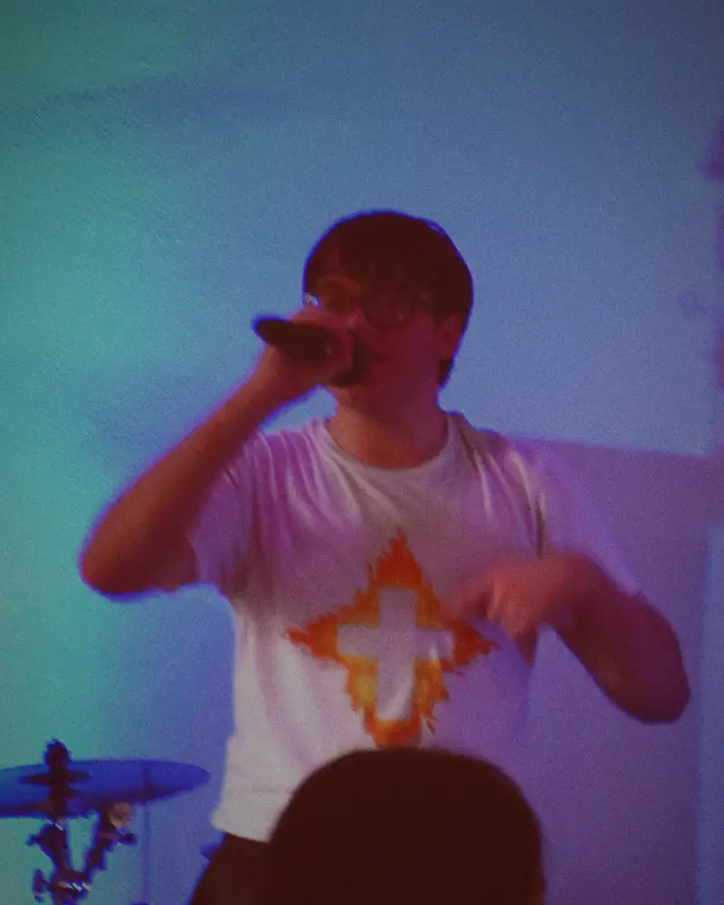

# GLucak website design (phase 1, Laptop designer, 2026-11-02)

Spec for the coder. Sources: `docs/research/direction.md` sections 2-4, `DECISIONS.md` D2-D16, the Home prototype in
`prototype/`. Where this file and the prototype disagree, tell the designer; don't guess.

**Status (2026-11-05):** Home is designed and measured with **Gabe's real photos**, the real playlist and Logo D, on a placeholder
era (colors). Type is **locked** (section 2). Hero A vs B waits on the owner's pick (`prototype/shots/hero-pick.png`). Still
waiting on Gabe: IDENTITY colors and art, the booking email, and his OK on the two "From Gabe" quotes (R1, L2 in `docs/copy/home.md`).
Known and in the prototype: Spotify artist link `https://open.spotify.com/artist/1SxMTO4oSXDbNSNzxx7cVX` (footer Spotify link).

**L2 (2026-11-05): Shop and the admin console** are designed in sections 14 and 15 and prototyped in `prototype/shop.html`
and `prototype/edit.html` (both open from disk). `node prototype/check.mjs --shop` checks them alone.

**Round 2 (2026-11-06): Music cover grid, footer / About link grid, Add to calendar, 404, pressed feedback** are section 16,
prototyped in `prototype/music.html`, `prototype/404.html` and Home's Shows block and footer. `node prototype/tools/round2.mjs`
checks them (shots in `docs/review/round2-design/`); the port list is 16h.

**v2 picks (2026-11-06): release card, Watch row, one photo per slot, the 5 : 7 phrase grid, solid header** are section 18,
built by the Desktop at 3ee444d and mirrored in `prototype/index.html` (plus the changes still to make, 18h). `node prototype/tools/v2picks.mjs`
checks them (shots in `docs/review/v2-picks/`).

**Open the prototype:** `prototype/index.html` from disk. Switches: `?hero=a` `?hero=b` `?shows=none` `?header=scrim`
`?era=placeholder-b` `?identity=out` `?identity=none`. Re-check with `node prototype/check.mjs` (results in
`prototype/shots/check-report.txt`), then `node prototype/tools/hero-pick.mjs` for the owner's side-by-side.
Web copies of Gabe's files: `node prototype/tools/resize.mjs` (section 3b).

## 1. The idea
Gabe's slogan runs the page, and the page gets louder as it goes. Four things make it his and not a template:
1. **The slogan as a poster lockup.** Each phrase is set in fitted lines of heavy condensed type, full width, so the
   headings grow from RISE to LIVE IT LOUD to PUSH PAST FEAR to THE TIME IS NOW. Volume comes from size. Nothing moves to do it.
2. **Crate-divider tabs.** Each section's plain label (Music, Shows, About, Join) is a tab standing on the section's top
   edge, like a divider in a record bin. It uses the exact nav word, costs no height, and reads before the big phrase.
3. **The show as a printed poster.** The next show is a paper-colored block on the dark page, with a huge date.
4. **One era color, spent carefully.** It appears on the main button, the poster's Tickets button, the play button,
   the duotone and the glow. Everything else is `bg` and `text`.

Rap is the type, rock is the still grain and hard edges, EDM is the slow glow. No other decoration.

## 2. Type (locked 2026-11-05)
**Locked: Big Shoulders Display 900 + Atkinson Hyperlegible Next.** D14 held the type until the logo arrived, to avoid two
competing wordmarks. Logo D, the logo IDENTITY uses, is a **symbol with no lettering** (a chrome cross with grey lightning
wings), so there is no second wordmark to compete with: GLUCAK in Big Shoulders *is* the wordmark, and Logo D sits beside it
as the mark (section 3a). Checked side by side in the header and the IDENTITY block: the cross's straight arms and hard
corners match the flat-sided, square-shouldered letters, and the lightning wings' sharp diagonals echo the K and A. The
mark's chrome and bevel stay in the mark: the type never gets chrome, bevels or outlines to match it. No clash, so no switch,
and the `--w-*` measurements stand. Changing the display face from here is a reviewed change (D12): re-measure every `--w-*`
with `node prototype/check.mjs --measure`.

| Role | Face | File | License |
|---|---|---|---|
| Display: name, phrases, buttons, dates | **Big Shoulders Display 900** | `fonts/big-shoulders-display-900.woff2` (14 KB, latin) | SIL OFL 1.1 |
| Reading: body, labels, links | **Atkinson Hyperlegible Next** 200-800 variable | `fonts/atkinson-hyperlegible-next-wght.woff2` (34 KB, latin) | SIL OFL 1.1 |

Both are self-hosted (CSP `font-src 'self'`). The license text sits beside them in `prototype/fonts/OFL-*.txt` and must ship with the fonts.

**Why Big Shoulders:** I set "GLUCAK" in nine heavy condensed options. Its tall, flat-sided letters read like level meters
on a mixing desk, it stays legible down to the slogan's 21px on a 320px phone, and it isn't the usual poster Anton. Rejected:
Anton (common), Archivo condensed (wider, so a shorter name), League Gothic (too light), Anybody at 50% width (letters clog),
Bebas Neue (direction.md). **Why Atkinson:** built for legibility, with enough character to sit beside the display face.

**Fitted lines.** Every lockup line has its font size calculated from its container, so each line fills the width and wraps
the same at every screen, with no script and no reflow:
```css
.fit { container-type: inline-size; }
.ln  { display: block; width: max-content; white-space: nowrap; line-height: .82;
       text-transform: uppercase; text-box: trim-both cap alphabetic;
       font-size: calc(100cqi / var(--w-line)); }
```
`--w-*` is that string's measured width in em, times 1.003 as a safety margin. `node prototype/check.mjs --measure` prints
them. **If the display face changes, re-measure every `--w-*`; nothing else changes.** Line breaks are forced in markup, one
span per line. `text-fit` would be simpler, but it is Chrome and Edge only, and these fans are on iPhones. `text-box` is a
harmless no-op in Firefox because `line-height` stays under 1.

**Scale** (`rem`): `--step--1` 1 (the floor on phones), `--step-0` 1.125 body, `--step-1` clamp(1.25, 1.15 + .5vw, 1.5),
`--step-2` clamp(1.625, 1.4 + 1.1vw, 2.25), `--step-3` clamp(2.25, 1.8 + 2.2vw, 3.5). Fallback stack for display:
`Impact, 'Arial Narrow', sans-serif`. Preload the display face. `font-display: swap`.

## 3. Tokens and color
Same structure as Riverside's `global.css`; the serif and gold don't carry over. Copy the `:root` block from
`prototype/styles.css`: space `--space-xs` to `--space-xl`, `--section`, `--gutter`, `--container: 90rem`, `--radius-s: 2px`,
`--header-h` 60px (72px from 900px), `--tab-h` 2.125rem, `--bar-h` calc(62px + safe area) under 700px, else 0. Corners are
hard (2px) except the Spotify box (12px, matches the embed). No shadows, no cards (one exception since 2026-11-06: the
release card in RISE, section 18a).

Era colors load as `--bg --text --accent --accent-text --muted`. Everything else derives, so no era adds a role:
- `--bg-2`: `color-mix(in srgb, var(--text) 7%, var(--bg))`. `--line`: same at 26%.
- **Poster:** `--text` as the paper, `--bg` as the ink, both already tested as a 4.5:1 pair.
- **Accent as small text on `bg` is banned.** The era test only promises 3:1 there. Accent carries fills, with `accent-text` on top.
- **Duotone, live photos only. Covers and Dave Bahm's art are never tinted.** An SVG filter: grayscale, then a two-stop table
  from `bg` to a capped peak. **The ceiling:** the peak is `bg` mixed toward `accent`, stopping at the first mix with 4:1 against
  `text`. So text over any tinted photo passes the 3:1 large-text rule by construction, in any era, whatever the photo. Proven:
  a teal era failed at 2.77:1 before the ceiling and passes at 5.12:1 with it. Compute it at build from the era file (`peak()` in
  `prototype/app.js`) and print the filter into the layout. No extra color role needed.
- **Scrims:** only where small text sits (2026-11-05: the old full-width top band dimmed his face). Hero: a top-right ellipse,
  `bg` at 55% strength, 62% of the width by 130px, behind Menu and the nav (4.5:1); plus the bottom ramp, clear until 42% of
  the height, `bg` at 80% strength at 70%, solid `bg` at the bottom (Now line). **Hero A under 900px (2026-11-05, with the lifted
  (a) photo):** two more layers: a top-left ellipse (`bg` 45%, 40% of the width by 110px) over the brand's spot (it is hidden
  until the header goes solid, but shows there with no JS), and a light veil from 1.5rem above the strip's end to 2.5rem below
  it, then `bg` at 30% under name and slogan (the lift puts his white shirt behind the name: 3.07:1 with no veil). His face in the
  strip stays clear. Push Past Fear uses a lighter one. Exact values in `styles.css` and section 11.
- **Treatments replace the duotone on photos (D34, section 3b):** the photos are graded in the file (`class="graded"`); the
  ceiling below still applies to any untreated photo with `.duo`.
- **Real photos through the duotone (2026-11-05), the ROADMAP risk 9 verdict: no muddiness, keep the derived ceiling and the
  filter as they are.** Tested all three photos against a darker curve (gamma 1.8), a lighter one (gamma 0.7) and two
  contrast stretches. Kealey's photo is not low-light, it is high-key (a bright, blue-lit wall), so his white shirt and the wall
  both land near the capped peak; he reads by his hair, glasses, mic and arms, which is enough. The current filter is best for
  it: darker curves turn his face into a silhouette. The low-light MCCC still holds up: face, shirt and arm lift off the dark
  curtain; only his black jacket merges with it. Gamma 0.7 separates the jacket a little. **If the owner finds a low-light
  photo too dark, the smallest fix is a per-photo `lift` (one `feFuncR/G/B type="gamma" exponent="0.7"` before the table),
  for low-light photos only.** It sits below the table, so the ceiling still holds. Not built: no photo needs it yet. What
  *does* dim hero A is the ceiling itself plus the glow over the photo. That's the price of text on a photo, and the reason B
  exists.

### 3a. The mark: Logo D (IDENTITY's logo)
`assets/from-gabe/logo-d-identity.png`, 1554x495: a chrome cross with a black outline, grey lightning wings at 65% opacity, a
soft drop shadow. **The PNG has real transparency** (64.5% of pixels fully clear, 16.2% partial: the wings and the shadow), so
no redraw is needed. It is a **mark, not a wordmark: it never replaces GLUCAK in the hero or anywhere else.** It belongs to the
era (D12 amended by the boss, 2026-11-05: era file field `mark`, section 4), so the next era can bring its own or none.
- **Header:** left of the brand word, `height: 30px` (94px wide), 0.5rem gap, in the same link (one target, "GLucak home").
  **Why 30px:** GLUCAK at 28px has 23px caps (Big Shoulders' cap height is 0.81em), and at 30px the cross is 25px tall, one step
  above the caps, so it reads as a symbol at a glance and doesn't outweigh the word. The pair is 183px wide (measured at 390),
  fits at 320 beside Menu, stays inside the 60px header, and the wings still span 16px. Same 30px from 900px (the 72px
  header gives it air; going bigger would make the mark louder than the name). On Home it hides with the brand word while
  the header is see-through over the hero (it would sit on the photo, which is banned below).
- **IDENTITY block** (Join band on Home, Music page): **beside** the word IDENTITY, to its left, `height: 40px`, vertically centred on
  the word (beside, not above: it saves about 60px of phone height, boss 2026-11-05).
- **Favicon:** a square crop of the cross from the original (wing tips inside the square stay as drawn), `favicon-32.png` and
  `apple-touch-icon-180.png` (on the era `bg`, because iOS fills transparency with black). Made by `tools/resize.mjs`; no
  redrawing. A cross-only file from Gabe or Dave would be crisper at 16px; nice to have, not needed.
- **Minimum size:** 24px tall (cross 20px). Below that the wings stop reading as lightning. Never in body text.
- **Clear space:** a quarter of the mark's height on every side (the cross's arm thickness): 8px at 30px, 10px at 40px (the IDENTITY gap is 12px). No
  text, edge or other graphic inside it.
- **Backgrounds:** solid `bg` or `bg-2`, with or without the grain, **in dark eras only** (bg luminance under about 0.05). The
  wings are 65% grey, so they need a dark ground (5.7:1 on #111). **Never** on a photo, the accent, the poster paper or any light
  ground: there the wings vanish (1.2:1 on #f5f5f5). If an era has a light `bg`, that era ships its own `mark` or none.
- **Never:** recolor, tint, duotone, outline, add glow or motion, stretch, crop for layout (the favicon crop is the one
  exception), or set type in chrome to match it.
- **Credit:** CREDITS.md says the logo is Gabe's or Dave Bahm's. Ask Gabe which, for the About page credits.

### 3b. Photos (Gabe's; treatments per slot, 2026-11-05, D34)
**Privacy rule (hard): No identifiable audience member on the site, ever; crops keep only Gabe, the stage and backs of heads
(privacy, 2026-11-05).** Above all no minors: the child in Kealey's frame sits under the cross (source x 3060-3300, y 2780-3120).
So the whole Kealey frame and the Paslier still (two fans' faces) are **never used**, in any size, on any page; the prototype's
`live-kealey-*` and `live-paslier-753` files are deleted and `prototype/tools/resize.mjs` no longer makes them. A new photo gets
a crop rectangle in the Desktop's `tools/photo/run.mjs` that leaves out every face but Gabe's (or a bandmate's) before it ships.

Every photo is one of the owner-approved **treatments** (`docs/research/photo-art-direction.md`), made by the Desktop's
`tools/photo/run.mjs` from Gabe's originals (sharp, no metadata, seeded, no AI) into `docs/review/photo-treatments/`, and
copied as they are. The treatment is the grade, so **no CSS duotone on top**: the `` carries `class="graded"` (`filter:
none`), not `duo`. The SVG duotone (`.duo`, section 3) stays only for a future untreated live photo; none is on Home. One
process per slot, so the page isn't a filter sampler. `alt=""`: they sit behind or beside his name. Era swap = one re-run of
`run.mjs --era` (the files bake in the era colors; the prototype's other two eras still show the placeholder renders).

| Slot | Treatment | Files (served by width) | Crop / CSS | Faces in frame |
|---|---|---|---|---|
| **Hero A** (default under 900px, D34; `?hero=a` everywhere) | **(a) era grade** | `a-era-grade-phone-800` (800x1000) under 900px; `a-era-grade-800` / `-1600` (3:2) only for `?hero=a` from 900px | Under 900px pinned by width and lifted so his eyes sit in the open strip above the name (section 5, the exact CSS in section 11) | Gabe; one back of a head at the bottom edge |
| **Hero B** (default from 900px, D34; `?hero=b` everywhere) | **(b) two-colour riso** | `b-riso-600` / `-1000` (`sizes="37vw"`, the slot is ~470px at 1280, so the 600 file at 0.78x) | `object-fit: cover; object-position: 50% 30%` (same 1.42 aspect as the slot) | Gabe; the same back of a head |
| Hero B's slot under 900px (`?hero=b` only) | **(f)** MCCC still, two inks on black | `f-mccc-240` / `-478` (`sizes="34vw"`, slot ~132px square at 390) | `44% 20%` | Gabe only (stage) |
| **Live It Loud poster** (the first booked `show`) | **(c) gig-poster cut**, torn foot | `c-poster-600` / `-1000` (600x750 alpha; `sizes="(min-width: 640px) 23rem, 50vw"`) | Square, `object-position: 50% 63%` (source rows ~95-695: above his head to under the tear), `mix-blend-mode: darken` (section 5) | Gabe; a back of a head as a solid silhouette |
| **Push Past Fear** (Home and About) | **(d) crowd tritone** | `d-crowd-phone-800` (800x371) under 753px; `d-crowd-800` / `-1600` from 753px | Under 753px `object-position: 8% 50%` (the box is taller than the file, so it loses the sides: keep Gabe, left); from 753px `50% 50%` | Gabe, the pallet cross, backs of heads only (crop stops at source y 2440) |
| **About, contact strip** (spec, section 6) | **(e) contact strip, B&W** | `e-contact-1600` (1600x339), `-phone-800` (two strips of two). **Must be regenerated first** (below); don't use the current files anywhere | As made, full column width | After the swap: Gabe, the cross, the mic stand or his shirt cross, the kit |

**Halftones (b, c, f) and moire:** each file is screened at its own size; never show one below ~0.6x of its file on a 2x+ screen.
`sizes` matches the slot, so the browser picks the file nearest it (riso 0.78x at 1280; poster 0.63x on a 2x phone at 390,
0.95x at 3x, 0.64x at 1280). Never stretch them full-bleed beyond their file.

**Exception to "one color world" (owner-approved treatments, 2026-11-05):** About's contact strip (e) is **black and white**, not
duotone and not era-graded; only its grease-pencil loop on frame 1 takes the era accent. It reads as the photographer's contact
sheet, so it stays B&W in every era.

**The video stills are never shown wider than their native size** (CREDITS.md); (f) files are at or below native.
Markup: `<picture>` with `media` sources, `srcset` with `w` descriptors, `width`/`height` set, the hero image
`fetchpriority="high"`, the rest `loading="lazy"`. **Hero by width (D34, `HERO = 'ab'`):** both heroes are in the page; each
`<picture>` serves a 1x1 data GIF (`data:image/gif;base64,R0lGODlhAQABAAAAACw=`, CSP `img-src data:` allows it) at the widths
where it is hidden, so **exactly one hero photo downloads** (measured, CHECK 2b: 320, 390, 800, 899 fetch only
`a-era-grade-phone-800`; 900 and 1280 only `b-riso-600`). Hero A's `` fallback is the phone file itself, not the 3:2 one: in
Chrome's device emulation the preload scanner once fetched the `` fallback (`a-era-grade-1600`) at 320 as well, and with the
phone file as fallback a slip like that can only fetch the file the phone needs anyway.

**Photo credits** go in the footer of every page, under the slogan, muted 16px, listing only the photos that page shows, in
CREDITS.md's wording: "Photo: Alexander Kealey." (every treatment above but (f) is his photo) and "Video: Montgomery County
Community College, MSP program group." only where (f) appears (`?hero=b` under 900px; never in the D34 default). Paslier's
credit goes with his still, which is no longer used. The About page repeats the full list with the photos.
- **Grain:** `era.texture` tiled on bands, footer and poster; still, never animated. If `texture` is null, use the site default
  `grain.png` (128px tile, 15 KB).

### 3c. IDENTITY guess era (2026-11-05): **a guess, not Gabe's colors**
Prototype only: `?era=identity-guess` (in `prototype/data.js`, **not** in `src/eras/`). It lets the owner see the site in
IDENTITY's light before Gabe's real art and colors arrive (about Nov 30); then this era is deleted, not promoted. In this era the
hero chip reads "IDENTITY colors: our guess from the smart-link art" and the footer note says the same.

**Source:** the og:image of `https://wingsmusic.lnk.to/IDENTITY` (Linkfire `artwork-600x315.jpg` and `-440x440.jpg`, read only,
kept out of the repo). Gabe's face and shoulders in deep blue light, a violet-magenta glow top right, white IDENTITY type, Logo D
under it. Dominant colors (k-means, 8 clusters, 440px square): black `#000001` 27%, indigo `#040243` 21%, `#090359` 17%,
ultramarine `#18078d` 10%, violet `#3b07ba` 10%, near-black blue `#02041c` 8%, the glow `#8312c8` 5%, the type `#dfdbed` /
`#f6f6f6` 2%. Hues 240-255 hold about 55% of the picture.

| Role | Value | From the art |
|---|---|---|
| `bg` | `#08044a` | The indigo field (between `#040243` and `#090359`). Luminance 0.0063: dark enough for Logo D (D25) |
| `text` | `#f6f5ff` | The white IDENTITY type, a touch cool |
| `accent` | `#a866ff` | The violet glow (`#8312c8`, hue 277, and `#3b07ba`, hue 258), lifted to hue 266 and lightened until it passes 3:1 on `bg` (the art's own violets reach only 1.7 to 2.6:1) |
| `accent-text` | `#08044a` | `bg`, as in every era |
| `muted` | `#bab6e6` | Lavender grey, between the type and the field |
| `bg-2` (derived) | `#191557` | `text` 7% into `bg` |
| `line` (derived) | `#464379` | `text` 26% into `bg` |
| Duotone dark / light (derived) | `#08044a` / `#9359e7` | `bg`; the ceiling stops at 87% toward `accent` (peak 4.01:1 against `text`) |

No new roles, ceiling rule unchanged, covers and Dave Bahm's art never tinted. **Contrast** (same maths as `app.js`, mark
composited from `mark-identity-300.webp`): text/bg 17.24, text/bg-2 15.14, muted/bg 9.69, muted/bg-2 8.51, muted on the player
box 5.40; **Listen** (accent-text on accent) 5.33, Listen's fill against the page (accent/bg) 5.33, on bg-2 4.68; **Now tag, tabs, poster
ink on paper** (bg on text, no accent involved) 17.24; **poster Tickets**: label 5.33, fill against the paper 3.23 (and its 3px
`bg` border 17.24); duotone peak 4.01 against text. **Logo D wings** (65% grey): on bg median 5.48:1 (darkest tenth 4.42), on
bg-2 5.19 (4.24), against 5.68 / 5.24 on the placeholder era; bg against black 1.13 (the D25 test allows 1.5). All pass the
era-file test (`test/eras.test.js` rules) and `prototype/check.mjs` (section 12).

**How it looks (my read of `prototype/shots/hero-pick-identity-guess.png`):** energetic, not muddy, and close to the art. The
indigo ground, white type and violet buttons read as IDENTITY at a glance, and it feels cooler and more "night" than the
red-orange placeholder. **Hero B is the stronger hero in this light:** indigo page, violet photo in the slot, white name: it is
nearly the cover. **Hero A goes flat:** the Kealey photo is high-key, so most of it lands near the capped peak, and violet at
that luminance (0.19) looks lighter and more pastel than red-orange did. Add the violet glow over it and the hero becomes a
lavender-violet field with his face as a ghost at the top. The text still passes (5.33:1), and it isn't muddy, but A has
less depth here than in the placeholder era, where the photo still read as a photo. A darker accent wouldn't help: the ceiling,
not the hue, sets the peak's lightness. If Gabe's real colors are also blue-violet, that's a point for B. A print-style two-colour
treatment (the Desktop's `docs/review/photo-treatments/`) with harder blacks would fix A's flatness better than the smooth
duotone. **Spotify's embed is always dark-themed** (`theme=0`, Spotify's dark grey) in every era (D35, amends D19). The
cover-derived colour follows Gabe's playlist cover, not the era, so it can clash with any palette; the dark theme sits on every
era's dark `bg`.

## 4. Field names (shared with the Desktop: keep this section in step with `src/`)
> **Single source for these names.** They match `src/lib/shows.js`, `src/eras/placeholder.json` and `src/data/shows.json` at
> 7a2e937. Release and IDENTITY fields below are agreed (D18) but not in `src/` yet.

**Era file** (`src/eras/<slug>.json`), matches D12:
| Field | Type | Use |
|---|---|---|
| `name` | string | Internal era name |
| `colors.bg` | #rrggbb | Page ground, duotone shadow |
| `colors.text` | #rrggbb | Main text, poster paper |
| `colors.accent` | #rrggbb | The one strong color (about a tenth of a screen) |
| `colors.accent-text` | #rrggbb | Text on accent |
| `colors.muted` | #rrggbb | Secondary text |
| `art` | path | Cover art, shown as made |
| `texture` | path or null | Still grain tile; null uses the site default |
| `word` | string | Era word, used in Join and on Music. Real era: `IDENTITY` |
| `mark` | path or null | **New 2026-11-05 (amends D12, boss ruling).** The era's logo mark, transparent PNG/WebP, shown as made (section 3a). IDENTITY: Logo D. Null: no mark anywhere, the brand word stands alone. Never replaces the word |

No extra color role is needed. The font is not in this file (D12).

**"From Gabe" quote** (D21, optional, one per band, on the band's own data; Home bands: `rise`, `live`, `now`; never `push`):
| Field | Type | Rule |
|---|---|---|
| `quote.text` | string | Required if `quote` is set. His exact words, at most 120 characters, from a post `social-content.md` marks as his own. Rendered escaped, never as HTML |
| `quote.url` | http(s) URL | Required. The post the words come from. The credit links here |
| `quote.date` | `YYYY-MM` or `YYYY-MM-DD` | Required. Shown as "Mar 2026" |
| `quote.platform` | string | Required. `Instagram`, `Threads`, `X`, `YouTube` and so on, as shown in the credit |

No `quote`, or any field missing or invalid, means nothing shows (no empty box). Gabe approves each one via the owner (D21).

**Show row** (`src/data/shows.json`):
| Field | Type | Rule |
|---|---|---|
| `date` | `YYYY-MM-DD` | Required |
| `time` | `HH:MM` 24h | Optional |
| `type` | `show` or `open-mic` | Required |
| `venue` | string | Required |
| `city` | string | Required |
| `link` | http(s) URL | Optional. `show` -> **Tickets**, `open-mic` -> **Details**, no link -> no button |
| `with` | string | Optional, renders "With Fran Carroll". Shown on the poster and the Shows page. |

**Release** (agreed, D18): `title`, `date`, `cover` (path, as made), `link` (smart link,
http(s)), `soundcloud` (optional), `type` (`single`, `ep`, `album`). Home's card uses the newest by `date`.

**IDENTITY block** (agreed, D18; not the era file): a release date and a pre-save link, both optional. The build reads them from
the IDENTITY row in `src/data/releases.json` (`date` 2027-08-13 from Gabe's own post, `link`), which serves the same purpose as
`releaseDate` / `presaveLink`. With no date, the state in section 7 applies. `tracks` waits on Gabe's answers (D10).

## 5. Home, top to bottom
Target about 5 phone screens. All heights below are measured at 390px.

> **Changed by section 18 (v2 picks, 2026-11-06):** the header is a solid band (18e); RISE is the release card (18a); the
> poster is text only and "Latest video" is the Watch row (18b, 18c); PUSH PAST FEAR has no photo band on Home (18c); from
> 900px every band is the 5 : 7 split (18d). Where this section and 18 disagree, 18 wins.

**Header.** Fixed. See-through over the hero, `bg` with a 2px `--line` once scrolled (IntersectionObserver on a sentinel, as in
Riverside `Header.astro`). Brand left: the era `mark` at 30px tall, then "GLUCAK" in the display face (the wordmark; locked,
section 2), one link: `<a class="brand"><span class="brand-word">GLUCAK</span></a>`. With no
`mark`, the word alone. On Home the brand stays hidden while the header is see-through over the hero, so the name never appears twice
and the mark never sits on the photo; it shows once the header is solid, and on every other page (with no JS it always shows). From
900px: nav **Music, Shows, About**, then a **Listen** button. Under 900px: **Menu** only; the bar carries Listen. `<details>` sheet
with focus moved in, Escape and link tap close it. Shop slot: one nav entry, off by a switch.

**0. Hero: A under 900px, B from 900px (D34; `html[data-hero='ab']`, the default).** Not full height. `?hero=a` / `?hero=b`
force one layout at every width (prototype test switches; the build's `HERO` constant). Holds, in order:
- `<h1 aria-label="GLucak">`, letters aria-hidden.
- **A:** GLUCAK fitted to full width over a full-bleed photo, treatment (a). **B:** G[photo]LUCAK: flex row,
  `--fs: calc(100cqi / (w-name + k + .1))`; slot width `fs × k`, height `fs × 1.56`, standing above the letters. `k` is 1.18 on phones,
  1.9 from 900px (slot height 1.34). No photo behind B. In `ab`, the slot is `display: none` under 900px and `.hero-photo` is
  `display: none` from 900px.
- **Photos (section 3b):** A uses (a)'s portrait file under 900px, **his face in the open strip above the name** (tuned
  2026-11-05; a plain cover crop hid it behind GLUCAK): the strip is `--strip` = header + 1.75rem (88px) on phones, header + 11vw
  from 700 to 899px; A gets `padding-top: var(--strip)`; the photo is pinned by width and lifted so his eyes land 2.625rem above
  the strip's end (46px on every phone, 106px at 800). Hair, glasses and eyes show; mouth and mic meet the top of the letters.
  B's slot uses (b) riso from 900px ((f) under 900px with `?hero=b`). Scrim as in section 3.
- Slogan, exact text. Phones: two fitted lines, "Rise, Live It Loud," / "Push Past Fear, The Time Is Now." From 900px: one fitted line.
- **Listen** (solid) and **Shows** (outline), 52px tall. Listen goes to the player, Shows to `#shows`.
- **Now line:** "Now" tag + one link. See section 7. No ticker: it never moves. Release wording (copy, `docs/copy/home.md`):
  **"Out now: {title}"**, the title exactly as on Spotify (today "Out now: Duck, Dodge, Jump, Fight"; the artists line sits right below in RISE, D33),
  linked to that release's `link`. Long titles wrap to two lines inside the 48px line (measured: the player stays put).

**1. RISE, tab Music.** Phrase at 3.5rem on phones; huge in a left column from 900px. The official embed at exactly **352px**,
full column width, with its height reserved, always dark-themed (`theme=0`, D35). Under it: **Play full songs on Spotify** as a real button (2026-11-05):
`btn btn-line btn-small`, 48px tall, display face 1.25rem, full width under 700px, natural width beside the link from 700px. It's
the playlist link: logged-out fans, most of them in Instagram's in-app browser, get 30-second previews in the embed, and this is
the way to full songs, so it earns a button. Outline, not solid: the accent stays on Listen. Then **Listen everywhere**, a text
link. It sits below the player, so the player's position doesn't move. Then the latest release: cover 96px
(160px wide screens) as made, title, then the **artists line** when the release has more than one artist (D33): the release's
`artists` exactly as Spotify shows them ("GLucak, J-BOY"), body face, `muted`, no "feat."; a solo release has no line. Then
"Latest release. Listen on:", two links. The title is `--step-2` (not `--step-3`), `text-wrap: balance`, so long titles take two
lines at 390. The same artists line goes under each title in the Music page's release strip.
**Every platform** and **Listen everywhere** both go to that release's `link`. Then the optional **From Gabe** quote (below).

**From Gabe (D21), the one quote style, every band that has one.** After the band's main content, never above the player:
RISE under the latest release (from 900px in the left column under it); LIVE IT LOUD after All shows; THE TIME IS NOW after the
IDENTITY block; never in PUSH PAST FEAR. Markup:
`<figure class="quote"><p class="quote-tag">From Gabe</p><blockquote class="quote-text"><p>{text}</p></blockquote><figcaption class="quote-credit"><a href="{url}">GLucak, {platform}, {Mon YYYY}</a></figcaption></figure>`.
4px left rule in `text` (same weight as band edges), 1rem left padding, 1rem above (0.5rem after All shows), max 36rem wide.
**Compact (2026-11-05):** the tag (like the Now tag: `text` ground, `bg` letters, 16px, 700) floats into the quote's first line,
so it costs no line of its own. Quote in the reading face, 700, `--step-1`, line-height 1.3, inline, curly quotes added by CSS
(`::before`/`::after`), so `text` stays exactly his words. The credit runs inline after the last word (muted 16px, a 48px link,
0.4rem before it): a short quote and its credit share a line. Static: no rotation, no carousel, no fade of its own. No accent.
**Measured at 390:** R1 (86 characters) is 3 lines plus the credit line, 132px; L2 (22 characters) is 2 lines with the credit on the
second, 76px. At 320: 163px and 107px. LIVE IT LOUD's quote is not shown when no show is booked ("Hope to see you there!"
would point at nothing).

**2. LIVE IT LOUD, tab Shows.** One fitted line. Then next shows: **first show as the poster** + up to two rows. Poster: fitted date,
place, time and `with`, button, and **the art, treatment (c)** (2026-11-05): `<picture></picture>`, first in the `li`, `picture { display: contents }`. Grid areas: phones (card
under 37rem) `'date date' 'place art' 'meta art' 'btn art'`, columns `minmax(0, 1fr) 55%`, rows `auto auto auto 1fr`: the date
across the top as before, the art a square on the right bled to the card's right and bottom edges (`margin: 0 -1rem -1rem 0`,
`width: calc(100% + 1rem)`, `aspect-ratio: 1`, `align-self: end`), so the torn edge is the poster's foot; Tickets bottom-left.
Card 37rem and up (container query on `ul.shows`): `'date art' 'place art' 'meta art' 'btn art'`, columns `minmax(0, 1fr) 23rem`,
art also bled to the top (`margin-top: -1rem`), place aligned to the bottom of its row. Art: `object-fit: cover; object-position:
50% 63%; mix-blend-mode: darken` (its paper, #f5f5f5, takes the card's paper and grain in every era; only ink and the tear
show). At 390 the art is 190px and the poster 291px tall (the text-only layout measures 177px, so +114px; a full-width art band cost 360px,
so it was rejected for phones). **Shows beside the video only from 72rem (1152px)** (was 900px): below that the shows column is
under 37rem and the art would stack 500px tall. Rows: date, place, kind, button or nothing; 60px minimum. Poster rule: the first upcoming row with
`type: show` is the poster; if none in the three is a show, all rows, no poster. Then **All shows**, then the From Gabe quote
(L2, if approved), in the same column. Then **Latest video**, a 16:9
facade: no YouTube loads until tapped; the iframe uses `youtube-nocookie.com` (allowed by CSP); no JS means a plain link. From
1152px: shows left 7 columns, video right 5.

**3. PUSH PAST FEAR, tab About.** Lockup on two fitted lines (FEAR is the biggest word on the phone) over a full-bleed photo,
treatment (d), the crowd tritone (section 3b: Gabe, the cross, backs of heads); one line from 900px. Under it, **bio sentence 1
only, exact** (241 characters: "Despite facing various difficulties ... bring others to Christ."). **D23: his words go on the site
exact or not at all**, so there is no shortened or stitched second line on Home; the full bio, word for word, is on About. No
invented testimony; epilepsy appears only because his bio says it, and whether that sentence stays on Home is open for Gabe (D18).
**Patreon**, **About GLucak**. No "From Gabe" quote here (D21). The About tab stands on the band edge above the photo: `.push-head`
must not clip overflow (fixed 2026-11-05; the tab was clipped before, so check the build's port).

**4. THE TIME IS NOW, tab Join.** Lockup on two fitted lines. **Sign-up comes first:** "Get the next show and every new song first."
(proposal, Gabe reviews), one email field, **Join**. Then the **IDENTITY block**. From 900px the lockup takes the left 7 columns and the
form sits beside it, so the form is in view with the heading.

**IDENTITY block** (same classes as the build, `src/pages/index.astro`; the Music page uses it too):
```html
<div class="identity-state">
                 <!-- era mark, 40px tall, left of the word; omitted if mark is null -->
  <p class="identity">IDENTITY</p>                      <!-- display face, --step-3 -->
  <p class="identity-when"><time datetime="2027-08-13">August 13, 2027</time> &middot; 281 days to go</p>
  <a class="btn btn-line">Pre-save IDENTITY</a>
</div>
```
`.identity-state`: grid, `grid-template-columns: auto 1fr`, items centred in the row, start-aligned, gap 0.5rem by 0.75rem; mark and
word share row 1, everything else spans both columns (`grid-column: 1 / -1`). `.identity-when`: reading face 700, `--step-0`, `text` color, tabular figures.
The pre-save is `btn-line` (52px), 0.75rem above it (gap plus 0.25rem), never solid (the accent stays with Join in this band). The day count is
worked out once, New York time, at build or page load, and **never ticks**: no live counter, no seconds, no animation.
"1 day" singular. On release day and after: `<p class="identity-when">Out now. <a class="text-link">Listen</a></p>` and no
pre-save. No date: the mark and the word only. Gabe's own post settles the date, so the old "IDENTITY, 2027" line is retired.

**Footer (every page).** Closing line "Listen. Shows. Join." fitted, each word a link. The link grid (section 16b): Instagram, Threads, X,
YouTube, Spotify, SoundCloud, Patreon. Slogan. **Photo credits** for that page (`.credits`, muted 16px, section 3b). **Motion on/off**. Automatic year. Privacy. On pages other than Home, add the
sign-up above the links. The prototype's note about placeholders is removed.

**Phone bar (under 700px, every page, D8).** Always visible: never hides on scroll, so **delete Riverside's hide script**. Listen,
Shows, Watch, Join; icon plus 16px label, 60px tall plus safe area. Shop replaces Watch when the shop opens. Body gets
`padding-bottom: var(--bar-h)`, and `scroll-padding` clears both header and bar. Set `aria-current` on subpages.

## 6. Other launch pages
Same header, footer, bar, tokens and tabs. Each page opens with its one fitted phrase, tab above.
- **Music** (tab Music, RISE): the player; releases as the cover grid, the crate (section 16a); the IDENTITY block, `era.word` as a fitted line
  with tracks filling in toward Scenic Route as the larger last row (slots and titles wait on Gabe, D10); SoundCloud.
- **Shows** (tab Shows, LIVE IT LOUD): table of Date, Venue, City, Tickets; on phones, stacked rows; `with` under the venue. **Played** list.
  Booking email. Empty state as in section 7.
- **About** (tab About, PUSH PAST FEAR): full bio word for word (D23: exact or not at all), photos, Patreon, socials, booking
  email, and the photo credits list (every photographer and video source on the site, plus the logo credit once Gabe says whose it is).
  Not prototyped (Home only); the build follows this:
  - **Top:** the PUSH PAST FEAR band with treatment (d), exactly as on Home (`PushPhoto`, section 3b).
  - **The photos: treatment (e), the contact strip (D34),** after the full bio, before Patreon and socials. Full column width
    (max `--container`), `alt="Four frames from one photo by Alexander Kealey: Gabe singing, the cross of pallets, the mic stand,
    the drum kit"`, `loading="lazy"`, `class="graded"` (no duotone). From 700px `e-contact-1600` (one strip of four, 1600x339,
    `sizes="(min-width: 90rem) 90rem, 100vw"`); under 700px `e-contact-phone-800` (two strips of two, 800x674). Frames are about
    190 CSS px wide on a phone: fine for a contact sheet, so no tap-to-zoom. Static: no hover, no motion.
  - **The HANDS frame (frame 3) is REPLACED before this ships.** It is an audience close-up (raised hands, right beside the
    child under the cross), which breaks the privacy rule (section 3b). **The Desktop's `tools/photo/run.mjs` must regenerate
    `e-contact-1600` and `e-contact-phone-800` with frame 3 swapped:** replace
    `['HANDS', { left: 1820, top: 2600, width: 1200, height: 800 }]` with
    `['MIC', { left: 2050, top: 1750, width: 1050, height: 700 }]` (source pixels of `live-alexander-kealey.jpg`, 6000x4000;
    3:2 like the others): the empty mic stand against the white panel, the pallets to its right, a sliver of Gabe's elbow at the
    left edge, **no audience** (checked on the original: the nearest back of a head ends at x 1977; the child is at y 2780+). If
    the owner prefers his shirt cross: `['SHIRT', { left: 1560, top: 1880, width: 450, height: 300 }]` (checked: only his shirt,
    the cross and his hand; it stops above the back of a head at y 2240), but it is soft (450px of source for a ~380px frame)
    and repeats frame 1, so MIC is the pick. The edge print keeps
    "DSC 0832 · PHOTO ALEXANDER KEALEY", the frame label reads MIC. **Don't use the current `e-contact-*` files anywhere**, not
    in a preview either.
  - **B&W, the one exception to the era colors (owner-approved treatments, 2026-11-05; section 3b):** the strip is black and
    white in every era; only the grease-pencil loop on frame 1 takes the era accent. It sits on `bg` with no scrim and no text
    over it.
  - Under it, `a-era-grade-clear-1200` (the unprinted (a), no text over it) may follow as the big photo once the Desktop
    confirms its crop: same frame as hero A, Gabe plus one back of a head, so it passes the rule.
- **From Gabe on other pages:** the same style and rules as Home (section 5), at most one per band, after the band's main content.
- **Privacy:** plain text page, footer link only. Covers email sign-up and the Spotify embed.
- **Shop** (tab Shop, MERCH): built early (D36, temporary store), designed in **section 14**. Off by `SHOP_ENABLED`; when on,
  Shop joins the nav, the sheet and the footer line, and replaces Watch in the phone bar (D8).

## 7. States
| Case | Shows |
|---|---|
| **No upcoming shows** | Heading stays. "No shows booked right now" in display type, **Follow** (Instagram), **Request a show** (mailto, needs the booking email), then **Played** rows if any. Latest video stays. The LIVE IT LOUD quote is not shown. Never a blank section. |
| **No past shows either** | Omit Played. |
| **No ticket link** | No button, ever. No disabled button, no "TBA". |
| **Open mic** | Row with kind "Open mic"; Details if linked. Never the poster. |
| **Show today** | Stays upcoming through the whole New York day (`splitShows`). |
| **Now line** | Next upcoming row of either type if within 14 days (D18), labelled by its type: "Next show: Venue, City" or "Next open mic: Venue, City", linked to `#shows`. Otherwise the newest release. (Most of his gigs are open mics; the label keeps it honest.) |
| **No IDENTITY date** | Mark and "IDENTITY" only. No countdown, no pre-save, nothing broken-looking. (The date is now known, 2027-08-13 from Gabe's own post, so this is the fallback only.) Prototype: `?identity=none`. |
| **Date set** | "August 13, 2027 · 281 days to go", static per page load (no ticking digits, so no motion), plus **Pre-save IDENTITY** if linked. Section 5. |
| **Release day** | Flips to "Out now. Listen" by date, New York time; the pre-save goes. Prototype: `?identity=out`. |
| **No quote** | Nothing: no "From Gabe" box, no empty space (D21). |
| **No era mark** | The brand word alone in the header; nothing above IDENTITY. |
| **No playlist link** | Launch blocker. Never ship the empty box. |
| **Embed blocked or slow** | Box keeps 352px. A note under the iframe, seen only while it loads or if it's blocked: "Loading the Spotify player. If it doesn't appear, use Play full songs on Spotify below." No layout jump. |
| **No JS** | Page reads fully: no motion, headings visible, facade is a link, server-rendered shows. |
| **Sign-up** | Success: "You're on the list." Bad email: "Enter an email like name@example.com." Server down: "That didn't go through. Try again." All in `role="status"`. |
| **Sign-up sending** (DESIGN 19d) | Valid email sent: the status line reads "Sending…" and Join gets `aria-disabled="true"`; another tap or Enter does nothing until the server answers, then one of the three messages above replaces it and `aria-disabled` goes. Join keeps its look (no grey, no spinner, no new words on it). A bad email never reaches Sending. No JS: the form posts as before. |
| **Link not known yet** | Build fails rather than ships `#`. In the prototype these are dashed links. |

## 8. Motion (hard rule)
Exactly two motions exist on Home.
1. **Glow:** one layer behind hero and player, a radial gradient painted once and moved only by `transform` and `opacity`: 24s,
   ease-in-out, alternate, opacity .68 to .88, shift about 12% of its width. Stops when hero + Rise no longer fill the bottom of the
   screen (IntersectionObserver), so it is never a second moving thing beside a heading fade.
2. **Heading fade:** LIVE IT LOUD, PUSH PAST FEAR, THE TIME IS NOW fade in once, opacity only, 0.6s, the first time they reach the
   screen. No slide. RISE doesn't fade: the glow already owns that screen.

Banned: flashing, strobe, glitch, distortion, video in the hero, tickers, carousels (a still swipe row that moves only under a
finger is not one: section 18b), parallax, pinned scroll, smooth-scroll hijacking,
hover animation on cards, any animation on `background`, `filter` or layout. A clip added later must pass a frame-level flash check first (D14).

**Spotify's embed** scrolls a long playlist title inside its cross-origin iframe. It stops under the device's reduce-motion setting
(checked 2026-11-05 with `--force-prefers-reduced-motion`); our footer Motion switch can't reach it. Accepted: small, no luminance
change, and the device setting stops it (D19).

**Off switches, both required.** CSS motion is only declared inside `@media (prefers-reduced-motion: no-preference)` **and** under
`html[data-motion='on']`, so with no JS or either switch off, nothing runs. `boot.js` sets `data-motion` before paint. Footer button:
"Motion: on / off", remembered in `localStorage` in a try/catch. Under the device setting it reads "Motion: off (device setting)" and is disabled.

## 9. Accessibility floor
Text 4.5:1. Large text and controls 3:1. Targets 48px minimum. Nothing under 16px on phones. Tabs 16px or more, exact nav word, real
content right under the heading (D6). Tab and phrase share one `<h2>`: `<span class="tab">Shows</span> <span class="phrase">Live It Loud</span>`,
so screen readers and find-in-page get both. 3px focus ring in `text`. Skip link. No autoplay sound.
**Spotify player focus (a11y audit row 9, 2.4.7, accepted 2026-11-06):** the embed's `<iframe>` gets no ring of ours
(`outline: none` on our side); the focus ring on the controls inside it is Spotify's own, drawn in their document, and we
can't style it. Accepted: it is a third-party frame, its own controls do show focus, and the "Skip the Spotify player" link
before it (and the audit's row 2 fix) keeps keyboard users from having to walk through it.
Text at 200% (1.4.4 / 1.4.10): section 17.

## 10. Gabe's edit screen
**The look of `/edit/` (sign-in, tabs, rows, editor form, upload, save bar, every message state) is section 15.** This
section keeps the scope.
One simple form page per thing, large fields, plain words, phone friendly. Built on Riverside's admin pattern; every field escaped on
output, http(s) links only, with the `<script>` and `' OR 1=1 --` tests.
- **Shows:** list with Add, Edit, Delete. Fields: Date (date picker), Time (optional), Type (Show / Open mic), Venue, City, Link (optional, hint:
  "Tickets or details page"), With (optional). Save shows the row as fans will see it. Past shows move to Played by themselves.
- **Releases:** Title, Date, Cover (upload, shown as made, square), Smart link, SoundCloud link (optional), Type.
- **Links:** Spotify playlist, YouTube channel, Patreon, socials, booking email.
- **Bio:** About text and the Home short version.
- **IDENTITY:** Release date, Pre-save link.
- **Not on this screen** (a reviewed change): era file, fonts, layout.

## 11. Speed and porting notes for the coder
- **Copy into `public/media` (L1):** `c-poster-600`, `f-mccc-240` and `f-mccc-478` (only `c-poster-1000` is there now). Copy the
  poster block (`.shows` container, `.poster*`, `@container (min-width: 37rem)`) from `prototype/styles.css` word for word;
  don't rebuild it from the prose in section 5.
- Prototype first load (2026-11-05, uncompressed): HTML 15 KB, CSS 32 KB, JS 13 KB (app 10, boot 1, data 2), fonts 48 KB, grain 15 KB,
  mark 5 KB, favicon 2 KB = **130 KB before photos**. **Photos (D34 default, exactly one hero photo per width, the prototype
  too):** under 900px `a-era-grade-phone-800` 29 KB (one file at every density); from 900px `b-riso-600` 25 KB (1x) or
  `b-riso-1000` 64 KB (2x). Lazy, below the fold: poster art `c-poster-600` 16 KB / `-1000` 38 KB; Push Past Fear
  `d-crowd-phone-800` 19 KB on a phone, `d-crowd-800` 12 KB / `-1600` 42 KB wider. **A phone loads about 160 KB before Spotify
  (was about 200 KB on 3x).** One live iframe (Spotify); YouTube behind the facade. Photos are the Desktop's treatment files
  (`tools/photo/run.mjs`, sharp, no metadata), copied as they are; `prototype/tools/resize.mjs` now makes only Logo D and icons.
- **Port of L1 for D4 (2026-11-05), exact values from `prototype/styles.css`:**
  - Hero A under 900px (replaces the src rule `@media (max-width: 699px) { html[data-hero='a'] .hero-inner, html[data-hero='ab']
    .hero-inner { padding-top: calc(var(--header-h) + 1.75rem); } }`, which now runs to 899px with a width-scaled strip):
    ```css
    @media (max-width: 899px) {
      :root { --strip: calc(var(--header-h) + 1.75rem); }
      html:not([data-hero='b']) .hero-inner { padding-top: var(--strip); }
      .hero-photo img {
        position: absolute; left: 0; top: 0; height: auto; margin-top: calc(var(--strip) - 2.625rem - 41.875%);
        -webkit-mask-image: linear-gradient(to bottom, #000 78%, transparent); mask-image: linear-gradient(to bottom, #000 78%, transparent);
      }
      .hero-photo::after {
        background:
          radial-gradient(ellipse 62% 130px at 100% 0, color-mix(in srgb, var(--bg) 55%, transparent), transparent),
          radial-gradient(ellipse 40% 110px at 0 0, color-mix(in srgb, var(--bg) 45%, transparent), transparent),
          linear-gradient(to bottom, transparent calc(var(--strip) - 1.5rem), color-mix(in srgb, var(--bg) 30%, transparent) calc(var(--strip) + 2.5rem)),
          linear-gradient(to bottom, transparent 42%, color-mix(in srgb, var(--bg) 80%, transparent) 70%, var(--bg));
      }
    }
    @media (min-width: 700px) and (max-width: 899px) { :root { --strip: calc(var(--header-h) + 11vw); } }
    ```
    The `.hero-photo::after` override must come after the base `::after` rule. `41.875%` = his glasses at y 335 of the 800px-wide
    file; margin-top % resolves against the width, so it holds at every width. If `run.mjs` re-crops (a)'s phone file, re-measure
    that one number.
  - Hero A markup in `ab`: the phone file serves every width under 900px and is the `` fallback itself:
    `<source media="(min-width: 900px)" srcset="{GIF}">` (drop the `(max-width: 699px)` source and the 3:2 `srcset` in `ab`; keep them for
    `HERO = 'a'`, where from 900px the 3:2 file takes `object-position: 50% 30%`).
  - Push Past Fear: `.push-photo { object-position: 8% 50%; } @media (min-width: 753px) { .push-photo { object-position: 50% 50%; } }`
    (src has `50% 50%` at every width, which cuts Gabe off the left on phones).
  - Poster art: section 5, item 2 (markup, grid areas, `.shows { container-type: inline-size }`, `@container (min-width: 37rem)`),
    `sizes="(min-width: 640px) 23rem, 50vw"`, and the shows/video split moving from 900px to 72rem. `src/lib/shows.js` prints the art
    in the poster `li` only (rows never get it).
  - Credits: the MCCC credit only with `HERO = 'b'` under 900px; Paslier's credit goes (his still isn't used).
- **Port of L2 for D4 (2026-11-05): Shop (section 14) and the admin console (section 15).** CSS is the block headed "L2" at the end
  of `prototype/styles.css`; copy it word for word. In order:
  1. **`src/styles/global.css`:** add to `:root` `--w-merch: 2.6128;` and `--hatch: repeating-linear-gradient(-45deg,
     color-mix(in srgb, var(--line) 70%, transparent) 0 2px, transparent 2px 14px);`; add `[hidden] { display: none !important; }` and
     `.vh {…}` from the prototype's reset; add the `aria-current` rules (nav, sheet, phone bar) from "Subpages"; **replace** the built
     Shop block (`.shop-title .phrase` to `@media (min-width: 700px) { .product-detail … }`) with the prototype's "Shop" block; keep
     the built `.ln-close:has(a[href$="/shop/"]) { --w-close: 10.46; }` (the prototype's `.ln-close-shop` is its stand-in).
     The Shop block includes **`.shop-details .product-detail:not(:target) { display: none; }`** (D41 F1: only the detail you
     came to shows; the server still prints every detail, so shared `#product-<id>` links work).
  2. **`src/pages/shop/index.astro`:** the phrase becomes `<span class="phrase fit"><span class="ln ln-merch">Merch</span></span>`.
  3. **`src/lib/products.js`:** `card()`: `<li class="product-card" data-status="${p.status}">`, then after `img(…)` the tape
     (`<span class="product-tape" aria-hidden="true">Sample</span>` for sample, `…>Sold out</span>` for sold-out, nothing else).
     `detail()`: `data-status` on the `article` and the same tape after its `img`. Status `p`: `class="product-status ${cls}"`
     with `is-sold-out` / `is-available` (buyable) / `is-coming-soon` (everything else), on the card and in `actionHtml()` (replaces
     the `is-sold-out`-only logic). **The card's `img` gets `alt=""`** (D41 F4: the name is already the link's text); the
     detail's `img` keeps `alt="{name}"`. Everything else (escaping, price rule, Buy + note) unchanged. Tests: the tape and class
     appear for each status; the tape's text is never data; card `alt` empty, detail `alt` the escaped name.
  4. **`tools/make-shop-samples.mjs`:** render `prototype/assets/shop/sample-*.svg` as they are to transparent WebP
     (`sharp(svg).webp({ quality: 90, alphaQuality: 100 })`), same names in `public/media/shop/`. No era colours, no text in the image.
  5. **`src/pages/edit/index.astro`:** replace the `<style is:global>` rules with the prototype's "Admin console" block (keep
     `[hidden]`); `#out-ask` becomes `<div id="out-ask" class="ed-ask" role="alert" hidden><p>…question…</p><p class="ed-ask-btns">
     <button id="out-yes" class="ed-btn">Sign out</button> <button id="out-no" class="ed-btn">Stay</button></p></div>` (Stay is a
     plain `ed-btn`, D41 F3: one accent button per view);
     Add buttons get `ed-add`. The Save button stays before its message (CSS reorders).
  6. **`public/js/edit.js`** (the prototype's `prototype/admin.js` is a working reference with the same names): `say(el, text,
     state)` sets `data-state` per the table in 15h; rows rebuilt as 15f (head, actions, `fieldset.ed-form[hidden]` with a `.vh`
     legend, Edit with `aria-expanded` / `aria-controls`, new rows open, error rows `.bad` + open, `err` in the head); `number()` also
     disables Move up on the first row and Move down on the last; Status as radios (15g); the upload button markup (15g), keeping
     the built `fetch` upload and its "Uploading…" line (D41 F2: no progress bar, no XHR);
     `save()` guards with `aria-disabled` (15i); the empty line gets `ed-help ed-empty`; drop the past-row opacity (CSS does it).
     All data still through `textContent` / `value` only.
- **Port of round 2 (verdict task 7): section 16h.** Cover grid, link grid, Add to calendar, 404, pressed states; CSS block "Round 2" at the
  end of `prototype/styles.css`, word for word.
- **CSP:** the prototype ran clean under the exact `server.js` CSP. **No inline scripts:** Riverside's `is:inline` scripts in `Header` and
  `MobileBar` won't run under `script-src 'self'`; move them to external files. `boot.js` must load blocking in `<head>`.
- **`filter: url(#duo)`** needs the SVG in the same document: print it in `Base` layout.
- **Sign-up form** posts to our own server (`form-action 'self'`), `POST /api/signup` (D18); **the server calls Kit**, the browser
  never does. Include the injection tests and rate limiting.
- **`src/lib/shows.js` changes needed (Desktop's file):** poster plus rows markup with the classes in `prototype/styles.css`; empty state
  from section 7 instead of "No upcoming shows yet."; "Played" instead of "Past shows".
- **Reuse:** `Header` (overlay, sheet), `MobileBar` (without the hide script), `Facade` (without the hover zoom and the sendBeacon, unless stats
  are wanted), token structure. **Don't reuse:** serif and gold, pills, shadows, rounded cards, hero video.

## 12. Measured (2026-11-05, Gabe's real photos; Chrome headless over DevTools, `Emulation.setDeviceMetricsOverride`, so 320 and 390 are true widths)
| Check | Result |
|---|---|
| **Round 2 (2026-11-06, `node prototype/tools/round2.mjs`, section 16g)** | No sideways scroll at 320 / 390 / 1280 (Home, Music, 404, Shop); targets none under 48px; 16px minimum; contrast lowest 8.77:1 at rest, 16.83:1 pressed, 3 eras; 0 animations on Music and 404; every pressable changes colour, 0 transitions; **Home 5.78 screens** at 390x660 without the note with the 16f trim (5.86 without it) |
| **L2, Shop and admin console (CHECK 7, `node prototype/check.mjs --shop`, report `shots/check-shop-report.txt`; also in the full run)** | **Re-run 2026-11-06 after D41 (F1-F4).** **No sideways scroll** at 320, 390 and 1280 on 12 states (shop samples / mixed / empty / off; one detail targeted: sample, available with Buy, sold out; edit sign-in, products uploading + 409, products with errors + sign-out ask, shows, empty). **Tap targets:** 3 to 40 per state, **none under 48px** at 320 or 390 (radio rows measured by their label; the file input lies over its 56px button). **Smallest text 16px** (status lines, chips, hints). **Contrast** (45 pairs per era against the nearest painted background, every page state): lowest 5.71:1 placeholder, 7.41:1 placeholder-b, 5.33:1 identity-guess (the accent Buy / Save buttons), field borders 7.41:1+, **none under the floor**. D6: tab "Shop" 17px 700, nav word matches; MERCH 133px at 390. **First products:** top of the first picture at y 362 (y 341 at 320x568); two pictures fully and four partly in view at 390x844, four fully at 1280x800. **Shop page height (D41 F1: only the targeted detail shows; 5 details in the markup, 0 shown without a hash, 1 with):** grid only **1748px = 2.07 screens at 390x844** (2.65 at 390x660; 1791px = 3.15 at 320x568; 1618px = 2.02 at 1280x800), was 3644px = 4.32 at 390x844 with every detail shown. With one detail: sample 2120px = 2.51 at 390x844, available 2168px = 2.57, sold out 2042px = 2.42 (2094-2167px at 1280). **Buy's note (or the status line) is on the first screen** when you arrive from a card: bottom at y 535 (available), 474 (sample), 409 (sold out) against a fold at 782 (390x844) and 598 (390x660); y 333-430 at 1280. **Animations 0** on both pages, normal and reduced motion, also after opening a row and switching tabs. **No innerHTML** (or outerHTML / insertAdjacentHTML / document.write) in `shop.js` or `admin.js`. **CSP and errors: none.** Both open from disk (the font *preload* is refused on `file://` there, as on Home; `@font-face` still loads it). Home unchanged: player 90px visible, 5.80 screens, flash 0.0001 |
| **L1, treatments + hero by width (D34), re-run 2026-11-05 with `?hero=ab` added to every loop** | Player at 390x660: ab / a **90px visible**, b 80 (unchanged). No sideways scroll at 320, 390, 1280 for ab, a, b. **One hero photo per width (CHECK 2b):** 320, 390, 800, 899 fetch only `a-era-grade-phone-800`; 900 and 1280 only `b-riso-600`. **His face in the strip (A):** eyes at y 46 on phones (name starts at 88; hair top -4 at 390, chin 102), y 106 at 800 (name at 148). **Text over (a), lifted, with the phone veil:** at 390: name **4.65**, slogan **6.18**, brand 3.93 (need 3); Menu **6.82**, Now **14.18** (need 4.5). Second era 4.60 / 5.93 / 3.90 / 6.69 / 11.80; IDENTITY guess 4.76 / 6.43 / 3.95 / 6.94 / 13.86. At 320: 4.72 / 6.02 / 3.94 / 6.35 / 14.29 (second era 4.65 / 5.86, guess 4.83 / 5.81, Menu 6.26-6.48, Now 11.82-14.29). At 800x1024: 3.97 / 8.65 / 4.26 / 7.80 / 13.50. Without the veil the name was 3.07. PUSH PAST FEAR over (d): **5.39:1**. Tap targets 36, none under 48px (Tickets beside the art included). Solid pairs unchanged (lowest 5.33, IDENTITY guess). Reduced motion: no animations. Flash: 86 / 87 / 94 frames, largest change 0.0001. CSP and errors: none; opens from disk. **Home height at 390x660: ab 3938px = 5.80 screens without the note** (was 5.61): the poster art adds 114px (poster 177 to 291px). Cap 5.8 (D39) |
| Player top at 390x660, clear of the bar (before L1) | A: top 508, bar 598, **90px visible** (was 114; A gave 24px to the strip for his face). B: top 518, **80px visible** (unchanged). Holds with the real Now line "Out now: Duck, Dodge, Jump, Fight (feat. J-BOY)", which wraps to two lines inside its 48px. Box 352px, the real embed |
| Slogan and GLUCAK, no horizontal scroll | scrollWidth equals viewport at 320, 390, 1280 on both heroes. Slogan is two forced lines at 320: 41px and 21.6px |
| D6 labels at 390 | 17px, weight 700, 17.3:1, exact nav word. All four tabs show (About was clipped by `.push-head` before; fixed) |
| Text over the **real** photos, from pixels (99.5th percentile background, text hidden) (before L1) | A: name **5.39:1**, slogan **6.19:1** (need 3), Menu **10.84:1**, Now **13.63:1** (need 4.5; the real two-line Now line). B: name 16.85, slogan 15.90, Menu 17.32, Now 14.06. A on the second era: name 5.34, slogan 5.95, Menu 10.35, Now 11.37. PUSH PAST FEAR heading over the Paslier still: 7.68:1 |
| Tap targets, text size | 36 targets, none under 48px (Spotify button 48px, both quote credits 48px). Smallest text 16px. No sideways scroll at 320, 390, 1280 with the long title and quotes |
| Solid pairs, both eras | Lowest 5.71:1 |
| **IDENTITY guess era** (`?era=identity-guess`, section 3c; **a guess, not Gabe's colors**) | Text over the real photo, hero A at 390x660: name **5.33:1**, slogan **6.10**, brand 6.23 (need 3); Menu **10.53**, Now **13.43** (need 4.5). Solid pairs (CHECK 3e): lowest solid button (Listen) 5.33, Tickets on poster 5.33, muted on footer 8.49. Tabs and Now tag 17.24. Logo D wings on bg 5.48:1, on bg-2 5.19:1. Duotone peak `#9359e7`, 4.01:1 against text. All other checks unchanged (same layout). Sheet: `prototype/shots/hero-pick-identity-guess.png` (`node prototype/tools/hero-pick.mjs --era identity-guess`) |
| Home height at 390x660 | **A 3812px = 5.61 without the prototype note after D33's artists line** (3px over the cap 5.6; accepted, since the collaborator credit is never dropped; the built site measures 5.25). Before D33: A 3795px = 5.75 screens, 5.58 without the note (cap 5.6, boss 2026-11-05). B 5.84 / 5.67. Empty shows 5.60 / 5.43. With both real quotes (R1, L2), the real release title and Now line. Committed baseline was 5.21 / 5.07 (2026-11-03 report; the 5.13 in the old table was an earlier run). What added height: the IDENTITY block (date, pre-save, mark beside the word), both quotes (132 and 76px, compact style), the Spotify button and the footer credits; what took it back: D23 (mission line gone), the mark beside IDENTITY instead of above (about 60px), the compact quote (tag in the first line, credit inline) |
| Reduced motion | Emulated with `Emulation.setEmulatedMedia`: `document.getAnimations()` empty, headings visible. Footer switch: also empty. The IDENTITY count is text, not motion |
| Flash | **By construction:** the only loop is one 24s opacity and transform drift (opacity .68 to .88), so it cannot reach 3 flashes a second. Supporting sample only, too slow to detect a 3 Hz flash on its own: 87 and 95 frames over 26s, largest change in mean luminance 0.0001 against WCAG's 0.10, on both heroes with the real photos. Most moving things on screen at once, brisk scroll: 1 |
| CSP and errors | None under the real CSP (WebP served as `image/webp`). Also opens from disk |
| Real Spotify embed (CHECK 1b) | Loads logged out under the real CSP at 390 and 1280, no errors, 137 and 107 colors painted. Spotify's "Preview" badge shows (30-second previews). Title marquee stops under the device reduce-motion setting |
| Photo files | The treatment files carry no EXIF, ICC or XMP (sharp writes none; `photo-art-direction.md`). Rows above marked "before L1" were measured on the old whole-frame and Paslier files, now deleted |
| **Faces, slot by slot (2026-11-05, every image the prototype uses, at 390 and 1280 in placeholder, placeholder-b and identity-guess; the files are the same in every era, only the page colors change)** | Hero A (a) phone file: Gabe, one back of a head at the bottom (masked into bg). Hero A (a) 3:2, `?hero=a` from 900px: Gabe, the same back of a head. Hero B (b) riso: Gabe, the same back of a head as a dot silhouette. (f) MCCC, `?hero=b` phones: Gabe on stage only. Poster (c): Gabe, the back of a head as a solid ink shape. Push Past Fear (d), all three sizes: Gabe, the pallet cross, three backs of heads, no profile. Spotify embed cover: Gabe only. **No identifiable audience face anywhere.** Not on the page: (e) contact strip (its HANDS frame fails; regenerate first, section 6) |

## 13. Not verified
- **The hero is decided (D34):** A under 900px, B from 900px; `prototype/shots/hero-pick.png` and `-identity-guess.png` now show the
  live default first, then A and B alone.
- **The treatments in other eras.** The files are the placeholder era's renders; `?era=placeholder-b` and `?era=identity-guess`
  show them unchanged (the riso stays red-orange on the violet page, (d) stays red). Real look per era needs `run.mjs --era` on
  Gabe's era file. Contrast over (a) was measured in all three eras, but on the same pixels.
- **The (e) contact strip** is spec only, and its files must be regenerated with the MIC frame (section 6) before anyone looks at
  it on a page.
- **Halftone moire on 1x screens.** On a 1x phone-sized window the poster art shows at 0.32x of its 600 file (190px); real phones
  are 2x+ (0.63x at 2x, 0.95x at 3x), and 320px 2x phones get 0.51x. A 400px poster file from `run.mjs` would cover those.
- **Hero A at 700-899px** uses the 800px phone file, so a 2x tablet (iPad portrait) upsamples it about 2x: soft. A
  `a-era-grade-phone-1600` from `run.mjs` (same crop) would fix it; add it as `1600w` in a `srcset` on the `` fallback.
- **The duotone on IDENTITY's real colors.** All photo tests ran on the placeholder era (and the second one). The ceiling holds by
  construction in any era, but how dark the photos look depends on the real accent. **Partly tried on the IDENTITY guess era**
  (section 3c, blue-violet from the smart-link art): it passes, but it flattens hero A. Re-run on Gabe's real colors.
- **The IDENTITY guess era is a guess.** Its colors come from a 600x315 / 440x440 JPEG of the smart link's art, not from Gabe's
  files or his palette, and the accent was lifted to pass contrast, so it is brighter than any violet in the art. Never ship it
  or copy it to `src/eras/`.
- **Logo D at 16px** (browser tab) was seen only as a 32px PNG. A cross-only file from Gabe or Dave would be crisper.
- **The "From Gabe" quotes are real words but not yet approved** (R1 and L2, marked "Pending Gabe's OK" in the prototype; the chip
  never ships). Real wrap measured (section 5): R1, 86 characters, 3 lines plus credit at 390 (132px), 4 at 320 (163px); L2, 22
  characters, 2 lines with the credit inline at 390 (76px). Credits "GLucak, Instagram, Sep 2026" and "GLucak, YouTube, Sep 2026"
  link to the posts. Not checked in Safari (the floated tag and inline credit).
- **Safari and the Instagram in-app browser were not tested.** Only Chrome ran. Check `filter: url()`, `cqi`, `text-box`, `color-mix`,
  `mask-image` (hero A's fade; `-webkit-` prefixed too), `mix-blend-mode: darken` (poster art), container queries and the safe
  areas on a real iPhone.
- The Spotify embed ran only in headless Chrome, logged out. Logged-in playback, Safari, and Instagram's in-app browser (previews? does
  the playlist link open the app?) are part of the real-phone test.
- No PEAT run. The flash result rests on the code having one 24s loop, not on the 3.4 fps sample.
- Screen readers and a keyboard-only pass were not run. Hero B's slot is thumbnail-sized on phones, as D14 predicted.
- The Music, Shows and About pages, and the footer sign-up on them, are specified here, not prototyped.
- **L2, Shop and admin (sections 14, 15), Chrome only.** Not run in Safari / iOS: `display: contents` on `#shop-mount` and
  `.product-body` inside a grid, the tape's grid-area containing block (an absolutely positioned grid child), `rotate`,
  `:has()` (save bar edge, radio rows, upload focus ring), `color-scheme: dark` on the native date / time pickers, `accent-color`
  on the radios, and `:target` showing the one detail after a tap, Back, and a shared link opened from Instagram's in-app
  browser (D41 F1). Real-phone test list.
- **The placeholder line art ships as SVG in the prototype only.** The build's `IMAGE` rule allows webp / png / jpg, so the
  Desktop renders the same SVGs to transparent WebP (`tools/make-shop-samples.mjs`); the alpha edge of the dashes at 600px
  was not checked.
- **Screen readers on the collapsed admin rows** (Edit with `aria-expanded` / `aria-controls`, the visually hidden legend, the
  radio fieldset) and the tape being `aria-hidden` were reasoned, not heard.
- **New words not in `docs/copy/admin.md`:** the button **Edit** (the brief asks for it; it opens a row's form). Everything
  else on both pages is copy from shop.md / admin.md or a word those files already use (Sample, Sold out, the short status
  names). Edit and Stay are approved (D41, in `docs/copy/admin.md`). (No Back link on the detail, by D41: the browser's Back and the phone bar's
  Shop return to the grid.)
- **A real product photo on the card** was not tried (none exist). The hatch sits under every picture; an opaque photo hides
  it. A product photo with transparency would show the hatch through it: the upload re-encode should flatten onto `bg-2` if
  that ever looks wrong.

- **Round 2 (section 16), Chrome only.** Not run on a real iPhone: `:active` with the empty touchstart listener, `-webkit-tap-highlight-color`,
  tapping a `text/calendar` link (iOS Add to Calendar sheet; Android downloads the file and offers the calendar app), and **the
  Instagram in-app browser with an .ics link** (it may not hand the file to the calendar; then the fan has to open the page in
  Safari). Whether fans read the calendar-plus glyph without words is a guess: watch the real-phone test, and if they don't, the
  words go back on the Shows page poster only (it has no height cap). The coming singles' real art was not fetched (Linkfire's
  440px square may be a promo, not the cover). Covers are 300px files: soft on 2x screens from 700px (16h item 8).

## 14. Shop (`/shop/`, L2 2026-11-05, D36 / D37 / D8)
**Prototype:** `prototype/shop.html` (`?shop=samples` default | `mixed` (one example per fan state, prototype only) | `empty`,
`?open=no` = the switched-off preview, `?era=`). Copy: `docs/copy/shop.md`, word for word. Products: `src/data/products.json`.

**The idea: the merch table at the show.** Gig merch is laid out on a table, each thing with a strip of masking tape on it, the
tour poster behind. Three pieces carry it, all from the system that already exists: the fitted MERCH (the band phrase),
**paper** (poster paper = `text` ground, `bg` ink) for anything a fan must read before buying (the sample banner, the tape), and
the **hatch** for "nothing real here yet". One loud thing: **the tape**. No new colours, no new type, no motion.

### 14a. Heading
`<h1 class="spine shop-title" id="h-shop"><span class="tab">Shop</span> <span class="phrase fit"><span class="ln ln-merch">Merch</span></span></h1>`
(the build has a plain `<span class="phrase">Merch</span>`; make it fitted like every other page). `.ln-merch { font-size:
calc(100cqi / var(--w-merch)); }`, `--w-merch: 2.6128` (MERCH measured 2.6050em × 1.003). D6 holds: the tab is the exact nav word
(Shop, 17px, 700), real content (the banner, then products) sits right under. At 390 MERCH is 133px type, 348 of 349px wide.
**From 900px** the band's `.wrap` is a grid `minmax(0, 7fr) minmax(0, 5fr)`, gap `--space-xl`, `align-items: end`, and
`#shop-mount { display: contents }`, so MERCH takes the left 7 columns (rows 1-2) and the banner sits beside its foot (column 2,
row 2), the preview chip above it (row 1); grid, details and the empty slot span both columns. The first products start at
y 362 at 1280x800 (four fully in view).

### 14b. Preview chip and sample banner
- **Preview chip** (`SHOP_ENABLED` off): unchanged, `<p class="shop-preview"><span class="ph-chip inline">Preview: the shop is not open yet</span></p>`.
- **Sample banner** (only when **every** product is a sample, D37): `<p class="shop-banner" role="note">This shop is a preview.
  Everything here is a sample and can't be bought.</p>`. Paper: `background-color: var(--text); background-image: var(--texture);
  color: var(--bg)`, 700, `--step-0`, line-height 1.35, `max-width: 40rem`, padding `--space-s` `--space-m`, left padding
  `calc(--space-m + .75rem)`; a `::before` hatch stub 0.75rem wide on the left edge: `repeating-linear-gradient(-45deg, var(--bg) 0
  3px, transparent 3px 9px)`. The same `text` / `bg` pair the era test already holds to 4.5:1, so it passes in every era by construction.

### 14c. Product grid and card
**Two columns on phones.** Why: four products in the first screen and a half (the first two pictures fully in view at 390x660,
four partly at 390x844); one column is a full screen per product, five screens of samples before anything else. 16px text still
fits the 132px column at 320. Three columns from 700px, four from 1100px. `.shop-grid { grid-template-columns: repeat(2,
minmax(0, 1fr)); gap: var(--space-l) var(--space-m); }`, from 700px `gap: var(--space-xl) var(--space-l)`.

Markup (build + **L2 additions in bold**):
`<li class="product-card" **data-status="{status}"**><a class="product-link" href="#product-{id}">`**`<span
class="product-tape" aria-hidden="true">Sample</span>`**`<p class="product-name">…</p><p class="product-price">…</p><p class="product-status
**is-coming-soon**">Coming soon</p></a></li>`. Price only when not a sample (built). Order: picture, tape, name, price, status.
- **The card is one link** (the whole card, ~170x260px at 390). No hover motion: on hover devices only the name underlines (0.06em).
  Focus: the 3px `text` ring, offset 4px.
- **Picture:** `alt=""` on the card (D41 F4: the name is already the link's text, so a screen reader hears it once); square,
  `object-fit: cover`, 2px `--line` border, `background-color: var(--bg-2); background-image: var(--hatch)`.
  `--hatch: repeating-linear-gradient(-45deg, color-mix(in srgb, var(--line) 70%, transparent) 0 2px, transparent 2px 14px)` in
  `:root`. The hatch shows only through transparent placeholder art; a real (opaque) photo covers it.
- **Name:** display face 900, 1.5rem, line-height 1, uppercase, `text-wrap: balance`, `overflow-wrap: anywhere`.
- **Price:** reading face 800, `--step-0`, tabular figures. "Free" for 0 (built).
- **Status (never colour alone): a square glyph + the word**, reading face 700, 16px, `text`: `::before` 0.75em square, 2px
  `currentColor` border. `is-available` filled; `is-coming-soon` hollow; `is-sold-out` hollow with a diagonal stroke and the word in
  `muted`; `is-sample` dashed (admin rows only: fans see Coming soon). Class from status: sold-out -> `is-sold-out`; available with a
  link -> `is-available`; everything else (sample, coming-soon, available without a link) -> `is-coming-soon`. It matches
  `statusText()`.
- **The tape** (only two words ever: **Sample** for status sample, **Sold out** for sold-out; nothing on Available or Coming soon):
  `position: absolute; top: .75rem; left: -.4rem; rotate: -4deg;` paper (`text` + texture, `bg` ink), display face 900, 1.25rem
  (1.5rem from 700px), uppercase, letter-spacing .03em, padding `.2rem .55rem .15rem`, `pointer-events: none`. **Static**, never
  animated. `aria-hidden="true"`: the name already starts "Sample:" and the status line says Sold out. It moves the word SAMPLE
  out of the image (the built webps bake it in at a size that is about 6px on a phone) into real text at 20px.
- **Sold out:** `[data-status='sold-out'] .product-media { filter: grayscale(1); opacity: .55; }` (static), plus the tape and the
  crossed glyph.

### 14d. Placeholder pictures (replace the built SAMPLE webps)
The built images bake in the placeholder era's colours (red-orange on #111: wrong in every other era), Arial, and 30px text that
is ~6px on a phone. **New art: `prototype/assets/shop/sample-{tee,hoodie,identity-cd,identity-vinyl,sticker}.svg`**, 800x800,
**transparent**, no text: the object as a **dashed outline** (`stroke="#fff" stroke-opacity=".8" stroke-width="10"
stroke-dasharray="30 18"`) plus four print **crop marks** in the corners (`stroke-opacity=".55"`, width 6). A dashed outline on a
hatched ground reads as a pattern-cutting sheet, never as a merch photo, in every era (white at 80% sits on any dark `bg-2`; all
eras are dark, D25). The Desktop's `tools/make-shop-samples.mjs` renders these SVGs as they are to transparent WebP
(`sharp(svg).webp({ quality: 90, alphaQuality: 100 })`, same file names, ~600-800px), so `products.json` doesn't change.

### 14e. Product detail (`article.product-detail#product-{id}`, under the grid)
Markup: built, plus `data-status="{status}"` on the `article` and the same tape `span` right after the `img`. Rules:
- **Only the detail you came to shows (D41 F1):** `.shop-details .product-detail:not(:target) { display: none; }`. The server
  still prints every detail, so a shared `/shop/#product-{id}` link opens that product; without a hash the page is the grid
  alone (2.07 screens at 390x844 instead of 4.32). No Back link and no new words: the browser's Back and the phone bar's Shop
  return to the grid. The detail's picture keeps `alt="{name}"`.
- `.shop-details`: grid, gap `--section`, `margin-top: --section`. `.product-detail`: grid, `position: relative`, gap `--space-m`,
  `padding-top: --space-l`, `border-top: 4px solid var(--line)`; **`:target` turns that edge `text`** (you see which one you
  came to). Scroll offset comes from `html`'s existing `scroll-padding-top` (header + tab).
- **Phones (under 700px): the poster pattern.** `grid-template-columns: minmax(0, 1fr) 48%; grid-template-rows: auto 1fr; gap:
  var(--space-s) var(--space-m)`; `.product-body { display: contents }` so its children join the article's grid: picture column 2
  rows 1-2; name column 1 row 1 (display 900, `--step-2`, line-height .95); price column 1 row 2 (display 900, `--step-2`);
  description, sizes, Buy, note and status span both columns below. **Why:** with a full-width picture (the built layout) Buy sat
  under the phone bar at 390x844; now Buy and its note are on the first screen when you arrive from a card.
- **From 700px:** `grid-template-columns: minmax(0, 22rem) minmax(0, 1fr)` (28rem from 900px), gap `--space-xl`; body is a grid,
  gap `--space-s`, `justify-items: start`; name `--step-3`.
- **Tape on the detail:** `grid-row: 1; grid-column: 2` on phones, `grid-column: 1` from 700px, `top: .75rem`: an absolutely
  positioned grid child uses its grid area as the containing block, so it lands on the picture's corner in both layouts.
- Description: `--step-0`, `max-width: 40rem`, `white-space: pre-line` (built). Sizes: 700, the built line "Sizes: S, M, L, XL,
  2XL". **Sizes are text, not boxes:** boxes look tappable, and size is picked on the store's page.
- **Buy** (`btn btn-solid product-buy`, the site's 52px accent button): full width on phones, `min-width: 12rem` and start-aligned
  from 700px. **The note** right under it, only there: muted 16px, `max-width: 30rem`: "You pay on the store's own page. We never
  see your card details." (D37).
- **Not buyable:** the status line as on the card at `--step-1` with its glyph: Coming soon or Sold out. A label, never a box, so it
  can't read as a disabled button.

### 14f. States
| Case | Shows |
|---|---|
| Every product is a sample (today) | Banner; every card: tape **Sample**, no price, hollow glyph "Coming soon"; detail: no price, no Buy, no note |
| Some real, some samples | No banner (D37); samples still taped, no price |
| Available with a link | Price; filled glyph "Available"; detail: price, **Buy** + the note |
| Available, no link yet / Coming soon | Price; hollow glyph "Coming soon"; no Buy, no note |
| Sold out | Price; grey picture at 55%; tape **Sold out**; crossed glyph, muted "Sold out"; no Buy |
| Free (price 0) | "Free" as the price line |
| No hash / a `#product-{id}` hash | The grid alone / the grid plus that one detail, its 4px top edge in `text` (D41 F1) |
| No products | `<p class="shop-empty">Nothing in the shop yet.</p>`: display 900 `--step-3` uppercase, inside a 2px dashed `muted` slot, padding `--space-xl --space-m`. No second line (copy) |
| Shop off (`SHOP_ENABLED` unset) | The preview chip; no Shop in nav, sheet or footer; Watch in the phone bar (D8) |
| Shop on | Shop in the nav and the sheet (`aria-current="page"` here: underlined 3px), the footer line "Listen. Shows. Shop. Join." (`--w-close` 10.46, built), the phone bar's Shop item (`aria-current`: a 3px `text` bar on its top edge, `box-shadow: inset 0 3px 0 var(--text)`) |
| Motion | None on the page: 0 animations, normal or reduced (the tape is a static rotation) |

## 15. Admin console (`/edit/`, L2 2026-11-05)
**Prototype:** `prototype/edit.html` (fakes the server). Switches: `?view=signin|editor`, `?tab=shows|products`, `?open=<row>`,
`?bar=dirty|saving|saved|shopoff|conflict|offline|errors`, `?upload=busy|error|done`, `?list=empty`,
`?login=signing|wrong|locked|off`, `?ask=1`. Copy: `docs/copy/admin.md`, word for word, plus the button **Edit** (section 13).

**Principles.** Gabe isn't technical and edits on his phone: one column (max 46rem, `width: min(100% - 2rem, 46rem)`), the site's
tokens and type, everything a 48px+ target (52px fields, 56px main buttons), every message in words plus a glyph, nothing moves.
The list stays short and scannable (rows collapsed), and the thing being edited is always outlined in `text`.

### 15a. Shell
`.ed-body { padding-bottom: 0; color-scheme: dark; }` (**`color-scheme: dark` is new:** without it Chrome draws the date / time
picker icons black on our dark field). `html:has(.ed-body) { scroll-padding: 1rem 0 10rem; }` so a focused field never sits
under the sticky save bar. Title "Edit the site": display 900, `--step-3`, uppercase, line-height .9.

### 15b. Sign-in card
`.ed-card`: `max-width: 28rem`, padding `--space-l`, `bg-2`, 2px `--line` border with a **4px `text` top edge** (the band edge),
heading display 900 `--step-2` uppercase. Labels 700 1.0625rem, `margin-top: --space-m`. **Sign in** is `.ed-main`, full width,
`margin-top: --space-l`. The message line under it takes `data-state` (15g): "Signing in…" busy; wrong password, lockout, not
switched on, no connection: error (the paper box).

### 15c. Fields (both tabs)
`input` (not file / radio), `select`, `textarea`: block, full width, `min-height: 52px`, `margin-top: .3rem`, padding `.5rem .75rem`,
`--step-0`, `text` on `bg`, **2px `muted` border** (the built `--line` border is about 2.3:1 against `bg`; `muted` is 7.4:1+ in every
era, so the field edge passes the 3:1 control rule), radius 2px. Focus: 3px `text` outline, offset 2px, border `text`. Textarea min
7.5rem. Placeholder `muted`. Hints: block, 16px, `muted`, `margin-top: .3rem`, line-height 1.35 (after the field, as built).
`.ed-two` (Date | Time, Type | Price) side by side from 480px.

### 15d. Buttons
- `.ed-btn`: inline-flex, centred, `min-height: 48px; min-width: 48px; padding: .5rem 1rem`, 700 1.0625rem, `text` on `bg`, 2px
  `text` border. Hover (hover devices only): inverted. No transitions.
- `.ed-main` (Sign in, Save shows / Save products): **the site's `.btn` look**: display 900 1.5rem uppercase, `accent` fill,
  `accent-text`, 56px. **One per view** (D41 F3: Stay in the sign-out confirm is a plain `ed-btn`).
- `.ed-add` (Add show / Add product): full width, 56px, **3px dashed** `text` border: an empty slot to fill.
- `:disabled` (Move up on the first row, Move down on the last): `muted` text, dashed `--line` border, `cursor: not-allowed`.
  **New:** the build moves nothing at the ends; a button that does nothing is worse than one that says it can't.
- `.ed-plain` (Sign out): border `muted`.

### 15e. Signed in, sign-out confirm, tabs, help, empty
- `.ed-who`: flex, space-between, wrap, 700: "Signed in as {name}" and Sign out.
- **Sign out with unsaved changes** (`#out-ask`, class **`ed-ask`**, a `div` holding the question `p` and `p.ed-ask-btns`): the paper
  box (`text` ground, `bg` ink, 700, padding `--space-m`); buttons in a 2-column grid, gap .5rem: **Sign out** and **Stay**, both
  plain `ed-btn` (`text` on `bg`, they stand out on the paper by themselves; Save keeps the view's one accent button).
- **Tabs** `.ed-tabs`: two halves of one bar, `grid-template-columns: 1fr 1fr`, 2px `text` border. `.ed-tab`: 56px, 800 `--step-0`,
  transparent; **`[aria-selected=true]` inverted** (`text` ground, `bg` letters), the crate-tab look. Focus ring offset 3px.
  Arrow keys as built.
- `.ed-help`: `muted`, `max-width: 40rem`. **Empty list:** the built empty line gets `class="ed-help ed-empty"`: 2px dashed `muted`
  border, padding `--space-l --space-m`, `text`, 700: "No shows yet. Press Add show." / "No products yet. Press Add product."

### 15f. Rows (both tabs): collapsed head + actions, Edit opens the form
**New structure** (replaces each built `fieldset.ed-show`):
```html
<li class="ed-row" data-status="sample">                      <!-- products only: data-status -->
  <div class="ed-row-head">
            <!-- products; shows: <p class="ed-row-date">Dec 5</p> -->
    <div class="ed-row-text">
      <p class="ed-row-num">Product 1</p>
      <p class="ed-row-title">Sample: GLucak tee</p>            <!-- shows: the venue -->
      <p class="ed-row-meta"><span class="product-status is-sample">Sample</span></p>
    </div>
    <p class="ed-err" role="alert"></p>                         <!-- moved here from the end of the form -->
  </div>
  <div class="ed-actions ed-actions-4">                         <!-- shows: Edit, Delete; no ed-actions-4 -->
    <button class="ed-btn">Move up</button><button class="ed-btn">Move down</button>
    <button class="ed-btn ed-edit" aria-expanded="false" aria-controls="form-7">Edit</button>
    <button class="ed-btn ed-del">Delete</button>
  </div>
  <fieldset class="ed-form" id="form-7" hidden><legend class="vh">Product 1</legend> …fields… </fieldset>
</li>
```
- `.ed-row`: padding `--space-m`, `bg-2`, 2px `--line` border, radius 2px. Open (`.is-open`): border `text`. List gap `--space-m`.
- Head: grid `64px minmax(0, 1fr)` (shows: `4.25rem`), gap `.25rem .75rem`, centred. Thumb 64px, `object-fit: cover`, hatch on `bg`,
  2px `--line`. Date: display 900 1.5rem uppercase, "Dec 5" (month short + day, from the date field). Number: 16px 700 `muted`.
  Title: 800 `--step-0`, `overflow-wrap: anywhere`, hidden while empty (a new row is named by its number; no invented words).
  Meta: 16px `muted`, flex wrap, gap `.25rem .75rem`. **Products:** the status glyph + short word in `text` (Coming soon, Available,
  Sold out, Sample: the first words of the built options) and the price ("$25.00", "Free") unless it's a sample (D37). **Shows:**
  "{City}, Show" / "{City}, Open mic", plus a **Played** tag for past dates (2px `muted` border, `text`, 700).
- **Past shows** ("grey" in the help line): **no opacity** (the built 0.6 drops muted text under 4.5:1); instead the row border is
  dashed and the title and date are `muted` (7.4:1+).
- **Actions:** grid, 2 equal columns, gap .5rem, `margin-top: --space-s`, button padding-inline .5rem: products Move up | Move down /
  Edit | Delete (each about 122px at 320); from 600px products one row of four, shows two buttons of max 9rem. Same place on every
  row. **Edit** toggles the form: `aria-expanded`, and when open the button is inverted (`text` ground). Opening focuses the first
  field. Delete keeps the built `confirm()`.
- **New rows** (Add show prepends, Add product appends, as built) open at once, focus on the first field.
- **A row with a save error:** `.bad` = 3px `text` border, a paper "!" square after the number (`.ed-row-num::after`, 1.5rem,
  `text` ground, `bg` ink, 800), the message in the head as a paper line (`.ed-err`: `text` ground, `bg` ink, 700, padding
  `.5rem .75rem`), and the row opens. The built `.ed-err::before { content: '! ' }` goes.

### 15g. The editor form
`.ed-form`: no fieldset border, `border-top: 2px dashed var(--line)`, `margin-top: --space-m`, padding-top `--space-xs`. Fields
and their order as built (admin.md labels and hints), except:
- **Status is four radio rows, not a `<select>`** (new): the option labels are long ("Sample (shows Coming soon, no price)") and a
  closed select cut them off at 390. `<fieldset class="ed-choices"><legend>Status</legend><label class="ed-choice"><input type="radio"
  name="status-N" value="coming-soon"><span>Coming soon</span></label>…</fieldset>`: rows 52px, gap .5rem, `bg`, 2px `muted` border,
  radius 2px; checked row 3px `text` border and 700; radio 1.5rem, `accent-color: var(--text)`; the whole row is the target; focus
  ring on the row via `:has(input:focus-visible)`.
- **Photo** (the path field stays, as built), then `.ed-upload`: a 120px preview (`.ed-pic`, hatch until there is a picture) and
  beside it (stacked under 400px) the upload: `<span class="ed-file-wrap"><label class="ed-btn ed-file" for="fN">Upload a
  photo</label><input type="file" id="fN" class="ed-file-input" accept="image/jpeg,image/png,image/webp"></span>`: the label is a full-width
  56px button with a 3px border; **the real file input lies over it** (`position: absolute; inset: 0; opacity: 0`), so the whole
  button is the target and the native "No file chosen" never shows; focus ring on the label via `:has(.ed-file-input:focus-visible)`.
  Then the hint "JPG, PNG or WebP, up to 5 MB.", then the message line (`.ed-hint.ed-upmsg`, 16px 700 `text`, states in 15h):
  **"Uploading…" (busy)** while the built `fetch` upload runs, then "Uploaded. Press Save to keep it." (ok) or the error box.
  **No progress bar** (D41 F2): uploads are 5 MB at most, the busy line says it's working, and a bar would need XHR and a moving
  element for little gain.

### 15h. Messages: one look for every message line (`.ed-msg`, `.ed-upmsg`)
`edit.js`'s `say(el, text, state)` sets `el.dataset.state` (and removes it for none). Flex, gap .6rem, 700, line-height 1.35,
`text`; `.ed-msg` `--step-0`, `.ed-upmsg` 16px; hidden while empty. A 1rem glyph from `::before`, **never colour alone**:
| `data-state` | Glyph | Used for (exact copy, admin.md) |
|---|---|---|
| `dirty` | hollow ring (2px, round) | "Not saved yet." |
| `busy` | ring, left half filled (static) | "Signing in…", "Saving…", "Uploading…" |
| `ok` | a tick (0.5 x 0.95rem, 3px right and bottom borders, rotated 45deg) | "Saved. It's on the site now.", "Saved. The shop isn't open to fans yet, so they won't see it until it's switched on.", "Uploaded. Press Save to keep it.", "Signed in again. Press Save." |
| `error` | **the paper box** (`text` ground, `bg` ink, padding `.6rem .75rem`) with a 1.4rem "!" square in `bg` / `text` | every error: wrong name / password, lockout, not switched on, no connection, the upload errors, "Not saved. Fix the … marked with !, then press Save.", the 409 line, "You were signed out. …", "Couldn't load the products. Reload the page." |

### 15i. The save bar (`.ed-bar`, per tab)
Sticky at the bottom of its tab (`position: sticky; bottom: 0; z-index: 5`), `bg`, 2px `--line` top border, padding `--space-s` (+ safe
area at the bottom). Grid, gap .5rem: **the message above the button on phones** (`.ed-msg { order: -1 }`: read, then press; DOM
order as built, button first), Save full width. **From 700px** the message left, Save right: `grid-template-columns: minmax(0, 1fr)
16rem`. The bar's top edge goes to **4px `text`** while the message is `dirty` or `error` (`.ed-bar:has(.ed-msg[data-state=dirty])`).
- **Saving:** Save gets `aria-disabled="true"` (**new:** `save()` returns early while one is on its way; the built page can send
  two), drawn as an outline with a dashed border, `cursor: progress`; the label doesn't change; the message "Saving…" (busy).
- **Saved:** ok, with the server's message (the shop-off line comes from `server.js`, D37).
- **409:** error box with "Someone else saved the {shows/products} just now, so yours didn't save. Reloading shows their changes but
  clears yours, so write down what you changed first." Rows untouched. At 320 it's 5 lines, the bar ~230px; acceptable for a rare
  message that must be read.

### 15j. Measured (prototype, `check.mjs --shop`, section 12)
No sideways scroll at 320 / 390 / 1280 in every state; all targets 48px+ (radio rows measured by their label); smallest text 16px;
lowest contrast 5.33:1 (the accent buttons in the IDENTITY guess era), field borders 7.41:1+; 0 animations.

## 16. Round 2: Music cover grid, link grid, Add to calendar, 404, pressed feedback (Laptop designer, 2026-11-06)
Sources: `docs/review/round2-verdict.md` task 5, D47, D51, D53, `docs/research/design-round-2.md` items 5-8 and 10,
`docs/copy/round2.md` (copy, word for word) and `docs/copy/music.md`. **Prototype:** `prototype/music.html`, `prototype/404.html`,
the Shows block and footer of `prototype/index.html` (both open from disk; `?era=` works on all three). CSS: the block headed
"Round 2" at the end of `prototype/styles.css`, sections 16a to 16f, **copy it word for word**. Checks: `node
prototype/tools/round2.mjs` (report and shots in `docs/review/round2-design/`). Port list: 16h.

**Hard rules held:** nothing new moves (0 animations on Music and 404, normal and reduced; no transition on any pressed state);
covers are never tinted, filtered, bordered or overlaid (D51); only our two fonts; Logo D only in the header and IDENTITY block, on
solid dark ground, as before; every target 48px or more; 16px minimum; contrast passes in all three eras (16g).

### 16a. Music: the crate (cover grid)
**The idea:** flipping through a record crate. The covers are Gabe's most eye-catching material, so they do the work: a plain grid,
no frames, no hover zoom, words underneath like a sleeve's spine.

**Page order (Music):** the RISE band (tab Music, RISE, the player, Play full songs on Spotify, Listen everywhere from 700px),
**without** its latest-release block (the crate's first released tile is the same release; the build's `RiseBand` takes a
`release={false}` prop on Music), then a `band releases-band` with "All releases" (`prose-h`), the crate, the IDENTITY block
(`margin-top: var(--section)`), "Hear more on SoundCloud".

**Grid:** `ul.crate`, 2 columns under 700px, 3 from 700px, 4 from 900px; gap `--space-l --space-m` (from 700px `--space-xl
--space-l`). At 390 a cover is 166px (2 x 166 = 332 device px on a 2x phone, close to the 300px files); at 1280 it is 283px.

**Order:** every row of `releases.json` except IDENTITY (it has its own block), **newest date first, one sort, no special cases**.
Coming releases are simply the newest, so they lead: today Scenic Route (Jan 15) then Who I Am (Nov 13), side by side in the first
row at every width, then Duck, Dodge, Jump, Fight and so on back to Time is at the Essence. Undated rows go last. On release day
(New York time, the daily rebuild) a coming tile becomes a released one in place; nothing moves position.

**Tile markup** (the whole tile is one link):
```html
<li class="tile" data-state="coming">                       <!-- data-state only while the date is after today -->
  <a class="tile-link" href="{link}" rel="noopener">
    
    <!-- no cover file: <span class="tile-art tile-art-none" aria-hidden="true"><span class="tile-when">Nov 13</span></span> -->
    <span class="tile-text">
      <h3 class="tile-title">{title}</h3>
      <span class="tile-artists">{artists}</span>              <!-- only when credit(r) is set (D33) -->
      <span class="tile-meta"><span class="tile-tag">Album</span>Dec 19, 2025</span>   <!-- tag for album / ep only -->
      <span class="tile-go">Listen</span>                     <!-- coming: Pre-save -->
    </span>
  </a>
</li>
```
- **Title exact** from `releases.json` (checked against Spotify, D31), shown in the display face uppercased by CSS only (the text
  node stays exact, as everywhere else); 1.375rem (1.625rem from 900px), `text-wrap: balance`, `overflow-wrap: anywhere`.
- **Artists line** (D33): 16px `muted`, only with a second artist ("GLucak, J-BOY", "GLucak, Micah Haun").
- **Meta line:** released "Sep 4, 2026" (16px `muted`, tabular figures); coming "Out Nov 13, 2026" (16px 700 `text`). Copy:
  music.md section 2. **Type tag only for Album and EP**, in the Now tag's look (`text` ground, `bg` letters): singles are most of
  the grid, so the tag marks the exception instead of saying "Single" nine times. (Changes music.md's "Single · Sep 4, 2026" meta;
  boss-approved, D55; no new words.)
- **Action word** "Listen" (released) or "Pre-save" (coming), 16px 700 underlined: it says what a tap does. Copy: music.md.
- **Cover `alt=""`:** the title is already the link's text (D41 F4's rule). This replaces music.md's "{title} cover art" alt in
  the grid only; Home's release block keeps its alt.

**What a tap does:** opens the release's `link` (its smart link, or its Spotify page) in the same tab, `rel="noopener"`, no new
window; a coming tile opens the same smart link, which carries the pre-save. One target per tile (about 166x290px at 390). No
SoundCloud link on tiles (no release has one today; if one gets a `soundcloud`, it goes on Home's release block, not here).

**No art yet** (a coming single without a cover file, or any release whose `cover` is missing): `.tile-art-none`, the shop's
hatch on `bg-2` with a 2px `--line` edge, and the date ("Nov 13", short month + day) as a `bg` label in the display face at 24cqi,
like a date sticker on an empty sleeve. It is never a made-up cover (D51). A released row without a cover shows the same slot
without the label. **Coming singles' real art:** when a square cover exists (Spotify after release; the smart link's
`artwork-440x440` only if it is the cover as made, not a promo), the Desktop's `tools/fetch-covers.mjs` saves it like the others and
the slot becomes the cover. The verdict's "placeholder cover" is this slot (the grey X box in `public/media/placeholder-cover.svg`
is retired from the grid).

**Hover** (hover devices): the title underlines (0.06em). **Pressed:** 16e. **Focus:** 3px `text` ring, offset 4px.

**States:** coming (hatched slot or art, "Out {date}", Pre-save) / released (cover, date, Listen) / album or EP (tag) / no cover
(hatched slot, no label) / no releases at all: the crate is omitted and the IDENTITY block follows the heading (never an empty grid).

### 16b. Link grid (footer on every page, About's "Find GLucak")
**Replaces `ul.socials`** (loose wrapping words, "X" alone on a line). `ul.links`: a ruled list of glyph + word.
- **Glyphs:** the brand marks from Simple Icons (CC0 1.0), one colour (`fill: currentColor`, so `text`), 20px, as drawn: never
  recoloured per brand, redrawn or outlined. Printed once per page as an inline sprite (`<svg class="defs" aria-hidden="true"
  width="0" height="0">` with `<symbol id="i-instagram" viewBox="0 0 24 24">` and so on; copy the paths from the sprite at the
  top of `prototype/music.html`). Inline, so CSP needs nothing new. 6.3 KB for all seven.
- **Cell:** `<li><a href rel="noopener"><svg aria-hidden="true"><use href="#i-x"/></svg><span>X</span></a></li>`: 48px tall, 16px
  700, gap 0.4rem, no underline (the rules and glyphs say "list of links"; hover underlines the word). Rows ruled with 2px `--line`
  (top of each cell, bottom of the list), like the show rows.
- **Columns:** 2 under 380px; **3 from 380px** (the six socials in two rows), each column at least its widest word
  (`minmax(max-content, 1fr)`, boss fix D55: with equal columns SoundCloud ran 11px past its rule at 390); **Patreon on its own full row** (`li.links-wide`,
  `grid-column: 1 / -1`): it is support, not a social, so the odd seventh item is a deliberate row, not an orphan. Footer from
  900px: all seven in one row. Footer order: Instagram, Threads, X, YouTube, Spotify, **SoundCloud**, Patreon (Spotify and
  SoundCloud swap): SoundCloud is the widest word (glyph + gap + word = 116px) and at 380-399px it runs 3-6px past its cell, so it
  goes last in its row. Under 380px two columns.
- **About ("Find GLucak"):** the same list with `links-lg` (56px rows, `--step-0`, 24px glyphs), in About's order with Patreon
  moved last (Spotify, YouTube, Instagram, SoundCloud, Threads, X, then Patreon wide). Not prototyped (About isn't); same CSS.

### 16c. Add to calendar (D53)
**Where:** the poster card and every upcoming row (shows and open mics), on Home and the Shows page. **Not** on Played rows (past
shows have no `.ics`; the server answers 404). **What:** a link to the server-made `.ics` for that show (verdict task 7).
- **Boss ruling D55:** glyph only on the rows and on the phone poster (below); **a poster card 37rem and wider shows the words
  too** (`span.cal-word` "Add to calendar" beside the glyph, the link on its own line under the date, `.poster-date` back to full
  width), at no height cost. Accessible name everywhere: `aria-label="Add to calendar: {venue}, {Mon D}"` (starts with the
  visible words, WCAG 2.5.3).
- **The glyph, always beside the date it saves:** calendar-plus (`#i-cal` in the sprite: rect 3/5/18x16, line at y 10, two rings,
  a + in the page), stroke 2, round caps, like the phone bar's icons. **No visible words.** Why: "Add to calendar" in words cost
  the poster a line (+31px at 390: Home 5.84, over the D39 cap), and in a row it either doubles the row or squeezes the venue to
  33px at 320. A calendar-with-a-plus next to a date is the common sign for "save this date". **Accessible name:** as D55 above.
- **Poster:** `a.cal-link`, a 48px square stamped at the right end of the date line: 3px `bg` border, transparent, the glyph 24px in
  `bg` ink. It shares the date's grid area (`grid-area: date; justify-self: end; align-self: start`) and `.poster-date` gets
  `padding-right: 3.5rem`, so the fitted date shrinks about 16% and the **poster is 13px shorter than before** (278px at 390).
  Works in both poster layouts (phone and the 37rem container) because both have a `date` area.
- **Rows:** `a.cal-btn` under the date (`grid-template-areas: 'date text btn' 'cal text btn'`, the date `align-self: end`). The glyph
  draws 24px; its box is 48x48 (`margin: -12px; padding: 12px`), reaching into the row padding and the gap above, where nothing
  else is tappable, so **rows stay 60px**. Played rows have no glyph and their date centres as before (`:has()`).
- **States:** default / hover (none beyond the cursor) / pressed (16e: poster square fills `bg` with a `text` glyph; row glyph gets
  a 36px `text` square behind a `bg` glyph) / focus ring. No "added" state: the phone's calendar takes over and we can't know.
  No time in the data: all-day event (round2.md). Show today: still has it. A show with no ticket link: still has it.
- **The file** (coder, from round2.md): `GET /shows/{date}-{venue-slug}.ics`, `Content-Type: text/calendar; charset=utf-8`,
  `Content-Disposition: attachment; filename="glucak-{date}-{venue-slug}.ics"`, no `download` attribute on the link (iOS Safari
  opens a `text/calendar` response as "Add to Calendar"; `download` can turn it into a plain file). CRLF, RFC 5545 escaping
  (`\\ \; \, \n`), http(s) URL only. `prototype/assets/sample-show.ics` is a valid all-day example.

### 16d. 404
Copy: round2.md section 2, word for word. `<title>Page not found - GLucak</title>`, `noindex`, status 404. Same header (no nav item
current), footer and phone bar as every subpage. **Nothing moves.**
- **Tab: an empty crate divider.** `span.tab.tab-blank` (aria-hidden): the tab's shape with no word, hatched `bg` on `text`. The
  crate has a gap where this page should be; no invented label, and D6's exact-nav-word rule isn't bent.
- **Heading:** h1 "Wrong turn." as a fitted lockup: phones two lines ("WRONG" / "TURN.", TURN. the bigger word, like PUSH PAST /
  FEAR), from 900px one line. `--w-lost: 5.2211; --w-lost1: 2.8179; --w-lost2: 2.1825` (measured x 1.003).
- Then the line "That page isn't here. The music is." (`--step-1`, 700), **Listen** (solid, to Music) and **Shows** (outline, to
  Shows), the hero's 52px pair, side by side, full width on phones; then **Home** as a text link. aria-labels from round2.md.
- Everything above the bar in one 390x844 screen (the footer starts at y 590); at 320x640 the buttons and Home are in view.
- The prototype `404.html` uses page-relative links; the build uses `/music/`, `/shows/`, `/`.

### 16e. Pressed: instant `:active` (D47; the Desktop builds it)
**One rule: pressed = ground and ink swap places, at once.** No transition, no movement, no scale, no shadow, no opacity change.
It is feedback to a finger, one swap per tap, so it isn't motion and stays on under reduced motion and with the Motion switch off.
The largest pressed area is a full-width link cell or tile text block (about 349x52 or 182x130 at 390), far under WCAG 2.3.1's
small-area threshold; and it only happens as often as someone taps.
| What | At rest | Pressed |
|---|---|---|
| `.btn-solid` (Listen, Join, Patreon, Follow, Buy) | `accent` / `accent-text` | `text` ground, `bg` letters (= its hover) |
| `.btn-line` (Shows, Pre-save, Spotify button) | outline | `text` ground, `bg` letters |
| Row Tickets / Details (`.row .btn-show`) | `text` / `bg` | `bg` ground, `text` letters, `text` border |
| Poster Tickets, poster calendar | `accent` fill / outline square on paper | `bg` ground, `text` letters (an ink block on the paper) |
| Text links (`.text-link`, Now link, Listen everywhere, listen-on, credit, legal, the closing LISTEN. SHOWS. JOIN., nav, sheet, Menu), link cells, Motion | plain | `text` block behind `bg` letters |
| Cover tile, product card | cover / picture as made | 4px `text` outline round the cover, the words below inverted (cover never changed) |
| Row calendar glyph | glyph | 36px `text` square behind a `bg` glyph |
| Video facade | dashed edge | solid `text` edge, play square `text` |
| Admin buttons and tabs (`.ed-btn`, `.ed-main`, `.ed-tab`, upload) | as section 15 | inverted |
| Phone bar | as built | as built (`accent` / `accent-text`) |
Plus `a, button, summary, label { -webkit-tap-highlight-color: transparent; }` (our own feedback replaces the grey flash), and
**iOS needs a touch listener for `:active` to fire:** `boot.js` adds `document.addEventListener('touchstart', () => {}, { passive:
true })` (one line, no work done). Hover rules stay inside `@media (hover: hover)`, so a tap never leaves a sticky hover.

### 16f. Home height (D39) and the trim that pays for it
The link grid costs the footer 56px at 390 (7 links in 48px rows need 3 rows where wrapped words took 2). D39: additions trim
first. **Trim (boss-approved, D55, Home only): under 700px Home's "Listen everywhere" is hidden** (Music keeps it, having no release block): it is the same smart link as the release
block's "every platform" 150px below it, and the full-width Spotify button already sits there. From 700px it stays beside the
button at no height. The calendar costs nothing (poster 13px shorter, rows unchanged). **Result: Home 5.78 screens at 390x660
without the note** (was 5.80; top 1260 (-56), shows 931 (-13), footer 520 (+56)). No shows booked: 5.46. If the boss rejects the
trim, Home is 5.86 and needs another trim or a logged cap change.

### 16g. Measured (`node prototype/tools/round2.mjs`, report `docs/review/round2-design/round2-report.txt`)
| Check | Result |
|---|---|
| Sideways scroll | None at 320, 390, 1280 on Home (shows / no shows), Music (two eras), 404, Shop (the glow layer is wider by design and clipped, as before) |
| Tap targets | Home 38, Music 31, 404 21, Shop 24 at 320 and 390: **none under 48px** (row calendar 48x48 box) |
| Smallest text | 16px everywhere (Now tag, player note, tile meta, link words) |
| Contrast, 3 eras, at rest and pressed (`CSS.forcePseudoState`) | Lowest at rest: tile artists 9.01 (placeholder) / 8.77 (placeholder-b) / 9.69 (identity guess); link words and glyphs 14.22+; calendar on the poster 16.83+. Pressed: 16.83+. **None under the floor** |
| Pressed | Every button, link, card and cell on Home (32), Music (29), 404 (19), Shop (22) changes colour when pressed; **0 have a transition** |
| Motion | 0 animations on Music and 404, normal and reduced motion. Home unchanged (two motions, section 8) |
| Home height | **5.78 screens** at 390x660 without the note (cap 5.8), poster 278px, rows 60px (16f) |
| Music page | Grid starts at y 715 (after the 352px player); 390x844: 2 columns, cover 166px, page 3.73 screens; 1280x800: 4 columns, cover 283px, 3.48 screens |
| CSP and errors | None under the real CSP |
| Shots | `docs/review/round2-design/`: music 320 / 390 / 1280 full, Music in the IDENTITY guess, 404 at 320 / 390 / 1280, Home 320 / 390 / 1280 full, shows and footer close-ups at 390 and 1280, pressed tiles and buttons at 390 |

### 16h. Port of round 2 (for the Desktop coder; verdict task 7, plus D47's `:active`)
Copy the "Round 2" CSS block from `prototype/styles.css` (16a to 16f) to the end of `src/styles/global.css`, word for word. Then:
1. **`src/components/Icons.astro`** (new): the sprite from `prototype/music.html` (seven Simple Icons symbols + `i-cal`), printed
   once in `Base.astro` right after `<body>`. Credit "Brand icons: Simple Icons (CC0)" in a source comment; no page credit needed.
2. **`Footer.astro`:** replace `<ul class="socials">…` with `<ul class="links">`, each item `<li><a href rel="noopener"><svg
   aria-hidden="true"><use href="#i-{id}"/></svg><span>{name}</span></a></li>`, Patreon's `li` gets `class="links-wide"`. Give
   `SOCIALS` in `content.js` an `id` per row and the 16b order (`instagram threads x youtube spotify soundcloud patreon`). Remove the old `.socials`
   rules from `global.css`.
3. **`about/index.astro`:** "Find GLucak" becomes `<ul class="links links-lg">` with the same items, `ORDER` = Spotify, YouTube,
   Instagram, SoundCloud, Threads, X, Patreon (wide).
4. **`music/index.astro`:** `<RiseBand release={false} />` (RiseBand skips its `article.release` and quote when false); the
   releases band becomes `<section class="band releases-band" id="releases">` with `prose-h` "All releases", one `ul.crate` built
   from **all** rows (released and upcoming, minus IDENTITY) sorted newest date first, tile markup as 16a. Coming = `date >
   etDay()`: `data-state="coming"`, "Out {dateLine}", Pre-save; no cover -> `.tile-art-none` with "{Mon D}". Drop the
   `releases coming` list, `release-row`, the `Single ·` meta and the "Placeholder cover" chip. IDENTITY block and the SoundCloud
   line stay after the crate (`.releases-band .identity-state` sets the gap).
5. **`src/lib/shows.js`:** `posterHtml` and `rowHtml` print the calendar link for **upcoming rows only** (a `past` flag from
   `playedHtml`): poster `<a class="cal-link" href="/shows/{key}.ics" aria-label="Add to calendar: {venue}, {Mon D}"><svg
   class="cal-icon" aria-hidden="true"><use href="#i-cal"/></svg><span class="cal-word">Add to calendar</span></a>` right after the `.poster-date`; rows
   `<a class="cal-btn" …>` (same, without the `cal-word` span) right after `.row-date`. `{venue}` escaped; `{key}` = the same date + venue slug the `.ics` route derives. Tests: the
   link is absent on Played rows; a venue with `<script>` / quotes stays escaped in the `aria-label`.
6. **The `.ics` route and `404.astro`:** as verdict task 7. 404 markup: copy `prototype/404.html`'s `<main>` (links `/music/`,
   `/shows/`, `/`), add `--w-lost*` to `:root`. Served with status 404 for unknown paths.
7. **`public/js/` boot script:** the one `touchstart` line from `prototype/boot.js` (16e). No other JS.
8. **Covers:** `fetch-covers.mjs` saves a 640px file next to the 300px one where Spotify has it, and the tile gets `srcset="… 300w,
   … 640w" sizes="(min-width: 900px) 18rem, (min-width: 700px) 30vw, 45vw"` (at 1280 the 300px file shows at 283px, soft on 2x).
   Nice to have, not blocking.
9. **Home trim (16f, approved D55):** the `@media (max-width: 699px) { .rise-player:has(~ .release) .under-link { display: none; } }`
   line (Home only; it is in the copied block). Without it the build's Home grows by the link grid's 56px.
10. **Remove the interim `:active` rules** bf6704b added to `global.css` (`.btn-line:active, .btn-show:active` in accent,
   `.product-card:active` brightness filter, `.sheet a:active`): 16e replaces them, so one pressed rule set exists and pictures are
   never changed.
11. **Copy changes from D57** (Now line show state, no aria-label on the Now link): `docs/copy/round2.md` section 1, as amended.

## 17. Text at 200% (a11y audit rows 1, 9, 10; Laptop designer, 2026-11-06)
Audit: `docs/research/discoverability-a11y.md` Part 2. Row 9 is the note in section 9. Check: `node prototype/tools/a11y200.mjs`
(every prototype page at 320 / 390 / 1280, root font 100% and 200%; sideways scroll is measured against the device width,
because in mobile emulation Chrome widens the layout viewport to fit the overflow; also overlaps, clipped text, targets under
48px). `--url http://localhost:PORT` runs it on the build; `--inject` adds this section's prototype block to the build first.
Report and shots in `docs/review/a11y-200/`: `report.txt` + first screens at 200% (prototype, fixed), `look-*.png` (the
problem spots, fixed), `before/` (the same spots before), `build/report.txt` (the build at c8a4aa1+), `build-fixed/report.txt`
(the build with 17b applied by `--inject`). The Desktop's `README.md` and `before*/after*` shots there are its c8a4aa1 pass.

**How the fixes work.** Root font 200% doubles rem and em, not px and not px media queries, so every fix keys on text size:
(a) a flex row that wraps only when a word stops fitting (`flex: 1 1 0%` + the automatic min-width), or (b) a container
query in rem (rem in a container query is the root size: 15rem is 240px at 100%, 480px at 200%). Each threshold sits below
what the narrowest 100% layout (320px) measures, so **100% is pixel-identical** (diffed shot for shot: only the D64 header
sync and the new Back link differ). Prototype: 0 issues in 66 views (was 27). Build at 97c5f91 (after c8a4aa1): 15 of
48 views still fail (320 at 200% on every page: phone-bar words, Menu, link grid, shop grid; shop 390; `/edit/` tabs and date
fields; a long poster place word under the art at 100%). The same build with 17b injected: 0 of 48.

### 17a. Causes (audit row 1)
| Symptom | Real cause | Fix |
|---|---|---|
| Hero Shows button off-screen | `.hero-actions`: two `flex: 1` buttons, no wrap | wrap (a) |
| GLUCAK collides with Menu | 94px mark + 1.75rem word + Menu in one fixed, px-height row; the word's line-height 1.5 made the bar 84px, taller than `--header-h` | line-height 1; word capped at 11.5cqi of the header; mark hidden under 19rem; desktop nav falls back to Menu under 36rem |
| "Music" label overlaps hero text | the 84px header over a 60px slot (it covers the tab under it) | as above |
| Poster photo over Tickets | `1fr` text column beside a 55% art column; Tickets is wider than the column | under 15rem the art goes under the text, full bleed |
| Rows off-screen | `4.5rem / 1fr / auto` row: the 1fr can't hold the place and Details is pushed out. `min-width: 0` on `.row-text` (suggested) would only let the text spill instead | under 17rem: date + calendar, then place, then the button |
| Bottom-bar labels touch | four 1rem labels in quarter columns (90px words in 80px at 320) | labels capped at 7cqi of the bar (22px at 320, 27px at 390). The bar stays one 62px row: body padding and scroll-padding use `--bar-h` in px, so two rows would cover content and focus |
| `/edit/` Products tab clipped | `.ed-tabs` grid `1fr 1fr` | wrapping flex (a) |
| Footer links overlap (also at 1280) | `.links`: 3 columns `minmax(max-content, 1fr)` from 380px, 7 from 900px | 7 from 52rem, 3 from 21rem, 2 from 15.5rem, else 1 |
| Found while testing | skip link peeking out (`top: -100px` < its height at 200%); release title beside the cover; Spotify note cut off in its 352px box; shop grid; product detail name 4 letters wide; editor date input's own min width; "Request a show" nowrap; video label climbing out of its box; Menu 7px off-screen (its -0.85rem margin outgrew the gutter); the 1.25rem gutter floor doubling to 40px; a long poster place word under the art (also at 100% on the build's real data, 320) | 17b |

### 17b. Port of a11y fixes (for the Desktop coder)
The Desktop's c8a4aa1 made a first pass in `src/` while the Laptop was out. This list is the **delta from the current
`global.css`** (items say what to replace). Copy the prototype's "17. Text at 200%" block (from its header comment to the end of `prototype/styles.css`) to the **end** of
`src/styles/global.css` word for word, except the lines marked below. It must stay last: it overrides media rules. Per selector:

**`src/styles/global.css`**
1. `.skip { top: -100vh; }` (`.skip:focus { top: 0.5rem; }` and the `.skip-inline` rules unchanged).
2. Header: `.site-header { container-type: inline-size; }` · `.brand { line-height: 1; font-size: min(1.75rem, 11.5cqi); }` ·
   `@container (width < 19rem) { .mark-head { display: none; } }` · `@container (width < 36rem) { .nav-desktop, .header-listen
   { display: none; } .nav-mobile { display: block; } }` · `.nav-mobile summary { margin-right: calc(-1 * min(0.85rem,
   var(--gutter))); }`. Checked with D64's scrim and `view-transition-name: site-header`. **Replace c8a4aa1's header pass:**
   remove `container-type: inline-size` from `.header-bar` and its `@container (max-width: 19rem) { .mark + .brand-word { display:
   none; } }`. Why: GLUCAK is the name and the link's visible label, the mark is decorative (`alt=""`); and above 19rem the
   word's 1.5 line-height still makes the bar 84px, which only `line-height: 1` fixes.
3. `:root { --gutter: clamp(20px, 12.8px + 2vw, 40px); }` (the same px as `clamp(1.25rem, 0.8rem + 2vw, 2.5rem)` at a 16px root).
4. `.hero-actions, .lost-actions { flex-wrap: wrap; }`, and set c8a4aa1's `.hero-actions .btn { flex: 1 1 auto; }` back to
   `flex: 1` (auto basis makes LISTEN and SHOWS unequal at 100%; with basis 0 they stay equal halves and still wrap).
5. `.release { flex-wrap: wrap; }` · `.release-text { flex: 1 1 0%; }`
6. `.player-box { height: auto; min-height: 352px; }` · `.player { height: 100%; }` (the build sets `height: 352px` on both).
7. Shows: `.rows { container-type: inline-size; }` (the Played `ul.rows`; `.shows` already is one) ·
   `@container (width < 15rem) { .poster { grid-template-columns: minmax(0, 1fr); grid-template-rows: none;
   grid-template-areas: 'date' 'place' 'meta' 'btn' 'art'; } .poster-art { width: calc(100% + 2 * var(--space-m)); margin:
   var(--space-m) calc(-1 * var(--space-m)) calc(-1 * var(--space-m)); } }` ·
   `@container (width < 17rem) { .row { grid-template-columns: minmax(0, 1fr) auto; grid-template-areas: 'date cal' 'text text'
   'btn btn'; row-gap: var(--space-xs); padding-block: var(--space-s); } .row-date, .row:not(:has(.cal-btn)) .row-date
   { grid-row: auto; align-self: center; } .cal-btn { justify-self: end; align-self: center; margin: 0; } .row > .btn-show
   { justify-self: start; } }` · `.poster-place, .poster-meta { overflow-wrap: break-word; hyphens: auto; }`. **Delete c8a4aa1's
   `@container (max-width: 17rem) { .row … .poster … }` block** at the end of the file (these two replace it: the calendar
   glyph stays beside the date instead of costing a line, and the poster keeps its art beside the text down to 15rem).
   c8a4aa1's `.shows, .rows { container-type: inline-size; }` stays (then drop the `.rows` line from the copied block).
8. `.empty-actions .btn { white-space: normal; text-align: center; }`
9. Video facade: `.yt { display: flex; flex-direction: column; justify-content: flex-end; overflow: visible; }` and, **instead
   of the prototype's `.yt-note` line**, `.yt-title { position: relative; z-index: 1; inset: auto; margin: 0 0.75rem 0.6rem; }`
   (the same place as the build's `inset: auto 0.75rem 0.6rem`; `.yt-img` stays absolute under it).
10. Links: `.wrap:has(> .links) { container-type: inline-size; }` (the footer wrap and About's `.wrap.prose`) ·
   `@media (min-width: 900px) { @container (width < 52rem) { .site-footer .links { grid-template-columns: repeat(3,
   minmax(max-content, 1fr)); } .site-footer .links-wide { grid-column: 1 / -1; } } }` ·
   `@container (width < 21rem) { .links { grid-template-columns: repeat(2, minmax(0, 1fr)); } }` ·
   `@container (width < 15.5rem) { .links { grid-template-columns: minmax(0, 1fr); } }`. **Revert c8a4aa1's auto-fit lines:**
   `.links` base back to `repeat(2, minmax(0, 1fr))`; `@media (min-width: 380px)` back to `repeat(3, minmax(max-content, 1fr))`;
   `.site-footer .links` at 900px back to `repeat(7, minmax(max-content, 1fr))`; `.links-lg` back to `@media (min-width: 380px)
   and (max-width: 519px) { .links-lg { grid-template-columns: repeat(2, minmax(0, 1fr)); } }`. Why: identical at 100% (auto-fit
   moved the columns) and D63 F1's "a cell is at least its word" holds at every size.
11. `.phone-bar { container-type: inline-size; }` · `.phone-bar a { font-size: min(1rem, 7cqi); }` (keep c8a4aa1's
   `repeat(4, minmax(0, 1fr))`: equal columns either way; the cap is what keeps the words apart).
12. Shop: `.band-shop > .wrap { container-type: inline-size; }` · `@container (width < 11.5rem) { .shop-grid
   { grid-template-columns: minmax(0, 1fr); } }` · `@container (width < 17rem) { .product-detail { grid-template-columns:
   minmax(0, 1fr); grid-template-rows: none; } .product-detail .product-name { grid-column: 1; grid-row: 1; } .product-detail
   .product-media { grid-column: 1; grid-row: 2; max-width: 66%; } .product-detail .product-tape { grid-column: 1; grid-row: 2; }
   .product-detail .product-price { grid-column: 1; grid-row: 3; } }` (after the existing `max-width: 699px` detail rules).
13. Back link (17c): `.product-back { margin-top: var(--space-xs); font-size: var(--step--1); }` · `@media (max-width: 699px)
   { .product-detail .product-body > .product-back { grid-column: 1 / -1; } }`
14. **Leave out** (prototype only): `.ph-note`, both `.hero-chip.is-long` lines, `.yt-note`, and the editor lines (next item).

**`src/pages/edit/index.astro`** (end of its `<style is:global>`): `.ed-tabs { display: flex; flex-wrap: wrap; }` ·
`.ed-tab { flex: 1 1 0%; }` · `.ed { container-type: inline-size; }` · `@container (width < 17rem) { .ed-row { padding:
var(--space-s) var(--space-xs); } .ed-row-head, .ed-row-head:has(.ed-row-date) { grid-template-columns: minmax(0, 1fr); }
.ed-choice { padding-inline: var(--space-xs); gap: var(--space-xs); } .ed-choice span { min-width: 0; overflow-wrap: anywhere; } }`
· `.ed-two { grid-template-columns: minmax(0, 1fr); }` · `@media (min-width: 480px) { .ed-two { grid-template-columns:
repeat(2, minmax(0, 1fr)); } }` (replaces the `1fr 1fr` line) · `.ed-field { min-width: 0; }`

**Markup:** `src/lib/products.js` `detail()`: append `<a class="text-link product-back" href="#h-shop">Back to all merch</a>` as
the **last child of `.product-body`** (after `actionHtml(p)`); `#h-shop` is the shop page's `h1` id. Test: each detail has
exactly one, with that href.

### 17c. "Back to all merch" (audit row 10, WCAG 2.4.3; overrides L2's "no Back link", kept small)
Words: **Back to all merch** (the page's own word, MERCH; no arrow glyph). Place: last in the detail, after Buy and its note (or
the status line), so the first screen on arrival from a card is unchanged and Buy stays where it was. Look: the `.text-link`
(700 weight, underline, 48px target) one step down (`--step--1`), a full-width row on phones. It links to the page's `h1`
(`#h-shop`): the hash leaves the detail, so the detail hides (D41 F1) and the page lands on MERCH with the grid under it.

## 18. v2 picks: release card, video row, one photo per slot, phrase grid, solid header (Laptop designer, 2026-11-06)
Sources: the owner's picks of the Desktop's `/v2/` Home, items 1-4 (`docs/review/v2-compare/README.md`, with its measurements),
item 5 by the Laptop boss under D25 (the owner may overrule: one switch, 18e); `docs/research/modern-references.md` items 1-5;
`assets/from-gabe/social/INDEX.md` (USE / MAYBE verdicts); the boss review of the port, `docs/review/v2-port-review.md` (F1-F5).
**Built** by the Desktop at **3ee444d** (`RiseBand.astro`, `VideoBlock.astro`, `index.astro`, `content.js` `HEADER_STYLE` +
`videoRow()` + `PHOTO_CREDITS`, `Base.astro`, the "v2 port" block at the end of `global.css`), with the boss's F1-F5 fixed at
**db72e35**. This section documents what is built, with the build's class names (`v2-*`), and lists the four changes still
to make in 18h (D1, D2, D4, D7).
**Prototype:** `prototype/index.html` (Home) is the build's markup and CSS (block "18. v2 picks" in `prototype/styles.css`,
before the 17 block) plus 18h, each marked `DELTA` there. Switch: `?header=scrim`. Check: `node prototype/tools/v2picks.mjs`
(report and shots in `docs/review/v2-picks/`).

**Hard rules held:** nothing new moves (the swipe row moves only under a finger or a Tab; 0 animations under reduced
motion; the glow and the heading fades are the same two motions as section 8); nothing flashes; every target 48px or more;
16px minimum; contrast passes in all three eras (18f); covers and Gabe's art are shown as made; no MAYBE picture anywhere.

### 18a. The release card (pick 1): the one exception to "no cards"
Section 3 says "no shadows, no cards". **Amended: no shadows; one panel is allowed, the release card in RISE.** It turns the
band from "word + embed box" into a thing you can play. Its look is fixed so it doesn't spread: `bg-2` ground, 2px corners
(`--radius-s`), no border, no shadow, no hover lift, no tint from the cover. No other block on the site gets a panel.

**Markup** (`RiseBand.astro`, `release` true; Music keeps the bare player, `release={false}`), in this source order:
`div.v2-card` > `div.rise-play` (`a.skip.skip-inline` "Skip the Spotify player", `div.player-box` 352px,
`p.under-player#after-player` with **Play full songs on Spotify**, plus SoundCloud only if the release has its own
`soundcloud`) > `article.v2-rel` (`img.v2-cover`, `div.v2-rel-text` > `p.v2-kicker` "Latest {type} · {Mon D, YYYY}", `h3` title
exact, `p.credit` artists line (D33, only with a second artist), `a.btn.btn-solid` **Listen**, `aria-label="Listen to
{title}"`, the smart link) > the RISE "From Gabe" quote, inside the panel (only once Gabe OKs it, `QUOTES_APPROVED`).

**Order: the player first on phones (the owner's condition).** Under 900px the panel reads player, Spotify button, then the
cover row, so the player's top stays on the first phone screen. **From 900px the cover row leads** (`.v2-card > .v2-rel {
order: -1; }`), the player under it. Measured at 390x660: player top **556px**, 42px above the phone bar (was 508 / 90px
before the picks; the v2 compare page had it at 780). `.band-rise .v2-split { gap: 0; }` and `.v2-card { padding-top:
var(--space-xs); }` under 900px keep it that high. The source order is the phone order (boss F5, db72e35; 3ee444d had the
cover row first and moved the player up with `order`, so on phones Tab met Listen under the player before the skip link).

**Sizes:** cover 36% of the panel on phones (117px at 390), 2fr : 3fr of the panel from 900px (250px at 1280); cover file
as made (`width="400" height="400"`, not lazy). Panel padding 0.75rem (1rem from 900px). Title `--step-2`, balanced.
Kicker and artists 16px `muted` (kicker 700). Listen 52px. **Kicker words:** "Latest single · Sep 4, 2026" (type from
`releases.json`, date by `dateLine`); no date: "Latest single". The date never breaks inside itself (18h item 5).

**Supersedes** section 5 item 1's release block (96px / 160px cover, "Latest release. Listen on:", the **every platform** /
SoundCloud links, and on Home "Listen everywhere", which the card's Listen replaces), the From Gabe placement "from 900px in
the left column under it" (now inside the panel), and 16f's Home trim rule (`.rise-player:has(~ .release) .under-link`:
nothing left to trim on Home). Music is unchanged (player, Spotify button, Listen everywhere).

### 18b. The video row (pick 2)
**"Watch"** replaces "Latest video" (section 5 item 2, the single 16:9 facade). `VideoBlock.astro`:
`div.video-block.v2-videos#shows-video` > `h3` Watch (`h2` on /shows/) > `ul.v2-vrow` > three `li.v2-vid` > `a` (`data-yt`:
the build swaps in the youtube-nocookie iframe on tap, D64(3); no YouTube request before the tap; without JS a plain link) >
`span.v2-thumb` (`img.yt-img` 640 / 1280 local thumbnail, `alt=""`, lazy; `span.yt-play`) + `span.v2-vtitle` (the first gets
`span.v2-tag` **Latest**). Which three: `videoRow(3)`, the newest upload, then the two newest `featured` (today Hobbyist?,
You're Not Alone, Duck, Dodge, Jump, Fight). No videos: one card to the channel and the placeholder chip.
- **Phones: a still swipe row.** Cards 82% wide, so the next one peeks; `scroll-snap-type: x mandatory`, `overscroll-behavior-x:
  contain`, `overflow-x: auto`, `position: relative` (keeps the new-tab hint inside). It costs no more height than the old box.
- **Not a carousel (section 8 clarified):** no autoplay, no timer, no arrows, no dots, no loop, no `scroll-behavior: smooth`.
  It moves only while a finger moves it, or to bring a card that takes keyboard focus fully into view: `public/js/app.js`
  `focusin` -> `scrollIntoView({ block: 'nearest', inline: 'nearest' })`, instant (boss F3, db72e35; Chrome otherwise leaves a
  focused card 46px on screen). A carousel that moves by itself stays banned.
- Titles: 16px 700, whole, no clamp (boss F4, db72e35: a two-line clamp hid 125 of 208px of the Duck, Dodge, Jump, Fight title
  at 200%); the longest takes 3-4 lines in a phone card. Hover underlines the title. Pressed (16e): the thumbnail's edge goes
  `text`, the title inverts; the picture is never changed.
- **Built: three across from 700px** (and on /shows/ a swipe row again in its narrow column from 72rem). **The owner's pick
  said "from 900px the latest big and two stacked"**: 18h D1 (700-899px keeps three across).

### 18c. One photo per slot, none repeated (pick 3)
**Rule (new, every page): one picture per slot, and no picture twice on a page,** counting the treatments of one photo as
the same picture (the Kealey frame is hero A, hero B, (c) and (d)). Pictures come only from `INDEX.md` rows marked **USE**, Gabe's
own photos (`CREDITS.md`) and his covers. A **MAYBE** file is never used, not cropped, not blurred; its slot shows the
labelled empty frame below until Gabe says yes. Video stills are 634x1128 or 874x492 screen captures: shown at or under native
width, portrait stills only in portrait slots, never full-bleed. Files: WebP, metadata stripped, never upscaled
(`public/media/v2/`, `public/media/videos/`; the prototype's copies are byte-identical, checked: no EXIF / XMP / ICC chunk).

| Slot (Home) | Under 900px | From 900px | Picture (INDEX.md) |
|---|---|---|---|
| Hero | A: (a) era grade | B: (b) riso | Kealey (the only slot that carries it) |
| RISE | the cover in the card | + `v2-land` still under RISE | Duck, Dodge, Jump, Fight cover; garage still `yt-K-OZiNvQB14-1` (camera Joseph Lucak) |
| LIVE IT LOUD | **poster text only** | + `v2-tall` still under the phrase | stage at Crooked Eye `yt-aZNW63M_C2E-2` |
| Watch | 3 thumbnails | 3 thumbnails | the videos' own thumbnails |
| PUSH PAST FEAR | `v2-belt` beside the lockup (D4) | under the lockup (D2) + the waiting slot | Crooked Eye, arm raised `yt-aZNW63M_C2E-4`; slot for the MAYBE crowd shot `yt-GRVXG9cHRX4-2` |
| THE TIME IS NOW | IDENTITY art beside the block | same, 12rem | `ig-De4m7omGlSq-2` |

Count (`v2picks.mjs` V2-3): **7 pictures at 320 / 390 / 899, 9 at 900 / 1280, no repeats** (6 photos + the cover on phones;
the boss found no repeat on Home, Shows, Music or About in the build either). Phones download only theirs: the `v2-wide-only`
stills are `display: none` + `loading="lazy"` under 900px and are never fetched (V2-4).
- **The poster becomes text only on Home:** `.v2-main .poster-art { display: none; }` and one column (`'date' 'place' 'meta'
  'btn'`; 37rem+: `'date' 'cal' 'place' 'meta' 'btn'`). The poster is 212px at 390 (was 278). **Supersedes D34 (c) on Home**
  (the approved gig-poster art, a cut of the Kealey photo). The Shows page keeps (c): there's no hero there, so it repeats
  nothing. It can come back on Home with a second real photo that isn't the hero's.
- **Push Past Fear loses its full-bleed (d) band on Home** (also Kealey). **Supersedes D34 (d) on Home** and section 5 item 3's
  "lockup over a full-bleed photo"; About keeps (d) at its top (`PushPhoto`), the only Kealey picture on that page.
- **The waiting slot** (`div.v2-slot.v2-wide-only`, `role="img"`, `aria-label="Empty photo slot: crowd shot, waiting on Gabe's
  OK"`): 4:5 (22rem wide at most, D2), the shop's hatch on `bg-2`, 2px dashed `muted` edge, the words "Photo slot: crowd shot.
  Waiting on Gabe's OK." on a `bg` label. From 900px only. When Gabe says yes, the file still needs a crop that keeps the
  child out (section 3b's rule).
- **Credits** (footer `.credits`, boss F1, db72e35: each picture named by its source): Home "Photo: Alexander Kealey. Video
  still: Joseph Lucak. Video stills: GLucak on YouTube. IDENTITY art: from GLucak's Instagram." (Joseph Lucak for the Duck,
  Dodge, Jump, Fight thumbnail at every width and the garage still from 900px; the Crooked Eye stills and the IDENTITY art by
  source until Gabe answers INDEX.md questions 1-2). /shows/: Kealey + Joseph Lucak. `CREDIT_FOR` in `content.js` maps each
  image to its credit and `test/credits.test.js` checks every built page against it. Three lines at 390 (+24px, paid in D7).

### 18d. Each phrase beside its content from 900px (pick 4)
From 900px every Home band is `div.wrap.v2-split`, `grid-template-columns: minmax(0, 5fr) minmax(0, 7fr)`, gap `--space-xl`:
`div.v2-side` (the `h2` with tab and phrase, then the band's photo, gap `--space-l`) and `div.v2-main` (the content). Under
900px it is one column, the same stack as before. The fitted lines are fitted to the side column (`.fit` is the container), so
nothing new is measured. **Supersedes** section 1 point 1 ("each phrase full width") from 900px (phones keep it), and section 5's
wide layouts: RISE's `rise-grid` on Home, the shows / video 7 : 5 split from 72rem on Home (`shows-grid` stays on /shows/),
PUSH PAST FEAR's one line across the photo, and THE TIME IS NOW's 7 : 5 lockup + form. D6 holds: the tab and the real content
are still the first thing beside or under the phrase.

**FEAR in the 5fr column** (the owner: "use the one-line lock if it's too heavy"). Measured (V2-6): two fitted lines make
FEAR **274px at 1280** (188 at 900, 311 at 1440), against IS NOW 176 (121, 200) and LIVE IT LOUD 108. The finale should be
the loudest phrase (section 1: the page gets louder as it goes), and FEAR at 2.5x LIVE IT LOUD reads as the page's headline.
**My call: too heavy, lock it** (one fitted line: 82px at 1280, 56 at 900), with the still under it so the left column isn't
empty beside the bio. **Built without the lock**: 18h D2. Phones are unchanged in type (FEAR 129px at 390, the biggest word).

### 18e. Header: a solid band from the first paint (pick 5, Laptop boss under D25)
One switch, one place: `HEADER_STYLE = 'solid' | 'scrim'` in `src/components/content.js` -> `<html data-header>` (prototype:
`boot.js`, `?header=scrim`). **'solid' (default):** `html[data-header='solid'] .site-header { background: var(--bg) !important;
border-color: var(--line) !important; }` on every page from the first paint, so Logo D always sits on solid dark ground (D25,
17.3:1 for the brand) and stays visible (D64(2)). Under 900px the hero A strip grows by one header height so his face sits
between the band and the name: `html[data-header='solid']:root { --strip: calc(var(--header-h) * 2 + 1.25rem); }` (700-899px:
`* 2 + 11vw`); eyes at y 98 at 390, hair just under the band. **'scrim':** the D64 gradient over the hero until you scroll, the
old 88px strip; Home is 52px shorter and the player 52px higher (504px). **Supersedes** section 5 "Header. Fixed. See-through
over the hero" and the D64(2) scrim as the default. The hero scrim's two top ellipses (section 3, for Menu and the brand over
the photo) now sit mostly under the band; harmless, left as built.

### 18f. Measured (`node prototype/tools/v2picks.mjs`, report `docs/review/v2-picks/v2picks-report.txt`)
The prototype is the build (db72e35) plus 18h, with both "From Gabe" quotes in (D39's measure; the build ships without them
until Gabe OKs them).
| Check | Result |
|---|---|
| **Home height, 390x660, D39 cap 5.8** | **5.80 screens without the note (3828px)**, both quotes in, with D4 and D7. The prototype as built (no D4 / D7) would be 4057px = **6.15**: D4 takes 185px, D7 44px. The boss measured the build with quotes at 6.13 at 3ee444d (F2); db72e35 then added a credit line and whole video titles (about +53px at 390), so expect the build with D4 + D7 near **5.85**, about 35px over. Before `QUOTES_APPROVED` flips: port D4 + D7, measure, and if still over, show one quote on Home (the boss's F2 option: L2 is 76px + gap) or log a cap change. Quotes off, the build measured 5.76 at 3ee444d. No shows: 5.31. `?header=scrim`: 5.72 |
| **Spotify player, px from the top** | 390x660: **556**, 42px above the phone bar; 390x844: 226px visible; 320x568: 524, under the bar (it was 476, 30px visible, before the picks; at 320x660 74px show); `?header=scrim` 504 (94px). 900x800: 713 (87px on screen); 1280x800: 902, under the cover row (the card leads there) |
| Photos | 7 pictures at 320 / 390 / 899, 9 at 900 / 1280, **none repeated**; a phone downloads none of the wide-only stills |
| Header | `rgb(17,17,17)` solid at scroll 0 on Home at 390 and 1280; the scrim switch gives the gradient |
| Swipe row | 390: row 349px, scrolls to 890 inside itself, page 390 (no sideways page scroll); 320: 280 / 721 / 320. Tab to the 2nd card: the row scrolls 302px and the card shows whole at x 21-307 (it stayed at 323-609 before F3). 1280 (D1): latest 443px wide, two stacked 222px |
| Contrast, 3 eras, 390 and 1280 | Lowest: card Listen 5.33 (IDENTITY guess), kicker / artists on `bg-2` 7.41-8.49, video titles and tag on `bg` 14+; **none under the floor** |
| Targets | 11 in the new pieces at 320 and 390, none under 48px (Home 39, none under 48: round2.mjs R2-2) |
| Motion | Reduced motion: 0 animations; normal: 1 (the glow). The row's `scroll-behavior` is `auto` |
| **Text at 200%** (`node prototype/tools/a11y200.mjs`; cards inside a scrolling `.v2-vrow` are exempt from "past the edge", the row itself is checked) | **0 issues in 66 views** (Home, no shows, IDENTITY guess, Music, Shop, product, 404, edit x4; 320 / 390 / 1280; 100% and 200%). Now line at 390x660 / 200%: **354-498px**, clear of the bar at 598 (569-665 before the boss's fix) |
| Round 2 (`node prototype/tools/round2.mjs`) | No sideways scroll (the glow excepted, by design), targets none under 48px, 16px minimum, contrast lowest 8.77:1, every pressable changes, 0 transitions, Music / 404 0 animations, Home 5.80, poster 212px, CSP and errors none |
| Shots | `docs/review/v2-picks/`: Home 390 first / full, 320 full, 900 full, 1280 first / full, the scrim switch at 390, IDENTITY guess 1280, no shows 390, the row swiped one card. `laptop-variant/`: my first pass before the build landed (not proposed further). 200% first screens: `docs/review/a11y-200/home-*-200.png` |

**Not verified:** Safari / iOS (scroll-snap with the 82% peek, `display: contents` on `.v2-push-body`, `order` in a grid,
container queries in rem, `scrollIntoView` inline in a snap row); the Instagram in-app browser; the build's click-to-load
iframe inside a swipe card (the prototype links out); screen readers on the card.

### 18g. Check the port against this (the build at db72e35, by selector)
Built and matching: `html[data-header]` from `HEADER_STYLE`; the two `--strip` rules; `.v2-split` / `.v2-side` / `.v2-main` and the
900px grid; `.v2-wide-only` (none + lazy under 900px); the `.v2-card` panel with `div.rise-play` first in the source and
`@media (min-width: 900px) { .v2-card > .v2-rel { order: -1; } }`; `.band-rise .v2-split { gap: 0 }` + `.v2-card { padding-top:
var(--space-xs) }` under 900px; `.v2-rel` 36% / 2fr : 3fr; `.v2-main .poster-art { display: none }` + the one-column poster
areas; the `.v2-vrow` swipe row (82%, snap, contain, relative) with the `focusin` line in `app.js`; `.v2-vtitle` unclamped;
`.v2-push-body`, `.v2-belt`, `.v2-slot`; `.v2-identity` 26% / 12rem with its 20rem / 26rem big-text rules; `.hero-inner` as a
container with `.hero-actions` hidden under 16rem on phones; `videoRow(3)`; `PHOTO_CREDITS` / `CREDIT_FOR`. Also: the `.played`
hide is Home-only (`.v2-main .played`), so Home's empty state shows no Played rows (section 7's "then Played rows" now means
/shows/); the quotes stay out until `QUOTES_APPROVED` (and D39, 18f).

### 18h. Port of v2: what is still to change (for the Desktop; the CSS is the DELTAS part at the end of the prototype's block 18, word for word)
1. **D1, video row from 900px (the owner's pick 2):** `@media (min-width: 900px) { .v2-vrow { grid-template-columns: minmax(0,
   2fr) minmax(0, 1fr); } .v2-vid:first-child { grid-row: 1 / span 2; } }` after the built `min-width: 700px` rule (700-899px
   keeps three across); the first card's `sizes` becomes `(min-width: 900px) 34vw, 82vw`. /shows/: its 72rem rule still wins
   inside `.shows-grid`; check 900-1151px there, where the row is full width.
2. **D2, FEAR's one-line lock with the still under it (pick 4):** `index.astro`: the push phrase becomes `<span class="phrase fit
   lock-push">` (the built `.lock-push` rules do the rest from 900px). CSS: `.v2-push .v2-push-body { display: contents; }`,
   `.v2-push .v2-side { grid-area: side; }`, and from 900px `.band-push.v2-push > .wrap.v2-split { grid-template-columns:
   minmax(0, 5fr) minmax(0, 7fr); grid-template-areas: 'side bio' 'p1 bio' 'p1 act' 'p1 p2'; grid-template-rows: auto auto
   auto 1fr; row-gap: var(--space-l); } .v2-push .v2-slot { width: min(100%, 22rem); }` (the children keep their built
   `grid-area`s). Belt `sizes="(min-width: 900px) 40vw, 30vw"`.
3. **D4, Push Past Fear on phones (pays for the quotes, boss F2):** with D2's `display: contents`: `.band-push.v2-push >
   .wrap.v2-split { grid-template-columns: minmax(0, 1fr) 30%; grid-template-areas: 'side p1' 'bio bio' 'act act'; }` and
   `@media (max-width: 899px) { .v2-push .v2-belt { align-self: stretch; height: 0; min-height: 100%; object-fit: cover;
   object-position: 50% 22%; } }`. The still stands beside the lockup at the lockup's height; the bio runs full width (6 lines,
   was 9 in the 70% column). **-185px at 390.**
4. **D7, D39 after the named credits (+24px) and the whole titles (+29px):** `.v2-card > .quote { margin-top: 0; }` and
   `@media (max-width: 899px) { .v2-card { padding-bottom: var(--space-xs); } .v2-videos { margin-top: var(--space-m); }
   .band-push.v2-push { padding-top: var(--space-m); } .band-push.v2-push > .wrap.v2-split { row-gap: var(--space-s); } }`.
   **-44px at 390.** (The quote's own margin is a gap twice over inside the panel; the rest are 0.25-0.5rem each.)
5. **Kicker date:** print it with no-break spaces (`Sep&nbsp;4,&nbsp;2026`, in the kicker or in `dateLine`), so a narrow card
   breaks after "·", never inside the date ("Sep / 4, 2026" at 390 in my first pass).
6. **Leave out of `global.css` (prototype only):** the lines marked "prototype only" (`.v2-rel-text .credit`, `.v2-thumb
   .yt-img`, the `.quote-chip` line): the build has its own `.credit` and `.yt-img` rules and no chip.
7. **Dead on Home after this** (check Music, /shows/ and About before removing): the 16f `.rise-player:has(~ .release)
   .under-link` line, `.rise-grid`'s `.release, .quote { grid-column: 1; }`. `rise-grid`, `rise-player`, `shows-grid`,
   `PushPhoto` and the poster art stay (Music, /shows/, About use them). `/v2/` and `v2.css` can go when the owner no longer
   wants the side-by-side.

## 19. Round IG: no filled labels, tinted neutrals, one rule less, the sign-up's Sending state (Laptop designer, 2026-11-10)
Sources: `docs/research/ig-design-tips.md` 4b items 1, 2, 3, 6, 9; `docs/review/round-ig-plan.md` (slice A); D47, D57, D67,
D69, D71. **Specified against the build** (repo at f0b4acc, `dist/` served by `node server.js`, empty `DATA_DIR`), not the
prototype (D69). Line numbers are `src/styles/global.css` at f0b4acc. Every look below was checked by injecting the delta
into the served build over CDP (no `src/` edit); shots in `docs/review/ig-round/design/` (`19a-*`, `19c-*` before / after,
`tint-*`, `tint-sheet.png`).

**Hard rules held:** nothing new moves, nothing can flash, no new colour role, no new font, the glow untouched. Home at
390x660, quotes off: **3633px -> 3631px** (19a 0, 19c -2; the slice 0 baseline is 3633 on this machine). 320: 3814 -> 3812;
1280: 4289 -> 4287. With the RISE quote on (the D67 setup) the quote block is **28px shorter** (160 -> 132px at 390).

**Generic defaults in my first plan, and what replaced each (ai-design-workflow 5):**
| Default I reached for | Why it is the template look | Instead |
|---|---|---|
| Swap each pill for a small tracked-out caps eyebrow ("NOW", "FROM GABE") above the line | The eyebrow is slop #13 / #18; it moves the label, it doesn't remove it | Drop the label where the line already says it; one plain word in weight and colour where it doesn't (Album / EP) |
| "Album · Dec 19, 2025" | Middle-dot meta line (the ban list) | Two spans in the existing flex row, separated by its 0.5rem gap: the word in `text` 700, the date stays `muted` |
| Label in the accent colour | Accent as small text on `bg` is banned (section 3); it also spends the era colour on a label | `text` only |
| A big decorative quotation mark (accent, 4rem) where "From Gabe" was | Decoration standing in for a label | Nothing added: the 4px rule, the quote marks and the credit already say whose words |
| A stock warm-grey ramp (stone / zinc) for the neutrals | A palette from a framework, not from the era | Mix the era's own accent into `--bg-2` / `--line` in OKLCH, one number, 0% = today |
| "Remove borders for a cleaner look", rules swapped for panels or shadows | Panels are slop #6; shadows are banned here | Keep every rule that does a job; remove only the one that repeats an ending the content already makes; zero would have been an allowed answer |
| Sending = spinner in the button, button greyed to 50% | A spinner is motion; a faded button reads as broken, and `disabled` drops focus | The words "Sending…" in the status line that already exists; Join keeps its look; `aria-disabled`, so focus stays |

### 19a. Filled labels: three go, one becomes a word (4b items 2, 3; D71 (1))
The four filled spans (`text` ground, `bg` letters) are the "tags and pills" tell. Each line was checked to read alone.
| Label | Where | Ruling | The line without it |
|---|---|---|---|
| **Now** (`.now-tag`) | `Hero.astro:35` | **Drop** | Every Now state starts with its own status word and date (D57): "Out Nov 13: Who I Am", "Out today: …", "Out now: …", "Show Nov 20: {venue}, {city}", "Open mic Nov 20: …", "Show today: …"; the fallback is "Out now: {title}". "Now Out now: …" said it twice. Same 48px row (measured 385-433 at 390, unchanged). |
| **From Gabe** (`.quote-tag`) | `Quote.astro:9` | **Drop** | Quote marks, the 4px `text` rule and the credit link "GLucak, Instagram, Sep 2026" under it. Shown only once `QUOTES_APPROVED` (still off). |
| **Album / EP** (`.tile-tag`) | `music/index.astro:25` | **A plain word**: `span.tile-type`, `text` 700, beside the `muted` date | "**Album** Dec 19, 2025". Singles carry no word (D55). It now fits on the date's line at 390 (the filled tag wrapped it: meta 48 -> 20px, Music 3292 -> 3234px). A coming album would read "**Album** **Out Jan 5, 2027**" (both 700 `text`, the coming tile's existing rule). |
| **Latest** (`.v2-tag`) | `VideoBlock.astro:25` | **Drop** | `videoRow(3)` puts the newest upload first by construction, and from 900px it is the big card spanning two rows (18h D1). The "Watch" heading and the order say it. |

**Markup (exact):**
- `src/components/Hero.astro:35` becomes (the `<!--gl:now-->` markers stay exactly as they are; server.js fills them):
  `<p class="now"><Fragment set:html="<!--gl:now-->" /><a href={now.link} rel="noopener">Out now: {now.title}</a><Fragment set:html="<!--/gl:now-->" /></p>`
- `src/components/Quote.astro`: delete line 9, `<p class="quote-tag">From Gabe</p>`.
- `src/pages/music/index.astro:25`: in the `tile-meta` span, `<span class="tile-tag">{TYPE_TAG[r.type]}</span>` becomes
  `<span class="tile-type">{TYPE_TAG[r.type]}</span>` (nothing else on the line changes).
- `src/components/VideoBlock.astro:25` becomes `<span class="v2-vtitle">{v.title}</span>`.
- `test/round2.test.js:79`: `/<span class="tile-tag">Album<\/span>Dec 19, 2025/` becomes `/<span class="tile-type">Album<\/span>Dec 19, 2025/`.
  (`test/build.test.js:92, 118` look for "From Gabe" only to prove quotes are off; they still pass and still pin "Trust me, I know".)

**CSS (global.css, exact):**
- Delete line 282 (`.now-tag { … }`), line 349 (`.quote-tag { … }`), line 1021 (`.v2-tag { … }`) and the dead line 550
  (`.release-meta { … }`: no element uses it; it was 4b item 3's all-caps meta line).
- Lines 345-347, the quote's comment, become:
  ```css
  /* "From Gabe" (D21): his words, exact, credited. One per band at most, after the main content, static. Hard left rule
     in text, same weight as the band edges; no accent (the era color stays on actions). No label (DESIGN 19a): the rule,
     the quote marks and the credit say whose words they are. The credit is one 48px link line. */
  ```
- Lines 710-711 become:
  ```css
  /* Album / EP only (singles are most of the grid, so the word marks the exception). A plain word, no fill (DESIGN 19a):
     text 700 beside the muted date; the meta row's gap separates them. */
  .tile-type { color: var(--text); font-weight: 700; }
  ```
- Lines 810-811 (16e, the pressed tile) become one line; without `.tile-type` in it a pressed tile would draw `text` on `text`:
  ```css
  .tile-link:active .tile-text :is(.tile-artists, .tile-meta, .tile-type) { color: var(--bg); }
  ```
  (checked: `19a-music-390-pressed.png`, "Album" reads in `bg` on the inverted block.)

**Not touched here:** the `.now` row's `gap` (harmless with one child); the card kicker "Latest single · Sep 4, 2026" and
the IDENTITY line "August 13, 2027 · 276 days to go" already use a middle dot (copy, slice 4 or the next round, not a
label); `src/pages/v2/index.astro:75` and `src/styles/v2.css:48` still carry `.v2-tag` on the frozen, unlinked /v2/
comparison page (18h item 7). **Boss call:** either slice 1's grep skips `src/pages/v2/` and `src/styles/v2.css`, or the
coder may also delete the tag there (same one-line change). I'd skip them: the owner's side-by-side should stay as he saw it.
**Supersedes:** section 5's Now line ("Now" tag + one link: now the link alone) and its quote markup and compact tag (the
`p.quote-tag` goes), 16a's type tag "in the Now tag's look", 18b's `span.v2-tag` **Latest**.

### 19b. Tinted neutrals: one `--tint` number (4b item 1; D71 (3), ships at 0%)
`--bg-2` and `--line` are pure greys today (sRGB mixes of `text` into `bg`). They become today's mix with a share of the
era `accent` mixed in, in OKLCH. A grey has no hue, so the mix takes the accent's hue (Chrome reports 32.3 for the
placeholder's `#ff4d2e` at every share) and gains chroma in proportion; it also lifts lightness a little toward the accent,
which is why `bg-2` separates more from `bg`. Every era gets its own tint for free (the IDENTITY guess's indigo leans violet).
`--text`, `--muted`, `--bg` and the era files are not touched.

**CSS, global.css lines 23-25 (the "Derived" lines in `:root`) become:**
```css
  /* Derived: no extra era roles. --tint (DESIGN 19b, D71) mixes that share of the era accent into the two dark
     neutrals, in OKLCH; 0% = the plain greys. The owner picks the value from docs/review/ig-round/design/tint-sheet.png. */
  --tint: 0%;
  --bg-2: color-mix(in oklch, var(--accent) var(--tint), color-mix(in srgb, var(--text) 7%, var(--bg)));
  --line: color-mix(in oklch, var(--accent) var(--tint), color-mix(in srgb, var(--text) 26%, var(--bg)));
```
At 0% Chrome paints `#212121` / `#4c4c4c`, exactly today's (0/255 apart). Everything that uses them follows with no other
edit: the footer ground, the release card, tile and thumbnail grounds, the empty slot, product pictures, `--hatch`, the
header rule, the Menu sheet rule, show rows, link-grid rules, the `/edit/` cards and rows. Not affected: the Spotify box's
and old facade's loading ground (`color-mix(in srgb, var(--bg) 78%, var(--text))`, lines 326 and 415): Spotify paints over it.

**The sheet** (`docs/review/ig-round/design/tint-sheet.png`; single shots `tint-{0,5,10}-home-390.png`, `-footer-390.png`).
Contrast is WCAG 2 on the painted value, placeholder era; the IDENTITY guess (section 3c) measured the same way.
| Option | `--bg-2` | `--line` | text on bg-2 | muted on bg-2 | bg-2 vs bg | Listen fill on bg-2 | IDENTITY guess: text / muted on bg-2 |
|---|---|---|---|---|---|---|---|
| A, 0% (today, ships) | `#212121` | `#4c4c4c` | 14.77 | 7.68 | 1.17 | 4.87 | 15.10 / 8.49 |
| **B, 5% (subtle, recommended)** | `#2b2423` | `#564e4c` | **13.96** | **7.26** | 1.24 | 4.61 | 14.29 / 8.03 |
| C, 10% (stronger) | `#352724` | `#5f4f4c` | 13.13 | 6.83 | 1.32 | 4.33 | 13.46 / 7.57 |
All pass the 4.5:1 text floor with room (lowest: muted 6.83 at C); 16% would still give muted 6.24, so the floor is not
what limits the choice; the look is.

**Recommendation: B, 5%.** On the phone's first screen the change is only the card's edge and the header rule; it shows in the
footer and, from 900px, the release card, which today is a cold grey panel sitting in the warm accent glow. At 5% both read as
a warm charcoal that belongs to the glow and to the accent. At 10% the footer reads as brown: a colour of its own, a fourth
one beside `bg`, `text` and `accent`, against section 1's "everything else is bg and text". **It ships at 0% (D71)**; when the
owner picks, the change is `--tint: 5%;` and nothing else. The slice 3 test should hold text and muted on `bg-2` >= 4.5 at 0,
5 and 10%.

### 19c. Rules and borders (4b item 9; D71 (5)): one removed
Every border and rule in global.css at f0b4acc. Kept unless the grouping is already made by space or by the change of content.
| Line | Selector | What | Ruling |
|---|---|---|---|
| 132 | `.btn` (+ `.btn-solid`, hover, 16e) | 3px `text` | **Keep.** The outline buttons (Shows, Pre-save, Spotify) are only their border; D47's pressed swap uses it |
| 113 | `:focus-visible` | 3px `text` outline | **Keep.** Focus (section 9) |
| 147 | `.ph-chip` | 1px dashed `muted` | **Keep.** Placeholder mark, removed at launch |
| 155, 157, 978 | `.site-header` | 2px `line` under the solid bar | **Keep.** A fixed bar the same colour as the page: content slides under it; nothing else marks its edge once you scroll |
| 185 | `.sheet` | 2px `line` under the open Menu | **Keep.** Ends the sheet over the page |
| 297, 536 | `.band` | 4px `text` top, the spine | **Keep.** The poster look; the tabs stand on it (section 1 point 2) |
| 348 | `.quote` | 4px `text` left | **Keep.** With "From Gabe" gone (19a) it is half of what marks the quote |
| 398 | `.row` | 2px `line` under each show row | **Keep.** Rows sit 0.3rem apart: no space does this |
| 415, 813 | `.yt`, `.yt:active` | 2px `line` | No visible effect: only `iframe.yt` (app.js) has the class and line 534 sets `border: 0`. Left |
| 450 | `.signup input` | 3px `text` | **Keep.** The field's only edge (control, 3:1) |
| 470 | `.site-footer` | 4px `text` top | **Keep.** The spine's last segment |
| 477 | `.motion-btn` | 2px `muted` | **Keep.** The button's only edge |
| 487, 546 | `.phone-bar` | 2px `text` top; current page 3px inset | **Keep.** Fixed over content; the current-page mark |
| 552 | `.coming .release-row` | 1px `muted` | **Dead** (no `.coming` element since the 16a crate): delete, no visual change, not counted |
| 581, 608-609, 639, 589-593 | shop: `.product-media`, `.product-detail`, `.shop-empty`, status glyph | | **Keep.** Shop is off; the target edge and glyphs carry meaning |
| 696 | `.tile-art-none` | 2px `line` round the hatched sleeve | **Keep.** `bg-2` is 1.17:1 on `bg`; without it the square's edge is the hatch's ragged stop |
| 724 | `.links` | 2px `line` under the whole list | **Remove** (below) |
| 725 | `.links li` | 2px `line` over each row | **Keep.** The ruled list of D53 ("a list, not buttons") |
| 752 | `.cal-link` | 3px `bg` on the poster | **Keep.** The button's only edge |
| 1018, 1023 | `.v2-thumb` | 2px `line` round each thumbnail | **Keep, checked.** YouTube thumbnails carry black side bars (Hobbyist?: a portrait frame in 16:9); on the `#111` page the frame is the card's only edge. Pressed uses it (16e) |
| 1039 | `.v2-slot` | 2px dashed `muted` | **Keep.** Dashed = waiting on Gabe (18c) |

**The one removal, line 724:** every row of the link grid already has its rule above it; the list's end is made by its last
48px row and the change to the muted 16px lines after it (12px `margin-top` on the footer's slogan; on About the next
`h2` in display type). The closing rule repeated that ending. 390: the footer goes from five rule rows to four; 1280: the
seven links stop sitting between two lines. -2px on every page. I looked for three and found one: the rest each do a job.
```css
.links { display: grid; grid-template-columns: repeat(2, minmax(0, 1fr)); column-gap: var(--space-m); margin-top: var(--space-xs); }
```
(was the same with `border-bottom: 2px solid var(--line);` at the end), and delete line 552 (dead). Shots: `19c-footer-390-*`, `19c-footer-1280-*`.

### 19d. The sign-up's Sending state (4b item 6; D71 (2))
The row is in section 7 ("Sign-up sending"). States, all in the existing `p.signup-status` (`role="status"`, `muted`, 1.5em
reserved, so no line moves):
| State | Status line | Join | Input |
|---|---|---|---|
| Idle | empty | as built | as built |
| Bad email (checked before sending; or the server answers 400 / 422) | "Enter an email like name@example.com." | as built (`aria-disabled` removed if it was sending) | `aria-invalid="true"` (until typed in) |
| **Sending** (valid email, request out) | **"Sending…"** (one character, U+2026) | `aria-disabled="true"`; a second tap or Enter does nothing until the answer | unchanged |
| Success | "You're on the list." | `aria-disabled` removed | cleared (`form.reset()`) |
| Server down / 5xx / network | "That didn't go through. Try again." | `aria-disabled` removed | kept, so a retry is one tap |
**No look change:** Join keeps its accent fill and words while sending (no grey, no opacity, no spinner, no "Sending…" on the
button); there is no `[aria-disabled]` rule for `.btn` and none is added (no global.css edit). `aria-disabled`, not `disabled`:
focus stays on Join and a screen reader hears "Sending…" then the answer from the same live region. A tap while sending still
gives 16e's instant swap (the tap was felt; the status line says why nothing else happens). No JS: the form posts as before.
Text through `textContent` only.
