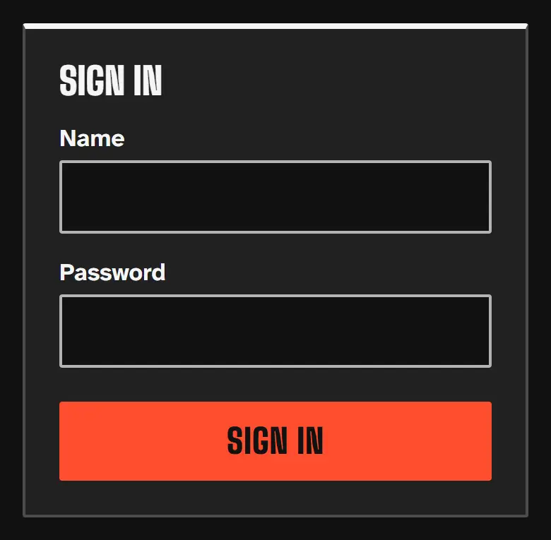
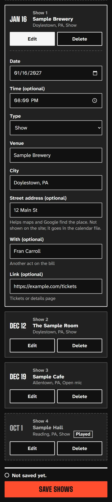
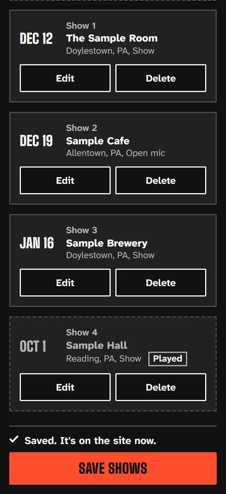
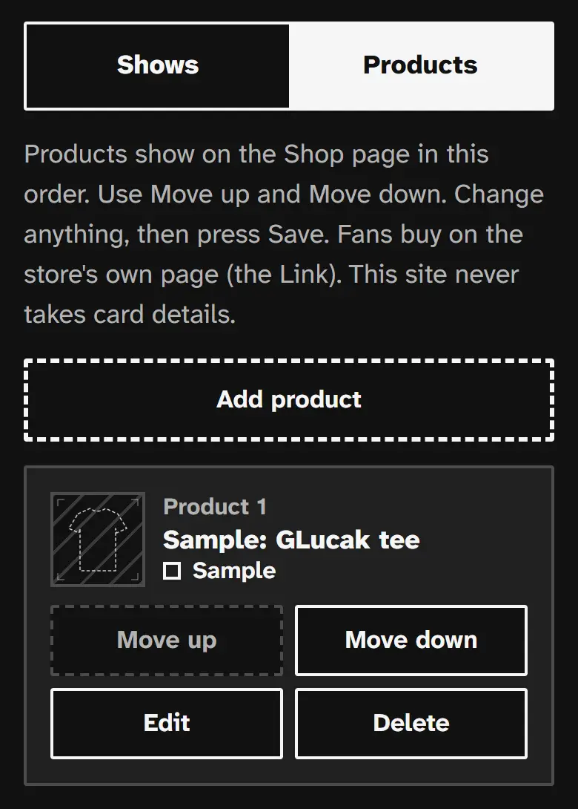
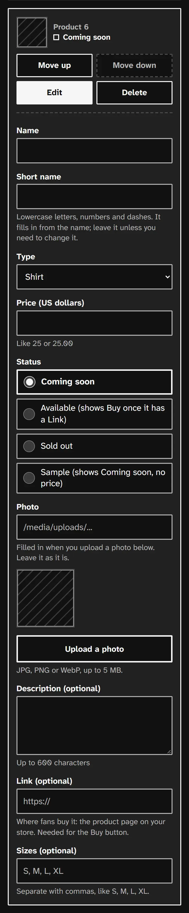
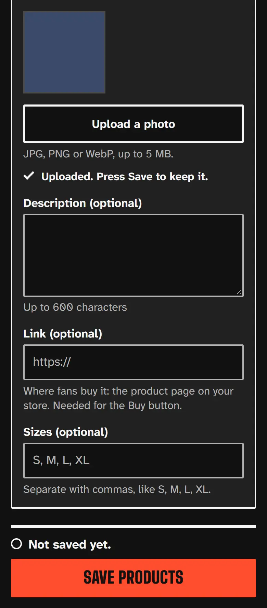
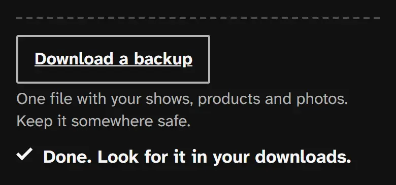

# How to update your site

Hi Gabe. This is your edit screen for the small stuff: shows, products and their photos. You change things, press **Save**, and the change is on the site. It works on your phone or a computer.

The screenshots use made-up sample shows and products. Your page will show your own.

## 1. Sign in

1. Open your edit page (I send you the link; save it as a bookmark).
2. Type your **Name** and **Password**, then press **Sign in**.

You stay signed in for 7 days on that phone or computer. Press **Sign out** at the top when you use someone else's device.

**If it says "That name and password don't match. Check them and try again."** Look at the spelling and capital letters and try again.

**If it says "Too many tries. Wait 15 minutes, then try again."** The page locked itself after a few wrong tries. That keeps strangers out. Wait 15 minutes and try once, carefully. Still locked out or forgot the password? Message me (see the end) and I will send a new one. Don't keep trying.

## 2. Add a show

1. Under **Shows**, press **Add show**. A new form opens at the top.
2. Fill it in:
   - **Date** (needed) and **Time (optional)**.
   - **Type**: **Show** or **Open mic**. This is the only difference, and fans see it on the site.
   - **Venue** and **City** (both needed), like "Doylestown, PA".
   - **Street address (optional)**, like "12 Main St". It is not shown on the site. It helps maps and Google find the place and goes into the calendar file when fans press Add to calendar.
   - **With (optional)**: another act on the bill.
   - **Link (optional)**: the tickets or details page. Start it with https://
3. Press **Save shows**.

## 3. Change or delete a show

1. Find the show in the list and press **Edit**. The form opens.
2. Change what you need.
3. Press **Save shows**.

To delete: press **Delete** on that show, then OK. It is only gone for good when you press **Save shows**.

Past shows look grey with a **Played** tag. You don't have to remove them: they leave the upcoming list by themselves and move down to Played on the Shows page.

## 4. What "Saved" means

Under the orange Save button you will see:

- **Not saved yet.** You changed something. Press Save.
- **Saving…** Wait a moment.
- **Saved. It's on the site now.** Done. Fans see it.

Nothing goes on the site until you press Save. If you leave with unsaved changes, the page asks first.

If it says **Not saved. Fix the show marked with !, then press Save.** open the row marked with ! and read the red line: it says what to fix, for example a missing date.

**If it says "You were signed out. Sign in above, then press Save again. Your changes are still here."** Sign in at the top and press Save again. Your changes are kept.

## 5. Products and photos

Open the **Products** tab. Products show on the Shop page in the order you see them. Use **Move up** and **Move down** to change it. Press **Add product** to start a new one.

Fill in **Name**, **Type**, **Price (US dollars)** (like 25 or 25.00), and pick one **Status**:

- **Coming soon**
- **Available (shows Buy once it has a Link)**. Add the **Link (optional)**, the product page on your store, so fans get the Buy button. The site never takes card details.
- **Sold out**
- **Sample (shows Coming soon, no price)**

Leave **Short name** alone; it fills itself in.

**To add a photo:**

1. Press **Upload a photo** and pick a JPG, PNG or WebP, up to 5 MB.
2. Wait. It says **Uploading…**, then **Uploaded. Press Save to keep it.** and shows a small preview.
3. Press **Save products**.

Leave the **Photo** box as it is; the upload fills it in.

If you press Save while a photo is still going up, it says **Wait for the photo to finish uploading, then press Save.** Wait for the tick, then press Save again.

Photo problems: **Pick a JPG, PNG or WebP photo.** (wrong kind of file) or **That photo is over 5 MB. Pick a smaller one.**

## 6. Download a backup

At the bottom of the page press **Download a backup**. It makes one file with your shows, products and photos and says **Done. Look for it in your downloads.**

Keep that file somewhere safe, like your Google Drive or email it to yourself. Do it now and then, and before big changes. You never have to do anything with it yourself; if anything is ever lost, I can put it back from that file.

If it says **You were signed out. Sign in above, then download again.** do that. If it says **Too many backups. Wait an hour, then try again.** it can wait.

## 7. You can't break the site

Everything here only changes your shows and products. You can't touch the design, the music or the other pages, and an empty or silly entry just gets an error message. Worst case: don't press Save, reload the page, and it goes back to how the site is now.

**Send me instead** (don't try it here):

- Big changes: new pages, a new look, the shop going live.
- A new release: send the title, date and links.
- Your bio, new videos or photos for the site.
- A new password, or anything that looks wrong.

## Who to contact

Text or email me, Alex Mishtuk (contact details are in the email this guide came with), and say what you need. If a message in the edit screen says "Tell the person who runs the site", that means me.
